# Introdução — Antes de abrir o fatiador

Uma impressora 3D não entende um modelo 3D. Ela entende uma lista de ordens simples: vá até tal ponto, empurre tanto de filamento, suba 0,2 mm, ligue o ventilador. Quem transforma a peça que você baixou ou desenhou nessa lista de ordens é o **fatiador** (*slicer*). E é nele que se decide quase tudo sobre o resultado: se a peça vai sair bonita, forte, rápida, barata ou tudo isso ao mesmo tempo.

Este livro é um manual do **Bambu Studio**, o fatiador oficial da Bambu Lab. A ideia é simples: você abre o programa, encontra uma opção que não entende, procura aqui e descobre o que ela faz, quando vale mexer e que valor usar para cada objetivo.

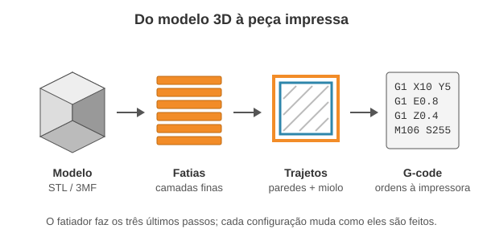

## O que o fatiador faz, em quatro passos

1. **Fatia** o modelo em camadas horizontais finas, como um pão de forma.
2. **Desenha cada camada**: as paredes (contorno), as superfícies sólidas de cima e de baixo e o preenchimento interno.
3. **Decide os movimentos**: velocidade, aceleração, onde começa cada volta (a costura), quando recolher o filamento para não deixar fios.
4. **Escreve o G-code**: o arquivo de instruções que a impressora executa linha por linha.

Cada capítulo deste livro corresponde a uma parte dessas decisões.

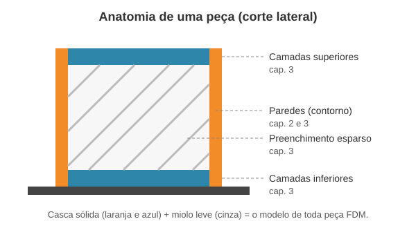

## Bambu Studio e seus "parentes"

O Bambu Studio não nasceu do zero. Ele é um derivado do PrusaSlicer, que por sua vez vem do antigo Slic3r. Depois, a comunidade pegou o Bambu Studio e criou o **OrcaSlicer**, que acrescenta várias opções e calibrações extras e funciona com impressoras de muitas marcas. Vários fabricantes também lançaram fatiadores próprios baseados nessa mesma família.

Na prática, isso significa que quase tudo o que você aprender aqui vale também nesses programas: os nomes das opções, a organização em abas e a lógica das configurações são muito parecidos. Quando uma opção existe só no OrcaSlicer, o livro avisa. No apêndice há uma tabela com as principais diferenças.

## Como este livro está organizado

| Capítulo | Assunto | Onde fica no programa |
|---|---|---|
| 1 | Conhecendo a interface | Telas Preparar, Pré-visualizar e Dispositivo |
| 2 | Qualidade | Processo › aba Qualidade |
| 3 | Resistência (paredes, topo/base, preenchimento) | Processo › aba Resistência |
| 4 | Velocidade e aceleração | Processo › aba Velocidade |
| 5 | Suportes | Processo › aba Suporte |
| 6 | Saia, borda, torre de purga e modos especiais | Processo › aba Outros |
| 7 | Filamento | Configurações do filamento |
| 8 | Impressora | Configurações da impressora |
| 9 | Calibração | Menu Calibração |
| 10 | Receitas prontas e solução de problemas | — |
| Apêndice | Fatiadores derivados e glossário | — |

Se você está começando, leia os capítulos 1 e 3 primeiro: eles explicam a interface e a estrutura de uma peça, e o resto fica muito mais fácil. Se você quer uma resposta rápida ("como deixo essa peça mais forte?"), vá direto ao capítulo 10.

## Três ideias que valem para o livro inteiro

**1. Os perfis da Bambu já são bons.** Os perfis de sistema foram testados pela fabricante para cada impressora e filamento. Mude uma coisa de cada vez, por um motivo claro, e compare o resultado.

**2. Toda opção é uma troca.** Mais qualidade quase sempre custa tempo. Mais resistência custa filamento. Menos suporte pode custar uma superfície pior. O livro sempre explica o que você ganha e o que perde.

**3. Nomes mudam, a lógica fica.** A tradução em português do Bambu Studio muda entre versões, e às vezes é estranha (o padrão *Lightning* já apareceu como "Iluminação", quando significa "Relâmpago"). Por isso, cada opção aparece com o nome em português e o nome em inglês entre parênteses. Se não encontrar uma opção, procure pelo nome em inglês, ou use a lupa de busca nas configurações.

> **Dica:** muitas opções só aparecem no **modo Avançado**. Se uma configuração deste livro não aparece aí, ative o modo avançado no topo do painel de configurações do processo (veja o capítulo 1).

## Sobre as fontes e a versão

O conteúdo foi montado com base na documentação oficial da Bambu Lab (wiki), no código-fonte público do Bambu Studio (incluindo o arquivo oficial de tradução para português), na wiki do OrcaSlicer e em dicas do fórum oficial da Bambu e da comunidade. A referência é o Bambu Studio da série 2.8 (estável em 2026). Valores padrão podem variar conforme a impressora, o bico e a versão instalada. Quando algo não pôde ser confirmado, o texto diz isso abertamente.

Cada capítulo termina com a lista de fontes usadas.

# Capítulo 1 — Conhecendo o Bambu Studio

Antes de mexer em qualquer número, vale entender onde as coisas ficam. O Bambu Studio parece simples à primeira vista: você arrasta um arquivo, clica em **Fatiar** e depois em **Imprimir**. Mas por trás dessa tela limpa existe um fatiador completo, herdeiro do PrusaSlicer e do Slic3r, com centenas de opções escondidas em camadas. Este capítulo é um mapa. Ele mostra as abas, os painéis, as ferramentas e a lógica de "quem manda em quem" nas configurações. Os capítulos seguintes vão destrinchar cada grupo de opções.

## Que versão estamos usando

O Bambu Studio é atualizado com frequência, quase todo mês. Quando este capítulo foi escrito (outubro de 2026), a versão estável mais recente era a **2.8.2** (lançada em agosto de 2026, com um pacote de correções 2.8.2.61 logo depois). Já havia versões beta públicas da **2.8.3** e da **2.8.4** circulando.

Alguns recursos recentes que aparecem ao longo deste livro:

| Versão | Novidade relevante |
|---|---|
| 2.2 | Simulação térmica **Helio** (prevê empenamento e falta de adesão entre camadas), ferramenta de pintura de **pele difusa** (*fuzzy skin*), opção experimental de afastar a costura de overhangs, limites de velocidade por altura |
| 2.5.3 / 2.6 | **Mistura de cores** (*color mixing*): cria um "filamento misto" alternando camadas finas de 2 ou 3 cores |
| 2.8.0 / 2.8.2 | Criador de **guia de montagem**, mapeamento de filamento mais inteligente, queda automática para rede local (LAN) quando a nuvem falha, pontos de pausa na barra de progresso |
| 2.8.3 beta | **Dicas ilustradas** ao passar o mouse sobre os parâmetros, largura de linha separada para o **preenchimento da camada inicial**, padrão de **passar a ferro em espiral de Arquimedes**, padrão próprio para a **camada logo abaixo do topo** |
| 2.8.4 beta | Melhorias na importação de texturas, topo monotônico com menos deslocamentos, ferramenta de texto com quebra de linha |

> **Atenção:** a tradução para português muda entre versões, e algumas traduções são, digamos, criativas ("Engomar" para *Ironing*, "Pele felpuda" para *Fuzzy Skin*). Por isso este livro sempre mostra o nome em inglês entre parênteses. Se a sua interface estiver diferente, procure pelo termo em inglês ou use a busca de configurações (a lupa no painel de parâmetros).

> **Dica:** se você usa o **OrcaSlicer**, quase tudo deste livro vale também. O Orca nasceu de uma bifurcação (*fork*) do Bambu Studio e os dois trocam recursos o tempo todo. A diferença é que o Orca costuma expor mais opções, e o Bambu Studio esconde algumas atrás do modo desenvolvedor.

## As abas principais

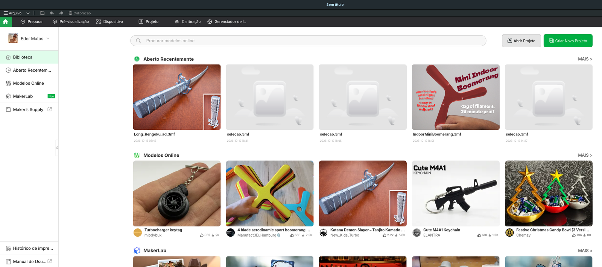

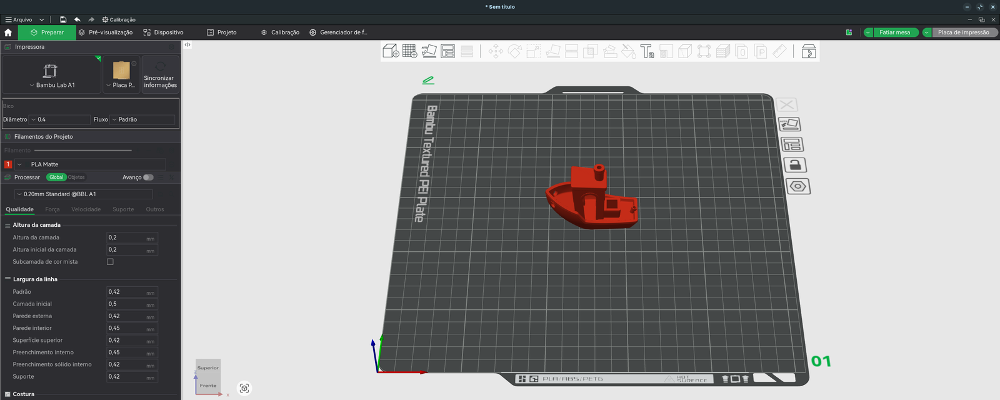

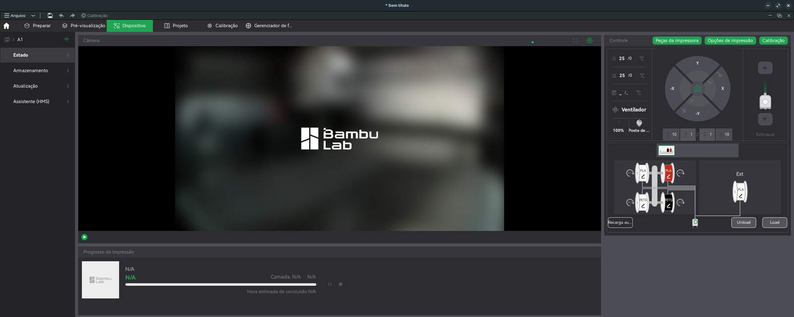

No topo da janela há uma fileira de abas. As três que você vai usar o tempo todo são **Preparar**, **Pré-visualizar** e **Dispositivo**. Elas seguem a ordem natural do trabalho.

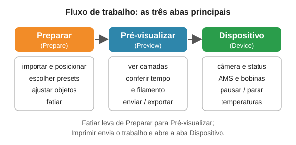

### Início (*Home*)

A aba com o ícone de casa. Mostra projetos recentes, acesso ao MakerWorld (o repositório de modelos da Bambu) e atalhos para criar um projeto novo. É só uma porta de entrada.

### Preparar (*Prepare*)

É onde você passa 90% do tempo. Aqui você:

- importa modelos (STL, 3MF, STEP, OBJ, AMF, SVG);
- posiciona, gira, escala e corta peças;
- escolhe impressora, tipo de mesa, filamentos e processo;
- ajusta configurações globais e por objeto;
- pinta suportes, costuras e cores;
- clica em **Fatiar placa** (*Slice plate*).

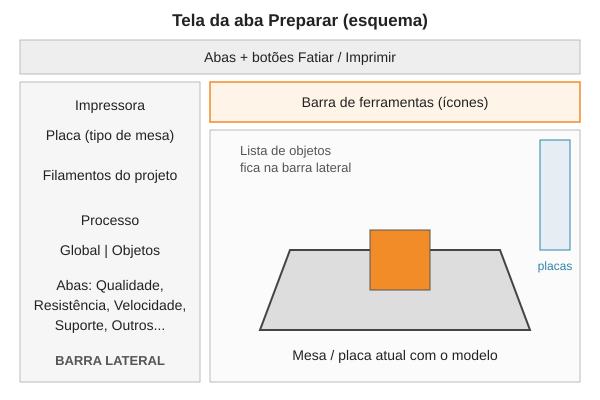

A tela tem três regiões:

1. **Barra lateral esquerda:** predefinições (impressora, mesa, filamentos, processo), a lista de objetos e o painel de parâmetros.
2. **Barra de ferramentas (no topo da área 3D):** ícones de adicionar, organizar, orientar, mover, girar, cortar, pintar etc.
3. **Área 3D:** a mesa com os modelos. As placas extras aparecem lado a lado.

### Pré-visualizar (*Preview*)

Depois de fatiar, o programa pula para esta aba. Ela mostra o resultado camada por camada: cada linha que o bico vai fazer, colorida por tipo. Aqui você confere tempo estimado, gramas de filamento, trocas de cor e possíveis problemas. É também daqui que você manda imprimir ou exporta o arquivo.

### Dispositivo (*Device*)

O painel de controle da impressora. Mostra a câmera ao vivo, o progresso, temperaturas, velocidade (modos silencioso, padrão, esportivo, louco), luzes, ventiladores, o estado do AMS e as bobinas carregadas. Você pode pausar, parar, pular objetos (em impressoras com firmware compatível), mover os eixos e carregar/descarregar filamento.

### Outras abas

Dependendo da versão e da impressora, aparecem também:

- **Vários dispositivos** (*Multi-device*): gerencia várias impressoras ao mesmo tempo, útil para quem tem uma pequena "fazenda".
- **Projeto** (*Project*): descrição, fotos e lista de materiais do projeto, usados ao publicar no MakerWorld.
- **Calibração** (*Calibration*): assistentes de calibração guiados para impressoras Bambu (veja a seção sobre calibrações no fim deste capítulo).
- **Gerenciador de filamentos** (*Filament Manager*): nas versões 2.8.x, cadastra suas bobinas, marcas e fabricantes, e se integra ao app Bambu Handy.

## Placas (*plates*)

Uma **placa** é uma mesa virtual. Um projeto (arquivo 3MF) pode ter várias placas, e cada uma vira um trabalho de impressão separado. Isso é ótimo para projetos grandes: um capacete com 12 peças pode ser distribuído em 4 placas, todas no mesmo arquivo.

O que dá para fazer com placas:

- **Adicionar placa** (*Add plate*): ícone na barra de ferramentas ou no canto da área 3D. O programa também cria placas automaticamente quando a organização não cabe numa só.
- **Mover objetos entre placas:** basta arrastar o objeto de uma mesa para outra.
- **Configurações da placa** (*Plate Settings*): clicando no ícone de engrenagem da placa você pode definir, só para ela, o tipo de mesa (Cool Plate, Engineering, High Temp, Textured PEI), a **sequência de impressão** (por camada ou por objeto), a sequência da primeira camada e o modo vaso espiral.
- **Travar a placa:** um cadeado impede que "Organizar" mexa nos objetos dela.
- **Renomear, apagar, mover a ordem.**
- **Fatiar placa** (*Slice plate*) ou **Fatiar tudo** (*Slice all*); **Imprimir placa** ou **Imprimir tudo**.

> **Dica:** use uma placa por cor ou por material quando não tiver AMS. Assim você troca a bobina entre uma impressão e outra sem refazer o arquivo.

> **Dica:** antes de publicar ou compartilhar um 3MF, nomeie as placas ("Corpo", "Tampa", "Parafusos"). Quem for imprimir vai agradecer.

## Predefinições (*presets*)

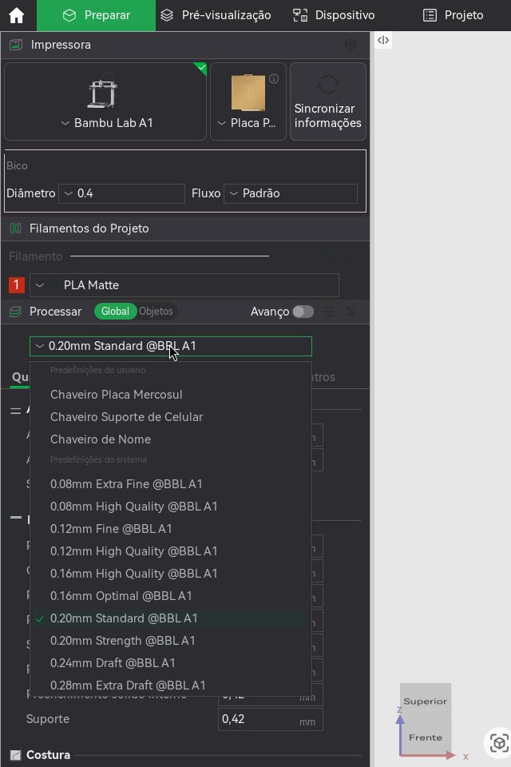

Toda impressão depende de três predefinições, escolhidas na barra lateral:

| Predefinição | O que guarda | Exemplos |
|---|---|---|
| **Impressora** (*Printer*) | Máquina, diâmetro do bico, volume de impressão, G-code de início e fim, limites de movimento, retração | "Bambu Lab P1S 0.4 nozzle", "Bambu Lab A1 0.6 nozzle" |
| **Filamento** (*Filament*) | Temperaturas do bico e da mesa, fluxo, velocidade volumétrica máxima, ventilação, retração específica do material, custo, densidade | "Bambu PLA Basic", "Generic PETG" |
| **Processo** (*Process*) | Tudo sobre *como* fatiar: altura de camada, paredes, preenchimento, velocidades, suportes, costura etc. | "0.20mm Standard @BBL X1C", "0.12mm Fine", "0.28mm Extra Draft" |

O processo é dividido em abas: **Qualidade** (*Quality*), **Resistência** (*Strength*), **Velocidade** (*Speed*), **Suporte** (*Support*), **Multimaterial** (*Multimaterial*) e **Outros** (*Others*). Cada uma terá seu capítulo neste livro.

### Predefinições do sistema, do usuário e do projeto

- **Do sistema:** vêm com o programa, são mantidas pela Bambu e atualizadas automaticamente. Não dá para alterá-las diretamente.
- **Do usuário:** as que você salva. Ficam na sua conta (se sincronização estiver ativa) e no seu computador.
- **Do projeto:** o 3MF guarda as configurações usadas. Ao abrir um arquivo baixado, o programa pergunta se você quer carregar as configurações dele.

### Como salvar a sua

1. Escolha uma predefinição próxima do que você quer (por exemplo, "0.20mm Standard").
2. Altere os valores. Cada valor modificado fica marcado (normalmente em laranja) e aparece um ícone de "desfazer" ao lado, que volta ao valor original.
3. Clique no ícone de **salvar** (disquete) ao lado do nome da predefinição.
4. Dê um nome claro, por exemplo "0.20 PETG peças funcionais".

A partir daí ela aparece na lista em **Predefinições do usuário**. Você pode exportar suas predefinições em pacote (*Export Preset Bundle*, no menu Arquivo) e importar em outro computador.

> **Dica:** no menu Arquivo há um gerenciador em lote de predefinições (desde a 2.2) para ver quais você salvou, quanto espaço ocupam na nuvem e apagar várias de uma vez.

> **Dica:** use **Comparar predefinições** (*Compare presets*) para ver lado a lado o que muda entre duas predefinições. É o jeito mais rápido de entender por que um perfil baixado imprime diferente do seu.

> **Atenção:** existe uma preferência que transfere os valores modificados quando você troca de predefinição de processo ou filamento. Se ela estiver ligada, uma alteração "fica grudada" ao mudar de perfil. Se algo estranho acontecer depois de trocar de perfil, confira se há valores em laranja.

### Filamentos do projeto

Logo abaixo da impressora fica a lista de **filamentos do projeto** (*Project Filaments*). Cada linha é um filamento numerado (1, 2, 3…), com cor e predefinição próprias. Os números importam: quando você atribui o filamento 2 a uma peça, ela será impressa com aquele material. Os atalhos de teclado 1 a 9 trocam o filamento do objeto selecionado.

O botão de **sincronizar** com a impressora lê as bobinas carregadas no AMS e preenche essa lista com tipo e cor reais.

## Modo Simples, Avançado e desenvolvedor

Para não assustar o iniciante, o Bambu Studio esconde parte das opções. Existem três níveis:

| Nível | Como ativar | O que mostra |
|---|---|---|
| **Simples** | padrão em instalação nova | só as opções essenciais (altura da camada, paredes, preenchimento, suportes, borda) |
| **Avançado** (*Advanced*) | chave **Avançado** no topo do painel de parâmetros do processo | quase todas as opções do fatiador |
| **Desenvolvedor** (*Develop mode*) | Preferências → marcar o modo desenvolvedor | opções experimentais ou "perigosas", como lacuna da costura, parede precisa, taxa de fluxo do topo, direção de passar a ferro |

Neste livro, sempre que uma opção só aparece no modo desenvolvedor, isso será avisado.

> **Dica:** deixe o modo **Avançado** ligado sempre. O modo desenvolvedor vale a pena para quem já entende o básico. Ele não muda nada sozinho, só mostra mais caixas.

> **Dica:** o ícone de lupa (ou o atalho de busca) no painel de parâmetros procura uma opção pelo nome em qualquer aba. Se você não lembra onde fica "ponte grossa", busque "ponte" ou "bridge".

Nas versões 2.8.3 em diante, passar o mouse sobre o nome de um parâmetro mostra uma dica ilustrada. Por enquanto isso vale para as opções do modo Simples; a Bambu prometeu estender para as avançadas.

## Global, por objeto e modificadores

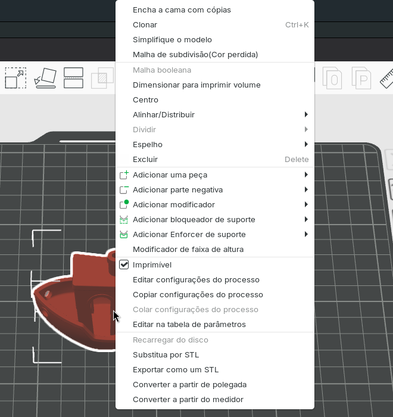

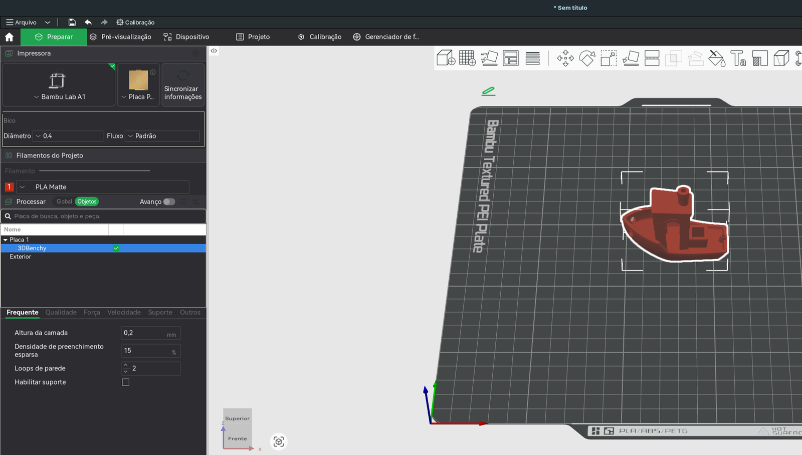

Esta é a ideia mais importante do capítulo. As configurações não precisam ser iguais para a placa inteira. Você pode dizer "esta peça tem 5 paredes", "este pedaço de cima tem 100% de preenchimento" ou "não coloque suporte aqui".

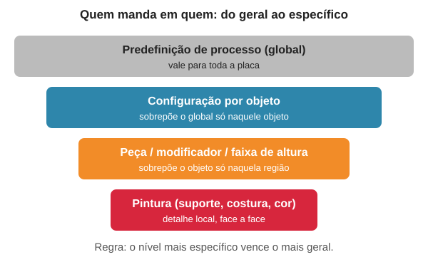

### Configuração global

No painel de parâmetros, a chave **Global | Objetos** alterna entre editar o processo da placa toda e editar objetos específicos. O que você mexe em **Global** vale para tudo que não tem configuração própria.

### Configuração por objeto

Na lista de objetos, clique com o botão direito num objeto e escolha **Adicionar configurações** (*Add settings*), ou selecione-o e mude para a visão **Objetos** no painel. Você escolhe categorias (Qualidade, Resistência, Velocidade, Suporte etc.) e só as opções marcadas passam a valer para aquele objeto. Na lista, um ícone aparece ao lado do objeto mostrando que ele tem configurações próprias.

Recursos úteis:

- **Copiar/Colar configurações de processo** (*Copy/Paste Process Settings*): leva as configurações de um objeto para outro.
- **Editar na tabela de parâmetros** (*Edit in Parameter Table*): mostra todos os objetos numa tabela, para mudar várias coisas de uma vez.

### Peças, modificadores e faixas de altura

Clicando com o botão direito num objeto, você encontra opções para adicionar sub-partes. Elas podem ser formas prontas (cubo, cilindro, esfera, slab), um STL importado, um texto ou um SVG.

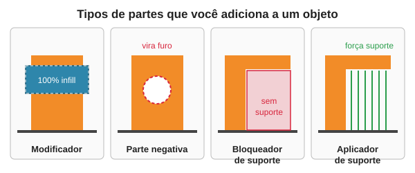

- **Parte** (*Part*): soma volume ao objeto. Útil para colar duas peças num objeto só, inclusive com filamentos diferentes.
- **Parte negativa** (*Negative Part*): subtrai volume. Vira furo, rebaixo ou encaixe. É como uma operação booleana, só que calculada no fatiamento.
- **Modificador** (*Modifier*): não é impresso. Define uma região do espaço onde valem configurações diferentes. Exemplo clássico: um cilindro ao redor do furo de um parafuso com 100% de preenchimento e 6 paredes.
- **Bloqueador de suporte** (*Support Blocker*): proíbe suporte dentro do volume.
- **Aplicador de suporte** (*Support Enforcer*): força suporte dentro do volume, mesmo que o ângulo não peça.
- **Modificador de faixa de altura** (*Height range Modifier*): aplica configurações entre duas alturas Z, por exemplo, mudar a altura da camada ou o preenchimento só do meio para cima.

> **Dica:** para deixar um furo de parafuso mais forte sem encher a peça inteira, use um modificador cilíndrico um pouco maior que o furo e aumente nele as paredes ou o preenchimento.

> **Dica:** em vez de editar o modelo no CAD para abrir um furo de teste, adicione uma parte negativa no próprio Bambu Studio. Ajuste o tamanho com a ferramenta de escala até encaixar.

> **Atenção:** a ferramenta **Malha booleana** (*Mesh boolean*) faz união, subtração e interseção "de verdade", alterando a malha. Peças negativas não alteram a malha; elas só atuam no fatiamento. Ao exportar STL, o programa pergunta se você quer aplicar o booleano das partes negativas.

## Ferramentas da barra superior

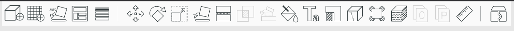

A barra no topo da área 3D concentra as ferramentas de manipulação (os "gizmos"). Os atalhos de teclado abaixo são os listados na janela de atalhos do programa (tecla **?** ou Shift + ?). Em telas pequenas a barra se recolhe automaticamente; passe o mouse para expandir.

### Adicionar e organizar

- **Adicionar** (ícone de cubo com +): importa arquivos. Atalho Ctrl+I.
- **Adicionar placa**.
- **Orientação automática** (*Auto orientation*): gira o objeto selecionado (ou todos, se nada estiver selecionado) para a posição que o programa julga melhor, buscando reduzir suportes e aumentar a área de contato. Atalho Shift+R.
- **Organizar** (*Arrange*): distribui os objetos na mesa evitando sobreposição. Atalho **A** (todos) ou Shift+A (só a placa selecionada). Clicando com o botão direito no ícone, há opções: espaçamento entre peças, permitir rotação, alinhar ao eixo Y, evitar a área de calibração, e se as cores/filamentos devem ser agrupados.

> **Dica:** a orientação automática é um ponto de partida, não uma verdade. Para peças que precisam ser fortes, pense na direção das camadas (as peças quebram entre camadas) antes de aceitar a sugestão.

### Mover, Girar, Escalar

- **Mover** (*Move*, tecla **M**): setas nos três eixos. Há campos numéricos para posição exata.
- **Girar** (*Rotate*, tecla **R**): anéis nos três eixos; segure Shift para passos fixos. Também aceita valores digitados.
- **Escalar** (*Scale*, tecla **S**): proporcional ou por eixo, em porcentagem ou milímetros. A opção "escalar para o volume de impressão" fica no menu do botão direito.

As setas do teclado movem a seleção 10 mm (1 mm com Shift).

### Deitar na face (*Lay on face*, tecla **F**)

Você clica numa face plana do modelo e ele gira para que essa face fique apoiada na mesa. É a forma mais rápida de corrigir um STL que veio "torto".

### Cortar (*Cut*, tecla **C**)

Divide o objeto com um plano. Desde as versões 1.9 o corte é bem mais completo:

- plano livre (pode girar em qualquer ângulo);
- **conectores**: pinos ou encaixes tipo cauda de andorinha (*dovetail*) gerados automaticamente entre as metades, para colar depois;
- opção de manter as duas metades, só uma, e virar cada uma para a mesa;
- corte em partes (para continuar sendo um objeto com sub-partes) ou em objetos separados.

> **Dica:** para imprimir uma peça maior que a mesa, corte-a e use conectores do tipo pino. A folga dos conectores pode ser ajustada; comece com 0,2 mm.

### Medir (*Measure*)

Clique em pontos, arestas ou faces para medir distâncias, ângulos e diâmetros. Útil para conferir se o modelo baixado tem a medida que você espera antes de imprimir uma peça de encaixe.

### Montar (*Assembly*)

Permite posicionar peças umas em relação às outras usando faces e eixos (por exemplo, encostar a face de uma tampa na face da caixa). Há também uma **vista de montagem** para conferir como as partes se encaixam. Nas versões 2.8 apareceu o **criador de guia de montagem**, que gera passos ilustrados para quem vai montar o projeto.

### Texto e SVG (*Text*, *SVG*)

A ferramenta de **texto** cria letras em 3D a partir das fontes do sistema. Você escolhe fonte, tamanho, profundidade, e se o texto será:

- **parte** (relevo, saindo da superfície);
- **parte negativa** (gravado, entrando na superfície);
- **modificador** (região com outras configurações, ideal para trocar só a cor das letras).

O texto pode ser projetado numa superfície curva ("embrulhando" o modelo). A ferramenta **SVG** faz o mesmo com desenhos vetoriais: logotipos, ícones, assinaturas.

> **Dica:** para uma placa de identificação com letras coloridas sem AMS, faça o texto em relevo de uma camada de altura e use a pausa/troca de filamento na pré-visualização (veja a seção sobre trocas de cor adiante).

### Pintura de suporte (*Support painting*)

Você pinta, direto no modelo, onde quer **forçar** suporte e onde quer **bloquear**. Há pincel circular, esfera, preenchimento por área e um modo que destaca automaticamente faces acima de um ângulo de overhang. O tamanho do pincel muda com Ctrl + roda do mouse.

> **Atenção:** a pintura só tem efeito se o suporte estiver ligado. Para usar só o que foi pintado, escolha o tipo de suporte "manual" na aba Suporte.

### Pintura de costura (*Seam painting*, tecla **P**)

Funciona igual à pintura de suporte, mas define onde a costura (o ponto onde cada volta de parede começa e termina) **deve** ou **não deve** ficar. É o controle mais preciso possível sobre a costura, assunto do Capítulo 2.

### Pintura de cores (*Color painting* / MMU)

Pinta faces do modelo com os filamentos do projeto. Ferramentas disponíveis: pincel, esfera, triângulo, preenchimento inteligente (*smart fill*, que pinta áreas planas ou contínuas de uma vez), preenchimento por altura e, desde a 2.2, o modo "mesma cor conectada". Você pode pintar mesmo sem AMS (vai precisar trocar a bobina na mão).

Funções relacionadas:

- **Decompor cor** (*Decompose Color*): ao importar um modelo com textura ou cores (OBJ/3MF colorido), o programa reduz as cores para o número de filamentos que você tem.
- **Mistura de cores** (*Mixed Filament*, 2.5.3 em diante, experimental): cria uma "cor nova" alternando camadas finas de até três filamentos do mesmo tipo. Funciona melhor em impressoras com dois bicos (H2D, H2C, X2D), porque em bico único cada alternância gera purga.

### Outras ferramentas

- **Malha booleana** (*Mesh boolean*): união, subtração, interseção entre objetos.
- **Simplificar modelo** (*Simplify Model*): reduz o número de triângulos de malhas muito pesadas.
- **Orelhas de borda** (*Brim Ears*): pequenos discos de borda colocados só em cantos, em vez de borda em volta da peça toda.
- **Pele difusa** (*Fuzzy Skin*): desde a 2.2 dá para pintar só as áreas que terão textura áspera.

## Altura de camada variável

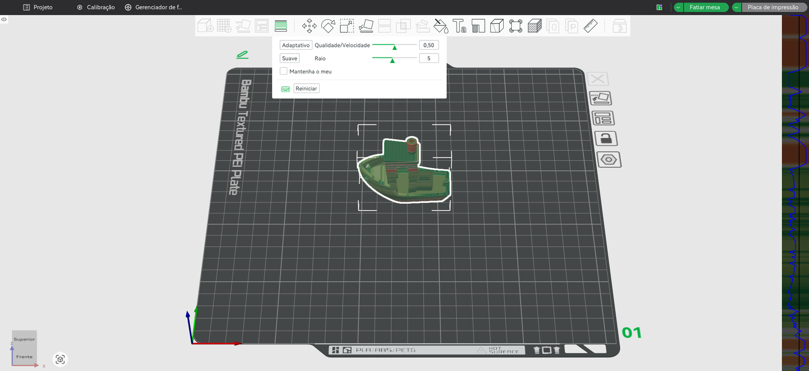

Uma peça com topo arredondado (um domo, uma cabeça de personagem) mostra "degraus" visíveis quando impressa com camada alta. Imprimir tudo em camada fina resolve, mas dobra o tempo. A **altura de camada variável** (*Variable layer height*) usa camada fina só onde precisa.

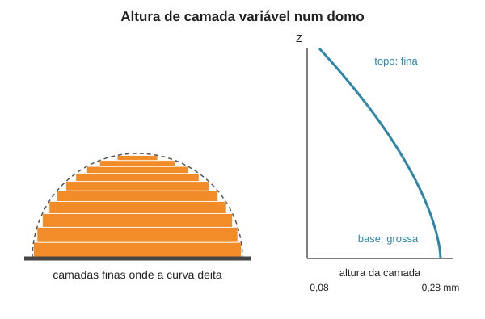

Como usar:

1. Selecione o objeto e clique no ícone de **altura de camada variável** na barra de ferramentas (ou no menu do botão direito).
2. Aparece um gráfico vertical ao lado do modelo, mostrando a altura de camada ao longo de Z.
3. Mova o controle deslizante entre **qualidade** (detalhe) e **velocidade**, e clique em **Adaptativo** (*Adaptive*). O programa calcula sozinho, afinando onde a curvatura pede.
4. Use **Suave** (*Smooth*) para suavizar as transições. O **raio** define o quanto suaviza; você pode clicar várias vezes. A opção **Manter mínimo** (*Keep min*) preserva as regiões que estão no valor mais fino.
5. Para ajustes manuais, arraste o mouse sobre o gráfico ou sobre o modelo (com a tecla indicada na própria tela) para engrossar ou afinar regiões específicas.
6. **Redefinir** volta à altura constante.

Limites e cuidados:

- A faixa possível depende do bico. Para 0,4 mm, a Bambu indica de 0,08 a 0,28 mm.
- Com vários objetos e mais de uma cor, a **torre de purga** só funciona se todos os objetos tiverem o mesmo perfil de altura variável.
- Não combina com suporte de árvore **orgânico**.
- Também não combina bem com a **subcamada de cor mista** (o programa avisa).

> **Dica:** para uma peça "mais bonita" em pouco tempo, use 0,20 ou 0,24 mm como base e a altura variável só nos topos curvos. Você ganha boa parte do acabamento de 0,12 mm com uma fração do tempo.

> **Dica:** para o mesmo efeito em uma faixa definida (por exemplo, só o rosto de uma estátua), use um **modificador de faixa de altura** com altura de camada menor.

## AMS e mapeamento de filamento

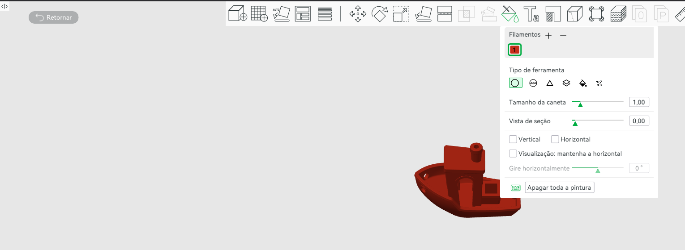

O **AMS** (*Automatic Material System*) é o trocador automático de bobinas da Bambu. Cada unidade tem 4 posições (o AMS Lite da série A também, o AMS HT tem 1). Com ele, o Bambu Studio pode trocar de filamento durante a impressão.

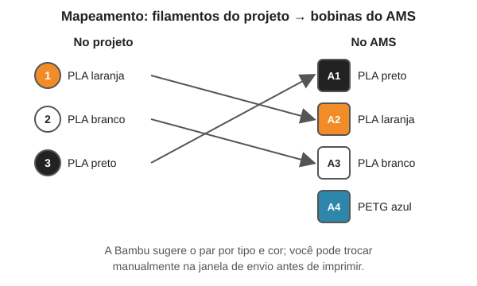

O fluxo:

1. **No projeto**, cada peça (ou região pintada) usa um filamento numerado: 1, 2, 3…
2. **Ao imprimir**, a janela de envio mostra o **mapeamento**: qual posição do AMS (A1, A2, B3…) vai alimentar cada filamento do projeto.
3. O programa sugere o mapeamento casando tipo e cor. Você pode clicar em cada filamento e escolher outra posição.

Pontos importantes:

- Se o tipo não bater (projeto pede PETG, AMS tem PLA), o programa avisa.
- As versões 2.8 recalculam o tempo estimado com base no mapeamento real.
- Em impressoras com dois bicos (H2D, H2C, X2D), aparece o **agrupamento de filamentos** (*Filament Grouping*): o programa decide quais filamentos vão para o bico esquerdo e quais para o direito, buscando menos purga. Você pode aceitar o "ótimo" ou reagrupar.
- **Volumes de purga** (*Flushing volumes*): botão ao lado dos filamentos. Define quanto material é descartado em cada troca de cor. Trocar de preto para branco exige muito mais purga que de branco para preto.
- **Purgar no preenchimento / no suporte / no objeto** (*Flush into infill / support / objects*): opções que reaproveitam a purga dentro da peça, reduzindo o "cocô" de filamento.
- **Recarga automática** (*Auto Refill*): quando uma bobina acaba, o AMS puxa outra igual (mesmo tipo e cor) automaticamente.

> **Dica:** para economizar filamento em peças multicoloridas, ordene as cores do mais claro para o mais escuro e use "purgar no preenchimento". O programa ainda calcula as purgas, mas joga parte delas dentro da peça.

## Pré-visualização em detalhe

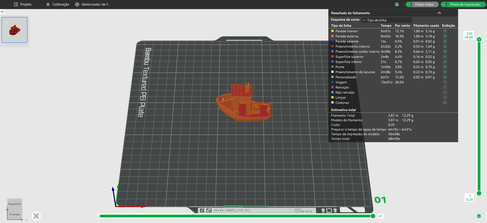

Depois de fatiar, a aba **Pré-visualizar** é a sua "radiografia" da impressão. Gaste um minuto nela antes de cada impressão importante.

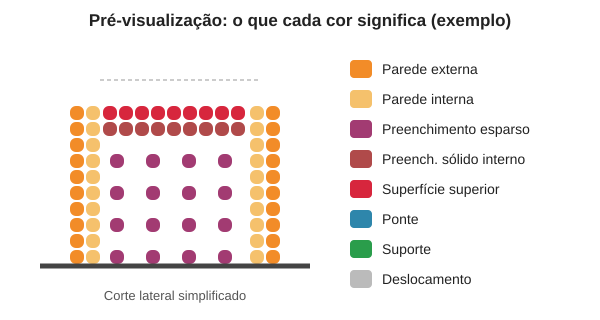

### Controles deslizantes

- **Vertical (à direita):** escolhe a camada. Arraste o controle de cima para ver a impressão "crescendo". As setas para cima/baixo movem uma camada; com Shift ou Ctrl, cinco. A tecla **L** liga o modo "uma camada só".
- **Horizontal (embaixo):** percorre os movimentos dentro da camada atual, mostrando a ordem exata em que o bico vai passar.

No controle vertical, clicando com o botão direito no "+" de uma camada, você pode inserir uma **troca de cor**, uma **pausa** ou um **G-code personalizado** naquela altura. É assim que se faz placa com letras coloridas sem AMS.

### Tipos de visualização (esquema de cores)

No canto da tela há um seletor de **esquema de cores**:

| Esquema | Para que serve |
|---|---|
| **Tipo de linha** (*Line Type*) | ver o que é parede externa, interna, preenchimento, ponte, suporte, topo etc. É o padrão |
| **Altura da camada** (*Layer Height*) | conferir a altura variável |
| **Largura da linha** (*Line Width*) | ver as larguras (útil com Arachne) |
| **Velocidade** (*Speed*) | descobrir onde o programa desacelera (overhangs, camadas pequenas) |
| **Velocidade do ventilador** (*Fan Speed*) | conferir resfriamento |
| **Temperatura** (*Temperature*) | ver mudanças de temperatura |
| **Fluxo** (*Flow*) | conferir a costura em rampa (*scarf*) e áreas de fluxo reduzido |
| **Taxa de fluxo volumétrico** (*Volumetric flow rate*) | ver onde se chega perto do limite do hotend |
| **Tempo de camada** (*Layer Time*) | identificar camadas muito rápidas (risco de superaquecimento) |
| **Filamento / Ferramenta** (*Filament / Tool*) | ver qual filamento ou bico faz cada parte |
| **Índice térmico** (*Thermal Index*) | presente quando a simulação Helio é usada |

Na legenda você pode clicar em cada tipo de linha para escondê-lo. Esconder o preenchimento, por exemplo, deixa ver as paredes por dentro. Há também opções para mostrar deslocamentos (*Travel*), retrações, costuras (*Seams*), limpezas (*Wipe*) e trocas de ferramenta.

### Tempo e filamento

O resumo mostra:

- **Tempo total**, separado em tempo do modelo e tempo de preparação (aquecimento, nivelamento, calibração) e timelapse;
- **filamento usado** em metros e gramas, por filamento;
- **custo**, se o preço estiver cadastrado na predefinição do filamento;
- número de **trocas de filamento** e quanto foi purgado.

> **Dica:** se o tempo estimado parece absurdo, mude o esquema para **Velocidade**. Quase sempre é alguma região muito lenta: overhangs, tempo mínimo de camada em peças pequenas ou passar a ferro em área grande.

> **Dica:** ative a exibição de **costuras** na legenda para ver onde ficarão as marcas na superfície antes de imprimir.

## Enviar para a impressora e exportar

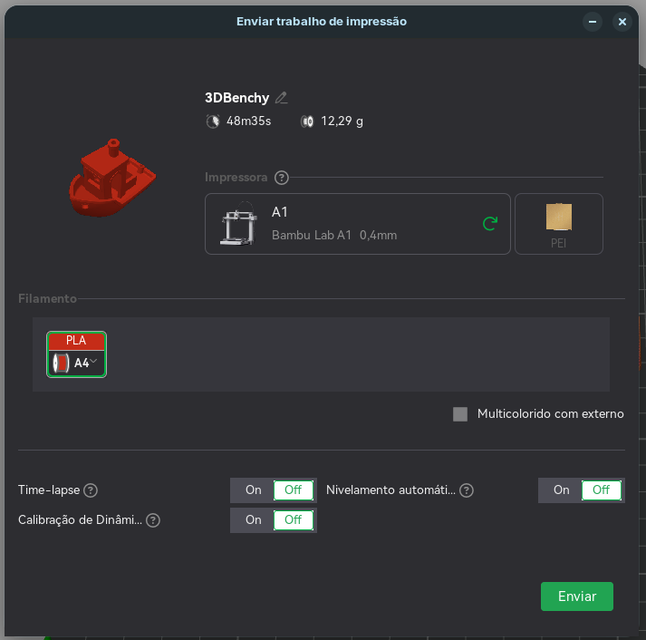

Depois de fatiar, o botão no canto superior direito oferece:

- **Imprimir placa** (*Print plate*, Ctrl+Shift+G): abre a janela de envio para a impressora conectada (pela nuvem ou pela rede local).
- **Imprimir tudo** (*Print all*): envia todas as placas em fila.
- **Enviar** (*Send*): manda o arquivo para o cartão de memória da impressora sem começar a imprimir.
- **Exportar arquivo fatiado da placa** (*Export plate sliced file*, Ctrl+G): salva um `.gcode.3mf` no computador, que pode ir num cartão microSD.
- **Exportar G-code** puro: útil para outras impressoras ou para análise. A Bambu recomenda imprimir sempre o 3MF fatiado, que carrega também informações de filamento e mapeamento.

### Opções da janela de envio

Antes de começar, a janela de envio mostra o mapeamento de filamentos e algumas caixas. Os nomes variam um pouco por modelo de impressora:

- **Nivelamento automático da mesa** (*Auto Bed Leveling*): mede a mesa antes de começar. No modo automático (impressoras mais novas), só faz uma checagem rápida e pula se estiver tudo bem.
- **Calibração de dinâmica de fluxo** (*Flow Dynamics Calibration*): mede o *pressure advance* do filamento antes de começar. No automático, pula se o filamento foi calibrado recentemente.
- **Time-lapse**: grava o vídeo da impressão. No modo "suave", a cabeça sai da peça a cada camada para a foto, o que aumenta um pouco o tempo.
- **Calibração de deslocamento de bico** (*Nozzle Offset Calibration*): em impressoras de dois bicos.
- **Usar AMS / mapeamento**: confirmação das bobinas.

> **Dica:** para filamentos que você já calibrou manualmente (veja o capítulo de calibração), desligue a calibração de dinâmica de fluxo no envio e selecione o perfil de *pressure advance* salvo. Economiza alguns minutos por impressão.

### Salvar o projeto

**Salvar projeto** (Ctrl+S) grava um `.3mf` com modelos, placas, pinturas, modificadores e todas as configurações. É o formato a guardar. O STL guarda só a geometria.

## Calibrações disponíveis

O menu **Calibração** (na barra superior) e a aba **Calibração** oferecem testes. Os do menu são manuais: o programa gera um projeto de teste, você imprime, olha o resultado e anota o melhor valor.

| Teste | O que descobre |
|---|---|
| **Temperatura** (*Temperature*) | imprime uma torre com faixas de temperatura diferentes para achar a melhor do filamento |
| **Taxa de fluxo** (*Flow rate*) — **Grosso** e **Fino** (*Coarse/Fine*) | placas com fluxos diferentes; escolha a de topo mais liso. Primeiro o grosso, depois o fino |
| **Avanço de pressão** (*Pressure advance*) | padrões em linha, em "V" ou torre, para achar o valor que deixa cantos limpos |
| **Teste de retração** (*Retraction test*) | torre com retrações crescentes para reduzir fiapos |
| **Mais… → Fluxo máximo** (*Max flowrate*) | velocidade volumétrica máxima do filamento antes de falhar |
| **Mais… → VFA** | teste de artefatos finos verticais (*vertical fine artifacts*) que aparecem em certas velocidades |
| **Tutorial** | abre a ajuda da Bambu sobre calibração |

A aba **Calibração** (em impressoras Bambu conectadas) traz assistentes guiados para **dinâmica de fluxo**, **taxa de fluxo** e **velocidade volumétrica máxima**. Ela imprime, mede (com o lidar ou com a câmera, nos modelos que têm) e salva os resultados direto na impressora ou na predefinição do filamento.

A ordem recomendada e os detalhes de cada teste ficam no capítulo dedicado à calibração.

> **Dica:** calibre de verdade apenas os filamentos de terceiros ou aqueles que você usa muito. Os perfis oficiais da Bambu para os filamentos da própria marca já vêm muito bem ajustados.

## Atalhos que valem decorar

| Atalho | Função |
|---|---|
| Ctrl+R | fatiar placa |
| Ctrl+G | exportar arquivo fatiado |
| Ctrl+Shift+G | imprimir placa |
| A / Shift+A | organizar tudo / só a placa atual |
| M, R, S, F, C | mover, girar, escalar, deitar na face, cortar |
| P | pintura de costura |
| 1–9 | atribuir filamento ao objeto selecionado |
| Ctrl+0 a Ctrl+7 | vistas de câmera (padrão, topo, baixo, frente, trás, esquerda, direita, isométrica) |
| Z | enquadrar a cena ou a seleção |
| Ctrl+K | clonar objeto |
| Shift+Tab | recolher/expandir a barra lateral |
| ? (Shift+?) | lista completa de atalhos |

## Resumo do capítulo

- **Preparar** organiza, **Pré-visualizar** confere, **Dispositivo** acompanha.
- Um projeto pode ter várias **placas**, cada uma com seu tipo de mesa e sequência.
- Toda impressão combina três **predefinições**: impressora, filamento e processo. Salve as suas com nomes claros.
- Ligue o modo **Avançado**; o modo **desenvolvedor** mostra ainda mais.
- Configurações vão do **global** para o **objeto**, para o **modificador** e para a **pintura**. O mais específico vence.
- Antes de imprimir, gaste um minuto na **pré-visualização**: tempo, gramas, costura e regiões lentas.

## Fontes deste capítulo

- [Bambu Studio — releases no GitHub](https://github.com/bambulab/BambuStudio/releases)
- [Código-fonte do Bambu Studio (abas, atalhos, menus e traduções)](https://github.com/bambulab/BambuStudio)
- [BambuHub — Bambu Studio 2.8.2](https://bambuhub.net/articles/bambu-studio-2-8-2)
- [Notas da versão 2.8.3 (newreleases.io)](https://newreleases.io/project/github/bambulab/BambuStudio/release/v02.08.03.66)
- [Wiki Bambu Lab — notas da versão 2.2.0](https://wiki.bambulab.com/en/software/bambu-studio/release/release-note-2-2-0)
- [Wiki Bambu Lab — Altura de camada adaptativa](https://wiki.bambulab.com/en/software/bambu-studio/adaptive-layer-height)
- [All3DP — recurso de mistura de cores no Bambu Studio](https://all3dp.com/4/never-mind-the-x2d-new-bambu-studio-update-adds-filament-color-mixing-feature/)
- [Fórum Bambu Lab — Bambu Studio 2.1.0 lançado](https://forum.bambulab.com/t/bambu-studio-2-1-0-released/172444)

# Capítulo 2 — Qualidade

A aba **Qualidade** (*Quality*) do processo concentra as opções que mudam a *aparência* e a *precisão* da peça: espessura das camadas, largura das linhas, onde fica a costura, como os furos saem no tamanho certo, como o topo fica liso e como as paredes finas são desenhadas. É a aba mais "artística" do fatiador. Também é a que mais esconde opções no modo Simples, então ligue o modo **Avançado** antes de continuar. Algumas opções só aparecem com o **modo desenvolvedor** ativado nas Preferências; elas estão marcadas ao longo do texto.

Na versão 2.8 a aba está organizada nos grupos abaixo, e este capítulo segue a mesma ordem:

1. Altura da camada (*Layer height*)
2. Largura da linha (*Line width*)
3. Costura (*Seam*)
4. Precisão (*Precision*)
5. Passar a ferro (*Ironing*)
6. Gerador de paredes (*Wall generator*)
7. Avançado (*Advanced*): ordem das paredes, pontes, fluxos, uma parede no topo, overhangs, deslocamentos

No fim há uma seção sobre opções que existem no **OrcaSlicer** mas **não** no Bambu Studio, porque elas aparecem muito em tutoriais e confundem.

Em cada opção relevante você encontra dicas rápidas para quatro objetivos: **Mais bonita**, **Mais rápida**, **Mais forte** e **Decorativa**.

> **Atenção:** os valores padrão citados aqui vêm do código do programa e dos perfis de sistema da Bambu para bico de 0,4 mm. Perfis de outras impressoras, bicos e filamentos podem ter valores diferentes. Em caso de dúvida, confie no que aparece na sua tela e use o botão de "desfazer" para voltar ao valor do sistema.

## Altura da camada

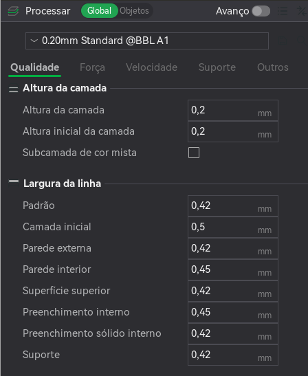

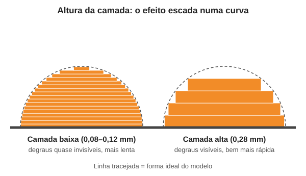

### Altura da camada (*Layer height*)

A espessura de cada fatia horizontal do modelo. É a configuração que mais influencia tempo e aparência ao mesmo tempo. Camadas mais finas desenham curvas e inclinações com degraus menores; camadas mais grossas imprimem muito mais rápido.

- **Valores típicos (bico 0,4):** 0,08 (extra fino), 0,12 (fino), 0,16 (ótimo), 0,20 (padrão), 0,24 (rascunho), 0,28 (rascunho extra). A faixa prática fica entre 25% e 75% do diâmetro do bico.
- **Aumentar:** imprime mais rápido, camadas mais visíveis, degraus maiores em curvas, em geral boa aderência entre camadas.
- **Diminuir:** superfície mais lisa em curvas e inclinações, detalhes verticais melhores, tempo bem maior (0,12 leva perto do dobro de 0,20).
- **Quando mexer:** escolha antes de tudo, normalmente trocando a predefinição de processo inteira (as predefinições "0.12mm Fine", "0.20mm Standard" etc. já ajustam velocidades junto).

> **Dica:** paredes verticais retas não ficam mais bonitas com camada fina; quem ganha são as superfícies inclinadas e curvas. Para um cubo, 0,20 ou até 0,28 mm dá praticamente o mesmo resultado.

- **Mais bonita:** 0,12–0,16 mm, ou 0,20 com altura de camada variável nos topos curvos.
- **Mais rápida:** 0,24–0,28 mm. Com bico 0,6, até 0,32–0,40.
- **Mais forte:** 0,20–0,28 mm. Camadas mais grossas têm menos interfaces entre camadas e costumam aguentar mais em tração vertical. Combine com mais paredes.
- **Decorativa:** 0,08–0,12 mm em miniaturas e estátuas; aceite o tempo extra.

> **Atenção:** a Bambu limita a altura de camada pela máquina e pelo bico. Para bico 0,2 as camadas ficam entre ~0,04 e ~0,14 mm; para 0,6 e 0,8, mais altas. O programa avisa se você sair da faixa.

### Altura inicial da camada (*Initial layer height*)

A espessura da primeira camada, a que encosta na mesa. Uma primeira camada um pouco mais grossa perdoa pequenas imperfeições de nivelamento e gruda melhor.

- **Valores típicos:** 0,2 mm (padrão para bico 0,4). Muitos usam 0,24–0,28 para mais tolerância.
- **Aumentar:** mais aderência e mais tolerância a mesa irregular; risco maior de pé de elefante.
- **Diminuir:** detalhe de primeira camada mais nítido (letras gravadas no fundo), mas exige mesa perfeita.
- **Quando mexer:** problemas de aderência ou peças com texto na face de baixo.

> **Dica:** a primeira camada também define a altura das camadas seguintes. Uma peça com 10 mm de altura e primeira camada de 0,2 + camadas de 0,2 cai certinho; se você mudar a primeira para 0,25, a altura final pode sair alguns centésimos diferente. Veja **Altura Z precisa** adiante.

- **Mais bonita:** 0,2 mm, mesa limpa.
- **Mais rápida:** não faz diferença significativa.
- **Mais forte/aderência:** 0,24–0,28 mm em peças grandes e materiais que empenam (ABS, ASA, PC).
- **Decorativa:** 0,2 mm, ou menor se a face de baixo for a "frente" da peça (letreiros impressos de cabeça para baixo).

### Subcamada de cor mista (*Mixed color sublayer*)

Recurso recente, ligado à **mistura de cores** (filamentos mistos, desde a 2.5.3). Quando ligado, as camadas que contêm um filamento misto são divididas em subcamadas mais finas, para que as cores se alternem com mais frequência e o olho veja uma mistura mais uniforme.

- **Padrão:** desligado.
- **Ligar:** mistura de cor mais homogênea, mais trocas e mais tempo.
- **Quando mexer:** só se você usa filamentos mistos.

> **Atenção:** o programa avisa que combinar esta opção com altura de camada variável pode piorar a mistura de cores. Use uma coisa ou outra.

## Largura da linha

A largura de cada "cordão" de plástico que o bico deposita. Ela não é fixa: o fatiador controla a largura ajustando quanto filamento sai por milímetro andado. Com mais material, o cordão é esmagado e se espalha; com menos, fica mais estreito. O limite prático é algo entre 75% e 150% do diâmetro do bico (0,3 a 0,6 mm para bico 0,4); fora disso a qualidade cai.

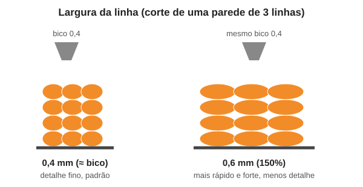

Regras gerais para todas as larguras:

- Um valor **0** significa "use a largura padrão" (o campo *Default*).
- Linhas mais largas usam mais plástico por segundo. Se a velocidade estiver alta, você pode bater no **limite de fluxo volumétrico** do filamento, e então o programa reduz a velocidade sozinho.
- Pontes e overhangs não seguem a largura configurada, porque a linha está no ar e fica com a seção redonda.

| Opção | Padrão no código | Perfis Bambu (bico 0,4) |
|---|---|---|
| Padrão (*Default*) | 0,4 | 0,42 |
| Camada inicial (*Initial layer*) | 0,4 | 0,5 |
| Preenchimento da camada inicial (*Initial layer infill*) | 0 (usa a da camada inicial) | 0,5 |
| Parede externa (*Outer wall*) | 0 (usa padrão) | 0,42 |
| Parede interna (*Inner wall*) | 0,4 | 0,45 |
| Superfície superior (*Top surface*) | 0,4 | 0,42 |
| Preenchimento esparso (*Sparse infill*) | 0,4 | 0,45 |
| Preenchimento sólido interno (*Internal solid infill*) | 0,4 | 0,42 |
| Suporte (*Support*) | 0,4 | 0,42 |

### Padrão (*Default*)

A largura usada por qualquer tipo de linha cujo campo esteja em zero. Funciona como valor-reserva.

- **Valores típicos:** igual ou um pouco acima do bico (0,42 para 0,4).
- **Quando mexer:** raramente. Prefira ajustar cada tipo individualmente.

### Camada inicial (*Initial layer*)

Largura das linhas da primeira camada. Desde a 2.8.3 ela vale para **tudo** da primeira camada **exceto o preenchimento** (paredes, suporte, borda…), que ganhou campo próprio.

- **Valores típicos:** 0,5 mm (~120% do bico).
- **Aumentar:** linhas mais esmagadas e mais área de contato, melhor aderência, mais tolerância a nivelamento.
- **Diminuir:** contornos mais finos e detalhes mais nítidos na face de baixo.
- **Quando mexer:** peças descolando da mesa (aumente) ou letras pequenas na base saindo borradas (diminua).

> **Dica:** paredes muito largas na primeira camada podem "comer" detalhes pequenos do contorno de baixo. Se a base tiver texto fino, deixe a camada inicial perto de 0,42 e use o campo de preenchimento da camada inicial para manter a aderência.

### Preenchimento da camada inicial (*Initial layer infill*)

Novo na 2.8.3. Largura do preenchimento (esparso, sólido e topo) na primeira camada, separada das paredes. Zero usa a largura da camada inicial.

- **Valores típicos:** a Bambu cita 0,55 mm como exemplo para bico 0,4.
- **Aumentar:** mais aderência e primeira camada mais rápida (menos passadas).
- **Quando mexer:** para ganhar aderência sem engordar o contorno da peça.

- **Mais rápida:** 0,55–0,6 mm.
- **Mais bonita:** 0,45–0,5 mm, deixa a face de baixo com linhas mais uniformes.

### Parede externa (*Outer wall*)

A linha mais externa da peça, a que você vê. É a que mais influencia aparência e precisão dimensional.

- **Valores típicos:** 0,40–0,42 mm.
- **Aumentar:** superfície um pouco mais "cheia", menos detalhe fino, parede um pouco mais forte.
- **Diminuir:** detalhes e textos laterais mais nítidos; abaixo de ~0,38 começa a falhar em velocidade alta.
- **Quando mexer:** miniaturas (diminua levemente) ou peças grandes rápidas (aumente).

- **Mais bonita/decorativa:** 0,40–0,42 mm, com velocidade de parede externa moderada.
- **Mais rápida:** 0,45 mm.
- **Mais forte:** 0,45 mm.

### Parede interna (*Inner wall*)

Todas as voltas de parede que não são a externa. Ninguém vê, então dá para engordar.

- **Valores típicos:** 0,45 mm.
- **Aumentar:** mais rápido e mais robusto; até 0,5–0,6 com bico 0,4 se o hotend aguentar o fluxo.
- **Quando mexer:** peças funcionais.

- **Mais forte / Mais rápida:** 0,5 mm. Duas paredes internas de 0,5 cobrem quase o mesmo que três de 0,4.

### Superfície superior (*Top surface*)

Largura das linhas da última camada de cima, a superfície visível.

- **Valores típicos:** 0,40–0,42 mm.
- **Diminuir:** linhas mais finas e topo mais liso, com mais passadas (mais tempo).
- **Aumentar:** topo mais rápido, linhas mais aparentes.

> **Dica:** se o topo mostra "listras" e buracos entre as linhas, primeiro calibre o fluxo; só depois mexa na largura. Uma largura levemente menor (0,38–0,40) ajuda o topo a ficar mais uniforme em letreiros e tampas.

- **Mais bonita:** 0,40 mm + passar a ferro.
- **Mais rápida:** 0,45 mm.

### Preenchimento esparso (*Sparse infill*)

O enchimento interno com padrão em grade, giroide etc.

- **Valores típicos:** 0,45 mm.
- **Aumentar:** preenchimento mais rápido e rígido. Muitos usam 0,5–0,6 com bico 0,4.
- **Quando mexer:** para ganhar tempo em peças grandes.

- **Mais rápida:** 0,5–0,6 mm (cuidado com o limite volumétrico do filamento).
- **Mais forte:** 0,5 mm, combinado com densidade adequada.

### Preenchimento sólido interno (*Internal solid infill*)

As camadas sólidas internas: as que ficam abaixo do topo e acima do fundo (além das visíveis) e áreas pequenas demais para preenchimento esparso.

- **Valores típicos:** 0,42 mm.
- **Aumentar:** mais rápido, sólido mais "denso".
- **Quando mexer:** pouco. Linhas muito largas aqui podem marcar o topo por baixo ("efeito de transparência").

### Suporte (*Support*)

Largura das linhas da estrutura de suporte.

- **Valores típicos:** 0,42 mm.
- **Diminuir:** suporte mais fraco e mais fácil de remover.
- **Aumentar:** suporte mais rígido, para peças altas, e mais rápido.

> **Dica:** a interface do suporte (a camada que toca a peça) é configurada na aba Suporte, não aqui.

## Costura

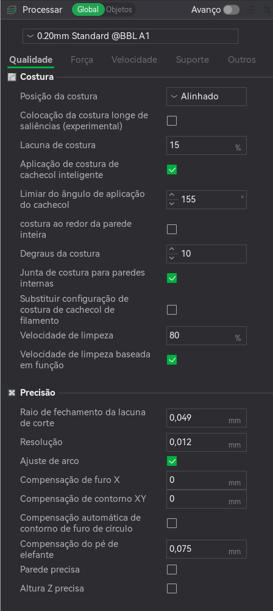

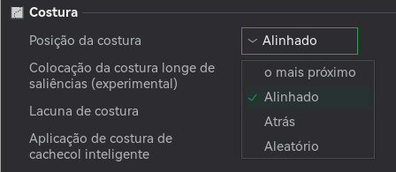

Cada volta de parede é um laço fechado. O bico precisa começar e terminar o laço em algum ponto, e esse ponto deixa uma marca: uma pequena saliência, uma fenda ou uma linha vertical ao longo da peça. Isso é a **costura** (*seam*, também chamada *Z-seam*). Não dá para eliminá-la completamente (a única exceção é o modo vaso espiral), mas dá para escolher onde ela fica e disfarçá-la.

### Posição da costura (*Seam position*)

Define a estratégia para escolher o ponto inicial de cada parede externa.

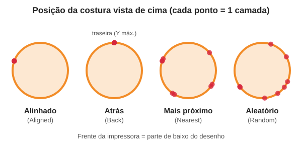

| Opção | Comportamento | Bom para |
|---|---|---|
| **Alinhado** (*Aligned*) — padrão | procura cantos (de preferência côncavos, depois convexos) e tenta manter a costura no mesmo lugar camada após camada, formando uma linha vertical limpa | quase tudo; peças com cantos |
| **Atrás** (*Back*) | coloca a costura na parte de trás da peça (lado do Y máximo, o fundo da mesa) | peças com uma "frente" clara: bustos, máscaras, placas |
| **O mais próximo** (*Nearest*) | prefere cantos, mas se não houver, usa o ponto mais perto de onde o bico terminou o movimento anterior | reduzir deslocamentos e fiapos; peças funcionais |
| **Aleatório** (*Random*) | sorteia o ponto em cada camada | cilindros e formas orgânicas sem cantos, onde a linha vertical seria muito visível |

- **Quando mexer:** sempre que a costura estiver aparecendo em lugar feio.

> **Dica:** a costura "some" melhor em cantos vivos. Em peças com cantos, o Alinhado quase sempre esconde a costura dentro de um canto. Em cilindros lisos não há onde esconder: escolha Atrás (e vire a peça para que a costura fique no lado de trás) ou use a costura em rampa (*scarf*).

> **Dica:** o Aleatório espalha a costura, mas cria pequenas "espinhas" (*zits*) pela superfície toda. Visto de longe some; de perto, a superfície fica levemente áspera.

> **Dica:** para controle total, use a **pintura de costura** (tecla P) na aba Preparar. Pintar uma faixa vertical nos fundos da peça vence qualquer posição automática.

- **Mais bonita:** Alinhado em peças com cantos; Atrás ou pintura de costura em peças orgânicas; scarf em cilindros.
- **Mais rápida:** O mais próximo.
- **Mais forte:** Aleatório ou O mais próximo espalham o ponto fraco; Alinhado concentra todos os inícios numa linha só, o que pode virar uma linha de quebra em peças sob tensão (pinos, ganchos).
- **Decorativa:** pintura de costura + Atrás.

### Colocação da costura longe de saliências (*Seam placement away from overhangs*) — experimental

Novo desde a 2.2. Nos modos Alinhado e Atrás, tenta evitar que a costura caia sobre uma área em balanço (*overhang*). Costura sobre overhang costuma ficar feia, porque o início do laço fica "no ar".

- **Padrão:** desligado.
- **Quando ligar:** peças com overhangs onde a costura estava saindo bagunçada.

> **Atenção:** é experimental. Confira na pré-visualização (com as costuras visíveis) se o resultado ficou melhor.

### Lacuna da costura (*Seam gap*) — modo desenvolvedor

Para não haver sobreposição de material no ponto de encontro, o laço é encerrado um pouco antes de fechar. A lacuna é dada em porcentagem do diâmetro do bico.

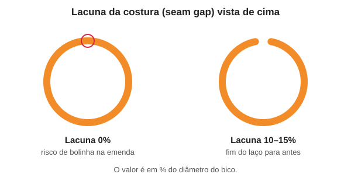

- **Valores típicos:** 15% (padrão), ou seja, 0,06 mm num bico 0,4.
- **Aumentar:** menos "bolinha" na costura, mas pode aparecer uma pequena fenda.
- **Diminuir:** costura menos visível como fenda, mas com risco de saliência.
- **Quando mexer:** se a costura mostra um caroço (aumente um pouco) ou um buraco (diminua).

> **Dica:** antes de mexer na lacuna, calibre o **avanço de pressão** (*pressure advance*). Valor baixo causa caroço no fim do laço; valor alto causa falta de material. A lacuna é só o ajuste fino depois disso.

### Costura em rampa — scarf seam

Uma técnica em que o laço não começa "de uma vez": a primeira parte é impressa subindo em rampa, com a altura (e o fluxo) crescendo aos poucos, e o final do laço passa por cima dessa rampa, também em rampa. As duas pontas se sobrepõem suavemente em vez de se encontrarem num ponto. O resultado é uma costura muito menos visível, principalmente em superfícies lisas e curvas.

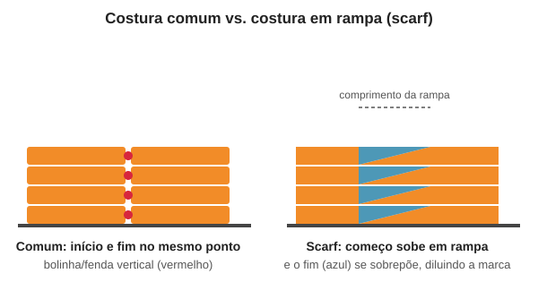

O preço: um pouco mais de tempo, e pouco efeito em cantos vivos (onde a costura comum já se esconde bem) e em overhangs.

#### Onde ficam as opções de scarf

Isso confunde muita gente. No Bambu Studio o scarf é controlado **em dois lugares**:

1. **No filamento** (*Filament → Configurações de costura em rampa do filamento*): tipo de scarf, altura inicial, lacuna e comprimento. **Por padrão o tipo vem como "Nenhum"** em muitos perfis, ou seja, o scarf fica desligado mesmo que as outras opções estejam preenchidas.
2. **No processo, aba Qualidade → Costura:** opções gerais (aplicação inteligente, ângulo, rampa em volta da parede toda, degraus, paredes internas) e uma chave para **substituir** as configurações do filamento.

> **Dica:** se você ligou tudo no processo e o scarf não aparece, confira o **tipo de scarf no filamento**. Usuários no fórum relatam também que, com vários filamentos no projeto, vale conferir todos os slots. Para verificar se o scarf foi aplicado, use o esquema de cores **Fluxo** na pré-visualização: a rampa aparece como um degradê.

#### Aplicação inteligente da costura em rampa (*Smart scarf seam application*)

Aplica o scarf só em laços "lisos" (sem cantos vivos), onde uma costura comum ficaria visível. Em laços com cantos, mantém a costura tradicional escondida no canto.

- **Padrão:** ligado.
- **Desligar:** scarf em todos os laços, inclusive os com cantos (mais tempo, ganho pequeno).

> **Dica:** deixe ligado. É o melhor dos dois mundos.

#### Limiar do ângulo de aplicação do scarf (*Scarf application angle threshold*)

Usado pela aplicação inteligente. Se o ângulo mais fechado do laço for **maior** que este valor (ou seja, não houver canto vivo), o scarf é aplicado.

- **Valores típicos:** 155° (padrão).
- **Diminuir:** o scarf passa a valer também em laços com cantos mais marcados.
- **Aumentar:** só laços quase perfeitamente redondos ganham scarf.

#### Scarf ao redor da parede inteira (*Scarf around entire wall*)

A rampa se estende pelo comprimento todo da parede, como uma hélice suave.

- **Padrão:** desligado.
- **Ligar:** em teoria, costura ainda menos visível; na prática, mais tempo e pouco ganho.

#### Degraus do scarf (*Scarf steps*)

Número mínimo de segmentos em que a rampa é dividida. Mais degraus = rampa mais suave.

- **Valores típicos:** 10 (padrão).
- **Quando mexer:** quase nunca. 10 é suficiente.

#### Scarf para paredes internas (*Scarf joint for inner walls*)

Aplica a rampa também nas paredes internas.

- **Padrão no código:** ligado (os perfis podem variar).
- **Ligar:** o início das paredes internas não "empurra" a parede externa na região da costura, o que pode ajudar o acabamento.
- **Desligar:** um pouco mais rápido; recomendado pela maioria dos guias quando o objetivo é só o visual externo.

#### Substituir a configuração de scarf do filamento (*Override filament scarf seam setting*)

Quando ligada, as quatro opções seguintes aparecem no processo e passam a valer no lugar das do filamento. A grande vantagem: elas podem ser usadas em **modificadores** e por **objeto**. Assim você liga o scarf só num vaso ou só num cilindro do projeto.

- **Padrão:** desligado (valem as do filamento).

#### Tipo de costura em rampa (*Scarf seam type*)

- **Nenhum** (*None*): sem scarf.
- **Contorno** (*Contour*): só no contorno externo da peça.
- **Contorno e furo** (*Contour and hole*): no contorno e também nas paredes ao redor de furos.

> **Dica:** "Contorno" é o ponto de partida. Use "Contorno e furo" se os furos são visíveis (um copo, uma luminária vazada).

#### Altura inicial do scarf (*Scarf start height*)

Altura em que a rampa começa, em milímetros ou em porcentagem da altura de camada.

- **Valores típicos:** 10% (padrão). O programa não aceita valores iguais ou maiores que a própria camada e volta para 10%.
- **Aumentar:** rampa mais curta em altura (começa mais alto).
- **Diminuir:** rampa começando quase do zero, transição mais suave.

#### Lacuna do declive do scarf (*Scarf slope gap*)

Encurta as paredes interna e externa no ponto da costura, em milímetros ou em porcentagem do bico, para reduzir excesso de material na emenda.

- **Valores típicos:** 0 (padrão).
- **Quando mexer:** se aparecer um "caroço" no fim da rampa, aumente aos poucos (5–10%).

#### Comprimento do scarf (*Scarf length*)

Comprimento horizontal da rampa. Zero desliga o scarf.

- **Valores típicos:** 10 mm (padrão no Bambu Studio; o OrcaSlicer usa 20 mm).
- **Aumentar:** transição mais longa e suave; mais tempo.
- **Diminuir:** rampa curta, menos eficaz.

> **Dica:** em peças pequenas (circunferência menor que uns 30 mm), um scarf de 10 mm já cobre boa parte do laço. Em vasos grandes, experimente 15–20 mm.

- **Mais bonita/decorativa:** scarf com tipo Contorno, aplicação inteligente ligada, comprimento 10–20 mm, avanço de pressão calibrado.
- **Mais rápida:** sem scarf.
- **Mais forte:** o scarf não enfraquece a peça de forma relevante, e a emenda em rampa pode até distribuir melhor o ponto de início.

> **Atenção:** no OrcaSlicer existem opções extras de scarf, como velocidade da rampa e fluxo da rampa, além de "limpar antes da parede externa". Elas **não existem** no Bambu Studio (nem no modo desenvolvedor), segundo usuários no fórum oficial em 2026.

### Velocidade de limpeza (*Wipe speed*) — modo desenvolvedor

Ao terminar uma parede, o bico faz um pequeno movimento de **limpeza** (*wipe*) por cima do que acabou de imprimir, enquanto retrai, para não deixar um fio ou gota. Esta opção define a velocidade desse movimento, como porcentagem da velocidade de deslocamento.

- **Valores típicos:** 80% (padrão).
- **Quando mexer:** só tem efeito se a **velocidade de limpeza baseada em função** estiver desligada.

### Velocidade de limpeza baseada em função (*Role-based wipe speed*)

Faz a limpeza acontecer na mesma velocidade da linha que acabou de ser impressa. Se o bico estava fazendo a parede externa a 200 mm/s, a limpeza também vai a 200 mm/s.

- **Padrão:** ligado.
- **Por que ajuda:** evita mudanças bruscas de velocidade bem no ponto da costura, que deixariam marcas.

> **Dica:** deixe ligado. O OrcaSlicer também recomenda.

### Dicas gerais para costuras limpas

1. Calibre o **avanço de pressão** do filamento. É a causa número um de costura feia.
2. Calibre o **fluxo**.
3. Use cantos (Alinhado) ou pinte a costura.
4. Em cilindros, use scarf ou vire a costura para trás.
5. Prefira a ordem de paredes Interna/Externa ou Interna/Externa/Interna (ver adiante). A ordem Externa/Interna costuma deixar a costura mais aparente.
6. Seque o filamento. Filamento úmido escorre e deixa bolhas exatamente na costura.

## Precisão

Este grupo trata de medidas: furos que saem pequenos, peças que saem grandes, base alargada, altura final errada. Também tem duas opções sobre como o caminho do bico é descrito no G-code.

### Raio de fechamento de lacunas no fatiamento (*Slice gap closing radius*)

Quando o programa corta a malha 3D em fatias, pequenas falhas da malha podem virar rachaduras no contorno. Lacunas menores que o dobro deste raio são fechadas automaticamente.

- **Valores típicos:** 0,049 mm (padrão).
- **Aumentar:** corrige modelos com malha "suja", mas pode fechar detalhes finos de propósito (fendas, ranhuras finas).
- **Diminuir:** preserva detalhes minúsculos, mas modelos ruins podem ficar com falhas.
- **Quando mexer:** quase nunca. Só se um modelo com malha problemática gerar paredes quebradas.

> **Dica:** antes de aumentar este valor, tente **Corrigir modelo** (*Fix model*) no menu do botão direito.

### Resolução (*Resolution*)

Antes de gerar o G-code, o programa simplifica o contorno, juntando pontos muito próximos. Isso evita arquivos gigantes com milhares de microssegmentos que a impressora não consegue processar rápido.

- **Valores típicos:** 0,01 mm (código), 0,012 mm (perfis Bambu).
- **Diminuir:** mais pontos, mais fiel ao modelo, fatiamento mais lento.
- **Aumentar:** fatiamento mais rápido, curvas um pouco "facetadas" se exagerar.
- **Quando mexer:** modelos enormes que demoram muito para fatiar num computador fraco (aumente para 0,02–0,05).

### Ajuste de arco (*Arc fitting*)

Transforma sequências de pequenos segmentos retos em comandos de arco (G2/G3). A tolerância usada é a mesma da Resolução.

- **Padrão:** desligado no código, ligado em muitos perfis Bambu.
- **Ligar:** G-code menor e, em impressoras com processamento lento, curvas mais suaves.
- **Quando mexer:** em impressoras Bambu, mantenha como veio no perfil. O efeito na qualidade é pequeno: muda mais a forma de *descrever* o caminho do que o caminho em si.

> **Atenção:** se você usa o Bambu Studio para outra impressora, confirme que o firmware aceita G2/G3. No Klipper o padrão de segmentação de arcos é grosseiro (1 mm), o que pode até piorar curvas pequenas.

### Compensação de furo X-Y (*X-Y hole compensation*)

Furos impressos quase sempre saem menores que o desenho, porque o plástico se espalha um pouco para dentro e os furos encolhem ao esfriar. Esta opção aumenta (valor positivo) ou diminui (negativo) todos os furos no plano XY.

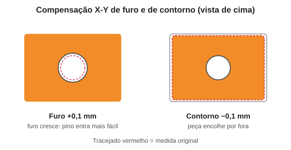

- **Valores típicos:** 0 (padrão). Ajustes comuns ficam entre +0,05 e +0,15 mm.
- **Aumentar:** furos maiores, pinos e parafusos entram mais fácil.
- **Diminuir:** furos mais justos.
- **Quando mexer:** peças de encaixe que não encaixam. Imprima uma peça de teste com furo conhecido, meça com paquímetro e corrija.

> **Dica:** o valor é aplicado no raio de cada lado. Se um furo de 5 mm saiu com 4,8 mm, comece com +0,1.

### Compensação de contorno X-Y (*X-Y contour compensation*)

Mesma ideia, para o contorno externo: aumenta ou diminui a peça por fora.

- **Valores típicos:** 0 (padrão). Ajustes de −0,05 a −0,1 mm são comuns quando as peças saem grandes.
- **Quando mexer:** peças que deveriam entrar num encaixe e estão grandes demais.

> **Atenção:** compensações erradas pioram tudo. Antes de usá-las, calibre o fluxo e confirme que o erro é repetível. E lembre que elas valem para o processo inteiro; para uma peça só, aplique por objeto.

- **Mais forte/funcional:** use com medição; não chute valores.
- **Decorativa:** deixe em zero.

### Compensação automática de contorno e furos circulares (*Auto circle contour-hole compensation*)

Recurso experimental da Bambu que compensa automaticamente furos e contornos **circulares** com diâmetro até 50 mm, usando dados calibrados pela própria Bambu.

- **Padrão:** desligado.
- **Limitação:** segundo a descrição do programa, só funciona com PLA Basic, PLA-CF, PET-CF, PETG-CF e PETG HF.
- **Ao ligar:** as compensações manuais de furo e contorno são zeradas e travadas.

#### Deslocamento personalizado pelo usuário (*User Customized Offset*)

Aparece quando a compensação automática está ligada. Ajusta o encaixe sobre o valor automático.

- **Valores típicos:** 0 (padrão).
- **Quando mexer:** para deixar encaixes mais justos ou mais folgados. A descrição interna diz que positivo aperta e negativo afrouxa; teste com uma peça pequena, porque a interpretação do sinal em encaixes macho/fêmea pode confundir.

> **Dica:** é ótimo para quem imprime muito encaixe redondo (rolamentos, pinos) com filamentos Bambu. Para outros materiais, use as compensações manuais.

### Compensação do pé de elefante (*Elephant foot compensation*)

A primeira camada é esmagada contra a mesa e a mesa quente amolece as camadas de baixo. O resultado: a base da peça sai mais larga, como a "pata de um elefante". Esta opção encolhe a primeira camada para compensar.

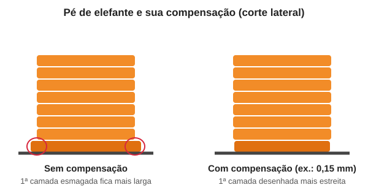

- **Valores típicos:** 0 no código; **0,15 mm** nos perfis X1/P1 e **0,075 mm** na série A1. O programa recusa valores acima de 1 mm.
- **Aumentar:** base mais estreita; em excesso, a primeira camada fica "recuada" e a peça parece ter um degrau.
- **Diminuir:** base mais larga.
- **Quando mexer:** se a borda de baixo da peça tem uma "aba" que atrapalha encaixes, ou se a primeira camada está esmagada demais.

> **Dica:** no Bambu Studio só existe um valor, aplicado à primeira camada. O OrcaSlicer permite distribuir a compensação em várias camadas.

> **Dica:** antes de aumentar a compensação, verifique a temperatura da mesa (muito alta piora o pé de elefante) e a altura da primeira camada.

- **Mais bonita/funcional:** 0,1–0,2 mm em peças com encaixe na base.
- **Decorativa:** valor padrão.

### Parede precisa (*Precise wall*) — modo desenvolvedor

Ajusta o espaçamento entre a parede externa e a interna vizinha para que não haja sobreposição entre elas (com a ordem Interna/Externa). Isso deixa a dimensão externa mais fiel e as camadas mais consistentes, sem perder resistência. Veio do OrcaSlicer e apareceu no Bambu Studio 2.1.

- **Padrão:** desligado.
- **Ligar:** medidas externas mais exatas, superfície mais uniforme.
- **Quando mexer:** peças de encaixe e peças técnicas.

> **Dica:** funciona melhor com avanço de pressão e fluxo calibrados. Se ao ligar aparecerem pequenas falhas entre as paredes, é sinal de fluxo baixo.

### Altura Z precisa (*Precise Z height*)

Como as camadas têm altura fixa, a altura total da peça vira um múltiplo dela. Uma peça de 20,1 mm com camadas de 0,2 sairia com 20,2 mm. Esta opção ajusta a altura das últimas camadas para que a altura final bata com o modelo.

- **Padrão:** desligado (experimental).
- **Ligar:** altura exata, útil em peças que se empilham ou se encaixam no eixo Z.

> **Atenção:** ela mexe na altura das últimas camadas. Com torre de purga ou altura variável, confira a pré-visualização.

### Polyhole

O OrcaSlicer tem a opção **Converter furos em polifuros** (*Convert holes to polyholes*), que transforma furos redondos em polígonos de poucos lados para saírem no diâmetro certo. **Ela não existe no Bambu Studio**. A alternativa mais próxima é a compensação automática de furos circulares ou a compensação manual.

## Passar a ferro (Ironing)

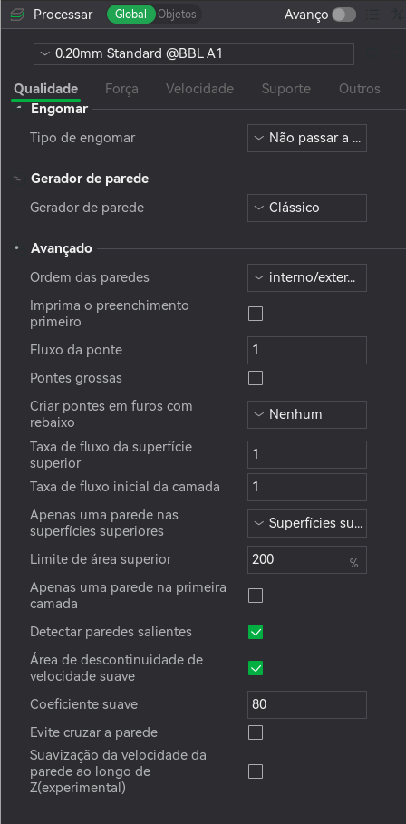

Depois de imprimir a última camada de um topo plano, o bico passa de novo sobre ela, bem devagar e soltando pouquíssimo material. O calor do bico alisa os sulcos entre as linhas e o pouco material extra preenche as falhas. O resultado é um topo liso, quase brilhante.

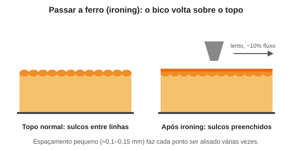

> **Atenção:** passar a ferro só funciona em superfícies **planas e horizontais**. Não alisa laterais nem topos curvos (nesses casos só aumenta o tempo). Também pode arrastar peças mal grudadas e, com PLA, PETG e TPU, aumentar o risco de entupimento por calor subindo pelo bico (*heat creep*) se a passada for muito lenta.

### Tipo de passar a ferro (*Ironing Type*)

Em que superfícies aplicar.

| Opção | Efeito |
|---|---|
| **Não passar a ferro** (*No ironing*) — padrão | desligado |
| **Superfícies superiores** (*Top surfaces*) | todas as superfícies superiores, em qualquer altura |
| **Superfície mais alta** (*Topmost surface*) | só o topo mais alto do objeto |
| **Toda camada sólida** (*All solid layer*) | todas as camadas sólidas, inclusive internas. Quase nunca vale a pena: muito tempo, pouco ganho |

- **Quando usar:** placas de identificação, porta-copos, tampas, caixas, chaveiros, qualquer peça com face superior plana à vista.

> **Dica:** você pode ligar o passar a ferro só para um objeto (configuração por objeto) ou só para uma faixa de altura (modificador de faixa), em vez de ligar para a placa toda.

- **Mais bonita/decorativa:** Superfícies superiores.
- **Mais rápida:** desligado.
- **Mais forte:** irrelevante.

### Padrão de passar a ferro (*Ironing Pattern*)

O desenho que o bico faz ao passar.

- **Retilíneo** (*Rectilinear*) — padrão: linhas paralelas em zigue-zague. Rápido e uniforme.
- **Concêntrico** (*Concentric*): voltas que acompanham o contorno. Bom para formas redondas; pode deixar marca no centro.
- **Espiral de Arquimedes** (*Archimedean Chords*, nome interno): novo na 2.8.3. Parte do centro da região e se expande em espiral, contornando furos. Deixa menos marcas no centro que o concêntrico. A Bambu avisa que exige ajuste fino de fluxo, espaçamento, velocidade e temperatura.

> **Dica:** comece com Retilíneo. Em tampas redondas, experimente a espiral (versão 2.8.3 ou mais nova).

### Velocidade de passar a ferro (*Ironing speed*)

- **Valores típicos:** 20 mm/s (código), 30 mm/s (perfis Bambu).
- **Diminuir:** mais calor sobre a superfície, alisamento maior, mais tempo e mais risco de heat creep.
- **Aumentar:** mais rápido, menos efeito.

### Fluxo de passar a ferro (*Ironing flow*)

Quanto material sai durante a passada, em porcentagem do fluxo de uma camada normal.

- **Valores típicos:** 10% (padrão). Faixa útil de 5% a 20%.
- **Aumentar:** preenche mais falhas; em excesso, sobra material e aparecem cristas ou bolhas, principalmente nas bordas.
- **Diminuir:** topo menos preenchido, linhas ainda aparentes.

> **Dica:** se o topo passado a ferro ficou com linhas e falhas, suba o fluxo de 2 em 2 pontos. Se ficou com bordas elevadas e "ondas", desça.

### Espaçamento entre linhas de passar a ferro (*Ironing line spacing*)

A distância entre uma passada e a próxima.

- **Valores típicos:** 0,1 mm (código), 0,15 mm (perfis Bambu). O programa não aceita menos de 0,05 e volta para 0,1.
- **Diminuir:** cada ponto é alisado mais vezes; superfície mais lisa e muito mais tempo.
- **Aumentar:** mais rápido, efeito menor. Mantenha bem abaixo do diâmetro do bico.

### Recuo do passar a ferro (*Ironing inset*)

Distância mantida entre a área passada a ferro e as bordas da superfície. Zero desliga o recuo.

- **Valores típicos:** 0 (código), 0,21 mm (perfis Bambu, cerca de metade da largura de linha).
- **Aumentar:** evita acúmulo de material e "rebarba" nas bordas.
- **Quando mexer:** se aparecer um cordão elevado no contorno do topo.

### Direção de passar a ferro (*Ironing direction*) — modo desenvolvedor

Ângulo das passadas em relação às linhas do topo.

- **Valores típicos:** 45° (padrão).
- **Quando mexer:** quase nunca. Cruzar as linhas do topo num ângulo diferente é justamente o que faz o alisamento funcionar bem.

### Receita rápida de passar a ferro

| Objetivo | Tipo | Fluxo | Espaçamento | Velocidade |
|---|---|---|---|---|
| Topo bonito, tempo razoável | Superfícies superiores | 10% | 0,15 | 30 |
| Topo espelhado (placas) | Superfície mais alta | 12–15% | 0,10 | 20 |
| PETG (gruda no bico) | Superfície mais alta | 8–10% | 0,15 | 30–40 |

## Gerador de paredes

Toda camada começa pelas paredes. O **gerador de paredes** (*Wall generator*) é o algoritmo que decide como desenhá-las. A diferença aparece em regiões finas, onde a espessura da peça não é um múltiplo exato da largura de linha.

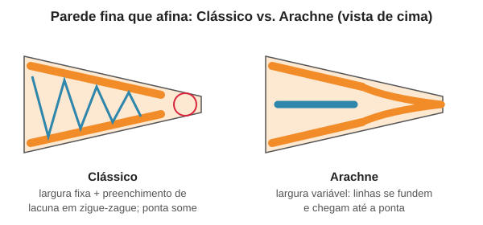

### Gerador de parede (*Wall generator*)

| | **Clássico** (*Classic*) | **Arachne** |
|---|---|---|
| Largura das linhas | fixa | variável ao longo da linha |
| Regiões finas | preenche com "preenchimento de lacuna" (*gap fill*) em zigue-zague; detalhes muito finos podem sumir | estreita ou alarga as linhas para caber; captura detalhes finos |
| Continuidade | laço contínuo, uma costura por laço | o laço pode ser quebrado em partes, gerando mais pontos de início/fim |
| Superfície externa | geralmente mais uniforme | pode mostrar pequenas marcas de transição |
| Velocidade | constante | mudanças de largura exigem mudanças de fluxo |

- **Padrão:** o código usa **Arachne**; vários perfis de sistema da Bambu vêm com **Clássico**. Confira o seu.
- **Quando usar Arachne:** textos pequenos em relevo, miniaturas, peças com paredes finas ou que afinam (pontas, lâminas, cones), logotipos. Também é obrigatório para os modos "Extrusão" e "Combinado" da pele difusa (o programa oferece trocar automaticamente).
- **Quando usar Clássico:** peças grandes e lisas onde a aparência da parede externa importa mais que detalhes finos; peças técnicas onde você quer costura previsível.

> **Dica:** se letras pequenas estão saindo incompletas ou "comidas", troque para Arachne antes de qualquer outra coisa.

> **Dica:** se você vê pequenas "ondas" ou marcas de transição na parede externa de peças lisas com Arachne (há relatos no fórum oficial), confirme que a **Contagem de distribuição de parede** está em 1. Se continuar, experimente o Clássico.

- **Mais bonita (peça lisa):** Clássico.
- **Mais bonita (detalhe fino):** Arachne.
- **Mais forte:** Arachne preenche melhor regiões finas, sem buracos entre paredes.
- **Decorativa:** Arachne em miniaturas.

As opções abaixo só aparecem com **Arachne**. Todas são em porcentagem do diâmetro do bico, exceto o ângulo e a contagem. Com Clássico, aparece na aba Resistência a opção **Detectar parede fina** (*Detect thin wall*), que é o "remendo" do Clássico para paredes finas.

### Ângulo do limiar de transição da parede (*Wall transitioning threshold angle*)

Quando duas paredes se aproximam formando uma cunha, o Arachne pode criar uma linha central extra para preencher o meio (passando de número par para ímpar de paredes). Este ângulo decide quando isso acontece: cunhas com ângulo **maior** que o valor não recebem transição, e o centro fica sem parede extra.

- **Valores típicos:** 10° (padrão). Faixa de 1° a 59°.
- **Aumentar:** mais transições, mais curtas; preenchimento mais completo de cunhas, com mais starts/stops.
- **Diminuir:** menos linhas centrais, risco de pequenas lacunas ou excesso de material.
- **Quando mexer:** raramente. Peças com muitas pontas finas (estrelas, engrenagens) podem se beneficiar de 15–20°.

### Margem do filtro de transição de parede (*Wall transitioning filter margin*)

Evita que a quantidade de paredes fique alternando para cima e para baixo em regiões cuja espessura está bem no limite entre N e N+1 paredes. Amplia a faixa de larguras aceitas antes de mudar a contagem.

- **Valores típicos:** 25% (padrão).
- **Aumentar:** menos transições, menos paradas e deslocamentos; porém larguras mais variáveis, com risco de sub ou sobreextrusão.
- **Diminuir:** larguras mais uniformes, mais transições.

### Comprimento da transição de parede (*Wall transition length*)

Quando a peça afina e o número de paredes muda, as linhas se dividem ou se juntam ao longo de uma distância. Este é o tamanho desse trecho.

- **Valores típicos:** 100% (padrão = 0,4 mm com bico 0,4).
- **Aumentar:** transição mais gradual e suave.
- **Diminuir:** transição brusca.

### Contagem de distribuição de parede (*Wall distribution count*)

Quantas paredes, contadas do centro para fora, absorvem a variação de largura.

- **Valores típicos:** 1 (padrão).
- **Aumentar:** a variação é espalhada por mais paredes, inclusive chegando à externa.
- **Diminuir (1):** só a parede mais interna varia; a parede externa fica com largura constante, o que é melhor para a aparência.

> **Dica:** deixe em 1. É o que protege a superfície visível.

### Largura mínima da parede (*Minimum wall width*)

Largura da linha usada para desenhar detalhes finos (aqueles maiores que o "tamanho mínimo do recurso"). Se o detalhe for mais grosso que esse valor, a linha fica com a largura do próprio detalhe.

- **Valores típicos:** 85% (padrão = 0,34 mm com bico 0,4).
- **Diminuir:** detalhes finos mais fiéis à espessura real, mas linhas muito finas podem falhar.
- **Aumentar:** detalhes finos ficam mais grossos que no modelo, porém mais confiáveis.

### Tamanho mínimo do recurso (*Minimum feature size*)

Detalhes mais finos que este valor **não são impressos**. Detalhes acima dele são alargados até a largura mínima da parede.

- **Valores típicos:** 25% (padrão = 0,1 mm com bico 0,4).
- **Diminuir:** tenta imprimir até detalhes minúsculos (muitas vezes viram fiapos).
- **Aumentar:** ignora detalhes muito finos, deixando a impressão mais limpa.

> **Dica:** em miniaturas com espadas, antenas e cabelos finos, mantenha os padrões e prefira bico 0,2 se o detalhe sumir.

## Avançado

O último grupo da aba Qualidade junta opções de paredes, superfícies, pontes, overhangs e deslocamentos. A Bambu documenta várias delas numa página da wiki chamada "configurações avançadas de qualidade".

### Ordem das paredes (*Order of walls*)

Em que ordem as voltas de parede são impressas em cada camada.

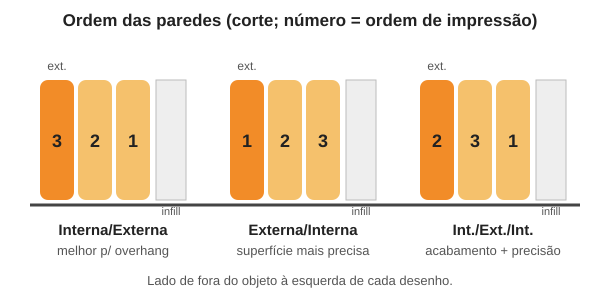

| Opção | Como funciona | Vantagens | Desvantagens |
|---|---|---|---|
| **Interna/Externa** (*inner/outer*) — padrão | de dentro para fora; a externa por último | a externa se apoia na interna: **melhor para overhangs**; costura mais limpa | a interna "empurra" a externa, pequenas imprecisões dimensionais |
| **Externa/Interna** (*outer/inner*) | a externa primeiro | superfície externa com dimensão mais exata e detalhes nítidos | overhangs piores (a externa fica no ar), costura mais aparente |
| **Interna/Externa/Interna** (*inner/outer/inner*) | imprime as internas, pula uma, faz a externa e por fim a interna encostada nela | superfície e precisão próximas de Externa/Interna, costura mais controlada | overhangs um pouco piores; precisa de 3 ou mais paredes para fazer sentido |

- **Quando mexer:** peças técnicas com medidas críticas ou superfícies sem overhang.

> **Dica:** a maioria dos guias (inclusive o do OrcaSlicer) prefere Interna/Externa/Interna a Externa/Interna quando o foco é acabamento. Use Interna/Externa quando há overhangs importantes.

- **Mais bonita:** Interna/Externa/Interna.
- **Mais rápida:** sem diferença relevante.
- **Mais forte:** Interna/Externa (melhor ligação entre paredes em overhangs).
- **Decorativa/miniatura com overhang:** Interna/Externa.

### Imprimir o preenchimento primeiro (*Print infill first*)

Inverte a ordem padrão (paredes antes do preenchimento): imprime antes todas as linhas horizontais (preenchimento esparso, sólido, topo, fundo, pontes) e só depois as paredes.

- **Padrão:** desligado.
- **Ligar:** em alguns overhangs ajuda, porque a parede tem onde se apoiar; porém o preenchimento pode empurrar a parede para fora e marcar a superfície ("efeito de transparência").
- **Quando mexer:** raramente. Se ligar, combine com Parede precisa ou ordem Interna/Externa/Interna.

### Fluxo da ponte (*Bridge flow*)

Multiplicador do material usado em pontes (linhas que atravessam o vão entre dois apoios).

- **Valores típicos:** 1,0 (padrão; alguns perfis 0,95).
- **Diminuir (0,85–0,95):** linhas mais finas e tensas, que cedem menos.
- **Aumentar:** pontes mais cheias, sem falhas entre linhas, com risco de cederem.
- **Quando mexer:** pontes caídas (diminua) ou pontes com buracos entre linhas (aumente).

> **Dica:** se a **ponte grossa** estiver ligada, este multiplicador vale sobre o fluxo da ponte grossa.

### Pontes grossas (*Thick bridges*)

Com esta opção, a ponte externa é extrudada como um fio redondo com o diâmetro do bico (0,4 mm de "altura" mesmo que a camada seja 0,12). Sem ela, a ponte usa a altura de camada normal.

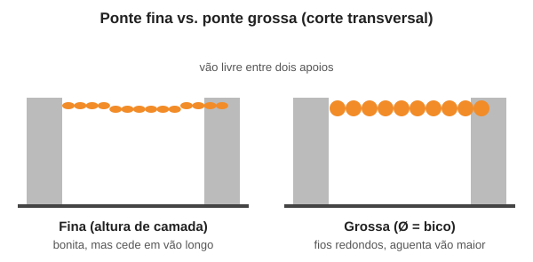

- **Padrão:** desligado no código (os perfis podem variar).
- **Ligar:** pontes muito mais confiáveis, vencem vãos maiores; aparência um pouco pior (linhas redondas, mais marcadas).
- **Desligar:** pontes mais bonitas e planas, mas só confiáveis em vãos curtos.
- **Quando mexer:** com camadas finas (0,08–0,12), a ponte sem esta opção pode romper por falta de material: ligue.

> **Atenção:** ela vale só para pontes **externas**. As pontes **internas** (sobre o preenchimento esparso) **sempre** são grossas no Bambu Studio.

- **Mais bonita:** desligado, com vãos curtos.
- **Mais forte/confiável:** ligado.
- **Decorativa com camada fina:** ligado.

### Criar pontes em furos com rebaixo (*Bridge counterbore holes*)

Furos de parafuso com rebaixo para a cabeça (*counterbore*) têm um problema: quando a peça é impressa com o rebaixo para baixo, a transição do furo largo para o estreito fica no ar. Esta opção cria pontes para imprimir isso sem suporte.

- **Nenhum** (*None*) — padrão: nada é feito.
- **Parcialmente com ponte** (*Partially bridged*): faz pontes em parte da área sem apoio, que sustentam a camada seguinte.
- **Camada de sacrifício** (*Sacrificial layer*): fecha o furo inteiro com uma camada de ponte; depois da impressão você fura essa membrana com uma broca ou estilete.

> **Dica:** a camada de sacrifício é a mais confiável. Para parafusos M3/M4 em peças funcionais, funciona muito bem.

### Taxa de fluxo do objeto (*Object flow ratio*) — modo desenvolvedor, por objeto

Multiplicador de fluxo aplicado a um objeto específico. Só aparece nas configurações por objeto, não na global.

- **Valores típicos:** 1,0.
- **Quando mexer:** se uma única peça do projeto (por exemplo, impressa com outro filamento) precisa de mais ou menos material.

### Taxa de fluxo da superfície superior (*Top surface flow ratio*) — modo desenvolvedor

Multiplicador de fluxo só para o preenchimento sólido do topo.

- **Valores típicos:** 1,0.
- **Diminuir (0,9–0,97):** topo mais liso, sem cristas.
- **Aumentar:** preenche falhas entre linhas do topo.

> **Atenção:** calibre o fluxo do filamento antes. Esta opção é um ajuste fino, não um conserto para fluxo errado.

### Taxa de fluxo da camada inicial (*Initial layer flow ratio*) — modo desenvolvedor

Multiplicador do fluxo da primeira camada.

- **Valores típicos:** 1,0.
- **Aumentar levemente (1,05):** primeira camada mais cheia, ajuda com mesa texturizada.
- **Diminuir:** se a primeira camada estiver com "ondas" ou excesso.

### Apenas uma parede nas superfícies superiores (*Only one wall on top surfaces*)

Nas superfícies superiores planas, usa só uma parede em vez do número configurado. Sobra mais área para o padrão do topo, que fica mais uniforme, principalmente em letras e detalhes pequenos.

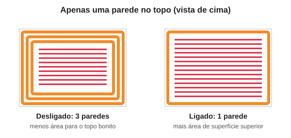

- **Não aplicado** (*Not apply*): usa o número normal de paredes.
- **Superfícies superiores** (*Top surfaces*) — padrão: em todas as superfícies superiores.
- **Superfície mais alta** (*Topmost surface*): só no topo mais alto.

> **Dica:** em letreiros com letras em relevo, esta opção faz uma grande diferença: as letras ficam preenchidas com linhas de topo em vez de virar um amontoado de paredes.

- **Mais bonita:** Superfícies superiores.
- **Mais forte:** Não aplicado, se a parede do topo for importante para a rigidez (raro).

### Limite da área superior (*Top area threshold*) — modo desenvolvedor

Largura mínima (em porcentagem da largura da parede) que uma superfície superior precisa ter para receber o tratamento de "uma parede só". Superfícies mais estreitas mantêm o número normal de paredes. Não vale para a superfície mais alta.

- **Valores típicos:** 200% (padrão).
- **Aumentar:** transições mais suaves em superfícies curvas e inclinadas.
- **Diminuir (ou 0 no Orca):** se aparecerem artefatos em detalhes finos da camada seguinte.

### Apenas uma parede na primeira camada (*Only one wall on first layer*)

Usa uma só parede na primeira camada; o resto vira preenchimento sólido.

- **Padrão:** desligado.
- **Ligar:** primeira camada mais uniforme em letras e logotipos impressos na base; às vezes ajuda na aderência de áreas pequenas.

### Detectar paredes salientes (*Detect overhang wall*) — modo desenvolvedor

Mede quanto cada trecho de parede está "para fora" da camada de baixo (em porcentagem da largura da linha) e reduz a velocidade conforme o grau. Com 100% de overhang (linha totalmente no ar), usa a velocidade de ponte.

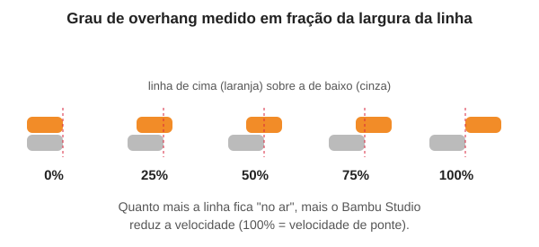

- **Padrão:** ligado.
- **Desligar:** todas as paredes usam a velocidade normal; overhangs ficam piores.
- **Quando mexer:** praticamente nunca. As velocidades de cada faixa (1/4, 2/4, 3/4, 4/4 e totalmente) ficam na aba **Velocidade**.

### Área de descontinuidade de velocidade suave (*Smooth speed discontinuity area*)

Quando a velocidade muda bruscamente (por exemplo, de 200 mm/s numa parede normal para 30 mm/s num overhang), o bico não consegue ajustar a pressão instantaneamente, e aparecem marcas e diferenças de brilho. Esta opção cria uma transição gradual de velocidade. Existe desde a 1.9.4.

- **Padrão:** ligado.
- **Desligar:** transições bruscas, marcas mais visíveis.

### Coeficiente de suavização (*Smooth coefficient*)

Controla o comprimento dessa transição. **Quanto menor o número, mais longa a transição.** Zero desliga.

- **Valores típicos:** 80 (padrão no código), 150 em alguns perfis X1. A Bambu recomenda a faixa de 1 a 200.
- **Diminuir:** transição longa e suave, overhangs mais uniformes; um pouco mais de tempo.
- **Aumentar:** transição curta.

> **Dica:** se você vê uma "faixa" diferente na parede logo antes de um overhang, experimente diminuir para 40–60.

### Evitar cruzar a parede (*Avoid crossing wall*)

Quando o bico precisa se deslocar entre dois pontos, em vez de cortar caminho por cima de uma parede, ele contorna. Isso evita gotas, fiapos e marcas na superfície. O desvio só acontece se o deslocamento for maior que o limite de distância de deslocamento configurado na impressora.

- **Padrão:** desligado.
- **Ligar:** superfície mais limpa, menos fiapos; deslocamentos mais longos (um pouco mais de tempo).
- **Quando ligar:** filamentos que escorrem (PETG, TPU), peças decorativas, peças com várias "ilhas".

> **Atenção:** o guia do OrcaSlicer aponta incompatibilidade com o modo de time-lapse "tradicional". No Bambu Studio, confira a pré-visualização com deslocamentos visíveis.

- **Mais bonita:** ligado.
- **Mais rápida:** desligado.

#### Comprimento máximo do desvio (*Avoid crossing wall – Max detour length*)

Limite do desvio. Se contornar exigir mais que isso, o bico vai em linha reta. Aceita milímetros ou porcentagem do deslocamento direto. Zero = sem limite.

- **Valores típicos:** 0 (padrão).
- **Quando mexer:** se o tempo subir muito com a opção ligada, limite a 50–100% ou a alguns milímetros.

#### Incluir suporte (*Avoid crossing wall – Includes support*)

Também evita cruzar por cima do suporte.

- **Padrão:** desligado.
- **Ligar:** menos marcas na peça vindas de deslocamentos sobre o suporte; mais tempo.

### Suavização da velocidade da parede ao longo de Z (*Smoothing wall speed along Z*) — experimental

Suaviza a velocidade da parede externa **entre camadas**, para evitar faixas horizontais quando a velocidade muda de uma camada para outra (por exemplo, em camadas pequenas com tempo mínimo de camada). Não funciona no modo vaso.

- **Padrão:** desligado.
- **Ligar:** superfície lateral mais uniforme; aumenta o tempo de impressão.
- **Quando ligar:** peças decorativas com faixas horizontais de brilho ou textura diferentes.

## Opções que estão em outras abas ou só no OrcaSlicer

Muitos tutoriais citam opções que você não vai achar na aba Qualidade do Bambu Studio. Para economizar sua busca:

| Opção | Situação no Bambu Studio |
|---|---|
| **Direção da ponte** (*Bridge direction*) | existe, mas fica na aba **Resistência → Avançado**. Zero = automático |
| **Velocidades de overhang por faixa** | aba **Velocidade** |
| **Detectar parede fina** (*Detect thin wall*) | aba **Resistência**, só com gerador Clássico |
| **Padrão da subcamada superior** (*Sub-top surface pattern*) | novo na 2.8.3, aba **Resistência → Avançado**; padrão monotônico |
| Densidade da ponte (*Bridge density*) | só no OrcaSlicer |
| Camadas extras de ponte (*Extra bridge layers*) | só no OrcaSlicer |
| Fluxo da ponte interna separado (*Internal bridge flow*) | só no OrcaSlicer |
| Tornar overhang imprimível (*Make overhang printable*) | só no OrcaSlicer (altera a geometria para cones de 45–60°) |
| Inverter em camadas pares/ímpares (*Reverse on even/odd*) | só no OrcaSlicer |
| Paredes extras em overhangs | só no OrcaSlicer |
| Compensação de fluxo em áreas pequenas (*Small area flow compensation*) | só no OrcaSlicer |
| Polifuros (*Polyholes*) | só no OrcaSlicer |
| Costuras internas escalonadas (*Staggered inner seams*) | só no OrcaSlicer |
| Limpar no laço / limpar para dentro (*Wipe on loop / Wipe inward*) | só no OrcaSlicer |
| Velocidade e fluxo da rampa do scarf | só no OrcaSlicer |
| Direção do laço de parede (*Wall loop direction*) | só no OrcaSlicer |
| Compensação de pé de elefante em várias camadas | só no OrcaSlicer |

> **Dica:** se uma dessas opções for essencial para você (por exemplo, "tornar overhang imprimível" para peças sem suporte), o OrcaSlicer fatia para impressoras Bambu e envia pela rede. Muita gente usa os dois programas.

## Receitas prontas

Combinações para começar. Ajuste ao seu caso.

### Peça mais bonita (decorativa, vitrine)

- Altura da camada 0,12–0,16 (ou 0,20 + altura variável)
- Parede externa 0,40, superfície superior 0,40
- Costura: Alinhado (com cantos) ou Atrás + pintura; scarf "Contorno" em cilindros
- Gerador: Clássico em peças lisas, Arachne em peças com detalhe fino
- Ordem das paredes: Interna/Externa/Interna (sem overhang) ou Interna/Externa
- Passar a ferro: Superfícies superiores, 10%, 0,15
- Uma parede no topo: Superfícies superiores
- Evitar cruzar a parede: ligado
- Suavização ao longo de Z: ligado se aparecerem faixas

### Peça mais rápida (protótipo, rascunho)

- Altura 0,28 (bico 0,4) ou 0,32–0,40 (bico 0,6)
- Larguras internas e preenchimento 0,5–0,6
- Costura: O mais próximo
- Sem passar a ferro, sem scarf
- Evitar cruzar a parede: desligado

### Peça mais forte (funcional)

- Altura 0,20–0,24
- Paredes internas e preenchimento 0,5
- Costura: Aleatório ou O mais próximo (espalha o ponto fraco)
- Ordem: Interna/Externa
- Gerador: Arachne (sem lacunas entre paredes)
- Parede precisa ligada se houver encaixe
- Compensação X-Y de furo calibrada para os parafusos
- Pontes grossas ligadas; furos com rebaixo em camada de sacrifício

### Placa ou letreiro com texto

- Camada inicial 0,2; largura da camada inicial ~0,42 se o texto estiver na base
- Arachne
- Uma parede no topo: Superfícies superiores
- Passar a ferro: Superfície mais alta
- Uma parede na primeira camada: ligado se o texto estiver na face de baixo

## Fontes deste capítulo

- [Código-fonte do Bambu Studio — definições de parâmetros (PrintConfig.cpp)](https://github.com/bambulab/BambuStudio/blob/master/src/libslic3r/PrintConfig.cpp)
- [Código-fonte do Bambu Studio — organização da aba Qualidade (Tab.cpp)](https://github.com/bambulab/BambuStudio/blob/master/src/slic3r/GUI/Tab.cpp)
- [Perfis de processo de sistema da Bambu (GitHub)](https://github.com/bambulab/BambuStudio/tree/master/resources/profiles/BBL/process)
- [Wiki Bambu Lab — Configurações avançadas de qualidade](https://wiki.bambulab.com/en/software/bambu-studio/parameter/quality-advance-settings)
- [Wiki Bambu Lab — Passar a ferro](https://wiki.bambulab.com/en/software/bambu-studio/parameter/ironing)
- [Wiki Bambu Lab — Largura de linha](https://wiki.bambulab.com/en/software/bambu-studio/parameter/line-width)
- [Wiki Bambu Lab — Gerador de paredes](https://wiki.bambulab.com/en/software/bambu-studio/wall-generator)
- [Wiki Bambu Lab — Pontes](https://wiki.bambulab.com/en/software/bambu-studio/parameter/bridge)
- [Wiki Bambu Lab — Costura](https://wiki.bambulab.com/en/software/bambu-studio/Seam)
- [Wiki Bambu Lab — notas da versão 2.2.0](https://wiki.bambulab.com/en/software/bambu-studio/release/release-note-2-2-0)
- [Notas da versão 2.8.3 (newreleases.io)](https://newreleases.io/project/github/bambulab/BambuStudio/release/v02.08.03.66)
- [Wiki OrcaSlicer — Costura](https://github.com/OrcaSlicer/OrcaSlicer/wiki/quality_settings_seam)
- [Wiki OrcaSlicer — Precisão](https://github.com/OrcaSlicer/OrcaSlicer/wiki/quality_settings_precision)
- [Wiki OrcaSlicer — Paredes e superfícies](https://github.com/OrcaSlicer/OrcaSlicer/wiki/quality_settings_wall_and_surfaces)
- [Wiki OrcaSlicer — Pontes](https://github.com/OrcaSlicer/OrcaSlicer/wiki/quality_settings_bridging)
- [Wiki OrcaSlicer — Overhangs](https://github.com/OrcaSlicer/OrcaSlicer/wiki/quality_settings_overhangs)
- [Fórum Bambu Lab — Scarf joints que não funcionam sempre](https://forum.bambulab.com/t/scarf-joints-doesnt-seam-to-always-work/157900)
- [Fórum Bambu Lab — Opções de scarf limitadas em relação ao Orca](https://forum.bambulab.com/t/limited-settings-for-scarf-seam-in-bambu-studio-cpmpared-to-orca-slicer/233445)
- [Fórum Bambu Lab — Bambu Studio 2.1.0 lançado (parede precisa)](https://forum.bambulab.com/t/bambu-studio-2-1-0-released/172444)
- [Stack Sheriff — Configurações do Bambu Studio explicadas](https://stacksheriff.com/3d-printing/bambu-studio-settings-explained/)

# Capítulo 3 — Resistência

A aba **Resistência** (*Strength*) decide o que fica **dentro** da peça e como ela é "embrulhada". Na tradução oficial do Bambu Studio essa aba aparece como **Força**. Os nomes mudam, mas a ideia é a mesma: aqui você escolhe quantas paredes a peça terá, quantas camadas sólidas fecham o topo e a base, quanto plástico vai no miolo e qual desenho esse miolo terá.

São as opções que mais mexem em três coisas ao mesmo tempo: **resistência**, **tempo** e **filamento gasto**. Quase toda decisão desta aba é uma troca entre elas. Uma peça decorativa pode ser quase oca. Um suporte de prateleira, não.

Este capítulo segue a ordem da interface (versão 2.8 do Bambu Studio, conferida no código-fonte publicado pela Bambu Lab). Primeiro as paredes, depois as cascas de topo e base, depois o preenchimento esparso e, por fim, o grupo **Avançado**. No meio do caminho há uma seção longa, com desenho, para **cada padrão de preenchimento**. No final, receitas prontas para cada tipo de peça.

> **Atenção:** a tradução em português do Bambu Studio é irregular e às vezes literal demais ("Loops de parede", "A Iluminação", "Escotilha cruzada"). Por isso o nome em inglês vem sempre entre parênteses. Se a sua tela mostrar outro nome, procure pelo nome em inglês ou passe o mouse sobre a opção para ler a dica.

> **Dica:** muitas opções deste capítulo só aparecem com o modo **Avançado** ligado (a chave no topo do painel de processo). Algumas dependem do padrão escolhido: as opções de Cross Zag, por exemplo, só surgem quando esse padrão está selecionado. Se algo descrito aqui não aparece para você, confira esses dois pontos.

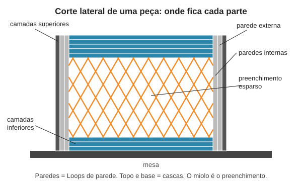

Os grupos da aba, na ordem em que aparecem:

| Grupo (pt-BR) | Grupo (inglês) | O que tem dentro |
|---|---|---|
| Paredes | *Walls* | Número de paredes, parede extra alternada, paredes finas |
| Camadas superiores/inferiores | *Top/bottom shells* | Camadas e espessura de topo e base, padrões e densidade dessas superfícies |
| Preenchimento interno | *Sparse infill* | Densidade, padrão, opções de cada padrão, âncoras |
| Avançado | *Advanced* | Sobreposição com a parede, direção, limites de área, combinação de camadas, espessura vertical |

---

## Primeiro, o conceito: casca e miolo

Uma peça impressa em FDM quase nunca é maciça. Ela é uma **casca** fechada com um **miolo** parcialmente vazio:

- As **paredes** (*walls*, também chamadas de perímetros) são as voltas que contornam a peça em cada camada. A de fora é a parede externa, que você vê. As de dentro são as paredes internas.
- As **camadas superiores e inferiores** (*top/bottom shells*) são camadas 100% sólidas que fecham a peça por cima e por baixo.
- O **preenchimento esparso** (*sparse infill*) é a estrutura vazada que ocupa o miolo. Ele segura as camadas de topo (que precisam de algo embaixo para não cair) e dá rigidez ao conjunto.
- Existe ainda o **preenchimento sólido interno** (*internal solid infill*): áreas internas que o fatiador decide fazer 100% sólidas, como as camadas de casca que ficam escondidas logo abaixo do topo ou regiões muito estreitas.

Guarde esta ideia, que vai voltar no fim do capítulo: **a casca trabalha mais do que o miolo**. Quando uma peça dobra, torce ou leva pancada, quem segura o esforço são as partes de fora. O preenchimento ajuda, mas rende menos por grama de plástico.

---

## Paredes (*Walls*)

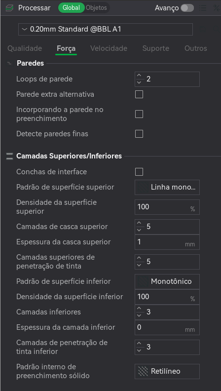

### Loops de parede (*Wall loops*)
Número de paredes (voltas de contorno) em cada camada. É, de longe, a opção de maior impacto na resistência de peças comuns.

- **Valores típicos:** 2 é o padrão dos perfis da Bambu. O perfil "Strength" da Bambu usa 6. Para peças de uso geral, 3 é um meio-termo muito bom. Para peças que levam carga, 4 a 6.
- **Aumentar:** a peça fica mais rígida e muito mais resistente a dobra, torção e impacto. Furos e roscas ganham material para segurar parafusos. A superfície externa fica mais bonita, porque o preenchimento deixa de "marcar" a parede (efeito em que o desenho do miolo aparece por fora). Custa tempo e filamento, mas bem menos do que aumentar a densidade para o mesmo ganho.
- **Diminuir:** peça mais leve e rápida. Com 1 parede só, a peça fica frágil, a parede externa tende a mostrar o preenchimento e qualquer falha de extrusão vira um furo.
- **Quando mexer:** sempre que a peça for funcional. Em peças pequenas e finas, mais paredes podem ocupar todo o interior. Nesse caso a peça fica praticamente maciça, o que é ótimo para resistência.

> **Dica:** a conta da espessura da parede é simples: número de paredes × largura da linha. Com bico de 0,4 mm e linhas de cerca de 0,42 a 0,45 mm, 2 paredes dão uns 0,9 mm, 3 paredes uns 1,3 mm e 4 paredes uns 1,8 mm. Se você vai fazer furos para insertos de latão aquecidos, 3 ou 4 paredes ajudam o inserto a "morder" plástico de verdade, e não preenchimento.

> **Dica:** dá para usar mais paredes só em uma parte da peça com um **modificador** (clique direito no objeto, *Adicionar modificador*). Exemplo: 6 paredes só em volta de um furo de parafuso e 2 no resto. O capítulo sobre objetos e modificadores explica como.

### Parede extra alternada (*Alternate extra wall*)
Coloca uma parede a mais **só nas camadas ímpares**. Nas camadas pares a peça tem o número normal de paredes; nas ímpares, uma volta extra avança sobre a área do preenchimento. O resultado é um entrelaçamento entre parede e miolo, camada sim, camada não.

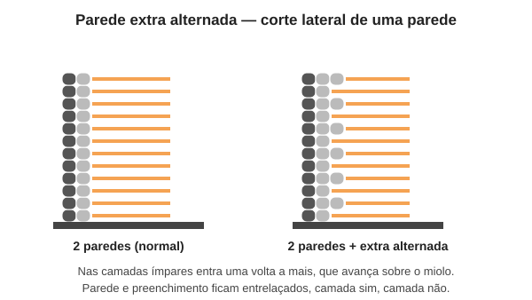

- **Valores típicos:** desligado (padrão). É uma opção nova, que surgiu na linha 2.8.
- **Ligar:** melhora a ligação entre camadas e entre parede e preenchimento, com custo menor do que uma parede extra permanente. Ideal quando a peça precisa aguentar um pouco mais sem dobrar o tempo de impressão.
- **Quando mexer:** peças funcionais em que 2 paredes parecem pouco, mas 3 parecem exagero.

> **Atenção:** quando você liga essa opção, o próprio Bambu Studio pode mostrar um aviso sugerindo ajustes: deixar **Loops de parede** em 2, ter alguma densidade de preenchimento (não 0%) e passar **Garantir espessura vertical da casca** para **Parcial**. É a combinação que a Bambu considera ideal para a função. Ela não funciona no modo vaso.

### Incorporar a parede no preenchimento (*Embedding the wall into the infill*)
Segundo a descrição da própria Bambu, essa opção "embute" uma parede nas regiões em que a peça está sem paredes, para que o contorno se ligue ao preenchimento sem emenda visível.

- **Valores típicos:** desligado.
- **Quando mexer:** casos específicos em que uma região ficou sem paredes (por exemplo, com modificadores que zeram as paredes, ou em combinações com o padrão Locked Zag em calçados e peças texturizadas). Para peças comuns, deixe como está.

> **Atenção:** a documentação pública dessa opção é muito curta. O comportamento exato em cada situação não está bem descrito pela Bambu, então teste numa peça pequena antes de confiar nela.

### Detectar paredes finas (*Detect thin wall*)
Quando uma parte da peça é tão fina que não cabem duas linhas lado a lado, o fatiador normalmente a ignora ou a preenche mal. Com esta opção ligada, ele imprime essa parte com **uma linha só**, que não forma um contorno fechado.

- **Valores típicos:** desligado (padrão).
- **Ligar:** salva detalhes finos (letras em relevo, aletas, bordas finas) que sumiriam no fatiamento. A qualidade dessa linha única nem sempre é boa, porque ela começa e termina em pontas soltas.
- **Quando mexer:** se, na pré-visualização, partes finas do modelo aparecem vazias ou somem.

> **Dica:** esta opção só vale para o gerador de paredes **Clássico** (*Classic*). Com o gerador **Aracne** (*Arachne*), que ajusta a largura da linha automaticamente, ela fica cinza, porque o Aracne já resolve paredes finas sozinho. O gerador de paredes fica na aba Qualidade (veja o capítulo sobre qualidade).

---

## Camadas superiores e inferiores (*Top/bottom shells*)

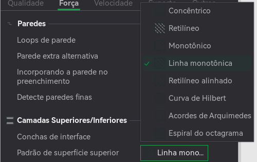

### Como as cascas funcionam

O topo de uma peça é impresso **em cima do preenchimento esparso**, ou seja, em cima de linhas espaçadas com ar entre elas. A primeira camada sólida acima do miolo é, na prática, uma série de pequenas pontes entre as linhas do preenchimento. Ela afunda um pouco entre os apoios. A camada seguinte já se apoia numa superfície quase fechada e afunda menos. Depois de algumas camadas, a superfície fica lisa.

Por isso o número de camadas de topo importa tanto para a **aparência** quanto para a **resistência**. Com poucas camadas, aparece o defeito chamado de **almofadado** (*pillowing*): calombos, furinhos e linhas afundadas na face de cima, como se a peça fosse uma almofada costurada.

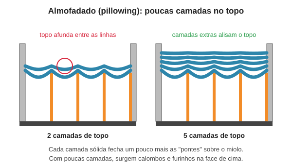

O almofadado piora quando:

- a densidade de preenchimento é baixa (vãos maiores entre os apoios);
- a altura de camada é pequena (cada camada é fina e "fecha" menos o vão);
- a ventilação é fraca para o material (o plástico demora a endurecer sobre o vão).

A base tem o problema oposto e mais brando: as camadas inferiores são impressas sobre a mesa, que é perfeitamente plana. Elas existem para dar fundo resistente e para servir de chão às camadas de cima. Por isso a base costuma precisar de menos camadas que o topo.

### Padrão de superfície superior (*Top surface pattern*)
Desenho das linhas da última camada do topo, a que você vê e toca.

- **Valores típicos:** **Linha monotônica** (*Monotonic line*) é o padrão nos perfis da Bambu. Monotônico também é ótimo.
- **Quando mexer:** para mudar o acabamento visual do topo. Os padrões estão explicados logo abaixo.

### Padrão de superfície inferior (*Bottom surface pattern*)
Desenho das linhas da primeira camada da base (exceto as áreas que são pontes, que seguem regras próprias).

- **Valores típicos:** **Monotônico** (*Monotonic*) nos perfis da Bambu.
- **Quando mexer:** para efeitos decorativos na face que fica na mesa. Com uma mesa texturizada ou lisa, o padrão da base aparece bem. Um padrão concêntrico ou espiral na base de um porta-copos, por exemplo, fica muito bonito.

#### Os padrões de superfície disponíveis

Os mesmos padrões aparecem para topo, base, preenchimento sólido interno e superfície logo abaixo do topo:

| Padrão (pt-BR) | Inglês | Como fica |
|---|---|---|
| Concêntrico | *Concentric* | Voltas que copiam o contorno da peça, de fora para dentro. Bonito em peças redondas; em peças quadradas os cantos podem ficar com sobras. |
| Retilíneo | *Rectilinear* | Linhas paralelas em zigue-zague. O bico pode pular de uma região para outra e voltar depois. |
| Monotônico | *Monotonic* | Linhas paralelas, mas sempre impressas na mesma ordem, de um lado para o outro. Brilho uniforme. |
| Linha monotônica | *Monotonic line* | Variante do monotônico que evita sobrepor a parede, com menos material acumulado nas junções. Pode deixar uma emenda visível nas bordas. Padrão de topo da Bambu. |
| Linha monotônica global | *Global monotonic line* | Variante recente (aparece só nas versões mais novas, linha 2.8.4): varre a área inteira em colunas, da esquerda para a direita. |
| Retilíneo alinhado | *Aligned Rectilinear* | Linhas sempre na mesma direção, sem girar entre camadas. Combinado com o preenchimento retilíneo alinhado, dá um efeito limpo em material translúcido. |
| Curva de Hilbert | *Hilbert Curve* | Um caminho em "labirinto" que cobre a superfície. Efeito decorativo com textura. |
| Acordes de Arquimedes | *Archimedean Chords* | Espiral que sai do centro. Efeito de disco de vinil. |
| Espiral octagrama | *Octagram Spiral* | Espiral em forma de estrela de oito pontas. Decorativo. |

A diferença entre Retilíneo e Monotônico merece um desenho, porque é a mais pedida em fóruns:

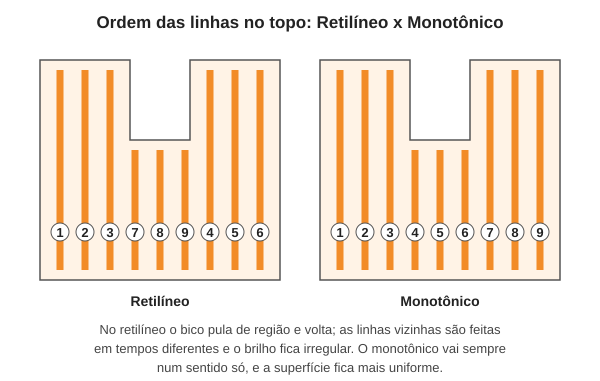

No retilíneo, quando a superfície tem uma reentrância ou um furo, o fatiador termina um trecho, pula para outra região e só depois volta. Linhas vizinhas são impressas em momentos diferentes e uma esmaga a borda da outra em sentidos opostos. A luz reflete diferente e aparecem "manchas" no topo. O monotônico obriga a ordem a ser sempre a mesma, e o reflexo fica uniforme. Custa um pouco mais de deslocamento do bico.

> **Dica:** para um topo realmente liso, combine Monotônico ou Linha monotônica com a **passagem de alisamento** (*ironing*), explicada no capítulo de qualidade.

### Densidade da superfície superior (*Top surface density*)
Densidade das linhas da camada de topo. 100% é uma superfície fechada. Valores menores deixam espaços entre as linhas e criam uma superfície texturizada. Em 0%, o topo fica só com as paredes.

- **Valores típicos:** 100% (padrão). A opção existe desde a linha 2.5.
- **Diminuir:** cria texturas, grades decorativas ou superfícies "respiráveis" (por exemplo, a tampa de um difusor).
- **Quando mexer:** apenas por efeito estético ou funcional.

> **Atenção:** a própria Bambu avisa que esta opção **não serve para corrigir excesso de extrusão**. Se o topo está com material sobrando, calibre o fluxo (capítulo de calibração) em vez de baixar a densidade.

### Densidade da superfície inferior (*Bottom surface density*)
Mesma ideia para a primeira camada da base. O valor mínimo aceito é 10%.

- **Valores típicos:** 100%.
- **Diminuir:** cria uma base vazada ou texturizada.

> **Atenção:** a base é a parte que gruda na mesa. Menos material nela significa **menos aderência**. Use com cuidado, de preferência em peças largas e baixas.

### Camadas de casca superior (*Top shell layers*)
Quantas camadas sólidas fecham o topo, **incluindo** a camada visível. Esse número funciona junto com a **Espessura da casca superior**: o fatiador usa o que der mais material.

- **Valores típicos:** 5 nos perfis de 0,20 mm da Bambu (o padrão genérico do programa é 4). Para camadas finas, o número sobe sozinho por causa da espessura mínima.
- **Aumentar:** topo mais liso, sem almofadado, e mais resistente a pressão e furos.
- **Diminuir:** economiza tempo, mas aumenta o risco de almofadado e de furinhos no topo.
- **Quando mexer:** aumente se vir almofadado ou se a peça precisar de um topo forte (uma tampa, uma superfície que leva peso). Em peças translúcidas, menos camadas deixam o miolo aparecer, o que pode ser um efeito desejado.

### Espessura da casca superior (*Top shell thickness*)
Espessura **mínima**, em milímetros, do topo sólido. Se o número de camadas multiplicado pela altura de camada der menos que isso, o fatiador acrescenta camadas. Zero desliga esta regra e deixa valer só o número de camadas.

- **Valores típicos:** 1,0 mm nos perfis de 0,20 mm da Bambu (0,6 a 0,8 mm em outros perfis).
- **Quando mexer:** é ela que protege você quando muda para camadas finas. Com 5 camadas de 0,08 mm, o topo teria só 0,4 mm; com a espessura mínima em 1,0 mm, o programa sobe para 13 camadas automaticamente.

> **Dica:** pense em **espessura**, não em número de camadas. Um topo de 0,8 a 1,2 mm resolve quase todos os casos de almofadado em PLA com preenchimento de 15%. Para preenchimentos muito baixos (5% a 10%) ou o padrão Relâmpago, suba para 1,2 a 1,6 mm.

### Camadas inferiores (*Bottom shell layers*)
Quantas camadas sólidas formam a base, incluindo a primeira camada.

- **Valores típicos:** 3 (padrão). 4 ou 5 para peças funcionais.
- **Aumentar:** base mais resistente e mais rígida, menos chance de ver o preenchimento pela face de baixo em materiais translúcidos.
- **Diminuir:** economia pequena. Abaixo de 2 a base fica frágil.

### Espessura da camada inferior (*Bottom shell thickness*)
Espessura mínima da base, na mesma lógica da espessura do topo.

- **Valores típicos:** 0 (desligado) nos perfis da Bambu, ou seja, vale só o número de camadas.
- **Quando mexer:** se você costuma trocar a altura de camada, defina algo como 0,6 a 0,8 mm para não ficar com uma base fina demais em camadas finas.

### Camadas de penetração de tinta superior e inferior (*Top / Bottom paint penetration layers*)
Estas duas opções valem para peças **pintadas** com a ferramenta de cor (impressão multicolorida com AMS). Elas dizem quantas camadas, a partir da superfície, recebem a cor pintada. Abaixo disso, o miolo usa a cor do objeto.

- **Valores típicos:** 4 no topo e 3 na base.
- **Aumentar:** a cor fica mais "profunda" e opaca, porque o filamento de baixo não transparece. Gasta mais trocas de filamento.
- **Diminuir:** economiza purga, mas cores claras podem ficar manchadas pela cor de baixo.

> **Dica:** o programa não deixa esse valor passar do número real de camadas de casca. Se você aumentar a penetração, aumente também as camadas de topo ou base.

### Usar preenchimento em vez de superfícies superior e inferior (*Use infill instead of top and bottom surfaces*)
Faz a peça usar o próprio preenchimento esparso no lugar das cascas sólidas de topo e base, deixando o desenho do miolo exposto.

- **Valores típicos:** desligado.
- **Quando mexer:** efeitos especiais, como solados e peças "vazadas" em TPU. Pelo que se vê no código atual do programa, ela foi feita para trabalhar junto com o padrão **Locked Zag**; com outros padrões, o efeito pode não aparecer.

### Padrão interno de preenchimento sólido (*Internal solid infill pattern*)
Desenho das áreas internas 100% sólidas: as camadas de casca escondidas abaixo do topo e acima da base, e regiões estreitas que o fatiador decidiu encher.

- **Valores típicos:** Retilíneo (padrão).
- **Quando mexer:** quase nunca. O retilíneo é rápido e firme. Se a opção **Detectar preenchimento sólido interno estreito** estiver ligada, as áreas estreitas usam concêntrico automaticamente.

---

## Preenchimento esparso (*Sparse infill*)

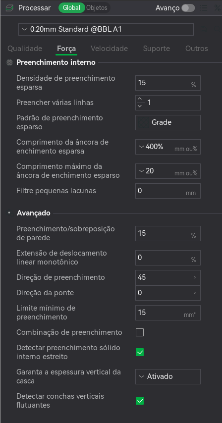

### Densidade de preenchimento esparsa (*Sparse infill density*)
Quanto do miolo é ocupado por plástico, em porcentagem. 0% deixa a peça oca (só paredes e cascas). 100% deixa o miolo totalmente sólido.

- **Valores típicos:** 15% nos perfis padrão da Bambu. 25% no perfil "Strength". Peças decorativas: 5% a 15%. Uso geral: 15% a 25%. Peças funcionais: 25% a 40%.
- **Aumentar:** mais rigidez, mais resistência à compressão (apertar a peça), melhor apoio para o topo. Tempo e filamento sobem quase na mesma proporção.
- **Diminuir:** peça mais leve e rápida. Topo mais sujeito a almofadado.
- **Quando mexer:** de acordo com a função da peça (veja as receitas no fim).

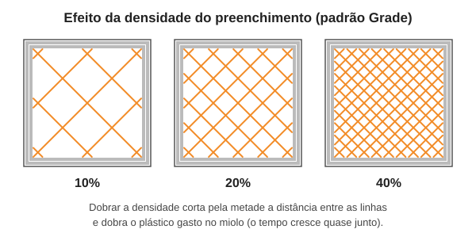

> **Dica:** a densidade é calculada **sobre o miolo**, não sobre a peça inteira. Em peças pequenas ou finas, paredes e cascas ocupam quase tudo, e a densidade quase não muda o peso final. Em peças grandes e "gordas", ela pesa muito.

> **Atenção:** subir a densidade acima de uns 50% raramente compensa. O ganho de resistência por grama cai, o tempo dispara e, em alguns padrões, o bico passa a raspar em linhas já impressas. Se precisar de uma peça quase maciça, aumente as paredes até elas ocuparem o interior; costuma sair mais rápido e mais forte do que 100% de preenchimento.

### Preencher várias linhas (*Fill multiline*)
Em vez de uma linha simples, cada "traço" do padrão vira um feixe de 2 a 5 linhas lado a lado.

- **Valores típicos:** 1 (padrão, linha simples). Máximo 5.
- **Como o Bambu Studio faz:** pela forma como o código calcula o espaçamento, o programa **mantém a densidade** escolhida. Com 2 linhas por traço, os traços ficam duas vezes mais afastados. O consumo de plástico fica parecido; muda a distribuição: menos traços, cada um mais grosso.
- **Aumentar:** cada traço do preenchimento vira uma "viga" mais grossa e robusta. Ajuda padrões fracos (como o Relâmpago) e dá um visual interessante em material translúcido.
- **Quando mexer:** experimentos de resistência e efeitos visuais. Com densidade baixa, mais linhas por traço significa vãos maiores, o que piora o apoio do topo.
- **Disponível para:** Cúbico, Grade, Retilíneo, Tri-hexágono, Retilíneo alinhado, Giroide, Favo de mel, Relâmpago, Favo de mel 3D, Cúbico adaptativo e Cúbico de suporte. Nos outros padrões a opção some.

### Padrão de preenchimento esparso (*Sparse infill pattern*)
O desenho do miolo. É o assunto da próxima seção inteira, padrão por padrão.

- **Valores típicos:** **Grade** (*Grid*) nos perfis da Bambu (o padrão "de fábrica" do programa, sem perfil, é Cúbico). Giroide é a escolha favorita de muita gente para peças funcionais.

### Opções que aparecem conforme o padrão

Algumas opções só aparecem para certos padrões. Elas estão explicadas junto do padrão correspondente, mais adiante:

- **Preenchimento conformal** (*Conformal infill*) e suas sub-opções: Zig Zag, Cross Zag, Locked Zag, Retilíneo e Retilíneo alinhado.
- **Pele e esqueleto** (*Skin / Skeleton*): Locked Zag.
- **Eixo y de preenchimento simétrico** (*Symmetric infill y axis*): Zig Zag, Cross Zag e Locked Zag.
- **Passo de mudança de preenchimento** (*Infill shift step*): Cross Zag e Locked Zag.
- **Etapa de rotação de preenchimento** (*Infill rotate step*): Zig Zag.
- **Ângulo da malha 1 e 2** (*Lattice angle 1 / 2*): Grade 2D.

### Comprimento da âncora de preenchimento esparso (*Length of sparse infill anchor*)
Liga a ponta de cada linha do preenchimento à parede interna com um pequeno trecho que corre **junto à parede**. Em vez de a linha só encostar na parede, ela "dobra" e acompanha a parede por um pedaço, formando um "L" ou um "U" com a linha vizinha.

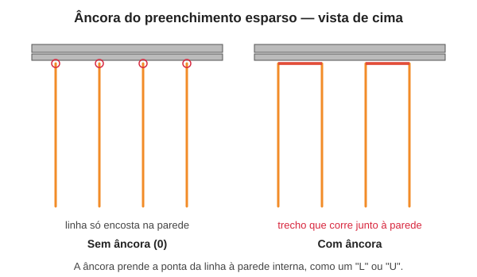

- **Valores típicos:** 400% (padrão), ou seja, quatro vezes a largura da linha de preenchimento. Também aceita milímetros (1, 2, 5, 10 mm) e 1000 (ilimitado).
- **Como funciona:** o programa tenta primeiro ligar duas linhas vizinhas por um trecho de parede. Se não achar trecho curto o bastante (limitado pela âncora máxima), prende a linha só por um lado, com o comprimento definido aqui.
- **Aumentar:** preenchimento mais bem amarrado às paredes, melhor transmissão de força entre miolo e casca.
- **Diminuir / 0:** desliga as âncoras de um lado só. As linhas ficam soltas nas pontas.

### Comprimento máximo da âncora de enchimento esparso (*Maximum length of sparse infill anchor*)
Limite superior da âncora. Se for zero, as âncoras são desligadas por completo e a opção anterior some da tela.

- **Valores típicos:** 20 mm (padrão).
- **Quando mexer:** raramente. Diminuir reduz a quantidade de plástico que corre junto às paredes (pode ajudar em peças translúcidas, em que esses trechos aparecem por fora).

> **Dica:** as âncoras são uma das razões de o preenchimento de fatiadores da família Bambu/Prusa/Orca ficar bem preso às paredes mesmo com densidade baixa. Na dúvida, deixe os valores padrão.

### Filtrar pequenas lacunas (*Filter out tiny gaps*)
Ignora lacunas menores que o valor informado, em vez de preenchê-las com linhas de preenchimento de vão (*gap fill*).

- **Valores típicos:** 0 (não filtra). É uma opção de nível desenvolvedor.
- **Aumentar:** menos linhas minúsculas e "tremidas", impressão um pouco mais limpa e rápida. Pode deixar pequenos buracos.
- **Quando mexer:** só se você vê muitos rabiscos de *gap fill* que atrapalham o acabamento.

---

## Os padrões de preenchimento, um por um

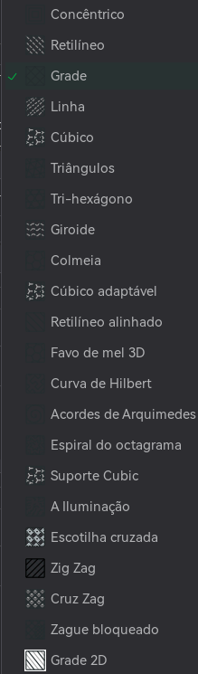

Antes da lista, quatro ideias que ajudam a comparar os padrões.

**1. Padrões 2D e padrões 3D.** Alguns padrões desenham a mesma coisa em todas as camadas (ou alternam entre duas direções). Empilhados, formam paredes verticais retas, como prismas. São os padrões "2D": Grade, Triângulos, Tri-hexágono, Favo de mel, Linha, Retilíneo. Outros mudam o desenho conforme a altura e formam estruturas que se apoiam em todas as direções: Cúbico, Giroide, Favo de mel 3D, Cross Hatch. Os 3D costumam distribuir melhor a força quando a peça é apertada ou dobrada em direções diferentes.

**2. Cruzar linhas na mesma camada.** Em padrões como Grade, Triângulos, Tri-hexágono e Cúbico, o bico passa **por cima de uma linha que acabou de imprimir na mesma camada**. Nesse ponto de cruzamento há duas linhas sobrepostas, com material dobrado. Em alta velocidade, ou com peças que empenam um pouco, o bico pode **raspar** nesse calombo. Isso gera barulho, vibração e, em casos ruins, desloca a peça ou entope a ponta. Os fatiadores modernos tentam compensar, mas o risco existe. Padrões sem cruzamento (Giroide, Favo de mel 3D, Cross Hatch, Retilíneo, Concêntrico) evitam esse problema.

> **Dica:** nas impressoras da Bambu, se você ouve "tec-tec-tec" durante o preenchimento ou vê o bico batendo em linhas, a primeira medida é ativar o salto em Z (*Z hop*) nos deslocamentos ou trocar o padrão por um sem cruzamento, como Giroide.

**3. Linhas retas e linhas curvas.** Linhas retas e longas deixam a impressora acelerar até a velocidade máxima. Curvas e zigue-zagues curtos obrigam a máquina a frear e acelerar o tempo todo. Por isso Giroide, Hilbert e as espirais são mais lentos, mesmo com o mesmo plástico.

**4. "Resistente" depende da direção.** Um padrão pode ser ótimo para aguentar peso de cima (compressão no eixo Z) e fraco para aguentar uma força lateral. Nas descrições abaixo, "XY" é a força no plano da mesa e "Z" é a força de cima para baixo.

A lista de padrões abaixo é a do Bambu Studio 2.8, na ordem da interface. Os nomes em português são os da tradução oficial; quando ela é estranha, uso também um nome mais natural.

---

### Concêntrico (*Concentric*)

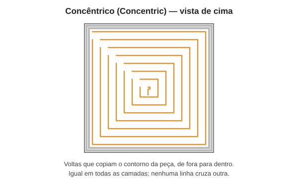

- **O que é:** o miolo é preenchido com voltas que copiam o contorno da peça, cada vez menores, como anéis de uma árvore.
- **Geometria:** igual em todas as camadas. As voltas empilhadas formam "tubos" verticais encaixados uns nos outros.
- **Resistência:** boa para cargas verticais (Z), porque cada volta é uma parede vertical. Fraca para forças laterais, já que não há nada ligando uma volta à outra no plano. Na prática, funciona como se a peça tivesse muitas paredes finas soltas.
- **Velocidade:** depende da forma. Em peças redondas é rápido; em formas complexas gera muitas voltas curtas.
- **Consumo:** normal para a densidade.
- **Cruza linhas na mesma camada?** Não.
- **Melhor uso:** peças flexíveis em TPU (a peça dobra de forma uniforme), cilindros, vasos, peças translúcidas em que você quer ver anéis. A Bambu cita o efeito visual em material transparente.

---

### Retilíneo (*Rectilinear*)

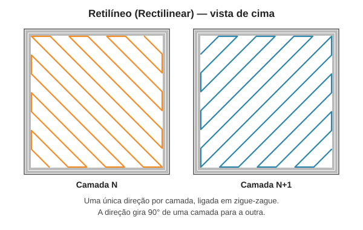

- **O que é:** em cada camada, linhas paralelas numa só direção, ligadas nas pontas em zigue-zague. A camada seguinte faz o mesmo girada 90°.
- **Geometria:** duas camadas consecutivas formam uma grade, mas cada camada só tem uma direção.
- **Resistência:** moderada no plano. Fraca em Z, porque cada linha se apoia na de baixo só nos pontos de cruzamento entre camadas.
- **Velocidade:** rápida. Linhas longas e retas, poucos deslocamentos.
- **Consumo:** normal.
- **Cruza linhas na mesma camada?** Não. O cruzamento é entre camadas diferentes, o que é seguro.
- **Melhor uso:** peças de uso geral, protótipos, peças altas e finas. Também é o padrão do preenchimento sólido interno. É uma ótima alternativa quando a Grade dá problema de bico raspando.

> **Dica:** no fórum da Bambu há relatos de quem trocou Giroide por Retilíneo em peças altas e estreitas numa A1 (que tem mesa móvel) e reduziu bastante o tempo, com menos balanço no topo da peça.

---

### Grade (*Grid*)

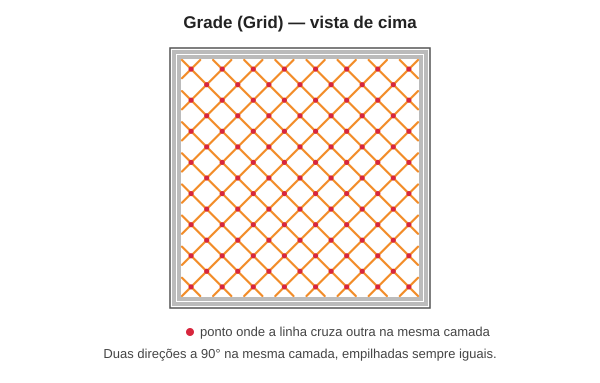

- **O que é:** duas famílias de linhas a 90° (por padrão, a 45° e 135° em relação à mesa), impressas **na mesma camada**. O desenho se repete idêntico em todas as camadas.
- **Geometria:** forma colunas quadradas verticais, como uma caixa de ovos alta.
- **Resistência:** boa em Z (as paredes das colunas são contínuas na vertical) e boa nas direções das linhas. Mais fraca nas diagonais em relação às linhas.
- **Velocidade:** rápida. Linhas retas e longas.
- **Consumo:** normal.
- **Cruza linhas na mesma camada?** **Sim**, em todos os pontos de encontro.
- **Melhor uso:** uso geral. É o padrão dos perfis da Bambu, em parte porque funciona muito bem com a **Combinação de preenchimento**. A própria Bambu descreve a Grade como simples e rápida, mas alerta que o acúmulo de material nos cruzamentos pode causar falhas.

> **Atenção:** em altas velocidades, a Grade é o padrão mais citado em queixas de "bico batendo no preenchimento". Se isso acontecer, troque para Retilíneo, Giroide ou Cúbico.

---

### Linha (*Line*)

- **O que é:** linhas paralelas, como no Retilíneo, mas **sem ligação** nas pontas. Cada linha é impressa sozinha e o bico se desloca para a próxima. A direção alterna 90° a cada camada.
- **Geometria:** parecida com o Retilíneo. O algoritmo pode inclinar levemente as linhas.
- **Resistência:** baixa. As pontas soltas não amarram nada.
- **Velocidade:** rápida para imprimir, mas com mais deslocamentos e retrações que o Retilíneo.
- **Consumo:** baixo a normal.
- **Cruza linhas na mesma camada?** Não.
- **Melhor uso:** praticamente nenhum hoje em dia. É um padrão antigo, mantido por compatibilidade. A Bambu avisa que, se o topo for impresso na mesma direção do preenchimento, ele pode ceder. Prefira Retilíneo.

---

### Cúbico (*Cubic*)

- **O que é:** um padrão 3D. Imagine o miolo cheio de cubos apoiados sobre uma das pontas (o vértice para baixo). Cada camada corta esses cubos e o resultado são três famílias de linhas a 60°, que se deslocam lateralmente à medida que a impressão sobe.
- **Geometria:** em algumas alturas parece Tri-hexágono; em outras, Triângulos. Empilhado, forma uma rede de cubos.
- **Resistência:** boa e bem distribuída nas três direções. Uma das melhores escolhas para peças funcionais, especialmente contra compressão.
- **Velocidade:** rápida, com linhas retas.
- **Consumo:** normal.
- **Cruza linhas na mesma camada?** **Sim**, nos pontos em que as três famílias se encontram (em geral, duas linhas por ponto).
- **Melhor uso:** peças funcionais de uso geral. É o padrão "de fábrica" do programa quando não há perfil. O youtuber Thomas Sanladerer, depois de comparar vários padrões, chegou a recomendar o Cúbico como escolha padrão por ser estável e equilibrado. A Bambu também menciona que os muitos espaços fechados de ar podem ajudar uma peça a flutuar e isolar calor.

---

### Triângulos (*Triangles*)

- **O que é:** três famílias de linhas a 60° que se encontram nos mesmos pontos, formando triângulos equiláteros. O desenho é igual em todas as camadas.
- **Geometria:** prismas triangulares verticais. O triângulo é a forma geométrica que não "deforma" sem esticar os lados, por isso é muito rígido no plano.
- **Resistência:** alta no plano XY (rigidez lateral excelente) e boa em Z.
- **Velocidade:** rápida.
- **Consumo:** normal.
- **Cruza linhas na mesma camada?** **Sim, e em cruzamento triplo**: três linhas passam pelo mesmo ponto. É o maior acúmulo de material entre os padrões comuns.
- **Melhor uso:** peças planas que não podem torcer ou dobrar no plano (placas, suportes chatos). Alguns usuários do fórum da Bambu o consideram o mais forte para cargas, mas não há consenso.

---

### Tri-hexágono (*Tri-hexagon*)

- **O que é:** parecido com Triângulos, mas uma das três famílias é deslocada. Surge um desenho de estrelas e hexágonos (em alguns fatiadores ele se chama "Stars").
- **Geometria:** prismas verticais com seção em triângulo e hexágono.
- **Resistência:** alta no plano, boa em Z. Rigidez parecida com Triângulos.
- **Velocidade:** rápida.
- **Consumo:** normal.
- **Cruza linhas na mesma camada?** **Sim**, mas só duas linhas por ponto. A Bambu destaca que ele tem menos cruzamentos que a Grade.
- **Melhor uso:** alternativa aos Triângulos com menos acúmulo nos cruzamentos. Bom para peças funcionais planas.

---

### Giroide (*Gyroid*)

- **O que é:** um padrão 3D baseado numa superfície matemática chamada giroide, que aparece na natureza (em asas de borboletas, por exemplo). Cada camada mostra ondas suaves; com a altura, as ondas mudam de forma e de direção.
- **Geometria:** uma única superfície contínua que divide o miolo em dois labirintos de canais entrelaçados.
- **Resistência:** muito equilibrada em todas as direções (quase igual em X, Y e Z). Não é necessariamente o mais forte em uma direção específica, mas é o mais "honesto" quando você não sabe de onde virá a força. Absorve bem impactos e deixa a peça dobrar um pouco antes de quebrar.
- **Velocidade:** mais lento que os padrões de linhas retas, porque o bico faz curvas o tempo todo. O fatiamento também demora mais.
- **Consumo:** normal.
- **Cruza linhas na mesma camada?** Não.
- **Melhor uso:** peças funcionais em geral, peças em TPU (flexibilidade uniforme), peças em material translúcido (efeito bonito), peças que vão receber resina ou líquido por dentro (os canais são todos interligados). É a escolha favorita de muita gente.

> **Dica:** como não tem cruzamentos, o Giroide é a solução mais comum para quem sofre com o bico raspando na Grade em alta velocidade.

---

### Favo de mel / Colmeia (*Honeycomb*)

- **O que é:** hexágonos, como em uma colmeia. Na tradução oficial ele aparece como **Colmeia**.
- **Geometria:** colunas hexagonais verticais. Cada linha é um zigue-zague de meio hexágono; duas linhas vizinhas se encostam e formam o hexágono, com os lados comuns **impressos duas vezes** (parede dupla).
- **Resistência:** alta em todas as direções no plano e muito boa em Z. Muita gente considera um dos padrões mais rígidos.
- **Velocidade:** lento. Muitas mudanças de direção, e o comprimento total de linha é maior.
- **Consumo:** alto. A Bambu indica que ele usa cerca de 25% mais material que outros padrões para a mesma densidade.
- **Cruza linhas na mesma camada?** Não; as linhas se encostam lado a lado, mas não se cruzam.
- **Melhor uso:** peças que precisam de muita rigidez e onde tempo não é problema. Efeito visual clássico em material translúcido.

---

### Cúbico adaptativo (*Adaptive Cubic*)

- **O que é:** um Cúbico com células de tamanhos diferentes. Perto das paredes e das cascas as células são pequenas (preenchimento mais denso); no centro de peças grandes elas crescem, e o miolo fica bem vazio. A tradução oficial usa **Cúbico adaptável**.
- **Geometria:** a mesma rede de cubos sobre um vértice, mas organizada em uma "árvore" de tamanhos (octree): cubos grandes no centro, divididos em cubos menores perto da superfície.
- **Resistência:** quase tão boa quanto o Cúbico para a maior parte dos usos, porque a parte densa fica justamente perto da casca, onde o esforço é maior.
- **Velocidade:** rápida, com bem menos linha total em peças grandes.
- **Consumo:** baixo em peças volumosas. Em peças pequenas a economia quase some.
- **Cruza linhas na mesma camada?** Sim, como o Cúbico.
- **Melhor uso:** peças **grandes e volumosas** em que você quer economizar plástico sem perder a firmeza da casca: bustos, caixas grossas, peças de cosplay.

---

### Retilíneo alinhado (*Aligned Rectilinear*)

- **O que é:** igual ao Retilíneo, mas **sem girar** entre camadas. Todas as camadas têm linhas na mesma direção.
- **Geometria:** as linhas empilhadas formam paredes finas verticais paralelas, como lâminas.
- **Resistência:** boa em Z e na direção das lâminas. Muito fraca na direção perpendicular às lâminas, porque nada as liga entre si além das paredes da peça.
- **Velocidade:** rápida.
- **Consumo:** normal.
- **Cruza linhas na mesma camada?** Não.
- **Melhor uso:** efeitos visuais limpos em material translúcido (junto com topo e base em Retilíneo alinhado) e peças rápidas sem exigência mecânica.

---

### Favo de mel 3D (*3D Honeycomb*)

- **O que é:** um padrão 3D formado por células de **octaedro truncado** (um sólido de faces quadradas e hexagonais que preenche o espaço sem vãos). Cada camada é uma fatia dessa estrutura.
- **Geometria:** linhas onduladas com trechos retos. Conforme a altura, as ondas aumentam e diminuem de amplitude e trocam de direção, montando as células.
- **Resistência:** boa e bem distribuída em todas as direções. Um pouco abaixo do Cúbico e do Giroide em testes informais, mas sem cruzamentos.
- **Velocidade:** lento. Muitas mudanças de direção curtas.
- **Consumo:** baixo a normal.
- **Cruza linhas na mesma camada?** Não.
- **Melhor uso:** peças que precisam de boa resistência em todas as direções sem o problema de cruzamentos; efeitos visuais em translúcido. Também é usado em peças flexíveis.

---

### Curva de Hilbert (*Hilbert Curve*)

- **O que é:** um caminho contínuo, do tipo "curva que preenche o espaço", que serpenteia em ângulos retos por toda a área.
- **Geometria:** igual em todas as camadas, formando um labirinto de paredes verticais.
- **Resistência:** baixa no plano; razoável em Z.
- **Velocidade:** **muito lenta**. Milhares de segmentos curtos com curvas de 90°.
- **Consumo:** normal.
- **Cruza linhas na mesma camada?** Não.
- **Melhor uso:** decoração e textura (em topo ou base de peças decorativas). Testes informais de resistência colocam a Curva de Hilbert entre os piores padrões para peças funcionais.

---

### Acordes de Arquimedes (*Archimedean Chords*)

- **O que é:** uma espiral de Arquimedes (voltas igualmente espaçadas) que parte do centro da peça.
- **Geometria:** a mesma espiral em todas as camadas, cortada pelas paredes quando chega às bordas.
- **Resistência:** baixa no plano, razoável em Z (parecida com Concêntrico).
- **Velocidade:** razoável em peças redondas, ruim em peças retangulares (muitas voltas cortadas).
- **Consumo:** normal.
- **Cruza linhas na mesma camada?** Não.
- **Melhor uso:** decorativo, principalmente como padrão de **topo ou base** em peças redondas (efeito de disco de vinil).

---

### Espiral octagrama (*Octagram Spiral*)

- **O que é:** uma espiral com formato de estrela de oito pontas.
- **Geometria:** igual em todas as camadas.
- **Resistência:** baixa.
- **Velocidade:** lenta, com muitas mudanças bruscas de direção.
- **Consumo:** normal.
- **Cruza linhas na mesma camada?** Não.
- **Melhor uso:** puramente decorativo, sobretudo em topo e base.

---

### Cúbico de suporte (*Support Cubic*)

- **O que é:** um Cúbico adaptativo "ao contrário". Em vez de ficar denso perto de todas as paredes, ele só fica denso **embaixo das superfícies de topo**, que precisam ser sustentadas. Longe do topo, as células são enormes. Na tradução oficial aparece como **Suporte Cubic**.
- **Geometria:** rede cúbica com células grandes no miolo, que vão diminuindo à medida que a impressão se aproxima do teto.
- **Resistência:** baixa. O objetivo é segurar o topo, não aguentar esforço.
- **Velocidade:** muito rápida.
- **Consumo:** muito baixo.
- **Cruza linhas na mesma camada?** Sim, como o Cúbico.
- **Melhor uso:** peças decorativas grandes, protótipos visuais. É um pouco mais firme que o Relâmpago, gastando um pouco mais.

---

### Relâmpago (*Lightning*)

- **O que é:** um preenchimento em forma de **árvores** que crescem de dentro da peça só para segurar o teto. Nas camadas baixas quase não há nada; os galhos aparecem e se ramificam perto das superfícies de topo. Na tradução oficial ele aparece, estranhamente, como **A Iluminação** (tradução errada de *Lightning*, que é "relâmpago").
- **Geometria:** galhos que se ramificam como um raio ou como raízes, sempre apontando para as áreas de topo que precisam de apoio.
- **Resistência:** **muito baixa**. A peça é praticamente uma casca oca. Quem segura tudo são as paredes e as cascas.
- **Velocidade:** a mais rápida de todas.
- **Consumo:** o menor de todos.
- **Cruza linhas na mesma camada?** Não.
- **Melhor uso:** peças decorativas, miniaturas, maquetes, protótipos de forma, qualquer coisa que só precisa "existir". Combina bem com 3 paredes e um topo mais grosso.

> **Atenção:** como os galhos são finos e esparsos, o topo depende muito de camadas suficientes. Com Relâmpago, use pelo menos 1,2 mm de espessura de topo para evitar almofadado. O recurso **Preencher várias linhas** ajuda a deixar os galhos mais robustos.

---

### Cross Hatch (*Cross Hatch*, "Escotilha cruzada" na tradução oficial)

- **O que é:** um padrão criado pela própria Bambu Lab. A peça é dividida em blocos de camadas. Em cada bloco, as linhas são retas numa direção (camadas de "repetição"). Entre um bloco e outro, algumas camadas de "transição" em zigue-zague giram a direção em 90°. A ideia é aproveitar a velocidade das linhas retas sem perder a amarração entre direções. A tradução oficial ("Escotilha cruzada") é literal; o termo correto seria algo como "hachura cruzada".
- **Geometria:** lembra uma versão "em linhas retas" do Giroide. As camadas de transição fazem o papel das curvas.
- **Resistência:** boa e bem distribuída, próxima do Giroide e do Favo de mel 3D.
- **Velocidade:** rápida na maioria das camadas. Segundo os comentários no código da Bambu, foi pensado para velocidade e para **reduzir ruído**.
- **Consumo:** normal.
- **Cruza linhas na mesma camada?** Não.
- **Melhor uso:** alternativa ao Giroide para peças funcionais em impressoras rápidas. Como o desenho muda bastante entre blocos, o tempo por camada varia, o que pode deixar marcas leves na parede externa em alguns materiais.

---

### Zig Zag (*Zig Zag*)

- **O que é:** um padrão da família Retilíneo, lançado pela Bambu em 2025. À primeira vista é igual ao Retilíneo (linhas em zigue-zague, alternando 90° por camada). A diferença é que o traçado é calculado sobre a caixa da **peça inteira**, então as linhas ficam perfeitamente alinhadas de uma camada para outra e o desenho é consistente em toda a peça.
- **Geometria:** igual à do Retilíneo, mais "organizada".
- **Opções próprias:**
  - **Etapa de rotação de preenchimento** (*Infill rotate step*): gira um pouco a direção das linhas a cada par de camadas, criando uma textura cruzada que vai "torcendo" com a altura. Padrão 0 (sem rotação).
  - **Eixo y de preenchimento simétrico** (*Symmetric infill y axis*): para peças com duas metades espelhadas no eixo Y (um par de solados, por exemplo). Ligue em uma das partes e a textura sai espelhada.
  - **Preenchimento conformal** (veja adiante).
- **Resistência:** parecida com o Retilíneo. A Bambu afirma que é mais forte que o Cross Zag e o usa como "esqueleto" do Locked Zag.
- **Velocidade:** rápida.
- **Consumo:** normal.
- **Cruza linhas na mesma camada?** Não.
- **Melhor uso:** peças em TPU com textura controlada e como base para efeitos com rotação. Usuários do fórum que testaram logo no lançamento não viram ganho claro sobre o Retilíneo em peças comuns.

---

### Cross Zag (*Cross Zag*, "Cruz Zag" na tradução oficial)

- **O que é:** outro padrão da família Zig Zag. A cada par de camadas, as linhas **andam um pouco para o lado**. Empilhadas, elas deixam de formar paredes verticais e passam a formar **paredes inclinadas**. Como as camadas alternam 90°, as inclinações se cruzam em X quando vistas de lado.
- **Geometria:** uma treliça inclinada em 3D, com aspecto de tecido quando vista pelos lados de uma peça translúcida ou sem paredes.
- **Opções próprias:**
  - **Passo de mudança de preenchimento** (*Infill shift step*): quanto as linhas andam para o lado a cada par de camadas. Padrão 0,4 mm. Maior = paredes mais inclinadas.
  - **Eixo y de preenchimento simétrico** e **Preenchimento conformal**, como no Zig Zag.
- **Resistência:** menor que a do Zig Zag em carga direta, mas a estrutura inclinada **cede e volta** de forma mais macia, o que é interessante em TPU.
- **Velocidade:** rápida.
- **Consumo:** normal.
- **Cruza linhas na mesma camada?** Não.
- **Melhor uso:** peças flexíveis em TPU com efeito de amortecimento e aparência texturizada (palmilhas, solados, protetores).

---

### Locked Zag (*Locked Zag*, "Zague bloqueado" na tradução oficial)

- **O que é:** um padrão híbrido, lançado na versão 2.1. Divide o miolo em duas regiões:
  - a **pele** (*skin*): uma faixa junto às paredes, por padrão em **Cross Zag**, que dá a aparência texturizada;
  - o **esqueleto** (*skeleton*): o centro, por padrão em **Zig Zag**, que dá resistência.
  
  As duas regiões se **sobrepõem** numa faixa de travamento, para não ficarem soltas uma da outra. Desde a versão 2.2, dá para escolher outros padrões para a pele e para o esqueleto.
- **Opções próprias:**
  - **Padrão de preenchimento de pele** (*Skin infill pattern*) e **Padrão de preenchimento do esqueleto** (*Skeleton infill pattern*).
  - **Densidade de preenchimento da pele** (*Skin infill density*) e **do esqueleto** (*Skeleton infill density*): por padrão acompanham a densidade geral, mas podem ser ajustadas separadamente.
  - **Profundidade de preenchimento da pele** (*Skin infill depth*): espessura da faixa de pele. Padrão 2 mm.
  - **Profundidade do bloqueio de preenchimento** (*Infill lock depth*): largura da sobreposição entre pele e esqueleto. Padrão 1 mm. Não pode passar da profundidade da pele. Quanto maior, mais firme a ligação.
  - **Largura da linha da pele** e **do esqueleto** (*Skin / Skeleton line width*): padrão 0,4 mm cada.
  - **Passo de mudança**, **Eixo y simétrico** e **Preenchimento conformal**.
- **Por que essas opções existem:** quando regiões vizinhas da peça têm densidades ou larguras de linha diferentes (por causa de modificadores, por exemplo), o preenchimento normal se divide em blocos separados, com emendas fracas. A Bambu chama isso de particionamento do preenchimento. Os parâmetros de pele e esqueleto foram feitos para manter tudo contínuo.
- **Resistência:** mais alta que Cross Zag puro, com o mesmo visual na lateral.
- **Velocidade:** um pouco mais lenta e com mais material que Zig Zag ou Cross Zag puros.
- **Cruza linhas na mesma camada?** Não dentro de cada região; na faixa de travamento as duas regiões se sobrepõem de propósito.
- **Melhor uso:** a Bambu cita explicitamente peças de alto esforço como **calçados**. Em geral: TPU em que você quer o visual do Cross Zag mas precisa de mais resistência.

---

### Grade 2D (*2D Lattice*)

- **O que é:** um padrão lançado na versão 2.5 para peças leves. Em cada camada há só linhas paralelas, em duas famílias. Conforme a peça sobe, uma família "anda" para um lado e a outra para o lado oposto. Vista de lado, a peça mostra uma **treliça** em X, como a estrutura de uma ponte ou de uma torre metálica.
- **Cuidado com o nome:** na tradução oficial ele também se chama **Grade** ("Grade 2D"). Não confunda com o padrão Grade (*Grid*).
- **Opções próprias:**
  - **Ângulo da malha 1** e **Ângulo da malha 2** (*Lattice angle 1 / 2*): inclinação de cada família em relação à vertical. Padrões −45° e 45°. Zero é vertical. Limite de −75° a 75°.
- **Resistência:** boa na direção da treliça (o plano das inclinações), baixa na direção perpendicular. Não é um padrão para aguentar força em todas as direções.
- **Velocidade:** rápida (linhas retas e paralelas).
- **Consumo:** baixo. Material de divulgação fala em 30% a 50% menos plástico que padrões tradicionais, mas a Bambu não publicou testes que confirmem esse número.
- **Cruza linhas na mesma camada?** Não; as linhas de cada camada são paralelas. As duas famílias se encontram nos "nós" da treliça em determinadas alturas.
- **Melhor uso:** peças leves com esforço numa direção conhecida, como asas e fuselagens de aeromodelos, braços e longarinas.

---

### Preenchimento conformal (*Conformal infill*)

Opção recente (aparece nas versões mais novas, linha 2.8.4) disponível para Zig Zag, Cross Zag, Locked Zag (na pele), Retilíneo e Retilíneo alinhado. Em vez de usar um único conjunto de linhas paralelas para a camada inteira, o preenchimento **segue o contorno** de cada camada. Em formas alongadas ou curvas, as linhas passam a irradiar de um centro, como os raios de uma roda.

Sub-opções (só aparecem com o conformal ligado; a maioria ainda sem tradução):

- **Escalonamento de camadas** (*Layer stagger*): **Desligado** empilha o mesmo desenho; **Alternado** (*Alternate*) mantém as direções, mas liga cada linha à vizinha do lado oposto, o que melhora a ligação entre camadas.
- **Camadas para frente** (*Forward layers*) e **Camadas invertidas** (*Reverse layers*): criam um ciclo de N camadas num sentido e M camadas no sentido contrário. Com 1 e 1, inverte uma camada sim, outra não.
- **Centro radial** (*Radial center*): de onde vem o centro dos raios. **Camada** (cada fatia escolhe o seu), **Eixo** (uma reta 3D ajustada aos centros) ou uma **curva suave**, para o centro não "pular" entre camadas.
- **Contagem de linhas radiais** (*Radial line count*): quantos raios. 0 calcula pela densidade.
- **Raio da região central** (*Center region radius*): dentro desse raio, o preenchimento volta a ser retilíneo comum. 0 é automático.

> **Atenção:** é um recurso novo e pouco documentado. Use para peças curvas ou alongadas (solados, alças, peças orgânicas em TPU) e confira a pré-visualização camada por camada antes de imprimir.

---

### Tabela comparativa dos padrões

Os valores abaixo são **qualitativos**, reunindo a descrição da Bambu, a wiki do OrcaSlicer (que usa o mesmo código base) e testes informais da comunidade. A resistência real depende muito da peça, das paredes e da direção da força.

| Padrão | Tipo | Resistência XY | Resistência Z | Velocidade | Consumo | Cruza na camada? | Melhor uso |
|---|---|---|---|---|---|---|---|
| Concêntrico | 2D | Baixa | Média | Média | Normal | Não | TPU, cilindros, translúcido |
| Retilíneo | 2D alternado | Média | Baixa | Rápida | Normal | Não | Uso geral, peças altas |
| Grade | 2D | Média-alta | Alta | Rápida | Normal | **Sim** | Uso geral (padrão Bambu) |
| Linha | 2D alternado | Baixa | Baixa | Rápida | Normal | Não | Evitar |
| Cúbico | 3D | Alta | Alta | Rápida | Normal | **Sim** | Funcional, uso geral |
| Triângulos | 2D | Alta | Média | Rápida | Normal | **Sim (triplo)** | Peças planas rígidas |
| Tri-hexágono | 2D | Alta | Média-alta | Rápida | Normal | **Sim** | Peças planas rígidas |
| Giroide | 3D | Alta | Alta | Lenta | Normal | Não | Funcional, TPU, translúcido |
| Favo de mel | 2D | Alta | Alta | Muito lenta | Alto | Não | Máxima rigidez sem pressa |
| Cúbico adaptativo | 3D | Média-alta | Média-alta | Rápida | Baixo | **Sim** | Peças grandes e volumosas |
| Retilíneo alinhado | 2D | Baixa (uma direção) | Média | Rápida | Normal | Não | Visual, translúcido |
| Favo de mel 3D | 3D | Média-alta | Média-alta | Lenta | Baixo-normal | Não | Funcional sem cruzamentos |
| Curva de Hilbert | 2D | Baixa | Média | Muito lenta | Normal | Não | Decorativo |
| Acordes de Arquimedes | 2D | Baixa | Média | Média | Normal | Não | Decorativo, topo/base |
| Espiral octagrama | 2D | Baixa | Média | Lenta | Normal | Não | Decorativo, topo/base |
| Cúbico de suporte | 3D | Baixa | Baixa | Muito rápida | Muito baixo | **Sim** | Decorativo grande |
| Relâmpago | Árvore | Muito baixa | Muito baixa | A mais rápida | O menor | Não | Decorativo, miniaturas |
| Cross Hatch | 3D | Média-alta | Média-alta | Rápida | Normal | Não | Funcional em alta velocidade |
| Zig Zag | 2D alternado | Média | Baixa | Rápida | Normal | Não | TPU, texturas |
| Cross Zag | 3D inclinado | Média | Baixa | Rápida | Normal | Não | TPU amortecedor |
| Locked Zag | Híbrido | Média | Média | Média | Médio-alto | Não* | Calçados, TPU com textura |
| Grade 2D | Treliça | Média (uma direção) | Média | Rápida | Baixo | Não | Peças leves (aeromodelos) |

\* No Locked Zag, pele e esqueleto se sobrepõem de propósito na faixa de travamento.

> **Dica:** se você quer **uma** regra para levar para casa: Grade ou Cúbico para o dia a dia, Giroide quando a peça precisa ser forte em qualquer direção (ou quando a Grade faz o bico raspar), Cúbico adaptativo para peças grandes, Relâmpago para peças que só precisam existir.

---

## Avançado (*Advanced*)

### Preenchimento/sobreposição de parede (*Infill/Wall overlap*)
Quanto a área do preenchimento é "esticada" para dentro das paredes, para que as duas partes se fundam. O valor é uma porcentagem da largura da linha.

- **Valores típicos:** 15% (padrão).
- **Aumentar:** preenchimento mais bem preso às paredes. Em excesso, empurra plástico contra a parede e pode marcar a superfície externa (o desenho do preenchimento aparece por fora).
- **Diminuir:** menos marcas, porém pode surgir uma fresta entre preenchimento e parede.
- **Quando mexer:** se vir o preenchimento "fantasma" na parede externa, baixe para 10%. Se o preenchimento se solta da parede em testes de quebra, suba para 20% a 25%.

### Extensão de deslocamento linear monotônico (*Monotonic line travel extend*)
Opção de nível desenvolvedor. Estende o percurso entre as linhas do padrão Linha monotônica para melhorar a aderência dessas linhas às paredes. Valor em porcentagem da largura de linha.

- **Valores típicos:** 0%.
- **Quando mexer:** raramente; só se as pontas das linhas do topo se descolarem das paredes.

### Direção de preenchimento (*Infill direction*)
Ângulo principal das linhas do preenchimento. Gira também o topo, a base e o preenchimento sólido interno, mas não as pontes.

- **Valores típicos:** 45° (padrão).
- **Quando mexer:** para alinhar as linhas a uma direção de esforço (uma régua que vai dobrar, por exemplo, fica melhor com as linhas do topo e da base ao longo do comprimento) ou por estética, para o topo ficar paralelo a uma borda da peça.

> **Dica:** se você quer que o topo de uma peça retangular fique com linhas paralelas às bordas, mude para 0° ou 90°. Em 45°, o topo fica diagonal, o que costuma esconder melhor pequenas imperfeições.

### Direção da ponte (*Bridge direction*)
Força o ângulo das pontes externas (partes que atravessam o ar entre dois apoios). Zero deixa o programa calcular sozinho a melhor direção, que normalmente é a do vão mais curto.

- **Valores típicos:** 0 (automático). Para forçar exatamente 0°, use 180°, que dá o mesmo resultado.
- **Quando mexer:** se o cálculo automático escolher uma direção ruim para uma ponte específica. Na maioria dos casos, deixe em 0.

### Limite mínimo de preenchimento (*Minimum sparse infill threshold*)
Regiões de preenchimento esparso **menores** que essa área (em mm²) são trocadas por preenchimento sólido.

- **Valores típicos:** 15 mm² (padrão).
- **Aumentar:** mais regiões pequenas viram sólidas. Peças com partes finas (pinos, aletas, colunas) ficam muito mais fortes, porque nesses pontos um preenchimento esparso seria só um rabisco frágil.
- **Diminuir:** economiza um pouco de plástico em peças cheias de detalhes.
- **Quando mexer:** se pinos ou partes estreitas quebram com facilidade, suba para 30 a 50 mm².

### Combinação de preenchimento (*Infill combination*)
Imprime o preenchimento esparso **a cada N camadas**, com uma linha mais alta, enquanto as paredes continuam na altura normal. Economiza tempo sem mudar a aparência externa.

- **Valores típicos:** desligado (padrão).
- **Como funciona:** a camada combinada não pode passar do diâmetro do bico. Com bico de 0,4 mm, segundo a Bambu: com camadas de 0,08 mm, o preenchimento sai a cada 5 camadas (0,40 mm); com 0,12 mm, a cada 3 (0,36 mm); com 0,16 mm e 0,20 mm, a cada 2 (0,32 mm e 0,40 mm). Com 0,24 mm ou 0,28 mm não há combinação possível com bico 0,4.
- **Ligar:** ganho de tempo, principalmente em camadas finas.
- **Quando mexer:** ótimo com camadas finas (0,08 a 0,12 mm) em peças em que só a aparência externa importa. Linhas mais altas no preenchimento são um pouco menos uniformes; para peças muito exigidas, deixe desligado.

> **Dica:** usuários comentam que a Grade é o padrão mais tolerante à combinação. Alguns padrões podem deixar pequenas falhas quando combinados.

### Detectar preenchimento sólido interno estreito (*Detect narrow internal solid infill*)
Detecta áreas sólidas internas estreitas e usa o padrão concêntrico nelas, para imprimir mais rápido. Desligado, essas áreas usam o retilíneo.

- **Valores típicos:** ligado (padrão).
- **Quando mexer:** quase nunca. Desligue apenas se o concêntrico estiver deixando falhas em alguma região estreita.

### Padrão da superfície sub-topo (*Sub-top surface pattern*)
Padrão da camada sólida logo abaixo do topo visível. Como essa camada é a "cama" da última camada, as linhas dela podem marcar o topo. Por isso um padrão monotônico dá o acabamento mais liso.

- **Valores típicos:** **Monotônico** (padrão desde a versão 2.8.3; antes, essa camada usava o padrão do preenchimento sólido interno, o retilíneo).
- **Quando mexer:** se você vê marcas da camada de baixo no topo, confira se está em Monotônico.

### Garanta a espessura vertical da casca (*Ensure vertical shell thickness*)
Em superfícies inclinadas (um telhado, uma cúpula), o topo vai "escadinhando" e, em alguns pontos, poderia ficar com menos camadas sólidas do que você pediu. Esta opção acrescenta preenchimento sólido nessas regiões para garantir a espessura.

- **Valores:** **Desativado**, **Parcial** e **Ativado** (padrão).
- **Ativado:** proteção máxima: cobre também as bordas de furos e aberturas. Gasta mais plástico em peças curvas.
- **Parcial:** cobre as superfícies inclinadas, mas não força sólido em volta de furos. Menos material extra. É o modo sugerido junto com a **Parede extra alternada**.
- **Desativado:** economiza plástico, mas superfícies inclinadas podem ficar finas e mostrar o preenchimento.
- **Quando mexer:** deixe ativado para peças funcionais e curvas. Use Parcial se quiser economizar ou se usar a parede extra alternada.

### Detectar conchas verticais flutuantes (*Detect floating vertical shells*)
Detecta trechos de parede que ficam no ar (sem apoio embaixo) e os imprime na velocidade de ponte.

- **Valores típicos:** ligado.
- **Quando mexer:** raramente. Ajuda na qualidade de saliências.

### Opções escondidas

Duas opções do grupo existem no código, mas não aparecem para o usuário comum:

- **Conchas de interface** (*Interface shells*): força cascas sólidas entre materiais ou volumes diferentes. Útil em multimaterial com materiais translúcidos ou suporte solúvel feito à mão. Nível desenvolvedor.
- **Espessura de suporte de ponte interna** (*Internal bridge support thickness*): a wiki da Bambu a descreve (cria laços de apoio sob as bordas de pontes internas para melhorar o topo com preenchimento baixo), mas, no código atual da interface, ela está escondida.

---

## Por que as paredes valem mais que o preenchimento

Esta é talvez a lição mais útil do capítulo, e vale a pena entender o motivo em vez de só decorar.

Imagine uma régua apoiada nas pontas, com um peso no meio. Ela enverga. A face de cima é **comprimida** e a face de baixo é **esticada**. O meio da régua, numa linha imaginária chamada linha neutra, quase não sofre esforço. É o mesmo princípio das vigas em I de construção: o metal fica concentrado em cima e embaixo, onde ele trabalha, e o meio é só uma alma fina.

Numa peça impressa, as **paredes e as cascas** ficam justamente nas faces externas, onde o esforço é máximo. O **preenchimento** fica no meio, perto da linha neutra. Por isso, cada grama de plástico colocado na casca rende muito mais rigidez e resistência do que o mesmo grama no miolo.

Tem mais dois motivos práticos:

- **Paredes são linhas contínuas e longas.** Uma parede é uma volta inteira, sem emendas, e as camadas de parede se apoiam umas sobre as outras em toda a extensão. O preenchimento é formado por segmentos curtos que se tocam em poucos pontos.
- **Preenchimento muito alto atrapalha.** Acima de certa densidade, o miolo fica tão fechado que o bico passa por cima de linhas recém-impressas, aquece demais a peça e pode criar tensões. O ganho por grama despenca.

O que os testes dizem, de forma resumida:

- Um teste publicado pela revista HackSpace com peças em PLA e preenchimento em Grade mostrou que, por grama de filamento, **acrescentar paredes rendeu cerca de duas vezes e meia mais resistência** do que aumentar a densidade. Pelos números do teste, cada quilo a mais de carga suportada custou perto de 0,25 m de filamento em paredes contra 0,64 m em preenchimento. Os próprios autores avisam que o teste foi simples e que cada peça merece seu próprio teste.
- Thomas Sanladerer, ao comparar padrões em vídeo, concluiu que, na maioria dos casos, **aumentar a espessura das paredes compensa mais** do que subir a densidade.
- No fórum da Bambu, a observação mais repetida é a mesma: as paredes carregam a maior parte da resistência lateral; o preenchimento serve para a peça não ceder por dentro e para apoiar o topo.
- Guias práticos de impressão para Bambu Studio chegam a afirmar que **5 paredes com 10% de preenchimento podem superar 2 paredes com 50%**, gastando menos filamento. O número exato depende da peça, mas a tendência é bem conhecida na comunidade. O canal CNC Kitchen, de Stefan Hermann, que testa impressões em máquina de tração, é muito citado nessa discussão; vale assistir aos vídeos dele sobre paredes e preenchimento para ver os ensaios de perto.

Na prática, a regra fica assim:

1. **Primeiro, paredes.** Para uma peça mais forte, vá de 2 para 3 ou 4 paredes antes de mexer na densidade.
2. **Depois, topo e base.** Garanta pelo menos 1 mm de casca sólida em cima e uns 0,8 mm embaixo.
3. **Por último, densidade.** Suba o preenchimento quando a peça for apertada (compressão), quando tiver grandes áreas planas de topo, ou quando as paredes já ocupam quase tudo e não há mais para onde ir.
4. **Orientação importa ainda mais.** Nenhuma configuração desta aba compensa uma peça impressa "deitada errado". As camadas se separam com muito menos força do que as linhas se rompem. Sempre que possível, oriente a peça para a força atravessar as linhas, e não descolar as camadas (veja o capítulo sobre preparação e orientação).

> **Exceção importante:** compressão pura. Se a peça vai ser **esmagada** (um pé de móvel, um calço), o preenchimento trabalha muito, porque é ele que impede o miolo de afundar. Nesses casos, densidade alta (40% a 60%) em padrão Cúbico, Giroide ou Grade faz diferença real.

---

## Receitas de resistência

Valores de partida para bico de 0,4 mm e camadas de 0,20 mm. Ajuste conforme a peça, o material e o resultado dos seus próprios testes.

| Tipo de peça | Paredes | Topo / Base | Densidade | Padrão sugerido |
|---|---|---|---|---|
| Decorativa | 2–3 | 5 / 3 (topo ≥ 1,0 mm) | 5–10% | Relâmpago, Cúbico de suporte ou Cúbico adaptativo |
| Uso geral | 3 | 5 / 4 | 15–20% | Grade, Cúbico ou Giroide |
| Funcional / mecânica | 4 | 6 / 5 | 25–35% | Giroide, Cúbico ou Cross Hatch |
| Leva carga | 5–6 | 7 / 6 | 35–50% | Cúbico, Giroide ou Tri-hexágono |
| Flexível (TPU) | 2–3 | 4 / 3 | 10–20% | Giroide, Concêntrico ou Cross Zag / Locked Zag |
| Leve | 2 | 4–5 / 3 | 5–12% | Cúbico adaptativo, Grade 2D ou Relâmpago |

### Peça decorativa
Vasos, bonecos, maquetes, enfeites. O que importa é a aparência e a velocidade.

- **Paredes:** 2 (3 se a peça tem cantos que podem bater).
- **Topo/base:** 5 camadas no topo, com espessura mínima de 1,0 a 1,2 mm para não almofadar sobre um miolo quase vazio. 3 na base.
- **Densidade e padrão:** 5% a 10% de **Relâmpago** ou **Cúbico de suporte**. Em peças grandes, **Cúbico adaptativo** a 10%.
- **Extras:** topo em **Monotônico** ou **Linha monotônica** com alisamento se a face de cima for visível.

> **Dica:** em peças decorativas grandes, o Relâmpago pode cortar o tempo pela metade em relação à Grade de 15%. Só não esqueça de engrossar o topo.

### Uso geral
Caixas, organizadores, suportes leves, peças do dia a dia.

- **Paredes:** 3.
- **Topo/base:** 5 / 4 (ou topo ≥ 1,0 mm e base ≥ 0,8 mm).
- **Densidade e padrão:** 15% a 20% de **Grade** (padrão Bambu) ou **Cúbico**. Se o bico raspar, **Giroide**.
- **Extras:** os demais valores padrão funcionam bem.

### Peça funcional / mecânica
Engrenagens, suportes de parede, encaixes, dobradiças, peças de reposição.

- **Paredes:** 4 (cerca de 1,7 a 1,8 mm). Em volta de furos de parafuso, use um modificador com 6 paredes.
- **Topo/base:** 6 / 5.
- **Densidade e padrão:** 25% a 35% de **Giroide**, **Cúbico** ou **Cross Hatch**.
- **Extras:** considere a **Parede extra alternada**; suba o **Limite mínimo de preenchimento** para 30 mm² se a peça tiver pinos; deixe **Garantir espessura vertical da casca** em Ativado.

### Peça que leva carga
Ganchos, pés de móvel, suportes de prateleira, peças de ferramenta, alavancas.

- **Paredes:** 5 a 6 (é o que o perfil "Strength" da Bambu usa).
- **Topo/base:** 7 / 6.
- **Densidade e padrão:** 35% a 50% de **Cúbico**, **Giroide** ou **Tri-hexágono** (este último para peças planas). Para compressão pura (calços, pés), até 60%.
- **Extras:** orientação correta é obrigatória. Considere imprimir em PETG, ABS/ASA ou materiais com fibra, mais resistentes que PLA a cargas constantes. Se a peça é pequena, mais paredes podem deixá-la totalmente maciça, o que é ótimo.

> **Atenção:** PLA sofre **fluência** (*creep*): sob carga constante, ele vai deformando aos poucos, principalmente em lugares quentes, como dentro de um carro. Para peças que ficam carregadas o tempo todo, nenhuma configuração desta aba substitui um material melhor.

### Peça flexível
Peças em TPU: capas, amortecedores, pneus, solados, juntas.

- **Paredes:** 2 a 3. Mais paredes deixam a peça bem mais dura.
- **Topo/base:** 4 / 3.
- **Densidade e padrão:** 10% a 20%. **Giroide** para flexibilidade igual em todas as direções; **Concêntrico** para peças redondas; **Cross Zag** ou **Locked Zag** para amortecimento com textura (solados, palmilhas); **Preenchimento conformal** em formas curvas.
- **Extras:** a densidade controla a "dureza" da peça. Faça testes com 10%, 15% e 20% para achar o toque certo.

### Peça leve
Aeromodelos, drones, peças que precisam pesar pouco.

- **Paredes:** 2 (em aeromodelismo, às vezes 1, com material e geometria pensados para isso).
- **Topo/base:** 4 a 5 / 3, com espessura mínima de topo para não almofadar.
- **Densidade e padrão:** 5% a 12% de **Cúbico adaptativo**, **Grade 2D** (quando a direção do esforço é conhecida) ou **Relâmpago** (quando o esforço é mínimo).
- **Extras:** use **Preencher várias linhas** com padrões fracos para engrossar as estruturas sem gastar mais plástico.

---

## Resumo do capítulo

- **Paredes primeiro.** É o ajuste que mais rende resistência por grama. Para peças funcionais, comece em 3 ou 4.
- **Topo com espessura de verdade.** Pense em milímetros (1,0 mm ou mais), não em número de camadas. Preenchimento baixo pede topo mais grosso.
- **Densidade com moderação.** 15% a 25% resolve a maioria dos casos; acima de 50% raramente compensa.
- **Padrão conforme a função.** Grade/Cúbico para o dia a dia, Giroide para resistência em todas as direções e para evitar bico raspando, Cúbico adaptativo e Relâmpago para economizar, Zig Zag/Cross Zag/Locked Zag para TPU.
- **Cruzamentos na mesma camada** (Grade, Triângulos, Tri-hexágono, Cúbico) podem fazer o bico raspar em alta velocidade.
- **Orientação** da peça na mesa vale mais do que qualquer ajuste desta aba.

---

## Fontes deste capítulo

- [Bambu Lab Wiki — Strength advanced settings](https://wiki.bambulab.com/en/software/bambu-studio/parameter/strength-advance-settings)
- [Bambu Lab Wiki — Fill patterns](https://wiki.bambulab.com/en/software/bambu-studio/fill-patterns)
- [Bambu Lab Wiki — Locked Zag](https://wiki.bambulab.com/en/software/bambu-studio/manual/locked-zag)
- [Bambu Lab Wiki — Release note 2.1.0](https://wiki.bambulab.com/en/software/bambu-studio/release/release-note-2-1-0)
- [Bambu Lab Wiki — Release note 2.2.0 (chinês)](https://wiki.bambulab.com/zh/software/bambu-studio/release/release-note-2-2-0)
- [Código-fonte do Bambu Studio no GitHub (PrintConfig, Tab, ConfigManipulation e módulos Fill, versão 2.8.4)](https://github.com/bambulab/BambuStudio)
- [Tradução oficial pt-BR do Bambu Studio (arquivo BambuStudio_pt_BR.po)](https://github.com/bambulab/BambuStudio/tree/master/bbl/i18n/pt_BR)
- [Fórum Bambu Lab — New infill patterns Zig Zag / Cross Zag](https://forum.bambulab.com/t/new-infill-patterns-zig-zag-cross-zag/158552)
- [Fórum Bambu Lab — Pros and cons of infill patterns](https://forum.bambulab.com/t/pros-and-cons-of-infill-patterns/60297)
- [Fórum Bambu Lab — Filament saving question about walls](https://forum.bambulab.com/t/filament-saving-question-about-walls/239037)
- [OrcaSlicer Wiki — Infill patterns](https://www.orcaslicer.com/wiki/print_settings/strength/strength_settings_patterns)
- [OrcaSlicer Wiki — Infill settings](https://www.orcaslicer.com/wiki/print_settings/strength/strength_settings_infill)
- [BambuHub — Bambu Studio 2.8.3](https://bambuhub.net/articles/bambu-studio-2-8-3)
- [The Crafty Catsman — Bambu Studio 2.5.0](https://www.thecraftycatsman.com/news/3d-printing/bambu-studio-2-5-0-guide/)
- [Raspberry Pi / HackSpace — Experiments with strong 3D prints](https://magazine.raspberrypi.com/articles/experiments-with-strong-3d-prints)
- [3Printr — Infill patterns in 3D printing (teste de Thomas Sanladerer)](https://3printr.com/infill-patterns-in-3d-printing-how-to-optimise-the-stability-of-your-parts-3373147)
- [All3DP — The strongest infill patterns](https://all3dp.com/2/strongest-infill-pattern/)
- [PrintPal — 10 Bambu Studio tips for stronger 3D prints](https://blog.printpal.io/10-bambu-studio-tips-for-stronger-3d-prints/)

# Capítulo 4 — Velocidade e aceleração

As impressoras Bambu Lab ficaram famosas por serem rápidas. Mas "rápido" no fatiador não é um número só: é um conjunto de dezenas de campos que trabalham juntos, e vários deles nem chegam a ser usados porque outro limite entra na frente. Este capítulo percorre toda a aba **Velocidade** (*Speed*) do perfil de processo, explica o que cada campo faz, mostra quais deles realmente mexem na qualidade e, principalmente, explica por que muitas vezes você aumenta um número e a impressão não fica nem um segundo mais curta.

Antes de começar, três ideias que vão aparecer o tempo todo:

1. **Velocidade** (mm/s) é o quanto o bico anda por segundo *quando já está embalado*.
2. **Aceleração** (mm/s²) é o quanto ele demora para chegar nessa velocidade e para frear. Em peças pequenas, com trechos curtos, o bico muitas vezes nunca chega à velocidade configurada; quem manda é a aceleração.
3. **Velocidade volumétrica máxima** (mm³/s), configurada no perfil do **filamento**, é o teto de quanto plástico o bico consegue derreter por segundo. Se a velocidade pedida exigir mais plástico do que isso, o fatiador reduz a velocidade sozinho.

> **Atenção:** a aba Velocidade só aparece completa no modo **Avançado** (*Advanced*) do Bambu Studio. No modo simples, a maior parte destes campos fica escondida. Se não estiver vendo alguma opção, ative a chave "Avançado" no topo do painel de configurações de processo.

## Como ler os valores deste capítulo

Os valores típicos citados aqui vêm dos perfis oficiais da Bambu Lab para bico de 0,4 mm e camada de 0,20 mm (o perfil "0.20mm Standard"), principalmente o da X1 Carbon, que serve de base para P1S e P1P. A A1 e a A1 mini usam números parecidos para velocidades, mas acelerações menores. Perfis de 0,08 mm, 0,12 mm, 0,16 mm, 0,24 mm e 0,28 mm usam outros números — em geral, quanto mais fina a camada, mais devagar as paredes.

Em impressoras mais novas, que aceitam bico de alto fluxo (*High Flow*), alguns campos mostram **dois valores**, um para cada tipo de bico. Se você mudou o valor e nada aconteceu, confira se editou a coluna do bico que está realmente instalado.

| Tipo de movimento | Valor típico (X1C, 0,20 mm Standard) |
|---|---|
| Camada inicial | 50 mm/s |
| Preenchimento da camada inicial | 105 mm/s |
| Parede externa | 200 mm/s |
| Parede interna | 300 mm/s |
| Perímetros pequenos | 50% da parede externa |
| Preenchimento esparso | 270 mm/s |
| Preenchimento sólido interno | 250 mm/s |
| Superfície superior | 200 mm/s |
| Lacunas | 250 mm/s |
| Ponte | 50 mm/s |
| Suporte / interface | 150 / 80 mm/s |
| Deslocamento | 500 mm/s (A1: 700 mm/s) |

## Velocidade da camada inicial

A primeira camada é a fundação de tudo. Ela precisa grudar bem na mesa e preencher as pequenas irregularidades da placa. Por isso é sempre bem mais lenta que o resto.

### Camada inicial (*Initial layer*)

Velocidade de tudo o que é impresso na primeira camada, **exceto** o preenchimento sólido: paredes, contornos, brim, saia e suporte da primeira camada.

- **Valores típicos:** 50 mm/s nos perfis 0,20 mm da Bambu (o valor genérico do programa é 30 mm/s).
- **Aumentar:** primeira camada mais rápida, mas o filamento tem menos tempo para "esmagar" na mesa; risco de cantos soltando e de linhas que não se unem.
- **Diminuir:** melhor aderência e linhas mais uniformes, ao custo de alguns segundos ou minutos.
- **Quando mexer:** se a peça descola nos cantos, se a primeira camada sai com falhas ou se você usa filamentos difíceis (PETG em placa lisa, TPU, ABS).

> **Dica:** antes de baixar a velocidade, limpe a placa com água e detergente neutro. Gordura de dedo é a causa número um de primeira camada ruim nas Bambu. Velocidade é a segunda linha de defesa.

### Preenchimento da camada inicial (*Initial layer infill*)

Velocidade do preenchimento sólido da primeira camada, ou seja, das linhas que fecham o fundo da peça entre as paredes.

- **Valores típicos:** 105 mm/s nos perfis 0,20 mm.
- **Aumentar:** reduz o tempo da primeira camada em peças com base grande (caixas, placas, letreiros).
- **Diminuir:** fundo mais uniforme, menos linhas "abertas" e menos chance de o bico arrastar linhas já feitas.
- **Quando mexer:** peças com base grande e plana que soltam no meio da impressão, ou fundo com aspecto de "riscos" separados.

> **Dica:** se a face de baixo vai ficar visível (um chaveiro, uma placa com textura da mesa), baixar esse valor para 50–60 mm/s costuma deixar a textura mais uniforme.

## Velocidade das demais camadas

Esse grupo (*Other layers speed*) concentra a maior parte dos campos. Cada um corresponde a um tipo de extrusão que você enxerga na pré-visualização quando escolhe "Tipo de linha".

### Parede externa (*Outer wall*)

Velocidade da parede mais de fora, a que você vê e toca. É **o campo mais importante da aba inteira** para a aparência da peça.

- **Valores típicos:** 200 mm/s no perfil 0,20 mm Standard; perfis "Fine" e "Extra Fine" usam bem menos.
- **Aumentar:** impressão mais rápida, mas a parede fica mais sensível a vibração, a variações de fluxo e a falhas de *pressure advance*; acabamento menos regular.
- **Diminuir:** superfície mais lisa e cantos mais definidos; com camadas finas, o ganho visual é grande.
- **Quando mexer:** sempre que a aparência for prioridade. Para peças decorativas, 80–150 mm/s é um bom ponto de partida.

> **Dica:** a recomendação mais repetida nos fóruns quando alguém quer "mais qualidade sem perder muito tempo" é baixar **só** a parede externa. Como ela é uma fração pequena do volume da peça, o tempo total sobe pouco e a diferença visual é grande.

### Parede interna (*Inner wall*)

Velocidade das paredes que ficam por dentro da parede externa. Elas dão resistência, mas não aparecem.

- **Valores típicos:** 300 mm/s.
- **Aumentar:** economiza tempo; em excesso, as paredes internas podem ficar subextrudadas e a peça mais fraca.
- **Diminuir:** paredes internas mais uniformes, que servem de "apoio" melhor para a parede externa.
- **Quando mexer:** raramente. Se a parede externa apresenta ondulações regulares que acompanham o padrão interno, baixar um pouco a parede interna pode ajudar.

> **Dica:** se a velocidade da parede interna for muito maior que a da externa, a impressora alterna o tempo todo entre muito rápido e devagar. Em alguns filamentos isso aparece como pequenas diferenças de brilho. Manter a interna no máximo 1,5 a 2 vezes a externa é um equilíbrio comum.

### Perímetros pequenos (*Small perimeters*)

Velocidade usada em contornos pequenos, geralmente furos e pinos finos. Pode ser em mm/s ou em porcentagem; quando é porcentagem, é calculada sobre a velocidade da parede externa. Zero significa automático.

- **Valores típicos:** 50% (ou seja, metade da parede externa).
- **Aumentar:** furos pequenos imprimem mais rápido, mas com camadas que podem não esfriar e ficar arredondadas ou deformadas.
- **Diminuir:** furos e pinos mais redondos e precisos, com mais tempo de resfriamento por camada.
- **Quando mexer:** peças com muitos furos de parafuso, pinos finos ou detalhes miniaturizados.

### Limite de perímetro pequeno (*Small perimeter threshold*)

Define até que tamanho um contorno é considerado "pequeno" e recebe a velocidade acima. O valor é um comprimento (em mm).

- **Valores típicos:** 0 mm (o padrão do programa); nesse caso o fatiador usa um critério interno.
- **Aumentar:** mais contornos passam a ser tratados como pequenos e são impressos mais devagar.
- **Diminuir:** só os contornos realmente minúsculos são desacelerados.
- **Quando mexer:** se furos de tamanho médio (por exemplo, 8–10 mm) estão saindo deformados e você quer que eles também desacelerem.

> **Atenção:** a descrição deste campo no programa fala ora em raio, ora em comprimento, e o comportamento exato pode variar entre versões. Teste com uma peça simples antes de confiar num valor.

### Preenchimento esparso (*Sparse infill*)

Velocidade do preenchimento interno com densidade parcial (grade, giroide, cúbico etc.).

- **Valores típicos:** 270 mm/s.
- **Aumentar:** quase nunca faz diferença, porque o preenchimento esparso costuma bater no limite volumétrico do filamento antes (veja a seção sobre velocidade volumétrica).
- **Diminuir:** preenchimento mais consistente; útil quando o preenchimento tem falhas ou quando a impressora vibra muito.
- **Quando mexer:** se aparecerem linhas de preenchimento quebradas ou se a peça "marca" o padrão de preenchimento na parede externa.

> **Dica:** em peças altas e estreitas, preenchimento muito rápido faz a peça balançar. Baixar o preenchimento esparso é uma das formas de reduzir o balanço sem mexer em tudo.

### Preenchimento sólido interno (*Internal solid infill*)

Velocidade das camadas sólidas que ficam escondidas dentro da peça: camadas logo abaixo do topo, logo acima do fundo, e áreas pequenas que o fatiador decide preencher totalmente.

- **Valores típicos:** 250 mm/s.
- **Aumentar:** economiza tempo em peças com muitas camadas sólidas.
- **Diminuir:** camadas sólidas internas mais lisas, o que ajuda a superfície superior a ficar plana.
- **Quando mexer:** se a superfície superior mostra marcas do padrão de baixo ou falhas, comece por aqui antes de mexer no topo.

### Velocidade da casca vertical (*Vertical shell speed*)

Velocidade de trechos sólidos internos que ficam em regiões de overhang da casca vertical. Aceita porcentagem, calculada sobre o preenchimento sólido interno.

- **Valores típicos:** 80%.
- **Aumentar:** pouca diferença de tempo.
- **Diminuir:** ajuda essas regiões, que ficam parcialmente sem apoio, a imprimir com menos falhas.
- **Quando mexer:** raramente.

> **Atenção:** este campo só aparece quando a opção de detectar preenchimento sólido interno estreito (na aba Resistência/*Strength*) está ligada. Se não encontrar, é por isso.

### Superfície superior (*Top surface*)

Velocidade das camadas sólidas de cima, que ficam visíveis.

- **Valores típicos:** 200 mm/s.
- **Aumentar:** economiza pouco tempo e piora o acabamento do topo.
- **Diminuir:** topo mais liso, com linhas mais bem assentadas e menos "rugas".
- **Quando mexer:** sempre que o topo for uma face de destaque. 100–150 mm/s já melhora bastante.

> **Dica:** para um topo realmente liso, combine velocidade menor com a opção de passar a ferro (*Ironing*), tratada no capítulo de qualidade. Velocidade sozinha não resolve um topo com poucas camadas sólidas.

### Lacunas (*Gap infill*)

Velocidade das linhas que fecham espaços estreitos demais para uma linha normal, como o vão entre duas paredes ou cantos finos. Essas linhas têm largura irregular.

- **Valores típicos:** 250 mm/s no perfil 0,20 mm (o valor genérico do programa é bem menor, 30 mm/s).
- **Aumentar:** economia pequena de tempo.
- **Diminuir:** lacunas mais bem preenchidas, sem buraquinhos entre paredes.
- **Quando mexer:** se aparecem pequenos furos ou fios soltos em letras, logotipos e regiões finas do topo.

## Desaceleração em overhangs

Overhang (balanço) é uma parede que avança para fora em relação à camada de baixo. Quanto mais ela avança, menos apoio a linha tem e mais tende a cair. Desacelerar dá tempo para o ventilador esfriar o plástico antes que ele ceda.

### Desacelerar em overhangs (*Slow down for overhang*)

Liga ou desliga toda a lógica de desaceleração por grau de overhang. Ligado por padrão.

- **Aumentar/ligar:** overhangs mais limpos, com menos "cachos" e bordas caídas.
- **Diminuir/desligar:** impressão um pouco mais rápida, com overhangs piores; ao desligar, os campos de velocidade por faixa somem da tela e deixam de ter efeito.
- **Quando mexer:** deixe ligado quase sempre. Desligar só faz sentido em peças sem overhang nenhum ou em testes.

### Velocidade de overhang por faixa (*Overhang speed*)

O grau de overhang é medido como a **porcentagem da largura da linha que fica sem apoio** na camada de baixo. Uma linha com 0% está totalmente apoiada; com 100% está totalmente no ar. O programa divide esse intervalo em faixas e atribui uma velocidade para cada uma:

| Faixa | Campo | Valor típico (0,20 mm Standard) |
|---|---|---|
| 10% a 25% | 10% | 0 (usa a velocidade normal da parede) |
| 25% a 50% | 25% | 50 mm/s |
| 50% a 75% | 50% | 30 mm/s |
| 75% a 100% | 75% | 10 mm/s |
| 100% (sem apoio) | 100% | 10 mm/s |

Um valor **0** numa faixa significa "não desacelerar": a velocidade normal da parede é usada.

Desde a versão 1.9.1, segundo a wiki da Bambu, a velocidade não pula em degraus entre as faixas; ela é interpolada dentro de cada faixa. Por exemplo, se a faixa de 25% vale 50 mm/s e a de 50% vale 30 mm/s, uma linha com 40% de overhang sai com algo perto de 38 mm/s. Isso deixa a transição suave e evita marcas na parede.

- **Aumentar os valores:** overhangs imprimem mais rápido, com mais risco de bordas caídas e enroladas.
- **Diminuir os valores:** overhangs mais bonitos; o custo de tempo é pequeno, porque só os trechos em balanço desaceleram.
- **Quando mexer:** se a parte de baixo de curvas (queixo de bustos, proa de barcos, arcos) sai feia, baixe as faixas de 50% e 75%. Se você tem um ventilador auxiliar forte e quer velocidade, pode subir um pouco.

> **Atenção:** a interpolação suave só funciona com o gerador de paredes **Clássico** (*Classic*). Com o **Arachne**, o comportamento pode ser diferente. Além disso, em inclinações muito fortes a linha pode passar a ser considerada 100% em balanço e cair na velocidade de ponte.

> **Dica:** se você ligar e desligar a opção e não notar diferença, olhe a pré-visualização em modo "Velocidade". Peças sem overhang real não mudam nada. Também acontece de o tempo mínimo de camada (*minimum layer time*, no filamento) já estar desacelerando aquelas camadas por causa do resfriamento.

### Velocidade de overhang 100% (*100%*)

É a velocidade da parede totalmente sem apoio, aquela que não encosta em nada da camada de baixo. Aparece na mesma linha das outras faixas.

- **Valores típicos:** 10 mm/s no bico padrão (30 mm/s na coluna de bico de alto fluxo, em perfis que têm as duas).
- **Quando mexer:** se as bordas totalmente soltas estiverem enrolando para cima, baixe; se estiverem bonitas e você quer ganhar tempo, suba aos poucos.

### Desaceleração em perímetros que enrolam (*Slow down for curled perimeters*)

Essa opção existe no OrcaSlicer: ela tenta prever onde a parede vai enrolar para cima (como a proa de um Benchy) e desacelera ali. No Bambu Studio que consultei, **essa opção não aparece na aba Velocidade**; o equivalente é a desaceleração por faixas descrita acima. Se você usa OrcaSlicer, a wiki dele recomenda deixá-la ligada, a menos que o resfriamento seja muito forte, e alerta que, com paredes externas muito rápidas, ela pode criar marcas se o *pressure advance* não estiver bem calibrado.

## Desacelerar por altura

Recurso presente no Bambu Studio 2.x, pensado para peças altas e finas, que balançam e podem até ser arrancadas da mesa quando o bico passa rápido lá em cima.

### Desacelerar por altura (*Slow down by height*)

Liga a função. Desligada por padrão. Quando ligada, aparecem seis campos.

- **Quando mexer:** torres, vasos altos, antenas, bonecos esguios, qualquer peça cuja altura seja muitas vezes maior que a base. É especialmente útil em impressoras de mesa móvel (A1, A1 mini), onde a mesa sacode a peça para frente e para trás.

#### Altura inicial (*Starting height*) e Altura final (*Ending height*)

Abaixo da altura inicial, nada muda. Entre a inicial e a final, o limite de velocidade e de aceleração vai caindo gradualmente. Acima da altura final, vale o limite final.

- **Valores típicos:** 0 mm e 400 mm (os padrões do perfil, que na prática deixam a função neutra).
- **Atenção:** a altura final precisa ser **maior** que a inicial, senão a função simplesmente não atua.

#### Velocidade na altura inicial / final (*Speed at starting/ending height*)

Teto de velocidade em cada uma das alturas. Os valores funcionam como **limite máximo**: se a velocidade normal daquele tipo de linha já for menor, ela é mantida.

- **Valores típicos:** 1000 mm/s nos dois (alto de propósito, para não interferir até você configurar).

#### Aceleração na altura inicial / final (*Acceleration at starting/ending height*)

Mesma ideia, para a aceleração.

- **Valores típicos:** 100.000 mm/s² nos dois (também neutro).

> **Dica:** para uma torre de 150 mm numa A1, uma configuração razoável para testar é: altura inicial 50 mm, final 120 mm, velocidade final 80 mm/s, aceleração final 2000 mm/s². Ajuste olhando a pré-visualização em modo "Velocidade". A limitação vale para linhas de impressão (paredes, preenchimento etc.), não para deslocamentos.

> **Dica:** outra solução citada no fórum para peças altas e finas é pintar pequenos suportes encostados na lateral da peça (capítulo 5), que funcionam como escoras. Brim mais largo também ajuda.

## Pontes, suportes e deslocamento

### Ponte (*Bridge*)

Velocidade de pontes (linhas esticadas sobre o vazio entre dois apoios) e de paredes totalmente em balanço.

- **Valores típicos:** 50 mm/s nos perfis Bambu (o valor genérico do programa é 25 mm/s).
- **Aumentar:** a linha estica mais, o que às vezes ajuda pontes longas a ficarem retas, mas aumenta o risco de a linha arrebentar.
- **Diminuir:** a linha esfria melhor; pode cair um pouco mais no meio se o ventilador não der conta.
- **Quando mexer:** pontes com "barriga" ou linhas arrebentadas. Teste valores entre 25 e 60 mm/s junto com o ajuste de fluxo de ponte (capítulo de qualidade).

### Suporte (*Support*)

Velocidade do corpo do suporte.

- **Valores típicos:** 150 mm/s.
- **Aumentar:** suporte mais rápido, porém com mais risco de galhos finos de árvore tombarem.
- **Diminuir:** suportes mais firmes, especialmente árvores altas.
- **Quando mexer:** se suportes caem ou se soltam durante a impressão.

### Interface do suporte (*Support interface*)

Velocidade das camadas densas do topo do suporte, aquelas que encostam na peça.

- **Valores típicos:** 80 mm/s.
- **Diminuir:** interface mais regular, o que deixa a face de baixo da peça mais lisa.
- **Quando mexer:** se a superfície apoiada sai com falhas ou se a interface descola do corpo do suporte.

> **Dica:** um tema comum no fórum é a primeira camada da peça logo acima da interface. Ela é impressa como ponte/overhang, então a velocidade de ponte e o resfriamento pesam tanto quanto a velocidade da interface.

### Deslocamento (*Travel*)

Velocidade dos movimentos sem extrusão, quando o bico vai de um ponto a outro.

- **Valores típicos:** 500 mm/s (A1: 700 mm/s).
- **Aumentar:** menos tempo de vazamento entre um ponto e outro (menos fiapos), até onde a mecânica aguenta.
- **Diminuir:** em geral só aumenta fiapos e tempo; faz sentido apenas se a impressora estiver derrubando peças altas com os movimentos.
- **Quando mexer:** quase nunca nas Bambu. Os valores de fábrica já estão no limite prático da máquina.

## Aceleração

A aceleração define o quão rápido a impressora muda de velocidade. Em peças pequenas, com muitos cantos e trechos curtos, ela importa mais que a velocidade em si: o bico mal chega a acelerar e já precisa frear de novo. Um usuário do fórum resumiu bem: num Benchy você nunca atinge a velocidade máxima; quem limita é a aceleração.

O efeito colateral de acelerações altas é o **ringing** (também chamado *ghosting*): depois de um canto ou de um detalhe em relevo, a parede mostra "ecos" ondulados. As Bambu reduzem isso com compensação de ressonância calibrada de fábrica (o "vibration compensation" da calibração inicial), por isso aguentam valores muito altos. Ainda assim, para a parede externa, menos aceleração = superfície mais limpa.

| Campo | Valor típico X1C/P1 | Observação |
|---|---|---|
| Impressão normal | 10.000 mm/s² | A1: 6.000 mm/s² |
| Deslocamento | 10.000 mm/s² | |
| Deslocamento da camada inicial | 6.000 mm/s² | |
| Camada inicial | 500 mm/s² | |
| Parede externa | 5.000 mm/s² | |
| Parede interna | 0 (usa a normal) | |
| Superfície superior | 2.000 mm/s² | |
| Preenchimento esparso | 100% (da normal) | |

### Impressão normal (*Normal printing*)

Aceleração padrão de tudo, impressão e deslocamento, fora da primeira camada. Serve de base para os campos que estiverem em 0 ou em porcentagem.

- **Aumentar:** impressões mais curtas, principalmente em peças grandes.
- **Diminuir:** menos vibração e barulho, peças altas mais estáveis.
- **Quando mexer:** impressões noturnas em que o barulho incomoda, ou peças altas e finas.

> **Atenção:** se esse campo for 0, os campos de aceleração da camada inicial, paredes, topo e preenchimento ficam desabilitados.

### Deslocamento (*Travel*)

Aceleração dos movimentos sem extrusão (fora da primeira camada).

- **Valores típicos:** 10.000 mm/s².
- **Quando mexer:** raramente. Baixar pode ajudar peças altas que balançam.

### Deslocamento curto (*Short travel*)

Aceleração para deslocamentos curtos perto da parede externa — movimentos menores que a distância mínima de retração. A ideia é reduzir o ringing nos cantos sem perder tempo. Zero desativa (usa a aceleração normal de deslocamento).

- **Valores típicos:** 250 mm/s².
- **Atenção:** em versões recentes, esse campo pode estar visível apenas no modo de desenvolvedor.

### Deslocamento da camada inicial (*Initial layer travel*)

Aceleração dos deslocamentos na primeira camada.

- **Valores típicos:** 6.000 mm/s².
- **Diminuir:** útil se o bico, ao se deslocar, arrasta linhas recém-impressas da primeira camada.

### Camada inicial (*Initial layer*)

Aceleração das linhas impressas na primeira camada. Valores baixos melhoram a aderência.

- **Valores típicos:** 500 mm/s².
- **Diminuir:** cantos da primeira camada mais bem assentados.
- **Quando mexer:** problemas de aderência nos cantos que não melhoraram com limpeza e velocidade.

### Parede externa (*Outer wall*)

Aceleração da parede visível. Um valor menor costuma melhorar a qualidade.

- **Valores típicos:** 5.000 mm/s².
- **Aumentar:** quase nenhum ganho de tempo; mais ringing.
- **Diminuir:** cantos mais limpos e menos ondas; 2.000–3.000 mm/s² já faz diferença visível em letras e detalhes.
- **Quando mexer:** ringing perto de cantos, logotipos e furos.

> **Dica:** num tópico do fórum sobre acelerações, a sugestão para quem quer qualidade máxima foi ir bem mais baixo (em torno de 1.000 mm/s²) e controlar o tempo pelas velocidades, não pela aceleração. Outros usuários lembram que valores muito baixos (centenas) são exagero e só alongam a impressão.

### Parede interna (*Inner wall*)

Aceleração das paredes internas. Zero significa usar a aceleração normal.

- **Valores típicos:** 0.
- **Quando mexer:** raramente.

### Superfície superior (*Top surface*)

Aceleração do preenchimento sólido do topo. Valores menores podem melhorar a superfície.

- **Valores típicos:** 2.000 mm/s².
- **Diminuir:** topo mais regular, sobretudo em superfícies grandes.

### Preenchimento esparso (*Sparse infill*)

Aceleração do preenchimento esparso. Aceita porcentagem, calculada sobre a aceleração normal.

- **Valores típicos:** 100%.
- **Diminuir:** útil em peças altas e estreitas, para reduzir o balanço causado pelo vai e vem do preenchimento.

### accel_to_decel (*Enable accel_to_decel* / *accel_to_decel*)

Campos herdados de impressoras com firmware Klipper: ajustam automaticamente o parâmetro de desaceleração do Klipper como porcentagem da aceleração. **Só aparecem quando a impressora selecionada usa G-code do tipo Klipper.** Em impressoras Bambu Lab ficam escondidos e não se aplicam.

### Jerk (*Jerk (XY)*)

Jerk é a mudança instantânea de velocidade permitida nos cantos, sem passar pela aceleração. Existem campos para padrão, parede externa, parede interna, preenchimento, superfície superior, primeira camada e deslocamento. **Quando a impressora selecionada é uma Bambu Lab, o Bambu Studio esconde todos esses campos**: o firmware das Bambu cuida disso internamente. Eles só aparecem para perfis de impressoras de terceiros. Junction deviation (o equivalente no Marlin moderno) não existe como opção na aba.

## Modos de velocidade da impressora

Além do fatiador, a própria impressora tem um seletor de **velocidade de impressão** (*Printing speed*), acessível na tela da máquina, na aba Dispositivo (*Device*) do Bambu Studio e no app Bambu Handy. Ele funciona como um multiplicador aplicado em tempo real sobre o que foi fatiado.

| Modo | Fator sobre o fatiado |
|---|---|
| Silencioso (*Silent*) | 50% |
| Padrão (*Standard*) | 100% |
| Esportivo (*Sport*) | 124% |
| Ludicrous (*Ludicrous*) | 166% |

Esses valores aparecem no manual de operação da tela da P1 e afetam velocidade e aceleração. Usuários do fórum relatam que outros parâmetros internos do movimento também mudam entre os modos.

Pontos importantes:

- O modo só pode ser mudado **com a impressão já em andamento**; mudanças durante o aquecimento e as calibrações iniciais costumam ser ignoradas.
- O tempo estimado no fatiador é sempre o do modo Padrão.
- O modo da impressora **não respeita** a velocidade volumétrica máxima do filamento. O fatiador calculou as velocidades para ficar abaixo do limite; o Sport e o Ludicrous multiplicam isso depois. Resultado: com filamentos no limite, o Ludicrous pode causar subextrusão.
- O Silencioso é útil para a madrugada, mas não espere silêncio total: o ruído dos ventiladores continua.

> **Dica:** se você sempre imprime em Sport, é melhor criar um perfil de processo com velocidades 20–25% maiores. Assim o fatiador continua respeitando o limite do filamento e a estimativa de tempo fica certa.

## O teto de tudo: velocidade volumétrica máxima

Este é o conceito que mais confunde iniciantes. Você coloca 500 mm/s no preenchimento e a impressão não acelera nada. Por quê?

O bico só consegue derreter uma certa quantidade de plástico por segundo. Essa quantidade é a **velocidade volumétrica máxima** (*Max volumetric speed*), configurada no perfil do **filamento** (aba Filamento > Velocidade volumétrica). O volume que uma linha exige é:

**volume (mm³/s) = velocidade (mm/s) × largura da linha (mm) × altura da camada (mm)**

Se a conta der mais que o limite do filamento, o Bambu Studio reduz a velocidade daquela linha até caber. Por isso:

- Aumentar velocidades acima do limite **não muda nada** no tempo.
- Camadas mais grossas e linhas mais largas batem no limite em velocidades menores.
- Trocar de filamento pode mudar o tempo de impressão mesmo com o mesmo perfil de processo.

Exemplo com linha de 0,42 mm e camada de 0,20 mm:

| Filamento (perfil Bambu) | Limite | Velocidade máxima real |
|---|---|---|
| Bambu PLA Basic | 21 mm³/s | cerca de 250 mm/s |
| PLA genérico | 12 mm³/s | cerca de 143 mm/s |
| Bambu PETG Basic | 8 mm³/s | cerca de 95 mm/s |
| PVA | 6 mm³/s | cerca de 71 mm/s |

Os valores de limite variam por impressora, por bico e por versão do perfil; confira o seu. TPU flexível costuma ter limites bem baixos.

> **Dica:** um usuário do fórum descobriu que a única forma de deixar a impressão inteira mais lenta, de forma proporcional e sem editar dezenas de campos, era baixar a velocidade volumétrica máxima do filamento. Funciona como um "freio geral": as linhas rápidas caem, as lentas continuam iguais.

> **Atenção:** a pré-visualização mostra a velocidade *configurada* em alguns modos e a *real* em outros. Para ver o efeito do limite, use o modo de visualização **Fluxo volumétrico** (*Volumetric flow rate*) ou **Velocidade** e passe o mouse sobre as linhas. Em impressoras com bico de alto fluxo, o perfil do filamento pode ter um limite separado para esse bico.

### Como achar o limite do seu filamento

O Bambu Studio tem um teste de **velocidade volumétrica máxima** no menu Calibração (*Calibration*). Ele imprime uma peça em que o fluxo sobe com a altura; você mede onde as paredes começam a falhar e calcula o limite. Por segurança, use uns 10–20% a menos que o valor onde a falha apareceu.

## Juntando tudo: o que mais importa para a qualidade

Se você vai mexer em poucas coisas, mexa nesta ordem:

1. **Velocidade da parede externa.** Maior impacto visual.
2. **Aceleração da parede externa.** Elimina ringing perto de cantos e detalhes.
3. **Overhangs e pontes.** Se a peça tem curvas por baixo, as faixas de desaceleração são o que separa um resultado limpo de um feio.
4. **Superfície superior e lacunas.** Topo e detalhes pequenos ficam mais bem fechados.
5. **Todo o resto.** Paredes internas, preenchimento, suporte e deslocamento mudam principalmente o tempo, e muitas vezes já estão travados pela velocidade volumétrica.

### Receitas rápidas

| Objetivo | O que mudar |
|---|---|
| Peça decorativa bonita | Parede externa 80–120 mm/s; aceleração da parede externa 2.000–3.000 mm/s²; topo 100–150 mm/s |
| Peça funcional rápida | Mantenha o perfil padrão; aumente a altura de camada em vez das velocidades |
| Peça alta e fina | Desacelerar por altura; aceleração de preenchimento menor; brim |
| Overhangs feios | Faixas de 50% e 75% mais lentas; mais ventilação no filamento |
| Imprimir à noite | Modo Silencioso na impressora, ou um perfil com aceleração normal reduzida |
| Filamento "difícil" (PETG, TPU) | Confira e respeite o limite volumétrico; velocidade de primeira camada menor |

> **Dica:** sempre que mudar velocidades, salve como um **perfil de usuário** (*User preset*) em vez de alterar o perfil de sistema. Assim você pode voltar ao original a qualquer momento e comparar resultados.

## Fontes deste capítulo

- [Bambu Lab Wiki — Slow down for overhang](https://wiki.bambulab.com/en/software/bambu-studio/slow-down-for-overhang)
- [Bambu Lab Wiki — P1 screen operation (modos de velocidade)](https://wiki.bambulab.com/en/p1/manual/screen-operation)
- [Código-fonte do Bambu Studio — definições de parâmetros (PrintConfig.cpp)](https://github.com/bambulab/BambuStudio/blob/master/src/libslic3r/PrintConfig.cpp)
- [Código-fonte do Bambu Studio — layout da aba Velocidade (Tab.cpp)](https://github.com/bambulab/BambuStudio/blob/master/src/slic3r/GUI/Tab.cpp)
- [Perfis oficiais de processo da Bambu Lab (GitHub)](https://github.com/bambulab/BambuStudio/tree/master/resources/profiles/BBL/process)
- [Fórum Bambu Lab — What parameters affect the speed?](https://forum.bambulab.com/t/what-parameters-affect-the-speed-how-can-i-experiment-with-speed/169232)
- [Fórum Bambu Lab — Acceleration settings](https://forum.bambulab.com/t/acceleration-settings/106534)
- [Fórum Bambu Lab — "Max volumetric speed" doesn't work?](https://forum.bambulab.com/t/max-volumetric-speed-doesnt-work/183093)
- [Fórum Bambu Lab — Quick speed settings and volumetric speed limit](https://forum.bambulab.com/t/quick-speed-settings-and-volumetric-speed-limit/65127)
- [Fórum Bambu Lab — Where does one select speed modes like ludicrous mode?](https://forum.bambulab.com/t/where-does-one-select-speed-modes-like-ludicrous-mode/13267)
- [Fórum Bambu Lab — Silent-Standard-Sport-Ludicrous: what actually is changed?](https://forum.bambulab.com/t/silent-standard-sport-ludicrous-what-actually-is-changed/94976)
- [Fórum Bambu Lab — Speed, confused, new option, slow down by height](https://forum.bambulab.com/t/speed-confused-new-option-slow-down-by-height/196277)
- [OrcaSlicer Wiki — Overhang speed](https://www.orcaslicer.com/wiki/print_settings/speed/speed_settings_overhang_speed)

# Capítulo 5 — Suportes

A impressão 3D por filamento constrói a peça camada sobre camada. Cada camada precisa de algo embaixo para se apoiar. Quando uma parte da peça avança muito para fora (um braço esticado, a aba de um chapéu, o teto de uma ponte longa), não há nada embaixo, e o plástico derretido cai no vazio. **Suporte** é a estrutura provisória que o fatiador cria para segurar essas regiões e que você remove depois.

Suporte é sempre uma troca: gasta filamento e tempo, deixa marcas na peça e dá trabalho para tirar. Por isso, este capítulo cobre duas coisas: todas as opções da aba **Suporte** (*Support*) do Bambu Studio e as estratégias para precisar de menos suporte — ou de um suporte que sai fácil.

> **Atenção:** muitas das opções abaixo só aparecem no modo **Avançado** (*Advanced*). Algumas aparecem só para certos tipos de suporte: as opções de árvore somem quando o tipo é normal, e vice-versa. Se um campo não está na sua tela, provavelmente é isso.

## Entendendo o overhang

Antes das opções, é preciso entender **quando** um suporte é necessário. A medida usada é o **ângulo da superfície em relação à horizontal**.

- Uma parede vertical tem 90°: cada camada fica exatamente em cima da outra. Sem problema.
- A 45°, cada camada avança cerca de metade da largura da linha sobre a de baixo. A maioria dos filamentos imprime isso sem suporte. É a famosa "regra dos 45°".
- Abaixo de uns 30–35°, as linhas ficam majoritariamente no ar e começam a cair.
- Uma superfície totalmente horizontal no ar (0°) só se sustenta como **ponte**, se tiver apoio nas duas pontas.

O quanto cada impressora aguenta depende do filamento, da altura da camada, do resfriamento e da velocidade. As Bambu, com ventilação forte, costumam aguentar overhangs mais agressivos que o padrão de 45°.

## Grupo Suporte

### Habilitar suporte (*Enable support*)

Liga a geração de suportes para o objeto (ou para a placa inteira, se configurado no processo global).

- **Valores típicos:** desligado nos perfis de fábrica.
- **Quando mexer:** ligue quando a pré-visualização mostrar regiões flutuando ou quando o Bambu Studio avisar sobre "overhangs que podem precisar de suporte".

> **Dica:** você pode ligar o suporte só para um objeto da placa. Clique com o botão direito no objeto na lista de objetos, adicione a configuração "Suporte" e ligue só ali. Isso evita gerar suporte em peças que não precisam.

### Tipo (*Type*)

Define como o suporte é criado. Há quatro opções:

| Tipo | Como funciona |
|---|---|
| **normal (automático)** (*normal(auto)*) | Detecta overhangs pelo ângulo limite e cria suporte em blocos/colunas sob eles. |
| **árvore (automático)** (*tree(auto)*) | Detecta overhangs e cria estruturas em forma de árvore, com galhos que se juntam num tronco. |
| **normal (manual)** (*normal(manual)*) | Só cria suporte normal onde você pintou um reforço (*enforcer*). |
| **árvore (manual)** (*tree(manual)*) | Só cria suporte em árvore onde você pintou. |

- **Valores típicos:** os perfis da Bambu vêm com **árvore (automático)**.
- **Quando mexer:** use "manual" quando o automático gera suporte em lugares que não precisam (por exemplo, dentro de furos que imprimem bem como ponte) e você prefere controlar exatamente onde vai.

> **Dica:** a wiki da Bambu menciona também um tipo "híbrido". Nas versões atuais, o híbrido aparece como **estilo** (*Tree Hybrid*) dentro do tipo árvore, não como tipo separado.

### Estilo (*Style*)

Muda a forma do suporte dentro do tipo escolhido.

**Estilos para suporte normal:**

| Estilo | Característica |
|---|---|
| **Grade** (*Grid*) | Projeta o suporte numa grade regular. Mais estável, ocupa toda a área abaixo do overhang. |
| **Ajustado** (*Snug*) | As torres seguem o contorno do overhang. Economiza material e deixa menos marcas, mas é menos estável. |

**Estilos para suporte em árvore:**

| Estilo | Característica |
|---|---|
| **Árvore fina** (*Tree Slim*) | Junta galhos de forma agressiva. Usa pouco material. |
| **Árvore forte** (*Tree Strong*) | Galhos e troncos mais grossos. Mais estável, gasta mais e pode ser mais difícil de tirar. |
| **Árvore híbrida** (*Tree Hybrid*) | Árvore fina na maior parte, mas usa blocos de suporte normal sob overhangs grandes e planos. |
| **Árvore orgânica** (*Tree Organic*) | Galhos curvos e suaves que desviam da peça; menos interface, mais fácil de remover. |

**Padrão** (*Default*): o programa escolhe sozinho. No código atual, o padrão funciona assim:

- Tipo normal → Grade.
- Tipo árvore → Orgânica, **exceto** quando você usa altura de camada variável (adaptativa), interface solúvel ou de filamento diferente, ou alguns modos especiais; nesses casos ele usa a Híbrida.

- **Quando mexer:** se a orgânica está tombando em peças grandes, tente a forte ou a híbrida. Se a peça tem uma grande área plana sem apoio (o fundo de uma caixa suspensa), a híbrida ou o normal em grade sustentam melhor.

> **Dica:** um conselho repetido no fórum é começar pela **Árvore híbrida** como escolha geral: ela é árvore onde a árvore funciona e bloco onde o bloco é melhor.

### Ângulo limite (*Threshold angle*)

Superfícies com inclinação **menor** que esse ângulo (medido a partir da horizontal) recebem suporte automático.

- **Valores típicos:** 30°.
- **Aumentar:** mais superfícies passam a receber suporte (inclusive as que imprimiriam bem sozinhas).
- **Diminuir:** menos suporte; só os overhangs mais deitados recebem.
- **Quando mexer:** se aparece suporte em regiões que você sabe que imprimem bem (comum em PLA), baixe para 20–25°. Se alguma região a 35° sai feia no seu filamento, suba.

> **Atenção:** este campo só funciona nos tipos automáticos. Nos tipos manuais, ele fica desabilitado, porque quem decide é a pintura.

> **Dica:** ao abrir a ferramenta de pintura de suporte, o Bambu Studio destaca em cores as faces abaixo do ângulo limite. É uma forma rápida de ver o que o automático vai suportar antes de fatiar.

### Apenas na mesa (*On build plate only*)

Impede que o suporte nasça em cima da própria peça. Todo suporte precisa partir da mesa.

- **Valores típicos:** desligado.
- **Ligar:** nada de marcas de suporte em faces superiores da peça; suportes mais fáceis de tirar.
- **Desligar:** overhangs que estão em cima de outras partes da peça também são suportados.
- **Quando mexer:** bonecos, miniaturas e peças em que um suporte apoiado no ombro, por exemplo, deixaria marca feia.

> **Atenção:** com essa opção ligada, regiões que só poderiam ser suportadas a partir da peça ficam **sem suporte**. Confira a pré-visualização: um usuário do fórum relatou que trocar o estilo e ligar "apenas na mesa" fez os suportes saírem com facilidade, mas é preciso garantir que nada ficou flutuando.

### Suportar apenas regiões críticas (*Support critical regions only*)

Gera suporte apenas para regiões críticas: pontas soltas (*sharp tails*), balanços presos só de um lado (*cantilever*) e partes que começariam flutuando. Overhangs comuns ficam sem suporte.

- **Valores típicos:** desligado.
- **Quando mexer:** peças onde você aceita overhangs um pouco feios, mas não quer que nada comece no ar.
- **Atenção:** só aparece com tipo **árvore (automático)**.

### Remover pequenos overhangs (*Remove small overhangs*)

Descarta suporte para overhangs muito pequenos, que provavelmente imprimem bem sem ajuda.

- **Valores típicos:** ligado.
- **Desligar:** até os menores detalhes em balanço recebem suporte.
- **Quando mexer:** se um detalhe pequeno importante (a ponta de um nariz, um dedo de miniatura) está saindo sem suporte e falhando, desligue ou pinte suporte só ali.

## Jangada (raft)

A **jangada** (*raft*) é uma plataforma de algumas camadas impressa na mesa; a peça é impressa por cima dela. As configurações de jangada ficam dentro da aba Suporte e compartilham boa parte dos parâmetros de suporte (filamento, interface, densidade da primeira camada).

**Para que serve:**

- Reduzir empenamento (*warping*) em ABS, ASA, PC e nylon, porque a jangada empena no lugar da peça.
- Dar base a peças com contato mínimo com a mesa (pés finos, esferas).
- Compensar uma mesa com problemas de nivelamento (raro nas Bambu, que nivelam sozinhas).

**Desvantagens:** gasta material, alonga a impressão e deixa a face de baixo da peça com acabamento pior que o da placa.

### Camadas da jangada (*Raft layers*)

Número de camadas da jangada. Zero desliga a jangada.

- **Valores típicos:** 0 (desligado). Quando usado, 2 a 4 camadas é o comum.
- **Aumentar:** base mais grossa e rígida, que segura melhor o empenamento.
- **Diminuir:** menos material e tempo.
- **Quando mexer:** ABS/ASA grandes que soltam nos cantos mesmo com brim; peças com apoio pequeno demais.

> **Dica:** se você usa filamento de suporte do tipo "Support for PLA/PETG" e a placa Cool Plate SuperTack, a Bambu orienta não deixar esse material tocar a primeira camada da mesa. Uma jangada com pelo menos duas camadas resolve: o filamento de suporte fica só na interface, longe da placa.

### Distância Z de contato da jangada (*Raft contact Z distance*)

Folga vertical entre o topo da jangada e a primeira camada da peça. Ignorada quando a interface é solúvel (distância Z superior igual a 0).

- **Valores típicos:** 0,1 mm.
- **Aumentar:** a peça se separa da jangada com mais facilidade, mas a face de baixo fica mais áspera.
- **Diminuir:** face de baixo mais lisa, peça mais grudada na jangada.
- **Quando mexer:** se a jangada não sai, suba para 0,15–0,2 mm; se a face de baixo está ruim, baixe.

### Densidade da camada inicial (*Initial layer density*)

Densidade da primeira camada da jangada **ou do suporte** (vale para os dois).

- **Valores típicos:** 90%.
- **Aumentar:** mais área colada na mesa; suporte e jangada mais firmes.
- **Diminuir:** menos material e base mais fácil de destacar da mesa.
- **Quando mexer:** se a jangada ou os suportes soltam da mesa durante a impressão.

### Expansão da camada inicial (*Initial layer expansion*)

Alarga a primeira camada da jangada ou do suporte para aumentar a área grudada na mesa. O valor −1 significa automático.

- **Valores típicos:** −1 (automático).
- **Aumentar:** base mais larga e mais aderente, muito útil para suportes em árvore altos e finos.
- **Quando mexer:** troncos de árvore que tombam ou jangadas que descolam nos cantos.

> **Atenção:** o OrcaSlicer tem também uma opção de expansão da jangada inteira (*raft expansion*). No Bambu Studio atual, a expansão disponível na aba é a da **camada inicial**; não encontrei um campo separado para expandir a jangada toda.

## Filamento de suporte

Impressoras com AMS podem imprimir o suporte com um filamento diferente do da peça. É aqui que se escolhe.

### Base do suporte/jangada (*Support/raft base*)

Filamento do corpo do suporte e da jangada. "Padrão" (*Default*) significa usar o filamento atual da peça, sem troca.

- **Quando mexer:** quase nunca. Imprimir o corpo inteiro com filamento especial gasta muito material caro e muitas trocas de cor.

### Interface do suporte/jangada (*Support/raft interface*)

Filamento das camadas de interface, as que encostam na peça. "Padrão" significa usar o filamento atual.

- **Quando mexer:** quando você tem um filamento que **não gruda** no material da peça. Com isso, a interface pode encostar diretamente (distância Z = 0) e a face de baixo fica quase tão lisa quanto o resto.

### Evitar filamento de interface na base (*Avoid interface filament for base*)

Quando ligado, o programa tenta não usar o filamento de interface no corpo do suporte. Aparece só quando você definiu um filamento de interface e deixou a base como "Padrão".

- **Valores típicos:** ligado é a escolha econômica.
- **Quando mexer:** deixe ligado; desligar faz sentido só se você quer o suporte inteiro no material especial.

### Combinações de material

A Bambu documenta estes filamentos e pares:

| Filamento de suporte | Peças compatíveis | Observação |
|---|---|---|
| **Support W / Support for PLA** | PLA, PLA-CF | Sai fácil, bom acabamento, pouco sensível à umidade |
| **Support for PLA/PETG** | PLA, PETG e versões CF | Solúvel em água; sensível à umidade |
| **PVA** | PLA, PETG e outros | Solúvel em água; muito sensível à umidade |
| **Support G / Support for PA/PET** | PA, PET, materiais de engenharia | Sensível à umidade |
| **PETG (HF ou Basic) como interface** | PLA Basic | Os dois não grudam bem entre si |
| **PLA Basic como interface** | PETG HF | O inverso do par acima |

**Dicas práticas sobre materiais diferentes:**

- **Não misture pares errados.** A Bambu alerta que, por exemplo, Support for PLA sob ABS, ASA, PC ou PAHT-CF pode entupir o bico, por causa das temperaturas diferentes.
- **PLA + PETG é o suporte "grátis".** Quem já tem os dois no AMS pode usar PETG como interface de peças de PLA (ou o contrário). A Bambu tem um guia específico para PLA Basic com PETG HF e recomenda: secar os dois filamentos, usar o segundo material **só na interface**, e deixar a **porta aberta** nas impressoras fechadas (X1, P1S), para o PLA não amolecer e entupir.
- **Use o material especial só na interface.** É a recomendação da wiki: corpo no filamento da peça, interface no filamento de suporte. Economiza tempo e material. Imprimir o suporte inteiro com material especial pode dar errado em suportes altos e finos, que deformam ou caem.
- **Evite árvore com PVA.** Galhos finos de PVA podem desabar no meio da impressão; prefira suporte normal.
- **Respeite as limitações da impressora.** Segundo documentação compilada sobre a Bambu, o Support for PA/PET não é compatível com A1 e P1P, e o Support for ABS não é compatível com a linha A1.
- **Remova rápido os higroscópicos.** Para peças de nylon e suportes de PVA ou Support for PA/PET, a wiki recomenda remover o suporte em até duas horas, antes que ele absorva umidade e amoleça.
- **Mantenha seco.** Os filamentos solúveis estragam rápido com umidade; guarde com dessecante.

> **Dica:** quando a interface é de material diferente, ajuste a **distância Z superior para 0** (veja abaixo). Com folga de 0,2 mm, você perde boa parte da vantagem do material que não gruda.

## Passar a ferro a interface

### Grupo Passar a ferro o suporte (*Support ironing*)

Passa o bico de novo sobre a interface com pouquíssimo fluxo, alisando a superfície onde a peça vai apoiar. Isso deixa a face de baixo da peça mais lisa. Foi introduzido no Bambu Studio 2.5.0.

Os campos são: **Habilitar passar a ferro a interface do suporte** (*Enable ironing support interface*), **Padrão** (*Support ironing pattern*: concêntrico ou retilíneo), **Velocidade** (*Support ironing speed*, típico 30 mm/s), **Fluxo** (*Support ironing flow*, típico 10%), **Espaçamento** (*Support ironing line spacing*, típico 0,15 mm), **Recuo** (*Support ironing inset*, típico 0) e **Direção** (*Support ironing direction*, ângulo).

- **Quando mexer:** peças de um só material em que a face apoiada precisa ficar mais apresentável.

> **Atenção:** só funciona com interface **sólida** — espaçamento da interface superior igual a 0 e padrão de interface diferente de Grade. Em versões recentes, esses campos aparecem apenas no **modo de desenvolvedor**.

## Grupo Avançado

### Voltas de parede do suporte (*Support wall loops*)

Número de paredes em volta do suporte, de −1 a 2. −1 é automático; 0 permite que regiões grossas do suporte sejam só preenchimento, sem parede.

- **Valores típicos:** −1 (automático).
- **Aumentar (2):** suportes e galhos com parede dupla, mais rígidos, e mais difíceis de quebrar.
- **Diminuir (0):** suportes mais leves e fáceis de remover.
- **Quando mexer:** galhos de árvore que balançam ou quebram durante a impressão → 2.

> **Dica:** no Bambu Studio, não existe um campo separado de "diâmetro de galho para parede dupla" (*branch diameter double wall*), como no OrcaSlicer. Pelo código, no automático (−1) o programa decide sozinho a partir de que espessura o galho recebe parede dupla; com 2, a parede dupla vale para todos os galhos.

### Distância Z superior (*Top Z distance*)

A folga vertical entre o topo da interface do suporte e a face de baixo da peça. É **a configuração mais importante para a facilidade de remoção**.

O programa sugere três valores de atalho:

| Valor | Nome na lista | Uso |
|---|---|---|
| 0 mm | solúvel (*soluble*) | Só com filamento de interface que não gruda ou é solúvel |
| 0,1 mm | semi-destacável (*semi-detachable*) | Melhor acabamento, sai com algum esforço |
| 0,2 mm | destacável (*detachable*) | Sai fácil; face de baixo mais áspera |

- **Valores típicos:** 0,2 mm.
- **Aumentar:** suporte sai mais fácil; a face de baixo da peça "cai" um pouco entre os apoios e fica mais rugosa.
- **Diminuir:** face de baixo mais lisa; suporte mais grudado.
- **Quando mexer:** se o suporte não sai, aumente em passos de 0,02–0,04 mm. Se a face de baixo está horrível, diminua.

> **Dica:** relatos do fórum com PLA na A1 (camada de 0,16 mm): um usuário soma 0,04 mm ao padrão e chega a 0,20 mm; outro diz que abaixo de cerca de 0,11 mm o suporte gruda a ponto de ser impossível de tirar. Na prática, a folga deve casar com a altura de camada; ative **altura de camada independente do suporte** (abaixo) se quiser valores "quebrados".

> **Atenção:** com **0**, o programa entende que a interface é solúvel. Usar 0 com o mesmo filamento da peça solda o suporte na peça.

### Distância Z inferior (*Bottom Z distance*)

A mesma folga, mas onde o suporte **nasce em cima da peça** (não da mesa).

- **Valores típicos:** 0,2 mm.
- **Aumentar:** o pé do suporte solta mais fácil da peça, deixando menos marca.
- **Quando mexer:** se a base dos suportes deixa marcas em faces superiores da peça.

### Padrão da base (*Base pattern*)

O desenho do corpo do suporte.

| Padrão | Característica |
|---|---|
| **Padrão** (*Default*) | Normal → retilíneo. Árvore híbrida → retilíneo. Árvore orgânica/fina/forte → sem preenchimento interno (o galho é só parede). |
| **Retilíneo** (*Rectilinear*) | Linhas paralelas. Simples e fácil de quebrar. |
| **Grade retilínea** (*Rectilinear grid*) | Linhas cruzadas. Mais rígido, mais difícil de remover. |
| **Favo de mel** (*Honeycomb*) | Hexágonos. Muito estável, gasta mais. |
| **Relâmpago** (*Lightning*) | Ramificações mínimas. Só funciona com tipo árvore; no normal vira retilíneo. |
| **Oco** (*Hollow*) | Só o contorno, sem preenchimento interno. |

- **Quando mexer:** suporte normal muito alto e instável → grade retilínea ou favo de mel. Quer economizar → retilíneo com espaçamento maior.

### Espaçamento do padrão da base (*Base pattern spacing*)

Distância entre as linhas do corpo do suporte.

- **Valores típicos:** 2,5 mm.
- **Aumentar:** menos material, suporte mais leve e mais fácil de quebrar em pedaços.
- **Diminuir:** suporte mais denso e firme.
- **Quando mexer:** suportes que cedem sob overhangs largos → diminua; suportes que dão muito trabalho → aumente para 3–4 mm.

### Ângulo do padrão (*Pattern angle*)

Gira o padrão do suporte no plano horizontal. A interface usa automaticamente o ângulo da base + 90°.

- **Valores típicos:** 0°.
- **Quando mexer:** para alinhar as linhas do suporte de modo que fiquem perpendiculares à direção mais longa do overhang, deixando-as mais fáceis de puxar.

### Camadas de interface superior (*Top interface layers*)

Número de camadas densas no topo do suporte, logo abaixo da peça.

- **Valores típicos:** 2 nos perfis da Bambu (o padrão do programa é 3).
- **Aumentar:** face de baixo da peça mais lisa e interface mais firme, que você consegue agarrar e puxar inteira.
- **Diminuir (0):** sem interface; o topo do suporte é o próprio padrão ralo da base, o que deixa a face de baixo da peça bem pior.
- **Quando mexer:** se a face de baixo mostra o desenho do suporte, aumente para 3.

> **Dica:** no fórum, uma combinação apontada para suporte fácil de tirar é: **3 ou mais camadas de interface superior** e **espaçamento de interface 0** (interface sólida). A interface sai como uma "chapa" só, em vez de se desfazer em fiapos.

### Camadas de interface inferior (*Bottom interface layers*)

Camadas densas na base do suporte, quando ele nasce em cima da peça. A opção "Igual ao superior" (*Same as top*) copia o número da interface superior.

- **Valores típicos:** 2 nos perfis da Bambu.
- **Diminuir (0):** o pé do suporte toca menos a peça e sai mais fácil; vários usuários consideram essa interface desnecessária na maioria dos casos.
- **Quando mexer:** se o pé do suporte está marcando faces de cima da peça, teste 0.

### Padrão da interface (*Interface pattern*)

Desenho das camadas de interface.

| Padrão | Característica |
|---|---|
| **Padrão** (*Default*) | Retilíneo intercalado. |
| **Retilíneo** (*Rectilinear*) | Linhas paralelas na mesma direção. |
| **Retilíneo intercalado** (*Rectilinear Interlaced*) | Alterna a direção a cada camada; boa sustentação. |
| **Concêntrico** (*Concentric*) | Contornos seguindo a forma; bom em interfaces redondas. |
| **Grade** (*Grid*) | Linhas cruzadas na mesma camada. Não permite passar a ferro. |

- **Quando mexer:** raramente. O padrão funciona bem na maior parte dos casos.

### Espaçamento da interface superior (*Top interface spacing*)

Distância entre as linhas da interface. Zero deixa a interface **sólida**.

- **Valores típicos:** 0,5 mm.
- **Aumentar:** interface mais aberta, menos área de contato, remoção mais fácil, face de baixo pior. Usuários do fórum relatam bons resultados de remoção com 0,7 mm ou mais.
- **Diminuir (0):** interface sólida, face de baixo mais lisa; necessário para usar o passar a ferro.
- **Quando mexer:** é o segundo botão de ajuste (depois da distância Z) para equilibrar acabamento e remoção.

### Espaçamento da interface inferior (*Bottom interface spacing*)

Mesmo conceito, para a interface inferior.

- **Atenção:** em versões recentes esse campo é visível só no modo de desenvolvedor.

### Expansão do suporte normal (*Normal Support expansion*)

Alarga (valor positivo) ou encolhe (negativo) a área horizontal do suporte normal.

- **Valores típicos:** 0 mm.
- **Aumentar:** suporte um pouco maior que o overhang, mais estável nas bordas.
- **Diminuir:** suporte mais justo, menos material.
- **Quando mexer:** se as bordas do overhang caem por falta de apoio, aumente 0,5–1 mm.

### Distância X/Y entre suporte e objeto (*Support/object xy distance*)

Folga horizontal entre o suporte e as paredes verticais da peça.

- **Valores típicos:** 0,35 mm.
- **Aumentar:** suporte não gruda nas laterais; fica espaço para enfiar uma espátula. Usuários do fórum usam de 0,5 a 2 mm.
- **Diminuir:** suporte mais próximo, sustenta melhor overhangs que começam junto de uma parede.
- **Quando mexer:** se o suporte está "soldado" nas paredes laterais, aumente.

### Z sobrepõe X/Y (*Z overrides X/Y*)

Decide quem tem prioridade quando as duas folgas entram em conflito, por exemplo, sob uma superfície inclinada. Ligado, o programa prioriza colocar suporte sob o overhang, mantendo da peça uma distância igual à distância Z superior. Desligado, a folga X/Y é sempre respeitada, mesmo que isso deixe um pedaço sem suporte.

- **Valores típicos:** desligado.
- **Quando mexer:** a própria descrição do programa recomenda ligar apenas com a **Árvore híbrida**.

### Folga da primeira camada entre suporte e objeto (*Support/object first layer gap*)

Folga horizontal entre suporte e peça **só na primeira camada**.

- **Valores típicos:** 0,2 mm.
- **Quando mexer:** se a base do suporte se funde com a primeira camada da peça e deixa rebarba.

### Não suportar pontes (*Don't support bridges*)

Não gera suporte sob áreas que podem ser impressas como ponte, o que evita suportes enormes desnecessários.

- **Valores típicos:** desligado.
- **Ligar:** menos suporte; pontes curtas imprimem bem sem ele.
- **Quando mexer:** peças com furos horizontais ou vãos curtos que estão recebendo suporte inútil.
- **Atenção:** aparece apenas para suporte **normal**. Para árvore, o equivalente é o campo abaixo.

### Comprimento máximo de ponte (*Max bridge length*)

Comprimento máximo de uma ponte que **não** recebe suporte. Zero suporta todas as pontes; um valor muito grande não suporta nenhuma.

- **Valores típicos:** 10 mm.
- **Aumentar:** menos suporte em vãos; vale a pena se suas pontes de 15–20 mm saem bem.
- **Diminuir:** pontes mais curtas também recebem suporte.
- **Quando mexer:** depois de testar as pontes da sua impressora com um teste de ponte. Aparece só para suporte em árvore.

> **Dica:** usuários relatam casos em que uma ponte continua recebendo suporte mesmo com essas opções. Normalmente a área não é uma ponte "pura" (falta apoio de um lado). A solução é bloquear com pintura.

### Altura de camada independente do suporte (*Independent support layer height*)

O suporte usa uma altura de camada própria, diferente da peça. Isso permite ajustar a folga Z com mais liberdade e economizar tempo (imprimindo o suporte com camadas mais grossas).

- **Quando mexer:** quando você quer uma distância Z que não é múltiplo da altura da camada, ou quando o suporte é grande e você quer encurtar o tempo.

> **Atenção:** essa opção não funciona com a **torre de purga** (*prime tower*) ligada. Em impressão multicolor, o programa avisa e desliga uma das duas.

## Opções do suporte em árvore

Este grupo só aparece quando o tipo é árvore.

### Distância entre galhos (*Branch distance*)

Distância entre os pontos vizinhos onde a árvore toca a peça.

- **Valores típicos:** 5 mm no programa (perfis podem variar).
- **Diminuir:** mais pontos de contato, overhang mais bem sustentado, remoção mais difícil.
- **Aumentar:** menos pontos, menos marcas, mais risco de o overhang cair entre eles.

### Diâmetro do galho (*Branch diameter*)

Diâmetro inicial dos galhos (na ponta).

- **Valores típicos:** 2 mm nos perfis da Bambu (5 mm é o padrão do código).
- **Aumentar:** galhos mais fortes e estáveis, que gastam mais.
- **Diminuir:** galhos finos, fáceis de quebrar, mas que podem balançar ou tombar.

### Ângulo do galho (*Branch angle*)

O quanto um galho pode se inclinar em relação à vertical. Ângulos maiores deixam o galho mais deitado e permitem alcançar mais longe.

- **Valores típicos:** 45° nos perfis da Bambu (40° no código), máximo 60°.
- **Aumentar:** galhos contornam melhor a peça e alcançam regiões escondidas, mas ficam menos estáveis.
- **Diminuir:** galhos mais verticais e firmes.
- **Quando mexer:** se os galhos encostam na peça ao contornar → aumente; se tombam → diminua.

### Ângulo do diâmetro do galho (*Branch diameter angle*)

Quanto o galho engrossa à medida que desce em direção à mesa. Zero deixa o galho com espessura constante.

- **Valores típicos:** 5°.
- **Aumentar:** troncos mais grossos na base, árvores mais estáveis.
- **Quando mexer:** árvores altas que tombam.

### Opções de árvore que não existem no Bambu Studio

Alguns campos de árvore que você verá em tutoriais do OrcaSlicer não aparecem no Bambu Studio atual:

- **Diâmetro da ponta** (*Tip diameter*), **Densidade dos galhos** (*Branch density*) e **Ângulo preferido do galho** (*Preferred branch angle*) — exclusivos do OrcaSlicer.
- **Diâmetro do galho com parede dupla** (*Branch diameter with double walls*) — no Bambu Studio é decidido automaticamente pelo campo de voltas de parede do suporte.
- **Altura de camada adaptativa para árvore** — não há campo próprio; quando a peça usa altura de camada variável, o Bambu Studio troca a árvore orgânica pela híbrida.
- **Brim automático da árvore** — existia em versões antigas e foi removido da interface.

> **Dica:** se galhos tombam, o resumo das soluções sugeridas por usuários é: atualizar o Bambu Studio (versões recentes corrigiram galhos flutuando), trocar para Árvore forte ou híbrida, colocar voltas de parede 2, aumentar o ângulo do diâmetro e/ou baixar a velocidade de suporte.

## Suporte pintado

Às vezes, o automático gera suporte demais; às vezes, de menos. A **pintura de suporte** (*Support painting*), no menu de ferramentas do topo (atalho **L**), resolve as duas coisas. Selecione o objeto e clique no ícone do pincel de suporte. A peça fica cinza, e você pinta na superfície.

- **Botão esquerdo:** **Reforçar suporte** (*Enforce supports*), pintado em verde: aqui terá suporte.
- **Botão direito:** **Bloquear suporte** (*Block supports*): aqui não terá suporte.
- **Shift + botão esquerdo:** apagar.

### Ferramentas de pintura

| Ferramenta | Uso |
|---|---|
| **Círculo** (*Circle*) | Pinta só as faces à vista, dentro de um círculo. Tamanho com Ctrl + roda do mouse. |
| **Esfera** (*Sphere*) | Pinta tudo dentro de uma esfera, inclusive faces escondidas. |
| **Preencher** (*Fill*) | Preenche áreas contíguas até uma quebra de ângulo (*Smart fill angle*). |
| **Preencher lacunas** (*Gap Fill*) | Fecha pequenas áreas não pintadas entre regiões pintadas. |

### Opções do painel

- **Destacar áreas de overhang** (*Highlight overhang areas*): pinta de outra cor as faces abaixo do ângulo indicado, para você ver o que precisa de suporte.
- **Ângulo limite do suporte automático** (*Auto support threshold angle*): mostra (e permite mudar) o ângulo usado no destaque.
- **Apenas em overhangs** (*On overhangs only*): quando ligado, o pincel só pinta faces que são realmente overhangs. Evita pintar paredes verticais sem querer.
- **Vista em corte** (*Section view*): corta a peça na altura para pintar em regiões internas.
- **Apagar toda a pintura** (*Erase all painting*).

### Como a pintura se combina com o tipo de suporte

- Com tipo **automático**: o programa gera o suporte automático **mais** o pintado. Bloqueios removem suporte automático da região.
- Com tipo **manual**: só sai suporte onde você pintou de verde.

> **Dica:** desde a versão 1.10.0, dá para pintar suporte em **faces verticais**. Isso permite criar escoras laterais para peças altas e finas que balançam. Um usuário do fórum usa pequenos pontos de suporte em árvore encostados na lateral para estabilizar peças altas.

> **Dica:** se o suporte não respeita a pintura, confira se o suporte está habilitado (no global ou no objeto) e se você não pintou com "apenas em overhangs" ligado numa face que não é overhang.

## Estratégias que valem mais que qualquer parâmetro

### Oriente a peça para precisar de menos suporte

O melhor suporte é o que não existe. Antes de mexer em qualquer campo:

- Gire a peça para que as superfícies grandes fiquem viradas para a mesa. A ferramenta **Colocar na face** (*Lay on face*, atalho F) ajuda.
- Use o botão de **orientação automática** e compare; nem sempre ele acerta, mas é um bom ponto de partida.
- Inclinar a peça uns 45° pode transformar um overhang de 0° em um de 45° que imprime sozinho.
- Lembre da direção de esforço: girar a peça muda a orientação das camadas, e peças impressas "deitadas" quebram de forma diferente das "em pé".
- **Corte a peça** (ferramenta *Cut*, atalho C) em duas partes que apoiam bem na mesa e cole depois. Muitas vezes é mais rápido e fica mais bonito do que imprimir com suporte.

### Faça o suporte sair fácil

Reunindo os conselhos mais repetidos no fórum da Bambu:

1. **Distância Z superior** de 0,2 mm (ou um pouco mais) com o mesmo material.
2. **Distância X/Y** maior (0,5–1 mm) para o suporte não grudar nas paredes.
3. **Interface superior** com 2–3 camadas; com espaçamento 0 se você quer que ela saia inteira, ou espaçamento maior (0,7 mm ou mais) se prefere menos contato.
4. **Interface inferior** desligada (0) quando o suporte nasce na peça.
5. **Fluxo levemente menor** no filamento e filamento **seco**: filamento úmido extruda demais e solda o suporte.
6. **Resfriamento forte** em overhangs: no perfil do filamento, ventilador de overhang em 100%.
7. **Deixe esfriar** antes de remover. Alguns usuários esperam até o dia seguinte.
8. Se nada disso resolver: **interface de outro material** (PETG sob PLA, ou filamento de suporte próprio) com distância Z 0.

### Quando preferir árvore, e quando preferir normal

| Situação | Melhor escolha |
|---|---|
| Miniaturas, bonecos, formas orgânicas | Árvore orgânica |
| Pontos soltos no ar (dedos, pontas, chifres) | Árvore |
| Grandes áreas planas suspensas | Normal (grade) ou árvore híbrida |
| Peças mecânicas com overhangs retos | Normal (ajustado) ou árvore híbrida |
| Interface/suporte solúvel (PVA) | Normal |
| Overhangs em cima da própria peça, onde marcas importam | Árvore (toca a peça em menos pontos) |
| Altura de camada variável | Árvore híbrida (o programa escolhe sozinho) |

> **Dica:** a árvore costuma gastar menos material e deixar menos marcas, mas leva mais tempo para fatiar e é mais sensível a tombamento em peças grandes. O normal é previsível e firme, mas cobre áreas enormes e pode ser chato de tirar de cavidades.

### Use a pré-visualização

Depois de fatiar, use o controle deslizante de camadas para descer até o início dos suportes e ver:

- Se algum overhang ficou flutuando sem nada embaixo.
- Se a interface está encostando onde você esperava.
- Se os galhos de árvore estão muito finos e altos (risco de tombar).

O tipo de linha "Suporte" e "Interface de suporte" tem cores próprias. Desligue a visualização da peça para enxergar só o suporte.

## Resumo dos valores padrão

| Opção | Valor típico (perfis Bambu) |
|---|---|
| Tipo | árvore (automático) |
| Estilo | Padrão (orgânica ou híbrida para árvore; grade para normal) |
| Ângulo limite | 30° |
| Distância Z superior / inferior | 0,2 / 0,2 mm |
| Distância X/Y | 0,35 mm |
| Folga da primeira camada | 0,2 mm |
| Interface superior / inferior | 2 / 2 camadas |
| Espaçamento da interface | 0,5 mm |
| Espaçamento da base | 2,5 mm |
| Diâmetro / ângulo do galho | 2 mm / 45° |
| Ângulo do diâmetro do galho | 5° |
| Distância entre galhos | 5 mm |
| Comprimento máximo de ponte (árvore) | 10 mm |
| Camadas de jangada / contato Z | 0 / 0,1 mm |
| Densidade da camada inicial | 90% |

## Fontes deste capítulo

- [Bambu Lab Wiki — Support](https://wiki.bambulab.com/en/software/bambu-studio/support)
- [Bambu Lab Wiki — Support painting](https://wiki.bambulab.com/en/software/bambu-studio/support-painting)
- [Bambu Lab Wiki — Support painting update](https://wiki.bambulab.com/en/software/bambu-studio/support-painting-update)
- [Bambu Lab Wiki — PLA Basic e PETG HF como suporte mútuo](https://wiki.bambulab.com/en/filament-acc/filament/pla-basic-and-petg-hf)
- [Código-fonte do Bambu Studio — definições de parâmetros (PrintConfig.cpp)](https://github.com/bambulab/BambuStudio/blob/master/src/libslic3r/PrintConfig.cpp)
- [Código-fonte do Bambu Studio — layout da aba Suporte (Tab.cpp)](https://github.com/bambulab/BambuStudio/blob/master/src/slic3r/GUI/Tab.cpp)
- [Código-fonte do Bambu Studio — visibilidade das opções (ConfigManipulation.cpp)](https://github.com/bambulab/BambuStudio/blob/master/src/slic3r/GUI/ConfigManipulation.cpp)
- [Perfis oficiais de processo da Bambu Lab (GitHub)](https://github.com/bambulab/BambuStudio/tree/master/resources/profiles/BBL/process)
- [Fórum Bambu Lab — Supports configuration so that it is easy to remove](https://forum.bambulab.com/t/supports-configuration-so-that-it-is-easy-to-remove/224011)
- [Fórum Bambu Lab — How to ensure support is easily removable?](https://forum.bambulab.com/t/how-to-ensure-support-is-easily-removable/121576)
- [Fórum Bambu Lab — Speed, confused, new option, slow down by height](https://forum.bambulab.com/t/speed-confused-new-option-slow-down-by-height/196277)
- [BambuHub — Supports in Bambu Studio](https://bambuhub.net/articles/bambu-studio-supports)
- [All3DP — Bambu Studio support settings simply explained](https://all3dp.com/2/bambu-studio-support-settings-simply-explained/)
- [OrcaSlicer Wiki — Tree support settings](https://www.orcaslicer.com/wiki/print_settings/support/support_settings_tree)

# Capítulo 6 — Outros: saia, borda, torre de purga e modos especiais

A aba **Outros** (*Others*) do perfil de processo é a "gaveta de tudo" do Bambu Studio. Ela junta coisas que não cabem nas abas de qualidade, resistência, velocidade ou suporte: o que vai em volta da peça na primeira camada (saia e borda), a torre de purga usada nas trocas de cor, os modos especiais de impressão (vaso, sequência por objeto, timelapse, pele difusa), opções avançadas de multimaterial e, por fim, como o G-code é gerado e entregue.

Neste capítulo vamos passar por cada grupo na ordem em que eles aparecem na interface. No final, há uma seção dedicada à impressão multicolor com o AMS, porque é ali que boa parte dessas opções faz diferença no bolso: purga é filamento jogado fora.

> **Atenção:** a tradução em português do Bambu Studio muda entre versões e às vezes é literal demais ("Lacuna Brim-object", "Expurgando volumes"). Por isso, sempre indicamos o nome em inglês entre parênteses. Se a sua tela mostrar outro nome, procure pelo nome em inglês ou passe o mouse sobre a opção para ver a dica.

> **Dica:** várias opções deste capítulo só aparecem com o modo **Avançado** ligado (o botão de alternância no topo do painel de processo). Algumas poucas ficam no nível "desenvolvedor", que é ativado nas Preferências. Se você não encontra algo, comece por aí.

Os grupos da aba Outros, na versão atual do código do Bambu Studio, são:

| Grupo (pt-BR) | Grupo (inglês) | O que tem dentro |
|---|---|---|
| Adesão à mesa | *Bed adhesion* | Saia e borda |
| Torre de purga | *Prime tower* | Tudo sobre a torre usada nas trocas de filamento |
| Opções de descarga | *Flush options* | Onde mais despejar a purga (preenchimento, suporte, objeto) |
| Modo especial | *Special mode* | Modo de fatiamento, sequência, vaso, timelapse, pele difusa |
| Avançado | *Advanced* | Detecção de aglomeração, intertravamento entre materiais, filamento por função |
| Saída de G-code | *G-code output* | Retração no preenchimento, exclusão de objetos, nome do arquivo |
| Scripts de pós-processamento | *Post-processing scripts* | Programas que alteram o G-code depois de gerado |
| Notas | *Notes* | Anotações livres do perfil |

---

## Adesão à mesa: saia e borda

A primeira camada é onde a maioria das impressões falha. A saia e a borda são duas ferramentas diferentes para ajudar nesse momento, e muita gente confunde as duas. A diferença é simples:

- A **saia** (*skirt*) é um contorno **solto** em volta da peça. Ela não encosta na peça. Serve para "escorvar" o bico (fazer o plástico começar a sair de forma regular) e para você conferir, logo no início, se a primeira camada está boa.
- A **borda** (*brim*) é um conjunto de voltas **coladas** na peça, como a aba de um chapéu. Ela aumenta a área de contato com a mesa e segura cantos que tendem a levantar (empenar).
- O **raft** é outra coisa: uma plataforma inteira impressa por baixo da peça. Ele não fica na aba Outros, e sim na aba de suporte (veja o capítulo sobre suportes).

### Voltas da saia (*Skirt loops*)
Quantos contornos a saia terá. Zero desliga a saia por completo.

- **Valores típicos:** 0 nos perfis da Bambu (as impressoras da marca já fazem uma linha de purga no início, então a saia é dispensável). Em outros fatiadores, 1 a 3 é comum. O limite na interface é 10.
- **Aumentar:** mais plástico passa pelo bico antes da peça, o fluxo chega mais estável. Gasta um pouco mais de filamento e de tempo.
- **Diminuir:** economia. Com 0, nenhuma saia é impressa.
- **Quando mexer:** quando você quer ver rapidamente se a primeira camada está nivelada e bem esmagada, sem arriscar a peça. Também ajuda com filamentos que demoram a fluir de forma regular.

> **Dica:** se o código-padrão da sua impressora não tem linha de purga (comum em perfis de terceiros), uma ou duas voltas de saia resolvem o problema do "primeiro centímetro falhado".

### Altura da saia (*Skirt height*)
Quantas camadas a saia terá de altura.

- **Valores típicos:** 1 camada. Quase ninguém muda.
- **Aumentar:** a saia vira um pequeno muro em volta da peça. Com muitas camadas, ela começa a funcionar como um **escudo contra correntes de ar** (*draft shield*), útil para ABS e ASA em impressoras abertas.
- **Quando mexer:** só quando quiser um escudo. Numa impressora fechada (X1, P1S, H2D), isso raramente é necessário.

### Distância da saia (*Skirt distance*)
O espaço entre a saia e a peça (ou entre a saia e a borda, se houver borda).

- **Valores típicos:** cerca de 2 mm (padrão do código). Limite de 55 mm.
- **Aumentar:** a saia fica mais longe e ocupa mais espaço na mesa. Evita colisões com bordas largas ou suportes.
- **Diminuir:** a saia fica mais perto. Abaixo de 1 mm ela pode grudar na peça e virar uma borda acidental.
- **Quando mexer:** se a saia estiver encostando na borda ou nos suportes.

> **Atenção:** no Bambu Studio, essa opção pode estar marcada como de nível "desenvolvedor" e não aparecer na interface comum em algumas versões. O valor padrão funciona para quase todo mundo.

### Escudo contra correntes (*Draft shield*)
Transforma a saia em uma parede alta em volta das peças. Tem três estados: desligado, limitado (altura igual à da saia) e ligado (altura igual à do objeto mais alto).

- **Situação no Bambu Studio:** a opção existe no código, mas está escondida da interface na versão atual. No **OrcaSlicer** ela aparece normalmente, com o nome *Shield*.
- **Quando faz sentido:** impressoras abertas (A1, A1 mini) imprimindo ABS/ASA perto de ventilador ou janela.

> **Dica:** no Bambu Studio, você consegue um efeito parecido aumentando a **Altura da saia** até a altura da peça. Não é exatamente igual, mas protege.

### Saia por objeto e tipo de saia (*Skirt per object* / *Skirt type*)
Define se cada objeto tem sua própria saia ou se uma saia única abraça todos os objetos.

- **Comportamento:** quando a impressão é **por objeto** (veja "Sequência de impressão" mais adiante), faz sentido cada peça ter a sua saia. Quando é por camada, uma saia combinada em volta de tudo é o normal.
- **No Bambu Studio:** a opção *Skirt per object* existe no código com padrão ligado, mas fica no nível desenvolvedor. No **OrcaSlicer**, a mesma ideia aparece como *Skirt type* com as opções *Combined* (combinada) e *Per object* (por objeto).

### Velocidade e comprimento mínimo da saia (*Skirt speed* / *Minimum extrusion length*)
Essas duas opções **não existem no Bambu Studio**; são do OrcaSlicer.

- **Velocidade da saia:** em zero, usa a velocidade da primeira camada. Saias muito rápidas às vezes não grudam.
- **Comprimento mínimo de extrusão:** garante que a saia gaste pelo menos X mm de filamento, adicionando voltas se for preciso. Útil em impressoras sem linha de purga.

No Bambu Studio, a saia sempre sai com as velocidades da primeira camada.

### Tipo de borda (*Brim type*)
Escolhe onde e como a borda é gerada. As opções são:

| Opção (pt-BR) | Inglês | O que faz |
|---|---|---|
| Automático | *Auto* | O fatiador analisa cada objeto (tamanho do contato com a mesa, altura, material) e decide se precisa de borda e de que largura. |
| Pintado | *Painted* | Só gera "orelhas" de borda nos pontos que você marcou (veja "Orelhas de borda" adiante). |
| Apenas borda externa | *Outer brim only* | Voltas só do lado de fora da peça. |
| Apenas borda interna | *Inner brim only* | Voltas só nos furos internos da peça. |
| Borda externa e interna | *Outer and inner brim* | As duas coisas. |
| Sem borda | *No-brim* | Nada de borda. |

- **Valor típico:** *Automático* é o padrão e funciona bem na maioria dos casos.
- **Quando mexer:**
  - Use **Sem borda** em peças largas e baixas de PLA, que não empenam, para economizar acabamento.
  - Use **Apenas borda externa** quando o automático não colocar borda e você estiver vendo os cantos levantarem.
  - Use **Borda interna** em peças com furos grandes que tendem a soltar por dentro (anéis finos, molduras).
  - Use **Pintado** em peças com cantos agudos que empenam, mas onde uma borda completa daria muito trabalho para tirar.

> **Dica:** o modo *Automático* pode decidir não colocar borda nenhuma. Se a peça for alta e fina, ou o material for ABS/ASA/PC/nylon, troque para *Apenas borda externa* e defina a largura você mesmo. Usuários do fórum relatam que o automático às vezes "economiza" demais em peças altas.

### Largura da borda (*Brim width*)
A distância da peça até a volta mais externa da borda.

- **Valores típicos:** 3 a 8 mm para PLA/PETG; 8 a 15 mm para ABS, ASA e materiais que empenam muito. No modo automático, o valor do perfil é ignorado e o fatiador calcula.
- **Aumentar:** mais área segurando a peça, menos risco de empenar. Mais trabalho para remover e mais filamento.
- **Diminuir:** remoção mais fácil, menos aderência extra.
- **Quando mexer:** sempre que trocar o tipo para manual (externa, interna ou ambas).

### Distância borda-objeto (*Brim-object gap*)
Um pequeno vão entre a volta mais interna da borda e a peça. Na tradução atual aparece como "Lacuna Brim-object".

- **Valores típicos:** 0,1 mm nos perfis comuns da Bambu (o padrão do código é 0). Máximo de 2 mm.
- **Aumentar:** a borda solta da peça com mais facilidade e deixa menos rebarba. Se exagerar, a borda deixa de segurar a peça e vira só uma saia.
- **Diminuir:** a borda fica mais grudada e segura melhor, mas pode deixar uma "pele" na base que precisa de estilete.
- **Quando mexer:** se a borda está difícil de tirar ou deixa marca, suba para 0,1–0,2 mm. Se a peça está soltando mesmo com borda, volte para 0.

### Orelhas de borda (*Brim ears*, também chamadas de *mouse ears*)
Em vez de uma borda contínua, você coloca pequenos discos de borda só onde a peça precisa: geralmente nos cantos, que é onde o empenamento começa. O resultado lembra orelhas de rato, daí o apelido.

Como usar no Bambu Studio:

1. Selecione o objeto na mesa.
2. Abra a ferramenta **Orelhas de borda** (*Brim Ears*) na barra lateral de ferramentas do modelo (ícone próprio; nas versões recentes, também pelo clique direito).
3. Clique com o botão esquerdo na borda da peça para **adicionar** uma orelha; clique com o direito para **remover**.
4. Ajuste o **diâmetro** das orelhas (*Head diameter*) no painel da ferramenta.
5. Use **Gerar pontos automaticamente** (*Auto-generate points*) para o programa colocar orelhas sozinho nos cantos com ângulo menor que o **Ângulo máximo** (*Max angle*) definido. O **Raio de detecção** (*Detection radius*) controla o quão perto da mesa ele procura cantos.
6. Garanta que o **Tipo de borda** do objeto está em **Pintado** (*Painted*). Se não estiver, a ferramenta mostra um aviso e oferece um botão para trocar.

- **Vantagem:** segura os cantos quase tão bem quanto uma borda inteira, sai em segundos e quase não deixa marca nas laterais.
- **Quando usar:** caixas e peças retangulares em ABS/ASA/PETG, peças com cantos vivos, peças com laterais que precisam ficar limpas.

> **Dica:** a ferramenta também tem uma **Vista em corte** (*Section view*), ajustável com Ctrl + roda do mouse, para você enxergar onde a peça toca a mesa e colocar as orelhas nos lugares certos.

> **Atenção:** orelhas posicionadas em lugares que não tocam a mesa são consideradas inválidas; a ferramenta avisa quantas estão nessa situação.

---

## Torre de purga (*Prime tower*)

Quando a impressora troca de filamento no meio da peça (AMS, H2D com dois bicos, troca de cor manual), o bico ainda está cheio do material anterior. A Bambu resolve isso em duas etapas: a maior parte do filamento velho é expulsa pela calha de descarte atrás da impressora (o famoso "cocô" de filamento) e, em seguida, o bico passa pela **torre de purga**. Na torre, ele termina de limpar a cor, se livra de restos grudados na ponta e, principalmente, estabiliza a pressão interna do bico antes de voltar para a peça.

Sem torre, a primeira linha depois da troca costuma sair falhada ou com bolha, e a cor anterior pode "vazar" nas paredes visíveis.

> **Dica:** a posição da torre na mesa é ajustada arrastando-a com o mouse na tela de preparação. Ela aparece como um bloco cinza quando há mais de um filamento em uso.

### Ativar (*Enable*)
Liga ou desliga a torre.

- **Valor típico:** ligada sempre que a impressão usa mais de um filamento. Com um filamento só, ela nem é gerada.
- **Desligar:** economiza filamento e tempo, mas a qualidade nas trocas cai. Além disso, várias funções dependem da torre: **descarga no preenchimento, no suporte e no objeto** não funcionam sem ela, e o **timelapse suave** também exige torre.
- **Quando mexer:** desligue apenas em trocas raras e em áreas pouco visíveis (por exemplo, uma placa com texto em outra cor só no topo), aceitando um pequeno defeito.

> **Atenção:** no fórum da Bambu, um usuário que tentou desligar a torre para economizar percebeu que as opções de descarga em objetos pararam de funcionar. A solução que ele achou foi manter uma torre pequena.

### Pontos de salto (*Skip points*)
Faz a parede da torre pular os pontos onde o caminho de limpeza começa.

- **Valor típico:** ligado (padrão).
- **Para que serve:** o início de cada passada de limpeza costuma acumular uma pequena gota. Se a parede da torre passar por cima desse ponto, ela pode bater na gota e criar uma bolha que cresce camada após camada. Pulando o ponto, a torre fica mais limpa e menos propensa a ser derrubada.
- **Quando mexer:** raramente. Deixe ligado.

### Costelas internas (*Internal ribs*)
Adiciona reforços dentro da torre para deixá-la mais estável.

- **Valor típico:** desligado (padrão).
- **Ligar:** torre mais rígida, menos chance de balançar ou soltar em impressões altas. Um pouco mais de filamento.
- **Quando mexer:** impressões altas (acima de 150–200 mm) ou quando a torre já caiu alguma vez.

### Largura (*Width*)
A largura da torre, em milímetros.

- **Valores típicos:** 35 mm é o padrão do código. Mínimo de 2 mm.
- **Aumentar:** torre mais larga e mais baixa para o mesmo volume, logo mais estável.
- **Diminuir:** torre mais estreita e mais alta, ocupa menos mesa mas fica mais instável.
- **Quando mexer:** para encaixar a torre em uma mesa cheia, ou para dar estabilidade.

> **Atenção:** com **Parede de costela** (*Rib wall*) ligada, a largura fica travada. Isso não é defeito: nesse modo a torre é sempre quadrada, e o lado é calculado automaticamente a partir do volume de purga. Para mudar o tamanho da torre nesse caso, ajuste o **volume de escorva** no perfil do filamento (veja adiante).

### Velocidade máxima (*Max speed*)
Velocidade máxima de impressão na torre, sem contar a etapa de "ramming" (o empurrão rápido que molda a ponta do filamento).

- **Valores típicos:** 90 mm/s (padrão). Mínimo de 10 mm/s.
- **Aumentar:** trocas um pouco mais rápidas. Risco de a torre ficar mal colada entre camadas e de o bico bater com mais força em gotas.
- **Diminuir:** torre mais sólida, trocas um pouco mais lentas.
- **Quando mexer:** se a torre está descolando ou rachando, baixe para 60–70 mm/s. Materiais flexíveis ou de alta temperatura também gostam de torre mais lenta.

### Largura da borda da torre (*Brim width*)
Uma borda só para a torre, para ela não soltar da mesa.

- **Valores típicos:** 3 mm (padrão). Existe também a opção **Automático** (*Auto*, valor -1), em que a largura é calculada pela altura da torre: quanto mais alta, maior a borda.
- **Aumentar:** torre mais firme na base.
- **Quando mexer:** use *Automático* em impressões altas. Em placas texturizadas com PETG, aumente se a torre soltar.

### Lacuna de preenchimento (*Infill gap*)
Controla o espaçamento das linhas de preenchimento dentro da torre, em porcentagem.

- **Valores típicos:** 150% (padrão). Mínimo de 100%.
- **Aumentar:** linhas mais espaçadas, torre mais leve e um pouco mais rápida, porém menos sólida.
- **Diminuir (até 100%):** linhas encostadas, torre mais maciça e estável.
- **Quando mexer:** se a torre está frágil ou com camadas soltas, aproxime de 100%.

> **Atenção:** a dica de interface dessa opção é praticamente vazia no próprio programa, e a wiki do OrcaSlicer também não a descreve. A explicação acima é a interpretação mais comum do nome e do comportamento no fatiamento; confira na pré-visualização.

### Parede de costela (*Rib wall*)
Adiciona quatro "costelas" (aletas em cruz) na parede externa da torre e deixa a seção o mais próxima possível de um quadrado.

- **Valor típico:** ligado (padrão nas versões 2.x).
- **Ligar:** torre muito mais estável contra tombamento, já que as aletas funcionam como contrafortes. A largura passa a ser automática.
- **Desligar:** volta ao formato retangular clássico, com largura ajustável.
- **Quando mexer:** desligue se precisar de uma torre de formato específico para caber na mesa.

#### Comprimento extra da costela (*Extra rib length*)
Estica (valores positivos) ou encurta (negativos) as costelas. Não dá para encolher abaixo do tamanho exigido pelo volume de limpeza. Padrão 0.

#### Largura da costela (*Rib width*)
Espessura das aletas. Padrão de 8 mm; ela é sempre menor que metade do lado da torre.

#### Parede com filete (*Fillet wall*)
Arredonda os cantos da parede da torre (padrão ligado). Cantos arredondados distribuem melhor as tensões e reduzem o risco de rachar.

### Recursos de interface da torre (*Enable tower interface features*)
Opção experimental, de nível desenvolvedor. Usa temperatura, pré-extrusão e purga específicas nas camadas da torre onde dois **materiais diferentes** se encontram (por exemplo, PLA e PETG). A ideia é melhorar a troca entre materiais incompatíveis. Padrão desligado.

### Sem camadas esparsas (*No sparse layers*)
Opção experimental. Quando ligada, a torre só é impressa nas camadas que realmente têm troca de filamento. Nas outras, ela é pulada, e na próxima troca o bico "desce" até o topo da torre.

- **Vantagem:** economiza tempo e filamento em peças com poucas trocas.
- **Risco:** o bico precisa descer até a torre, e pode bater na peça no caminho. O próprio texto da opção avisa que a responsabilidade por evitar colisão é sua.
- **No Bambu Studio:** nível desenvolvedor. No OrcaSlicer, a mesma ideia é mais acessível e existe ainda a opção de **combinar camadas esparsas**.

### Volume de escorva (*Prime volume*) — fica no perfil do filamento
Esta não está na aba Outros, mas muda diretamente o tamanho da torre. No perfil de **filamento**, há o volume de material empurrado na torre a cada troca:

- **Troca de filamento** (*Filament change*): padrão de 45 mm³.
- **Troca de hotend** (*Hotend change*): padrão de 60 mm³, para impressoras com troca de bico.

Quanto maior, mais alta e larga a torre. Usuários do fórum confirmam que este é o caminho para mudar o tamanho da torre quando a parede de costela está ligada.

> **Dica:** antes de reduzir o volume de escorva, lembre que ele é o que garante a primeira linha boa depois da troca. Corte aos poucos, por exemplo de 45 para 30 mm³, e veja a peça.

---

## Opções de descarga (*Flush options*)

Toda troca de cor exige jogar fora a mistura entre a cor antiga e a nova. Essas três opções permitem **reaproveitar** parte dessa purga dentro de lugares que ninguém vai ver, em vez de mandar tudo para a calha de descarte.

> **Atenção:** as três opções só funcionam com a **torre de purga ligada**.

### Descarga no preenchimento dos objetos (*Flush into objects' infill*)
Parte da purga é feita dentro do preenchimento da própria peça.

- **Valor típico:** desligado (padrão).
- **Ligar:** menos desperdício e trocas um pouco mais rápidas. O preenchimento fica com cores misturadas.
- **Quando mexer:** peças grandes, com bastante preenchimento esparso e paredes opacas.
- **Quando NÃO usar:** paredes em filamento transparente ou muito claro (a mistura aparece por fora), ou peças com pouco preenchimento (não cabe purga suficiente).

### Descarga no suporte dos objetos (*Flush into objects' support*)
A purga vai para dentro do material de suporte, que será jogado fora de qualquer jeito.

- **Valor típico:** ligado (padrão).
- **Quando mexer:** desligue apenas se o suporte for de um material especial (como suporte solúvel ou material de interface) e você não quer misturá-lo.

### Descarga neste objeto (*Flush into this object*)
Marca um **objeto inteiro** como "lixeira". Toda a purga possível vai para dentro dele, misturando as cores.

- **Valor típico:** desligado. Normalmente você liga **por objeto**, não no processo global: clique com o botão direito no objeto na lista, adicione a configuração de descarga e ligue só para ele.
- **Quando usar:** quando a placa tem peças que você não liga para a cor: um parafuso interno, um calço, uma peça que vai ser pintada, ou até um cubo de "sacrifício" colocado de propósito.

> **Dica:** um usuário do fórum testou colocar vários cilindros pequenos como objetos de descarga em uma impressão multicolor e conseguiu reduzir a purga a quase nada. O preço foi tempo: em um teste, o tempo total quase dobrou. Vale para impressões em que o filamento é caro e o tempo não importa.

> **Atenção:** se o primeiro filamento usado no objeto de descarga for diferente do da peça principal, a borda dele pode sumir. Também ajuda deixar o topo desse objeto alinhado com as camadas onde há troca de cor.

---

## Modo especial (*Special mode*)

### Modo de fatiamento (*Slicing mode*)
Define como o fatiador interpreta a geometria da malha em cada camada.

| Opção | Inglês | Para que serve |
|---|---|---|
| Normal | *Regular* | O padrão. Usa a malha como ela é. |
| Ímpar-par | *Even-odd* | Interpreta regiões sobrepostas alternando "dentro/fora". Pensado para modelos de aviões da 3DLabPrint, que dependem dessa lógica. |
| Fechar furos | *Close holes* | Fecha todos os furos da seção, transformando a peça em maciça por fora. |

- **Quando mexer:** quase nunca. Só se o autor do modelo pedir (aviões RC da 3DLabPrint, por exemplo) ou para consertar uma malha problemática.

### Sequência de impressão (*Print sequence*)
Decide se todas as peças da mesa sobem juntas ou uma de cada vez.

- **Por camada** (*By layer*, padrão): imprime a camada 1 de todas as peças, depois a camada 2 de todas, e assim por diante.
- **Por objeto** (*By object*): termina uma peça inteira e só depois começa a próxima.

Vantagens de imprimir **por objeto**:

- Se uma peça falhar, as outras já prontas estão salvas.
- Menos deslocamentos entre peças, logo menos fiapos (*stringing*) e menos marcas.
- Em multicolor, cada peça pode ter menos trocas no total.

Limitações:

- O cabeçote é largo. Enquanto ele imprime a segunda peça, não pode bater na primeira. Por isso as peças precisam ficar afastadas.
- As peças, em geral, não podem ser mais altas que a distância entre a ponta do bico e a barra do pórtico (o eixo X). Exceção: a **última** peça pode ser mais alta.

#### Folga do cabeçote (*Extruder clearance*)
Os valores de folga não ficam na aba Outros, e sim no **perfil da impressora** (grupo *Extruder Clearance*). São eles:

| Opção | Inglês | Padrão do código | O que mede |
|---|---|---|---|
| Raio máximo | *Max Radius* | 68 mm | Raio livre em volta do bico; nenhuma outra peça pode estar dentro dele. |
| Distância até a haste | *Distance to rod* | 40 mm | Distância horizontal do bico até a borda mais distante da barra. |
| Altura até a haste | *Height to rod* | 40 mm | Altura da ponta do bico até a barra de baixo. Limita a altura das peças. |
| Altura até a tampa | *Height to lid* | 120 mm | Altura da ponta do bico até a tampa do cabeçote. |

Os perfis oficiais de cada impressora já trazem os valores corretos; o padrão do código é só referência.

> **Dica:** quando você muda para *Por objeto*, o Bambu Studio desenha um contorno em volta de cada peça na mesa, mostrando a área proibida. Use o botão **Organizar** (*Arrange*) para posicionar tudo respeitando as folgas. Se aparecer aviso de colisão, afaste as peças ou mude a ordem na lista de objetos (a ordem da lista é a ordem de impressão).

> **Atenção:** em uma impressora aberta (A1/A1 mini), a geometria é diferente (cama que se move em Y) e as folgas também. Confie no perfil oficial e no aviso de colisão do fatiador.

### Vaso em espiral (*Spiral vase*)
Também chamado de **modo vaso**. Transforma um modelo sólido em uma casca de **uma única parede**, com fundo sólido e sem topo. Depois do fundo, a parede sobe continuamente em espiral: em vez de terminar uma camada e "pular" para a próxima, o bico vai subindo um pouquinho o tempo todo.

- **Resultado:** nenhuma costura visível, impressão rápida e econômica. Ótimo para vasos, luminárias, copos decorativos.
- **Limitações:** só uma parede (a peça é frágil e não é estanque de forma confiável), sem preenchimento, sem topo, sem suporte, um único objeto, uma só cor. O modelo precisa ter um único contorno por camada; se houver "ilhas" separadas numa camada, o resultado falha.
- **Valor típico:** desligado.
- **Quando usar:** peças decorativas finas, vasos, cúpulas de luminária, protótipos rápidos de forma.

> **Dica:** para deixar o vaso mais resistente, aumente a **largura de linha** da parede externa (aba Qualidade) para algo como 0,6 a 0,8 mm com bico de 0,4 mm, ou use um bico de 0,6 mm. A parede fica mais grossa e firme sem perder o efeito espiral.

> **Atenção:** o número de camadas de fundo vem das **camadas inferiores** (*Bottom shell layers*) configuradas na aba de resistência.

### Espiral lisa (*Smooth spiral*)
Uma melhoria do modo vaso. Além de suavizar o movimento em Z, suaviza também os movimentos em X e Y, para que nem mesmo em paredes inclinadas apareça qualquer marca de transição.

- **Valor típico:** desligado.
- **Ligar:** superfície ainda mais uniforme em vasos com curvas e inclinações.
- **Quando mexer:** sempre que perceber uma linha sutil em vasos com paredes não verticais.

#### Suavização máxima XY (*Max XY smoothing*)
O quanto o fatiador pode mover os pontos em X e Y para conseguir a espiral lisa. Aceita milímetros ou porcentagem do diâmetro do bico.

- **Valores típicos:** 200% (padrão), o que dá 0,8 mm em um bico de 0,4 mm.
- **Aumentar:** espiral mais lisa, mas o formato pode se afastar um pouco do modelo original.
- **Diminuir:** mais fiel ao modelo, menos suave.

### Time-lapse (*Timelapse*)
Gera um vídeo acelerado da impressão usando a câmera da impressora. Uma foto é tirada ao fim de cada camada e, ao terminar, todas viram um vídeo.

As opções atuais são:

| Modo | Inglês | O que acontece |
|---|---|---|
| Instantâneo | *Instant* (antes chamado de *Traditional*, tradicional) | A foto é tirada sem mover o cabeçote para fora. O cabeçote aparece em posições diferentes em cada quadro, o vídeo "treme". |
| Suave | *Smooth* | Ao fim de cada camada, o cabeçote vai até a calha de descarte (ou um ponto fixo), espera a foto e volta. A peça aparece "crescendo sozinha", sem o cabeçote na frente. |

O que muda na prática com o modo **suave**:

- **Exige torre de purga.** Enquanto o cabeçote está parado esperando a foto, o plástico escorre do bico. A torre serve para limpar esse escorrimento antes de voltar à peça. Por isso, mesmo em impressões de uma cor, o modo suave cria uma torre.
- **Mais tempo de impressão**, por causa do vai e vem em toda camada.
- **Risco de pequenas marcas** na superfície, nos pontos onde o bico sai e volta. Há relatos no fórum de defeitos visíveis em peças impressas com timelapse.

- **Valor típico:** desligado. O timelapse é ativado na hora de enviar a impressão (caixa *Timelapse* na janela de envio), e o tipo é escolhido aqui no processo.
- **Quando mexer:** use *Suave* para vídeos bonitos de redes sociais; use *Instantâneo* se você quer o vídeo sem gastar tempo e filamento extra.

> **Dica:** nas versões novas existe ainda a opção **Timelapse no ponto mais distante** (*Farthest point timelapse*), que tira a foto quando o cabeçote está no ponto mais distante da câmera, sem ir até a torre ou a calha. Só funciona no modo instantâneo e não vale para a A1/A1 mini (impressoras de cama móvel). Pode não aparecer em todas as versões.

> **Atenção:** em impressoras abertas como a A1, a câmera é diferente e alguns usuários relatam que o comportamento do modo suave muda entre versões de firmware. Se o cabeçote não estiver indo para a calha, verifique se a torre de purga está ligada e se o firmware está atualizado.

### Pele difusa (*Fuzzy skin*)
Faz o bico "tremer" aleatoriamente enquanto imprime as paredes, criando uma superfície áspera e fosca, parecida com tecido, pedra ou uma pintura texturizada. Na tradução atual aparece como "Pele felpuda".

Para que serve:

- Esconder linhas de camada e pequenos defeitos.
- Dar pegada em cabos, empunhaduras e tampas.
- Visual "artesanal" em vasos e decorações.

Custos: aumenta o tempo de impressão, reduz a precisão dimensional (furos ficam menores, encaixes mais apertados) e deixa a parede um pouco mais fraca.

#### Tipo / onde aplicar (*Fuzzy skin*)
Escolhe em quais paredes o efeito é aplicado.

| Opção (pt-BR) | Inglês | Onde aplica |
|---|---|---|
| Nenhum (permitir pintura) | *None (allow paint)* | Nada no perfil, mas você pode **pintar** áreas com a ferramenta de pele difusa no modelo. Padrão. |
| Contorno | *Contour* | Só na parede externa do lado de fora. |
| Contorno e furo | *Contour and hole* | Na parede externa e também nas paredes dos furos. |
| Todas as paredes | *All walls* | Em todas as paredes, internas e externas. Efeito mais forte, mais lento. |
| Desativado | *Disabled* | Desliga de vez, inclusive ignorando áreas pintadas. |

- **Quando mexer:** para peças com encaixes, prefira *Contorno* (assim os furos continuam no tamanho certo). Use pintura quando quiser textura só em parte da peça, como a área de pegada de um cabo.

#### Modo gerador (*Fuzzy skin generator mode*)
Como a textura é produzida.

| Modo | Inglês | Como funciona |
|---|---|---|
| Deslocamento | *Displacement* | O bico sai para os lados do caminho original. É o método clássico. Padrão. |
| Extrusão | *Extrusion* | O caminho continua reto, mas a quantidade de plástico varia, engrossando e afinando a linha. |
| Combinado | *Combined* | Deslocamento e extrusão juntos. Aparência parecida com o deslocamento, mas preenche melhor os vãos entre a parede externa e a interna. |

- **Quando mexer:** o deslocamento dá a textura mais marcada, mas sacode o cabeçote e pode deixar a parede mais fraca. Extrusão e combinado são mais suaves para a mecânica. Segundo a wiki do OrcaSlicer, extrusão e combinado só funcionam se a espessura não for maior que a largura de linha.

#### Tipo de ruído (*Fuzzy skin noise type*)
Qual "padrão" de aleatoriedade é usado.

| Tipo | Aparência |
|---|---|
| Clássico (*Classic*) | Ruído aleatório uniforme: áspero e irregular. Padrão. |
| Perlin | Variação mais suave e orgânica, textura mais coerente. |
| Billow | Parecido com Perlin, mas com "bolotas" mais agrupadas. |
| Ridged Multifractal | Cristas afiadas, efeito de mármore ou rocha. |
| Voronoi | Divide a superfície em células, cada uma deslocada por um valor: aspecto de mosaico ou couro. |

#### Distância entre pontos (*Fuzzy skin point distance*)
A distância média entre os pontos aleatórios colocados ao longo da parede.

- **Valores típicos:** 0,8 mm (padrão). Faixa de 0 a 5 mm.
- **Aumentar:** textura mais "larga", ondulada, menos pontos.
- **Diminuir:** textura fina e densa, tipo lixa. Arquivos maiores e mais tempo de fatiamento.

#### Espessura (*Fuzzy skin thickness*)
A largura da faixa dentro da qual o bico pode tremer.

- **Valores típicos:** 0,3 mm (padrão). Máximo de 1 mm.
- **Aumentar:** textura mais funda e chamativa. Acima da largura da parede externa, podem surgir buracos.
- **Diminuir:** textura mais sutil.
- **Quando mexer:** mantenha abaixo da largura de linha da parede externa, como a própria dica do programa recomenda.

#### Tamanho da característica (*Fuzzy skin feature size*)
Só vale para os ruídos coerentes (Perlin, Billow, Ridged, Voronoi). Define o tamanho base das "manchas" da textura, em milímetros.

- **Valores típicos:** 1 mm (padrão). Faixa de 0,1 a 500 mm.
- **Aumentar:** padrões maiores e mais visíveis.

#### Oitavas do ruído (*Fuzzy skin noise octaves*)
Quantas camadas de detalhe são somadas ao ruído coerente.

- **Valores típicos:** 4 (padrão). Faixa de 1 a 10.
- **Aumentar:** mais detalhe fino sobre a textura principal, fatiamento mais lento.

#### Persistência do ruído (*Fuzzy skin noise persistence*)
O quanto cada oitava extra perde de força.

- **Valores típicos:** 0,5 (padrão). Faixa de 0,01 a 1.
- **Diminuir:** textura mais lisa, dominada pelo padrão grande.
- **Aumentar:** os detalhes pequenos ficam tão fortes quanto o padrão grande, textura mais "nervosa".

#### Aplicar na primeira camada (*Apply fuzzy skin to first layer*)
Liga a textura também na primeira camada.

- **Valor típico:** desligado (padrão).
- **Quando mexer:** só se a base da peça precisar ficar texturizada. Ligada, a textura pode atrapalhar a adesão e criar a "pata de elefante" irregular.

> **Dica:** um bom ponto de partida para cabos e empunhaduras: *Contorno*, deslocamento, Clássico, espessura 0,25 mm, distância 0,5 mm. Para um efeito "pedra" em vasos: Ridged Multifractal com tamanho de característica de 3 a 5 mm.

> **Atenção:** pele difusa e **modo vaso** não combinam bem; a espiral contínua e o tremor lateral brigam. E, se a peça tem encaixe, lembre que o tremor ocupa espaço para dentro e para fora.

---

## Avançado (*Advanced*)

### Detecção de aglomeração (*Enable clumping detection*)
Liga uma verificação em que a impressora sonda o bico para detectar se há uma bola de filamento grudada nele (aglomeração). Isso acontece em impressões multicolor quando sobra plástico preso na ponta. A Bambu chama esse recurso de detecção de aglomeração por sondagem.

- **Valor típico:** desligado (padrão).
- **Quando mexer:** em impressoras compatíveis, em impressões longas e multicolor em que você já viu "bolhas" de filamento grudarem no bico.
- **Custo:** um pouco mais de tempo.

> **Atenção:** quais impressoras suportam essa função depende do modelo e do firmware. Verifique se a opção aparece habilitada para a sua máquina.

### Intertravamento por vigas (*Use beam interlocking*)
Quando dois filamentos diferentes se tocam (por exemplo, PLA e TPU em uma peça com parte flexível), a união entre eles pode ser fraca. Esta opção cria, na fronteira entre os dois, uma estrutura de vigas que se encaixam como os dedos de duas mãos entrelaçadas, prendendo um material no outro mecanicamente.

- **Valor típico:** desligado.
- **Quando mexer:** peças multimaterial com materiais que não colam bem entre si.

#### Largura da viga (*Interlocking beam width*)
Espessura de cada viga. Padrão de 0,8 mm.

#### Direção do intertravamento (*Interlocking direction*)
Ângulo das vigas. Padrão de 22,5°.

#### Camadas da viga (*Interlocking beam layers*)
Altura de cada viga em número de camadas. Padrão 2. Menos camadas dá uma ligação mais forte, mas mais sujeita a defeitos.

#### Profundidade do intertravamento (*Interlocking depth*)
A que distância da fronteira (medida em "células" da estrutura) as vigas avançam em cada material. Padrão 2. Poucas células resultam em aderência fraca.

#### Evitar a borda (*Interlocking boundary avoidance*)
Distância, em células, a partir da superfície externa onde o intertravamento não é gerado, para ele não aparecer por fora da peça. Padrão 2.

### Profundidade de intertravamento de região segmentada (*Interlocking depth of a segmented region*)
Um recurso diferente, voltado para peças **pintadas** em várias cores. Faz as regiões de cor penetrarem umas nas outras até essa profundidade, em vez de terem uma fronteira reta. Isso aumenta a aderência entre as partes coloridas. Zero desliga. Padrão 0.

### Filamento do preenchimento esparso, sólido e das paredes (*Sparse infill filament* / *Solid infill filament* / *Walls filament*)
Permite escolher um filamento específico para cada função da peça. Exemplo clássico: paredes em PLA bonito e caro, preenchimento em um PLA barato de outra cor, já que ninguém vê o miolo.

- **Valor típico:** 0 (padrão), que significa "use o filamento do próprio objeto".
- **Quando mexer:** para economizar filamento caro (silk, mármore, fibra de carbono) usando um filamento comum no preenchimento.
- **Cuidado:** cada mudança de função em uma camada pode gerar troca de filamento. Isso significa mais purga e mais tempo. Faça as contas: às vezes a purga custa mais do que a economia.

> **Dica:** combinar **filamento do preenchimento** com **descarga no preenchimento** é uma boa dupla: a purga cai dentro do preenchimento, que já é de uma cor que não importa.

---

## Saída de G-code (*G-code output*)

### Reduzir a retração no preenchimento (*Reduce infill retraction*)
Quando o bico se desloca dentro da área de preenchimento, um fio ou uma gota não faz diferença, porque ninguém vai ver. Esta opção pula a retração nesses deslocamentos, economizando tempo e reduzindo o desgaste do filamento no extrusor.

| Opção | Comportamento |
|---|---|
| Desativado (*Disabled*) | Sempre retrai normalmente. |
| Automático (*Auto*, padrão) | Pula a retração para filamentos que grudam pouco no metal do bico (como PLA) e mantém para filamentos "pegajosos" (como PETG), que tendem a escorrer e criar defeitos. |
| Ativado (*Enabled*) | Pula sempre, independente do filamento. |

- **Quando mexer:** se você vê fiapos ou bolhas aparecendo na superfície superior com PETG ou TPU, garanta que está em *Automático* ou *Desativado*. Em versões antigas, a opção era apenas um liga/desliga.

### Adicionar número de linha (*Add line number*)
Coloca um número (N1, N2, ...) no início de cada linha de G-code. Opção de nível desenvolvedor; útil apenas para firmwares ou ferramentas que exigem numeração. Padrão desligado.

### Excluir objetos (*Exclude objects*)
Adiciona ao G-code as marcações que dizem "a partir daqui é o objeto X". Com isso, durante a impressão, você pode **cancelar uma peça** que falhou e deixar as outras continuarem.

- **Valor típico:** ligado (padrão).
- **Nas impressoras Bambu:** o recurso de pular objetos funciona pelo próprio sistema da Bambu: na tela da impressora (modelos com tela compatível), no Bambu Handy ou na aba Dispositivo do Bambu Studio, há a opção de **pular objetos** (*Skip objects*). A dica da interface explica que esta opção específica gera o comando de exclusão do firmware **Klipper**, usado em impressoras de terceiros.
- **Quando mexer:** deixe ligado. Se você usa o Bambu Studio com uma impressora Klipper (Voron, Creality K1 etc.), é ela que habilita o recurso no Mainsail/Fluidd.

> **Dica:** pular objetos salva placas cheias. Se uma peça descolou e virou espaguete, cancele só ela antes que o fio enrosque nas outras.

### Formato do nome do arquivo (*Filename format*)
O modelo usado para dar nome ao arquivo exportado. Aceita variáveis entre colchetes.

- **Valor típico:** `[input_filename_base].gcode` (padrão), que usa o nome do projeto.
- **Exemplos úteis:** acrescentar a altura de camada ou o filamento ao nome, para identificar arquivos depois. As variáveis disponíveis são as mesmas dos códigos personalizados da impressora.
- **Observação:** no Bambu Studio, esta opção é de nível desenvolvedor. No OrcaSlicer ela fica visível e é bem usada.

### G-code detalhado e rótulos de objetos (*Verbose G-code* / *Label objects*)
Em outros fatiadores (PrusaSlicer, OrcaSlicer) há opções para escrever comentários explicativos em cada linha do G-code (modo "verbose") e para escolher o formato dos rótulos de objeto. **No Bambu Studio essas opções não aparecem** na aba Outros na versão atual. Os rótulos de objetos são gerados automaticamente quando *Excluir objetos* está ligado.

---

## Scripts de pós-processamento (*Post-processing scripts*)
Permite rodar programas que modificam o G-code depois que ele é gerado. Você lista o **caminho completo** de cada script; vários são separados por ponto e vírgula (ou um por linha). O fatiador chama cada script passando o caminho do arquivo de G-code como primeiro argumento, e o script também pode ler as configurações por variáveis de ambiente.

- **Valor típico:** vazio.
- **Exemplos de uso:** inserir pausas em alturas específicas, trocar comandos, adicionar marcações para outras ferramentas, remover a torre de purga de uma camada, gerar estatísticas.
- **Quando mexer:** só se você sabe o que o script faz. Um script errado pode gerar movimentos perigosos.

> **Atenção:** nas impressoras Bambu, o arquivo enviado é um `.3mf` com o G-code dentro. Alguns scripts escritos para outros fatiadores esperam um `.gcode` puro e podem não funcionar sem adaptação.

> **Atenção:** a interface valida o texto deste campo; caracteres especiais em caminhos podem gerar aviso. Prefira pastas sem acentos e sem espaços.

## Notas (*Notes*)
O campo **Notas do processo** (*Process notes*) é um bloco de texto livre salvo junto com o perfil. Use para lembrar por que você criou aquele perfil ("PETG para peças externas, testado com placa texturizada", "não usar com bico 0,2"). Não afeta a impressão.

---

## Opções relacionadas que ficam em outras abas
Algumas configurações que muita gente procura na aba Outros, na verdade, ficam em outro lugar no Bambu Studio:

| Opção | Onde fica | Resumo |
|---|---|---|
| Evitar cruzar paredes (*Avoid crossing wall*) | Aba Qualidade, grupo Avançado | Faz o bico desviar das paredes nos deslocamentos para não deixar marcas. Tem um limite de desvio máximo (*Max detour length*), em mm ou % do trajeto direto; zero desliga o limite. |
| Reduzir velocidade em saliências (*Slow down for overhang*) | Aba Velocidade | Reduz a velocidade conforme o grau de saliência da parede. No Bambu Studio não há a opção separada de "perímetros enrolados" (*curled perimeters*) do OrcaSlicer. |
| Raft | Aba Suporte | Plataforma inteira por baixo da peça. |
| Folga do cabeçote | Perfil da impressora | Usada na impressão por objeto (ver acima). |
| Volume de escorva | Perfil do filamento | Tamanho da limpeza na torre (ver acima). |

---

## Impressão multicolor e multimaterial com o AMS

Esta seção junta, em um só lugar, tudo o que influencia uma impressão colorida: como colocar as cores no modelo, como o Bambu Studio calcula a purga e como reduzir o desperdício.

### Como a troca de cor funciona
Cada troca de filamento segue, em linhas gerais, o fluxo da ilustração da torre de purga:

1. O cabeçote corta o filamento atual.
2. O AMS recolhe o filamento antigo e empurra o novo até o cabeçote.
3. O bico expulsa a mistura das duas cores pela calha de descarte. Essa é a **purga**, e a quantidade vem da **tabela de volumes de descarga**.
4. O bico vai à **torre de purga** para terminar a limpeza e estabilizar a pressão (o **volume de escorva**).
5. A impressão continua com a nova cor.

Em média, uma troca leva perto de um minuto e pode gastar de alguns décimos de grama a mais de um grama de filamento, dependendo das cores. Uma peça com 500 trocas pode desperdiçar mais filamento do que a própria peça.

### Formas de colocar cor no modelo

#### Atribuir filamento por objeto ou parte
Na lista de objetos, cada objeto ou parte tem uma coluna de filamento. Se o modelo vem em várias partes (comum em arquivos 3MF do MakerWorld), basta escolher um filamento para cada uma. É o jeito mais limpo: as cores mudam só nas fronteiras entre partes.

#### Pintura de cores (*Color painting*)
Selecione o objeto e abra a ferramenta de **pintura de cores** (atalho N na maioria das versões). Escolha o filamento e pinte com:

- **Pincel** (*Brush*) circular ou esférico, para pintar livremente.
- **Preenchimento inteligente** (*Smart fill*), que pinta uma região inteira até encontrar uma aresta com ângulo maior que o limite definido.
- **Preenchimento por gap** e **altura** (*Height range*), que pinta tudo entre duas alturas: ótimo para faixas horizontais, que geram poucas trocas.
- **Triângulo** (*Triangle*), que pinta faces inteiras da malha.

> **Dica:** pinte de modo que as mudanças de cor fiquem em poucas camadas. Faixas horizontais custam pouca purga; detalhes espalhados pela altura toda (olhos, letras na lateral) custam uma troca por camada.

#### Troca de cor por altura (*Change filament at layer*)
Na pré-visualização, use a barra de camadas à direita: clique no **+** numa camada para inserir uma troca de cor naquela altura. O modelo inteiro muda de cor a partir dali. É a forma mais barata de fazer peças coloridas, já que cada troca acontece **uma única vez**. Muito usada em placas de nome, letreiros e litofanias coloridas.

#### Texto e relevo
O texto 3D e os modificadores de relevo do Bambu Studio podem receber um filamento próprio. É assim que se fazem placas com letras em outra cor.

### A tabela de volumes de descarga (*Flushing volumes*)
Ao lado da lista de filamentos, na tela de preparação, há o botão **Volumes de descarga** (*Flushing volumes*). Ele abre uma tabela com todas as combinações "de → para" entre os filamentos do projeto. Cada célula diz quantos mm³ serão expulsos ao trocar de uma cor para outra.

- **Cálculo automático:** o Bambu Studio estima os valores pelas cores. Sair de uma cor **escura** para uma **clara** exige muito mais purga (o preto "mancha" o branco por muito tempo). O contrário exige bem menos.
- **Multiplicador** (*Flush multiplier*): um fator aplicado sobre toda a tabela. O valor real = multiplicador × valor da tabela. O padrão é 1,0.
- **Valores em vermelho:** a janela alerta quando um valor fica abaixo do recomendado. Abaixo disso, a cor anterior pode aparecer na nova.
- **Recalcular:** o botão de recálculo devolve os valores automáticos, apagando os seus ajustes.

> **Dica:** se você mudar o multiplicador e os números não se atualizarem, clique em outra parte da janela antes de confirmar. Usuários do fórum relatam que a tabela às vezes só atualiza depois disso.

> **Atenção:** em impressoras com dois bicos e modo de purga rápida, existe um multiplicador separado para esse modo, e o modo de volume de escorva pode ter as variantes *Padrão*, *Econômico* e *Rápido*. A disponibilidade depende da impressora.

### Como reduzir o desperdício de purga
Em ordem do mais seguro para o mais arriscado:

1. **Reduza o número de trocas.** É o que mais economiza. Prefira trocas por altura e faixas horizontais. Evite detalhes coloridos espalhados por toda a altura.
2. **Imprima peças de cores diferentes em placas separadas.** Não coloque na mesma mesa uma peça toda vermelha e outra toda azul só porque o AMS permite: cada camada teria uma troca. Separadas, não há troca nenhuma.
3. **Use impressão por objeto** quando as peças forem baixas e de cores diferentes: cada peça é impressa inteira, com bem menos trocas.
4. **Deixe a descarga no suporte ligada** (já é o padrão) e ligue a **descarga no preenchimento** em peças com paredes opacas.
5. **Use objetos de descarga**: peças que não importam a cor, com *Flush into this object*.
6. **Ajuste o multiplicador** com teste. Muita gente usa entre 0,6 e 0,8 sem problemas em cores parecidas. Desça aos poucos e imprima uma peça de teste com a combinação mais crítica (escuro para claro). Há modelos de calibração de purga no MakerWorld para isso.
7. **Ajuste valores individuais** da tabela: diminua só as trocas "fáceis" (claro → escuro, cores parecidas) e mantenha as "difíceis".
8. **Reduza o volume de escorva** no perfil do filamento, com cautela.
9. **Use filamento barato no preenchimento** (opção *Sparse infill filament*), combinando com a descarga no preenchimento.

> **Atenção:** purga de menos aparece como "contaminação": fiapos da cor anterior na cor nova, principalmente nas primeiras linhas depois da troca. Se aparecer, volte um passo.

### Ordem das cores
Como a purga depende do sentido da troca, a **ordem** importa:

- Trocar de **claro para escuro** é barato; de **escuro para claro** é caro.
- O Bambu Studio já tenta ordenar automaticamente as trocas dentro de cada camada para gastar menos (ele sabe a tabela de volumes e escolhe a sequência mais econômica).
- Você ajuda escolhendo bem **qual filamento é o principal**: o filamento base (o que imprime a maior parte da peça) normalmente fica como filamento 1. Se a peça é branca com detalhes pretos, o ideal é que o preto seja usado em poucas camadas.
- Cores "fortes" (preto, vermelho, azul escuro) contaminam mais. Branco, amarelo e cores pastel são as que mais sofrem.

> **Dica:** se o projeto tem preto e branco, verifique na tabela os valores "preto → branco". São os maiores. Se a sua peça permitir, redesenhe para que o preto apareça só nas camadas finais (por exemplo, letras em relevo no topo).

### Multimaterial: cuidados extras
Misturar **materiais diferentes** (não só cores) traz outros desafios:

- **Compatibilidade:** PLA e PETG grudam mal um no outro. Isso é útil para interfaces de suporte (o suporte sai fácil), mas ruim para peças que precisam ficar unidas. Nesse caso, use o **intertravamento por vigas**.
- **Temperaturas:** o bico precisa mudar de temperatura entre materiais. A torre absorve essa transição; não desligue a torre em impressões multimaterial.
- **Materiais flexíveis:** TPU geralmente **não passa pelo AMS** comum. Use a bobina externa e confira as orientações do seu modelo de impressora.
- **Suporte solúvel ou de interface:** use o suporte em material próprio só na camada de interface para economizar (veja o capítulo sobre suportes).

---

## Resumo rápido da aba Outros

| Situação | O que ajustar |
|---|---|
| Cantos de ABS levantando | Borda externa de 8–15 mm ou orelhas de borda |
| Borda difícil de tirar | Distância borda-objeto 0,1–0,2 mm, ou orelhas |
| Torre caindo em impressão alta | Parede de costela, borda da torre em Auto, costelas internas, velocidade máxima menor |
| Torre ocupando muito espaço | Reduzir volume de escorva no filamento; desligar parede de costela e ajustar largura |
| Desperdício alto em multicolor | Menos trocas, descarga no preenchimento/objeto, multiplicador menor |
| Peças em série, com risco de falha | Sequência por objeto |
| Vaso sem costura | Vaso em espiral + espiral lisa |
| Vídeo bonito da impressão | Timelapse suave (exige torre) |
| Textura de pegada | Pele difusa só no contorno |
| Peça falhou no meio de uma placa cheia | Excluir objetos ligado e pular a peça na impressora |

---

## Fontes deste capítulo

- [Código-fonte do Bambu Studio — definições das opções (PrintConfig.cpp)](https://github.com/bambulab/BambuStudio/blob/master/src/libslic3r/PrintConfig.cpp)
- [Código-fonte do Bambu Studio — organização da aba Outros (Tab.cpp)](https://github.com/bambulab/BambuStudio/blob/master/src/slic3r/GUI/Tab.cpp)
- [Código-fonte do Bambu Studio — ferramenta de orelhas de borda (GLGizmoBrimEars.cpp)](https://github.com/bambulab/BambuStudio/blob/master/src/slic3r/GUI/Gizmos/GLGizmoBrimEars.cpp)
- [Tradução pt-BR do Bambu Studio (arquivo .po)](https://github.com/bambulab/BambuStudio/blob/master/bbl/i18n/pt_BR/BambuStudio_pt_BR.po)
- [Wiki da Bambu Lab — Reduzir desperdício na troca de filamento](https://wiki.bambulab.com/en/software/bambu-studio/reduce-wasting-during-filament-change)
- [Wiki da Bambu Lab — Timelapse](https://wiki.bambulab.com/en/software/bambu-studio/Timelapse)
- [Wiki do OrcaSlicer — Pele difusa](https://www.orcaslicer.com/wiki/print_settings/others/others_settings_fuzzy_skin)
- [Wiki do OrcaSlicer — Saia](https://www.orcaslicer.com/wiki/print_settings/others/others_settings_skirt)
- [Wiki do OrcaSlicer — Torre de purga](https://www.orcaslicer.com/wiki/print_settings/multimaterial/multimaterial_settings_prime_tower)
- [Fórum Bambu Lab — Parede de costela trava a largura da torre](https://forum.bambulab.com/t/prime-tower-rib-wall-disables-width-editing/156007)
- [Fórum Bambu Lab — Como diminuir o volume de descarga](https://forum.bambulab.com/t/how-to-lower-flush-volume/52756)
- [Fórum Bambu Lab — Melhor uso da descarga em objeto](https://forum.bambulab.com/t/making-better-use-of-flush-into-object-in-bambu-studio/29422)
- [Fórum Bambu Lab — Timelapse suave e a calha de descarte](https://forum.bambulab.com/t/smooth-time-lapse-no-longer-moving-head-to-poop-chute/110670)
- [Fórum Bambu Lab — Timelapse pode causar defeitos na superfície](https://forum.bambulab.com/t/timelapse-photography-may-cause-surface-imperfection/184665)
- [uCreate (Universidade de Edimburgo) — Reduzindo desperdício de filamento na Bambu Lab](https://www.ucreatestudio.is.ed.ac.uk/reducing_bambu_lab_waste_filament)

# Capítulo 7 — Configurações de filamento

Até aqui, falamos muito do **perfil de processo**, que define *como* a peça vai ser fatiada: altura de camada, paredes, preenchimento, velocidades. Agora vamos para o segundo dos três perfis do Bambu Studio: o **perfil de filamento**. Ele descreve *o material* que está no carretel. É nele que ficam temperaturas, ventilação, limites de vazão, fluxo e tudo o que muda de um plástico para outro.

Pense assim: o processo diz "quero imprimir uma parede a 200 mm/s". O perfil de filamento responde "tudo bem, mas este PETG só derrete 21 mm³ por segundo, então vamos com calma" ou "este ABS não pode receber vento forte, senão racha". O fatiador junta as duas respostas e gera o G-code.

Para abrir o editor, clique no ícone de lápis ao lado do filamento na barra lateral (seção **Filamento**). Você verá abas na parte de cima. Os nomes mudam um pouco entre versões e traduções, mas a estrutura recente é esta:

- **Filamento** (*Filament*): informações básicas, temperaturas, limite volumétrico e costura scarf.
- **Resfriamento** (*Cooling*): ventilador da peça, ventilador auxiliar e exaustão.
- **Substituição de configurações** (*Setting Overrides*): retração e alguns ajustes de velocidade que o filamento pode impor sobre a impressora.
- **Avançado** (*Advanced*): G-code inicial e final do filamento.
- **Multifilamento** (*Multi Filament*): ajustes de purga e troca em máquinas com mais de um bico ou AMS.
- **Notas** (*Notes*): texto livre.

> **Atenção:** a tradução do Bambu Studio para o português é irregular. Algumas opções aparecem com nomes estranhos ("Ventilador de refrigeração parcial" para *Part cooling fan*, por exemplo). Por isso, neste capítulo cada opção traz também o nome em inglês. Se a sua tela mostrar outro texto, procure pelo nome em inglês trocando o idioma da interface em **Preferências**, ou use a busca de configurações (lupa).

> **Dica:** nunca edite diretamente um perfil do sistema (os que vêm com o cadeado ou que têm o nome "Bambu PLA Basic @BBL X1C", por exemplo). Faça as alterações e use **Salvar como** com outro nome. Assim, quando a Bambu atualizar os perfis oficiais, os seus não se perdem e você sempre tem o original para comparar.

## Como os perfis de filamento são organizados

Antes de entrar nas opções, vale entender a herança. Os perfis oficiais da Bambu são montados em camadas:

1. Um perfil genérico por família (por exemplo, "fdm_filament_pla") com valores comuns a qualquer PLA.
2. Um perfil base por produto (por exemplo, "Bambu PLA Basic @base") que ajusta densidade, custo, fluxo e vazão.
3. Um perfil final por impressora e bico (por exemplo, "Bambu PLA Basic @BBL X1C"), que pode mudar a velocidade volumétrica ou a retração para aquela máquina.

Quando você cria um perfil próprio, ele herda de um desses. Os campos que você não muda continuam acompanhando o pai. Por isso é tão útil partir do perfil mais parecido com o seu material: um PLA de outra marca deve começar de "Generic PLA" ou de "Bambu PLA Basic", nunca de um PETG.

Existem dois jeitos de criar filamentos personalizados:

- **Filamento personalizado do sistema:** pelo botão de engrenagem na lista de filamentos, opção de criar filamento. Você informa fabricante, tipo e nome, escolhe um filamento base e marca as impressoras. O Studio gera um perfil para cada impressora. Esse tipo de perfil pode ser atribuído a uma bandeja do AMS na aba **Dispositivo** e sincronizado com a impressora.
- **Salvar como:** você altera um perfil existente e salva com outro nome (como predefinição do usuário ou só dentro do projeto 3MF). É mais rápido, mas vale só para uma impressora e não aparece na lista do AMS da mesma forma.

> **Dica:** com a sincronização na nuvem ligada, a conta tem limite de perfis sincronizados (a wiki cita 200 filamentos). Acima disso, os novos ficam só no computador. Exporte seus perfis de vez em quando como backup.

## Aba Filamento

A primeira aba concentra o que define o material. Ela é dividida em grupos: **Informações básicas**, **Temperatura de impressão**, **Limitação de velocidade volumétrica** e **Costura scarf do filamento**.

### Informações básicas (*Basic information*)

#### Tipo (*Type*)
Diz ao fatiador a família do material: PLA, PETG, ABS, ASA, TPU, PA, PC, PVA, PLA-CF e assim por diante.

- **Valores típicos:** o tipo real do seu carretel.
- **Quando mexer:** só ao criar um perfil novo. Escolha o tipo correto mesmo que a marca chame de outra coisa ("PLA+" é PLA; "PETG HS" é PETG).

O tipo não é só um rótulo. O Studio usa essa informação para avisos de compatibilidade (por exemplo, quando você mistura PLA e PETG na mesma placa, ou coloca TPU no AMS), para escolher a ordem e o volume de purga e para alertar sobre placas inadequadas. A impressora também usa o tipo para decidir alguns comportamentos de segurança.

> **Dica:** no fórum da Bambu há relatos de avisos estranhos de "abra a porta" que surgiram porque a bandeja do AMS estava sem tipo definido. O fatiador assumiu PLA e estranhou a mesa quente do PETG. Mantenha o tipo certo em cada bandeja.

#### Fabricante (*Vendor*)
Só informativo. Aparece no nome do perfil e na lista de filamentos.

#### Material solúvel (*Soluble material*)
Marca o filamento como solúvel (em água, como o PVA, ou em outro solvente, como o HIPS em limoneno). O fatiador passa a considerá-lo uma boa opção para suportes e interfaces.

- **Quando mexer:** só para PVA, BVOH, HIPS e similares. Os perfis oficiais de PVA já vêm marcados.

#### Material de suporte (*Support material*)
Marca o filamento como próprio para suportes, mesmo que não seja solúvel. É o caso do **Support for PLA** e do **Support for PA/PET** da Bambu, que não se dissolvem, mas aderem pouco ao material principal e soltam com facilidade.

- **Quando mexer:** quase nunca. Em algumas versões, esse campo fica oculto no modo normal e só aparece em modo desenvolvedor.

> **Dica:** quando um filamento está marcado como suporte, o Studio pode usá-lo automaticamente nas interfaces ao escolher **Filamento de suporte/interface** no processo. Isso facilita impressões em que só a camada de contato é feita com o material especial, economizando um carretel caro.

#### Dureza mínima do bico (*Required nozzle HRC*)
Informa a dureza (escala Rockwell C) mínima do bico para imprimir esse filamento. Zero desliga a verificação. Os perfis de PLA-CF e PA da Bambu usam 40, o que exige bico de aço endurecido. Se o bico cadastrado na impressora for de aço inox, o Studio avisa.

- **Quando mexer:** se você criar um perfil para um material abrasivo (com fibra de carbono, fibra de vidro, glitter, pó metálico ou que brilha no escuro), coloque um valor alto para não esquecer.

#### Cor padrão (*Default color*)
A cor usada para mostrar o filamento na tela quando não há outra informação. Clicar com o botão direito volta ao padrão.

#### Diâmetro (*Diameter*)
O diâmetro nominal do filamento. Entra direto no cálculo de quanto o extrusor precisa empurrar.

- **Valores típicos:** 1,75 mm. As impressoras Bambu não usam 2,85 mm.
- **Quando mexer:** praticamente nunca. Corrigir subextrusão mexendo no diâmetro é um atalho ruim; use a relação de fluxo.

#### Relação de fluxo (*Flow ratio*)
Multiplica toda a extrusão desse filamento. Um valor de 0,95 manda 5% menos plástico do que o cálculo geométrico diria. Serve para compensar o quanto o material muda de volume ao derreter e esfriar, e pequenas diferenças de diâmetro reais.

- **Valores típicos:** entre 0,95 e 1,05, segundo a própria dica do Studio. Os perfis oficiais usam 0,98 para PLA Basic, Matte e Silk; 0,95 para PETG HF e ABS; 0,94 para PC; 0,96 para PA6-CF; 1,00 para TPU 95A.
- **Aumentar:** mais material. Corrige topos com frestas e paredes porosas. Em excesso, gera bordas grossas, rebarbas e topos ásperos.
- **Diminuir:** menos material. Corrige superfícies superiores com "cristas" e excesso. Em excesso, aparecem buracos e paredes fracas.
- **Quando mexer:** depois de rodar a **Calibração de fluxo** (menu **Calibração**) para um filamento de terceiros. Para filamentos oficiais, a Bambu diz que o padrão costuma estar bom.

> **Dica:** a wiki recomenda calibrar o fluxo só depois da dinâmica de fluxo (pressure advance) e apenas se ainda houver defeito visível. A calibração manual imprime blocos variando de 80% a 120% em passos de 5% (grossa) e depois uma fina, de 1 em 1%. Escolha o bloco com o topo mais liso e salve o resultado no perfil.

> **Atenção:** o fluxo final de um objeto é o fluxo do filamento multiplicado pelo fluxo definido no objeto (processo). Se você mexeu nos dois, as correções se somam. Prefira corrigir em um só lugar.

#### Ativar avanço de pressão (*Enable pressure advance*) e Avanço de pressão (*Pressure advance*)
O **avanço de pressão** (no Klipper, *pressure advance*; no Marlin, *linear advance*; na Bambu, também chamado de **dinâmica de fluxo** ou valor **K**) compensa o atraso entre o motor do extrusor empurrar o filamento e o plástico realmente sair pelo bico. O plástico derretido se comporta como algo elástico: ao acelerar, a pressão demora a subir e sai menos material; ao frear, a pressão sobra e sai material demais. O K antecipa a pressão nas acelerações e a alivia antes das frenagens.

- **Valores típicos:** a wiki oficial não publica uma faixa. Na prática, com bico de 0,4 mm em extrusoras diretas como as da Bambu, os resultados de calibração costumam ficar na casa de 0,01 a 0,06 para PLA e PETG, e bem mais altos para TPU. Trate isso como ordem de grandeza, não como meta.
- **Aumentar:** quinas mais limpas, menos bolha. Em excesso, falhas e afinamento logo depois das quinas e no começo das linhas.
- **Diminuir:** o oposto. Em falta, quinas estufadas e linhas que engrossam no fim.
- **Quando mexer:** veja a observação abaixo.

> **Atenção:** no Bambu Studio, a dica da própria opção diz que esse campo não tem utilidade nas impressoras Bambu e que, se ativado, sobrescreve o resultado da calibração automática. Nas impressoras da marca, o K efetivo vem da **calibração de dinâmica de fluxo**: ou da calibração automática antes da impressão (caixa "Calibração de dinâmica de fluxo" na janela de envio) ou do valor salvo na impressora e escolhido para a bandeja do AMS na aba **Dispositivo**. O campo do perfil é pensado principalmente para impressoras de terceiros. O comportamento exato tem mudado entre versões, então, se quiser fixar um K pelo perfil, confira no G-code se ele foi aplicado.

> **Dica:** a wiki recomenda recalibrar a dinâmica de fluxo quando trocar de marca ou modelo de filamento, trocar ou desgastar o bico, usar filamento úmido, ou mudar a velocidade volumétrica máxima ou a temperatura. Ela também avisa que o resultado pode variar uns 10% de uma calibração para outra, e que filamentos transparentes, úmidos ou uma placa sem aderência atrapalham a leitura automática.

#### Densidade (*Density*)
Usada só para estatística: converte o volume extrudado em gramas na estimativa de peso e custo.

- **Valores típicos:** PLA 1,24 a 1,32 g/cm³ (o PLA Matte e o Silk da Bambu usam 1,32); PETG cerca de 1,27; ABS e ASA cerca de 1,04 a 1,05; PC cerca de 1,2; TPU 1,18 a 1,22; PA puro cerca de 1,04 a 1,10.
- **Quando mexer:** se quiser estimativas de peso corretas para um filamento de outra marca. O valor costuma estar na ficha técnica (TDS).

#### Encolhimento (*Shrinkage*)
Porcentagem de tamanho que a peça mantém depois de esfriar. Se você mede 99,5 mm onde deveria ter 100 mm, o valor é 99,5%. O fatiador escala a peça em X e Y para compensar.

- **Valores típicos:** 100% (nenhuma compensação) para quase todos os perfis.
- **Quando mexer:** para peças técnicas em materiais que encolhem bastante (ABS, PA, PC), quando você mediu o encolhimento real com uma peça de teste.

> **Atenção:** só o filamento usado nas paredes externas é considerado. E a compensação acontece depois das verificações de espaço da placa, então deixe folga entre objetos.

#### Preço (*Price*)
Custo por quilo, só para estatística. Os perfis oficiais trazem o preço em dólar da loja da Bambu.

> **Dica:** coloque o valor que você realmente paga, em reais. A aba de estatísticas do fatiamento passa a mostrar o custo aproximado de cada impressão, o que ajuda muito a orçar peças para vender.

#### Temperatura de amolecimento (*Softening temperature*)
A temperatura em que o material começa a amolecer. Quando a temperatura da mesa fica igual ou acima desse valor, o Studio recomenda abrir a porta frontal e/ou tirar a tampa de vidro, porque o calor acumulado na câmara pode amolecer o filamento ainda dentro do extrusor e causar entupimento.

- **Valores típicos (perfis oficiais):** PLA 45 °C; PETG 60 a 70 °C; PVA 45 °C; TPU 30 °C; PC 120 °C; PA 108 °C (o PA6-CF da Bambu usa 170 °C e o PAHT-CF, 180 °C).
- **Quando mexer:** ao criar perfis de materiais diferentes. Em geral, use um valor um pouco abaixo da temperatura de transição vítrea (Tg) informada pelo fabricante.

> **Dica:** em algumas impressoras mais novas, a temperatura de amolecimento também parece influenciar a decisão do sistema de ar da câmara (modo de resfriamento ou aquecimento). Há relatos de usuários sobre isso no fórum, mas não encontrei confirmação oficial. Se a sua impressora tem esse recurso e você notar mudanças estranhas de modo, revise esse campo.

#### Outros campos do grupo
Versões recentes mostram ainda campos mais técnicos, muitos visíveis só no modo avançado ou desenvolvedor:

- **Categoria de adesividade** (*Adhesiveness Category*) e **Aderência ao metal** (*Metal stickiness*): ajudam o fatiador a decidir purgas e quando pode pular retrações. A aderência ao metal vai de "Nenhuma" a "Alta"; o PETG é marcado como alta, porque gruda no bico e precisa de retração mesmo dentro do preenchimento.
- **Fator de adaptação de velocidade** (*Velocity Adaptation Factor*): quanto o material tolera mudanças bruscas de velocidade. Valores maiores permitem transições mais curtas.
- **Resistência ao impacto Z** (*Impact Strength Z*): número informativo da ficha técnica.
- **Volume de purga/carga** (*Filament prime volume*) e afins: quanto material é usado para preparar o bico na torre de purga após uma troca.
- **Faixa de temperatura recomendada do bico** (*Recommended nozzle temperature*, mínimo e máximo): o Studio avisa se você digitar uma temperatura fora dela.

### Temperatura de impressão (*Print temperature*)

#### Temperatura da câmara (*Chamber temperature*)
Temperatura desejada dentro do gabinete. Só faz efeito em impressoras com controle ativo de câmara (como as que têm aquecedor de câmara); nas demais, o valor é ignorado ou serve só como referência.

- **Valores típicos:** 0 (desligado) para PLA, PETG, TPU e PVA. Para ABS, ASA, PC e PA, os perfis de impressoras com aquecedor usam valores na faixa de 40 a 65 °C.
- **Aumentar:** menos empenamento e melhor adesão entre camadas em materiais de engenharia. Em ABS/ASA, a filtragem de ar fica menos eficiente.
- **Quando mexer:** só em máquinas que controlam a câmara.

> **Atenção:** para materiais de baixa temperatura (PLA, PETG, TPU, PVA), câmara quente é receita de entupimento. A dica oficial recomenda deixar em 0.

#### Temperatura do bico (*Nozzle*): camada inicial e demais camadas
São dois valores: **Camada inicial** (*Initial layer*) e **Outras camadas** (*Other layers*).

- **Valores típicos (perfis oficiais):** PLA Basic 220 °C; PLA Silk 230 °C; PETG HF 230 °C na primeira e 245 °C nas demais; PETG genérico 255 °C; ABS 260/270 °C; ASA 270 °C; PC 270/280 °C; PA genérico 290 °C; PA6-CF 275 °C; TPU 95A 230 °C; TPU 85A 225 °C.
- **Aumentar:** o plástico flui melhor, aceita mais velocidade e as camadas grudam mais. Em excesso, mais fios, bolhas, perda de detalhe, brilho exagerado e risco de degradar o material.
- **Diminuir:** menos fios e mais detalhe. Em falta, subextrusão, camadas que descolam e cliques do extrusor.
- **Quando mexer:** ao usar filamento de outra marca, imprima uma torre de temperatura (menu **Calibração**) e escolha o melhor andar. Se você aumentar muito a velocidade volumétrica, suba alguns graus.

> **Dica:** primeira camada mais quente ajuda a aderência, mas pode aumentar o "pé de elefante". Já o PETG HF da Bambu faz o contrário: primeira camada mais fria (230 °C) para ele não grudar demais nem escorrer.

#### Temperatura da mesa por tipo de placa (*Bed temperature*)
Para cada tipo de placa, há dois valores (camada inicial e demais camadas). A tabela da interface traz, conforme a versão:

- **Placa fria / Placa PLA** (*Cool Plate*), e em versões novas também a **Cool Plate SuperTack** e a **Textured Cool Plate**.
- **Placa de engenharia** (*Engineering Plate*).
- **Placa PEI lisa / Placa de alta temperatura** (*Smooth PEI Plate / High Temp Plate*).
- **Placa PEI texturizada** (*Textured PEI Plate*).

Quando você escolhe a placa na barra lateral do projeto, o Studio usa a coluna correspondente. Um valor **0** significa "este filamento não é compatível com esta placa": o fatiador recusa ou avisa.

| Material (perfil oficial) | Cool Plate | Engineering | PEI lisa / High Temp | PEI texturizada |
|---|---|---|---|---|
| PLA Basic / Matte / Silk | 35 °C | não suportada (0) | 55 °C | 55 °C |
| PLA-CF | 45 °C | não suportada (0) | 55 °C | 55 °C |
| PETG HF | não suportada (0) | 70 °C | 70 °C | 70 °C |
| ABS genérico | não suportada (0) | 90 °C | 90 °C | 90 °C |
| ASA Bambu | não suportada (0) | 100 °C | 100 °C | 100 °C |
| PC genérico | não suportada (0) | 110 °C | 110 °C | 110 °C |
| PA genérico | não suportada (0) | 100 °C | 100 °C | 100 °C |
| TPU genérico | 30 °C | 30 °C | 35 °C | 35 °C |
| PVA | 45 °C | não suportada (0) | 55 °C | 55 °C |

*Valores extraídos dos perfis oficiais publicados no repositório do Bambu Studio; podem mudar entre versões e variar por impressora.*

- **Aumentar:** mais aderência e menos empenamento. Em excesso, a base amolece (pé de elefante), o PLA pode entupir por calor na câmara e peças grudam demais.
- **Diminuir:** peça solta mais fácil. Em falta, cantos levantam e a peça descola no meio da impressão.
- **Quando mexer:** se a primeira camada não gruda (suba 5 °C) ou se há pé de elefante e a peça sai com dificuldade (desça 5 °C). A maioria dos materiais tolera bem uma variação de ±5 °C.

> **Dica:** a Bambu comenta que a placa da Engineering é mais adequada para materiais de engenharia e sempre pede cola; a Cool Plate também pede cola para PLA; a PEI lisa dispensa cola com PLA, mas pede cola com outros materiais para evitar que a peça arranque pedaços da superfície; e a PEI texturizada funciona com quase tudo sem cola. A empresa desaconselha colas de terceiros nas placas lisas, pois podem danificá-las.

> **Atenção:** se a sua impressora tem mais de um filamento na placa, o Studio decide a temperatura da mesa pelo primeiro filamento ou pelo mais quente, conforme a opção **Tipo de temperatura da mesa** (*Bed temperature type*) nas configurações da impressora.

### Limitação de velocidade volumétrica (*Volumetric speed limitation*)

#### Velocidade volumétrica máxima (*Max volumetric speed*)
Quanto plástico, em milímetros cúbicos por segundo, o bico consegue derreter e empurrar. É o teto real de velocidade. O fatiador multiplica largura de linha × altura de camada × velocidade; se o resultado passar desse limite, ele reduz a velocidade daquela linha automaticamente.

- **Valores típicos (perfis oficiais, bico 0,4 mm padrão):** PLA Basic 21 mm³/s (alguns perfis de hotend de alta vazão sobem para 29); PLA genérico 12; PETG HF 21; PETG Basic 8; PETG genérico 25; ABS genérico 28,6; ASA Bambu 18; PC 18; PA genérico 8; PVA 15; TPU 95A 3,6; TPU 85A 2,2.
- **Aumentar:** permite velocidades maiores. Em excesso, o bico não acompanha: subextrusão, paredes fracas, superfícies opacas e cliques do extrusor.
- **Diminuir:** impressões mais lentas e mais seguras.
- **Quando mexer:** para um filamento novo, rode a calibração de velocidade volumétrica máxima e use um valor um pouco abaixo do ponto de falha. Para materiais que pedem calma (silk, PETG difícil), baixar a vazão é o jeito mais simples de deixar *todas* as velocidades mais lentas sem mexer no processo.

> **Dica:** um truque muito citado no fórum para PETG problemático é justamente esse: em vez de editar cada velocidade no processo, baixe a velocidade volumétrica máxima do filamento para algo entre 10 e 20 mm³/s. O fatiador recalcula tudo sozinho.

> **Atenção:** não pode ser zero. E lembre que o valor depende do bico: um hotend de alta vazão ou um bico de 0,6/0,8 mm derrete mais; um de 0,2 mm, bem menos.

#### Velocidade volumétrica adaptativa (*Adaptive volumetric speed*)
Recurso experimental. Quando ligado, o limite passa a ser o menor entre o valor ajustado e um limite calculado a partir da largura de linha e da altura de camada (linhas finas e baixas derretem de forma diferente de linhas grossas e altas).

- **Quando mexer:** deixe desligado, a não ser que um perfil oficial já o use.

#### Velocidade volumétrica de compactação (*Ramming volumetric speed*)
Usada em impressoras com mais de um extrusor ou troca de hotend. Define a vazão ao "compactar" o filamento antes da troca. O valor −1 significa usar a velocidade volumétrica máxima. Raramente precisa de ajuste.

### Costura scarf do filamento (*Filament scarf seam settings*)
O Bambu Studio permite que o filamento sugira configurações de **costura scarf** (costura em rampa que esconde o início e fim das voltas). Os campos são o tipo (nenhum, contorno, contorno e furos), altura inicial, folga e comprimento. Eles só valem se o processo não sobrescrever. A explicação completa da costura scarf está no capítulo sobre qualidade.

- **Quando mexer:** se um material específico mostra costura muito visível (silk e PETG são candidatos clássicos) e você quer que a rampa seja aplicada sempre que usar aquele filamento.

## Aba Resfriamento

O resfriamento é a área em que materiais mais se diferenciam. PLA quer muito vento; ABS e ASA quase nenhum; PETG fica no meio. O Bambu Studio usa um sistema que a Bambu chama de **resfriamento automático**: a velocidade do ventilador depende de quanto tempo a camada leva para ser impressa.

### A lógica do tempo de camada

O fatiador estima o tempo de cada camada. Com isso:

1. Camadas **mais rápidas** que o limiar de velocidade máxima recebem o ventilador no máximo. Se mesmo assim forem rápidas demais, o fatiador pode desacelerar a impressão.
2. Camadas **mais lentas** que o limiar de velocidade mínima recebem o ventilador no mínimo (ou nada, se "manter sempre ligado" estiver desligado).
3. Entre os dois limiares, o ventilador é interpolado de forma proporcional.
4. **Overhangs e pontes** podem ignorar essa curva e receber uma velocidade forçada.

A lógica faz sentido: uma camada pequena, que leva 4 segundos, não tem tempo de esfriar antes de o bico voltar por cima. Já uma camada grande, de 2 minutos, esfria sozinha.

### Ventilador de resfriamento da peça (*Part cooling fan*)

#### Nenhum resfriamento nas primeiras camadas (*No cooling for the first ... layers*)
Na interface aparece como uma linha "Para as primeiras N camadas" (*For the first*) com uma **Velocidade do ventilador** (*Fan speed*) específica para elas. O padrão é desligar o ventilador nas primeiras camadas para melhorar a aderência.

- **Valores típicos:** PLA, PETG, TPU e PVA desligam só na primeira camada (1); ABS, ASA, PC e PA costumam desligar nas 3 primeiras.
- **Aumentar o número de camadas:** melhor aderência e menos empenamento em materiais sensíveis. Em excesso, overhangs e detalhes nas primeiras camadas ficam piores.
- **Quando mexer:** se cantos levantam logo no começo, aumente para 2 ou 3. Em peças com detalhes baixos (letras em relevo de 1 mm), use 1.

> **Dica:** a velocidade de ventilador para essas camadas pode ser maior que zero. A OrcaSlicer documenta que um pouquinho de vento na primeira camada ajuda a proteger o cabeçote do calor da mesa sem estragar a aderência. No Bambu Studio, a mesma ideia existe como "velocidade do ventilador" ao lado do "para as primeiras".

#### Velocidade total do ventilador na camada (*Full fan speed at layer*)
Em vez de passar de 0 para o valor normal de uma vez, o ventilador sobe em rampa linear até atingir a velocidade máxima na camada indicada. Zero desliga a rampa.

- **Valores típicos:** 0 nos perfis oficiais.
- **Quando mexer:** em materiais que empenam, para que as primeiras camadas recebam vento de forma gradual (por exemplo, rampa até a camada 5 ou 10).

#### Limite mínimo de velocidade do ventilador (*Min fan speed threshold*)
São dois números na mesma linha: a **velocidade mínima** do ventilador (%) e o **tempo de camada** (s) a partir do qual ela vale. Camadas mais lentas que esse tempo usam a velocidade mínima.

- **Valores típicos (perfis oficiais):** PLA 100% a partir de 100 s; PETG HF 10% a partir de 30 s; ABS 10% a partir de 30 s; ASA 10% a partir de 35 s; PC 10% a partir de 30 s; PA 0% a partir de 4 s; PA6-CF 10% a partir de 5 s.
- **Aumentar a velocidade mínima:** mais resfriamento em camadas longas. Em ABS/ASA/PC, aumenta o risco de rachaduras e empenamento.
- **Quando mexer:** se peças grandes de PETG ficam com superfície feia, ou se peças de ABS racham entre camadas.

> **Dica:** repare que, no PLA de várias impressoras Bambu (como X1C e P1S), mínimo e máximo são 100%. Na prática, o ventilador fica sempre no máximo e o tempo de camada só serve para decidir quando desacelerar. Em outras máquinas (A1, H2D), os valores são menores, porque o ventilador é mais forte ou o fluxo de ar é diferente.

#### Limite máximo de velocidade do ventilador (*Max fan speed threshold*)
Também são dois números: a **velocidade máxima** (%) e o **tempo de camada** abaixo do qual ela é usada. Esse mesmo tempo serve de meta para a desaceleração descrita adiante.

- **Valores típicos (perfis oficiais):** PLA 100% abaixo de 4 s; PETG HF 40% abaixo de 12 s; ABS 80% abaixo de 3 s; ASA Bambu 35% abaixo de 12 s; PC 60% abaixo de 2 s; PA 60% abaixo de 2 s; PA6-CF 30%.
- **Aumentar o tempo:** mais camadas recebem ventilador máximo e mais camadas são desaceleradas. Melhora pontas e miniaturas, aumenta o tempo de impressão.
- **Diminuir o tempo:** menos desaceleração.
- **Quando mexer:** se pontas finas derretem (aumente o tempo); se peças pequenas estão demorando demais (diminua, com cuidado).

#### Manter o ventilador sempre ligado (*Keep fan always on*)
Faz o ventilador nunca parar: ele fica pelo menos na velocidade mínima, mesmo em camadas lentas. Isso evita o liga-desliga constante, que cansa o ventilador e cria variações de resfriamento entre camadas.

- **Valores típicos:** ligado em quase todos os perfis oficiais.
- **Quando mexer:** praticamente nunca. Só desligue se quiser o ventilador totalmente parado em camadas longas de materiais muito sensíveis.

#### Desacelerar a impressão para melhor resfriamento da camada (*Slow printing down for better layer cooling*)
Se o ventilador já está no máximo e a camada ainda leva menos tempo do que o limiar máximo, o fatiador reduz a velocidade para que a camada dure pelo menos esse tempo.

- **Valores típicos:** ligado.
- **Quando mexer:** mantenha ligado. Desligue só se estiver imprimindo vários objetos pequenos lado a lado (o tempo da camada já é longo) ou quando a desaceleração causar marcas visíveis e você preferir resolver de outro jeito.

> **Dica:** um jeito clássico de não precisar desacelerar é imprimir duas ou três cópias da peça pequena ao mesmo tempo. O bico passa de uma para outra e cada uma ganha tempo para esfriar.

#### Não desacelerar paredes externas (*Don't slow down outer walls*)
Quando ligada, a desaceleração para resfriamento poupa as paredes externas: elas mantêm a velocidade original e o fatiador tira o tempo de outros lugares.

- **Valores típicos:** desligado na maioria dos perfis.
- **Quando mexer:** ligue para filamentos com brilho (silk, PLA brilhante, PETG transparente), porque mudanças de velocidade da parede externa mudam o brilho e criam faixas horizontais. Também ajuda a evitar marcas parecidas com "Z banding" e artefatos finos verticais (VFA) que aparecem em certas velocidades.

#### Lógica de desaceleração (*Cooling slowdown logic*)
Opção recente. Define *onde* a desaceleração é aplicada:

- **Resfriamento uniforme** (*Uniform cooling*): tudo desacelera por igual. É o comportamento clássico.
- **Superfície consistente** (*Consistent surface*): desacelera primeiro preenchimento e paredes internas, preservando a velocidade da parede externa. Vem acompanhada da **Distância de transição do perímetro** (*Perimeter transition distance*), que suaviza a volta à velocidade original nos últimos milímetros (sugestão do próprio Studio: 5 a 10 mm).

- **Quando mexer:** se você usa filamentos brilhantes e quer acabamento uniforme sem desligar completamente a desaceleração.

#### Velocidade mínima de impressão (*Min print speed*)
O piso da desaceleração. Mesmo que a camada continue rápida demais, o fatiador não vai abaixo desse valor.

- **Valores típicos:** 20 mm/s nos perfis oficiais de PLA, ABS, PC e PA; 50 mm/s no PVA.
- **Diminuir:** mais tempo para esfriar pontas finas. Em excesso, o bico fica parado em cima da peça e o calor dele próprio derrete a ponta.
- **Quando mexer:** raramente. Para miniaturas com pontas muito finas, 10 a 15 mm/s pode ajudar, mas imprimir cópias costuma funcionar melhor.

#### Forçar resfriamento para overhangs e pontes (*Force cooling for overhang and bridge*)
Faz com que overhangs e pontes ignorem a curva de tempo de camada e recebam uma velocidade de ventilador específica.

- **Valores típicos:** ligado. A wiki recomenda manter assim, a menos que haja um motivo concreto.
- **Quando mexer:** quase nunca.

#### Limite de saliência de resfriamento (*Cooling overhang threshold*)
Define a partir de quanto "balanço" o ventilador forçado entra. O valor é a porcentagem da largura da linha que fica sem apoio embaixo. Com 0%, todas as paredes externas recebem o ventilador forçado; com "ponte", só pontes.

- **Valores típicos (perfis oficiais):** PLA 50%; PETG HF 10%; ABS, ASA e PC 25%; PA6-CF 0%. Em algumas impressoras recentes (A2L), o PLA usa 25%.
- **Diminuir:** mais paredes recebem o ventilador forte. Bom para overhangs, ruim para materiais que racham.
- **Quando mexer:** em PETG, se overhangs estão caídos, baixe; em ABS, se aparecem trincas nas paredes com balanço, suba.

#### Limite de saliência para resfriamento participante (*Overhang threshold for participating cooling*)
Não é velocidade de ventilador. Decide quais trechos com balanço entram no cálculo de desaceleração por resfriamento. É uma porcentagem da largura da linha sem apoio, semelhante ao limite acima.

- **Quando mexer:** raramente. Deixe o padrão do perfil.

#### Velocidade do ventilador para saliências (*Fan speed for overhang*)
A velocidade forçada usada em pontes e paredes com muito balanço.

- **Valores típicos:** PLA 100%; PETG HF 90%; ABS 80%; PC 60%; PA 30%; PA6-CF 40%.
- **Quando mexer:** se as pontes estão caindo, suba. Em ABS e ASA, se pontes trincam, desça.

#### Tempo de ventilador antes do início (*Pre start fan time*)
Liga o ventilador alguns segundos antes de chegar a um overhang, porque o motor demora para ganhar rotação. Aceita de 0 a 5 segundos.

- **Valores típicos:** 0 na maioria; alguns perfis usam valores pequenos.
- **Quando mexer:** se os primeiros milímetros de um overhang saem pior do que o resto, experimente 1 a 2 s.

#### Velocidade do ventilador ao passar a ferro (*Ironing fan speed*)
Velocidade aplicada durante o ironing. Valores mais baixos reduzem o risco de entupimento, porque o ironing extruda muito pouco e o bico esfria. −1 desativa (usa a curva normal).

- **Quando mexer:** se o ironing deixa a superfície áspera ou o bico entope durante essa etapa.

> **Dica:** a OrcaSlicer tem ainda campos separados para pontes internas e para interface de suporte. No Bambu Studio, esses ajustes podem não aparecer ou ficar em outro lugar, dependendo da versão.

### Ventilador de resfriamento de peça auxiliar (*Auxiliary part cooling fan*)
É o ventilador grande na lateral da câmara das X1, P1S, P2S e H2 (a A1 e a A1 mini não têm). Ele sopra a peça inteira, não só o ponto onde o bico está.

#### Para as primeiras camadas (*For the first*) e velocidade inicial
Igual ao do ventilador da peça: desliga ou usa uma velocidade especial nas primeiras camadas.

- **Valores típicos:** desligado na primeira camada; em algumas máquinas novas (P2S e X2D, segundo levantamentos de usuários), roda baixo, perto de 40%.

#### Velocidade total na camada (*Full fan speed at layer*)
Rampa linear até a velocidade definida, como no ventilador da peça.

#### Velocidade do ventilador (*Fan speed*)
A velocidade fixa do auxiliar. Ela **não** segue a curva de tempo de camada.

- **Valores típicos:** PLA, PVA e TPU 70%; PLA-CF 0%; ABS, ASA, PC e PA geralmente 0% (sem vento lateral).
- **Aumentar:** mais resfriamento geral, melhores overhangs grandes e menos calor na câmara. Em ABS/ASA, empenamento e trincas.
- **Quando mexer:** desligue (0%) para materiais que empenam. Em PLA, reduzir para 30 a 50% diminui o ruído e pode reduzir empenamento de peças grandes e finas.

> **Dica:** usuários do fórum relatam que, em PETG, um auxiliar perto de 30% com a câmara fechada (ou mais alto com ela aberta) ajuda a equilibrar acabamento e adesão entre camadas. Teste com seu material.

### Ventilador de exaustão (*Exhaust fan*)
Também chamado de ventilador da câmara. Nas X1 e P1S, ele puxa o ar quente para fora pela parte de trás. Não resfria a peça diretamente: controla a temperatura e os gases dentro da câmara.

#### Ativar filtragem de ar (*Activate air filtration*)
Liga o exaustor para filtrar melhor o ar. Só aparece em impressoras com suporte a esse recurso.

- **Valores típicos:** ligado em ABS, ASA, PA e semelhantes, que emitem mais vapores.

#### Durante a impressão (*During print*) e Impressão concluída (*Complete print*)
Velocidade do exaustor durante a impressão e depois que ela termina. O valor "durante" sobrescreve o que estiver no G-code inicial do filamento.

- **Valores típicos:** 70% e 70% nos perfis de PLA atuais.
- **Quando mexer:** para ABS/ASA em câmara fechada, reduza durante a impressão (a câmara precisa ficar quente) e aumente ao final para limpar o ar.

> **Atenção:** uma atualização do Studio, segundo relatos no fórum, passou a definir 70% de exaustão e auxiliar em vários perfis. Se você tinha perfis personalizados antigos, confira esses campos depois de atualizar.

## Aba Substituição de configurações

Na aba **Substituição de configurações** (*Setting Overrides*), o filamento pode impor valores próprios de retração e de algumas velocidades, sobrepondo-se ao que está nas configurações da impressora. Cada campo tem uma caixa de seleção: desmarcada, vale o valor da impressora; marcada, vale o valor escrito ali.

Os campos de retração são os mesmos do capítulo seguinte (configurações da impressora), aplicados só a esse filamento:

- **Comprimento** (*Length*) da retração.
- **Salto Z ao retrair** (*Z hop when retract*) e **Tipo de Z hop** (*Z Hop Type*).
- **Velocidade de retração** (*Retraction Speed*) e **Velocidade de desretração** (*Deretraction Speed*).
- **Comprimento extra na reinicialização** (*Extra length on restart*).
- **Limite de distância de viagem** (*Travel distance threshold*).
- **Retrair ao mudar de camada** (*Retract when change layer*).
- **Limpar enquanto retrai** (*Wipe while retracting*), **Distância de limpeza** (*Wipe Distance*) e **Quantidade de retração antes da limpeza** (*Retract amount before wipe*).
- **Retração longa ao cortar** (*Long retraction when cut*) e **Distância de retração no corte**, em máquinas com cortador de filamento.

Em versões recentes, a mesma aba também traz **Velocidade de overhang por filamento** (com faixas de 25%, 50%, 75%, 100% e totalmente sem apoio) e **Velocidade de ponte**, que só valem se você marcar a substituição das velocidades de overhang do processo.

- **Quando mexer:** sempre que um material precisar de retração diferente do padrão da máquina. Exemplos:
  - **TPU:** os perfis oficiais usam retração de 0,4 mm, bem menor que a da impressora. Retração grande em material flexível estica o filamento dentro do extrusor e causa entupimento.
  - **PETG:** costuma soltar mais fios; muitos usuários aumentam um pouco a retração ou ligam a limpeza.
  - **PLA no hotend de alta vazão:** o perfil oficial de PLA Basic para X1C traz retração de 0,4 mm e Z hop de 0,6 mm na variante de alta vazão.

> **Dica:** a wiki da Bambu lembra que nenhum ajuste de retração resolve filamento úmido. Se aparecem muitos fios e bolinhas, seque o filamento antes de mexer aqui. E evite retrações muito longas: elas causam subextrusão, falhas entre camadas e entupimentos.

## Aba Avançado: G-code inicial e final do filamento

### G-code de início de filamento (*Filament start G-code*)
Trecho de G-code inserido toda vez que esse filamento começa a ser usado (no início da impressão ou depois de uma troca). Aceita variáveis e condições entre chaves, como no G-code da impressora.

Os perfis oficiais da Bambu usam esse espaço para controlar o **exaustor da câmara** de acordo com a temperatura da mesa. No PLA, por exemplo, a lógica é mais ou menos esta: se a mesa estiver acima de certa temperatura, liga o exaustor (comando `M106 P3`) mais forte, para a câmara não esquentar e o PLA não amolecer no extrusor; se estiver um pouco mais baixa, liga mais fraco. No PETG, há uma linha parecida com um comentário dizendo que é para evitar que o PLA entupa. Depois, se a filtragem de ar estiver ativa, o exaustor recebe a velocidade "durante a impressão" definida na aba de resfriamento.

- **Quando mexer:** para comandos específicos de material. Exemplos práticos:
  - mudar o comportamento do exaustor (por exemplo, deixá-lo desligado em ABS para manter a câmara quente);
  - ajustar aceleração ou outros parâmetros só para um material;
  - inserir um aquecimento extra antes de começar.

> **Atenção:** não coloque aqui comandos de movimento sem saber exatamente onde o bico estará. O G-code do filamento é executado no meio do fluxo da impressão e um movimento errado pode bater o bico na peça.

> **Dica:** um usuário do fórum que imprime PETG com bons resultados coloca `M106 P3 S255` (exaustor no máximo) no G-code inicial para manter a câmara fresca. Já para ABS, há quem faça o contrário: um "aquecimento da câmara" deixando a mesa a 100–110 °C com o ventilador auxiliar ligado por 10 a 15 minutos antes de imprimir.

### G-code de final de filamento (*Filament end G-code*)
Executado quando o filamento deixa de ser usado (na troca ou no fim da impressão). Nos perfis oficiais costuma estar praticamente vazio.

- **Quando mexer:** raramente. Pode servir para desfazer algo que o G-code inicial ativou.

## Multifilamento e Notas

A aba **Multifilamento** (*Multi Filament*) aparece em versões recentes, principalmente para impressoras com dois bicos ou troca de hotend. Ela reúne a temperatura de purga (normal e rápida), a velocidade volumétrica de purga e retrações longas na troca de extrusora. Para quem usa AMS em uma impressora de bico único, esses campos raramente importam.

A aba **Notas** (*Notes*) é texto livre. Use para registrar o que você aprendeu com aquele carretel: "secar 6 h a 65 °C", "K calibrado 0,035 em 12/10", "pede cola na PEI lisa".

## Dependências

Na OrcaSlicer, a aba **Dependências** (*Dependencies*) mostra duas listas:

- **Impressoras compatíveis** (*Compatible printers*), com uma **condição** opcional, uma expressão lógica avaliada sobre o perfil da impressora.
- **Perfis de processo compatíveis** (*Compatible process profiles*), também com condição.

Se a impressora ou o processo selecionados não atendem, o filamento some da lista ou aparece como incompatível. Isso evita, por exemplo, que um perfil de PA-CF seja usado com bico de 0,2 mm.

No Bambu Studio atual, essa aba fica escondida. A compatibilidade é controlada pelo assistente de **criar filamento** (você marca as impressoras) e pelo botão **+ Adicionar predefinição** na tela de edição do filamento personalizado. Os perfis do sistema já trazem a lista de impressoras compatíveis internamente.

> **Dica:** se um filamento personalizado "sumiu" quando você trocou de impressora ou de bico, é quase sempre compatibilidade. Abra o gerenciador de filamentos personalizados e adicione a impressora que falta, ou crie uma versão para ela.

## Guia por material

Esta seção junta, para cada material, o que os perfis oficiais usam, o que a Bambu recomenda no guia de filamentos e o que a comunidade costuma relatar. Os números servem como ponto de partida. Cada marca e até cada cor pode pedir ajustes.

### Resumo rápido

| Material | Bico (°C) | Mesa (°C) | Placas boas | Câmara | Secagem sugerida | Bico endurecido |
|---|---|---|---|---|---|---|
| PLA | 190–230 | 35–65 | Cool, PEI lisa, PEI textur. | aberta ou fechada (porta/tampa abertas com mesa quente) | 55 °C, 8 h | não |
| PLA Silk | 215–235 | igual ao PLA | igual ao PLA | aberta | 55 °C, 8 h | não |
| PLA-CF | 210–240 | 45–65 | Cool, PEI lisa, PEI textur. | aberta ou fechada | 55 °C, 8 h | sim |
| PETG | 230–270 | 60–80 | Engineering, PEI textur. (PEI lisa com cola) | fechada recomendada, sem aquecer | 65–70 °C, 8 h | não |
| ABS | 240–280 | 90–100 | Engineering, PEI lisa, PEI textur. | fechada | 80 °C, 8 h | não |
| ASA | 240–280 | 90–100 | Engineering, PEI lisa, PEI textur. | fechada | 80 °C, 8 h | não |
| TPU 95A | 220–240 | 30–45 | Engineering, PEI, Cool (com ressalvas) | aberta ou fechada | 70 °C, 8 h (obrigatória) | não exige, mas aceita |
| PA / Nylon | 260–290 | 100–120 | Engineering, PEI (com cola) | fechada | 80 °C, 8–12 h (obrigatória) | PA puro não; PA-CF sim |
| PC | 260–290 | 100–120 | Engineering, PEI (com cola) | fechada (exigida) | 80 °C, 8 h (obrigatória) | não |
| PVA | 190–240 | 35–65 | Cool, PEI | aberta ou fechada | 55 °C, 8 h (obrigatória) | não |

*Faixas compiladas do guia de filamentos e da tabela de materiais da Bambu Lab. Elas variam entre documentos e versões; prefira sempre o que estiver no seu carretel.*

### PLA (Basic, Matte e similares)

O material mais fácil e o padrão das impressoras Bambu. Os perfis oficiais funcionam muito bem com o PLA da marca e razoavelmente bem com outras.

- **Bico:** 220 °C no perfil oficial. Para PLA de outras marcas, 200 a 220 °C costuma funcionar; suba se aumentar a velocidade.
- **Mesa:** 35 °C na Cool Plate; 55 °C na PEI lisa e texturizada. A Engineering Plate não é recomendada para PLA nos perfis atuais.
- **Resfriamento:** ventilador no máximo praticamente sempre; auxiliar em 70%; desliga só na primeira camada.
- **Velocidade volumétrica:** 21 mm³/s no PLA Basic com bico 0,4 padrão; 12 no PLA genérico. PLA Matte costuma tolerar um pouco menos.
- **Câmara:** com mesa acima de uns 45 °C, deixe a porta entreaberta ou tire a tampa de vidro. O PLA amolece perto de 50 °C e pode entupir o extrusor se a câmara ficar quente demais.
- **Secagem:** 55 °C por cerca de 8 h, quando necessário.

> **Dica:** a causa número um de entupimento de PLA em impressoras fechadas é *calor acumulado* (heat creep). Se você imprime PLA em placa a 55–65 °C com a porta fechada em dia quente, abra a porta ou use a Cool Plate com mesa mais fria.

> **Dica:** PLA Matte tende a soltar pó e é um pouco mais frágil entre camadas. Se uma peça mecânica quebrar fácil, experimente subir 5 a 10 °C.

### PLA Silk

O PLA com brilho sedoso tem aditivos que mudam bastante o comportamento. O brilho depende muito de temperatura e velocidade constantes.

- **Bico:** o perfil oficial do PLA Silk da Bambu usa 230 °C. A wiki sugere 225 a 235 °C para o Silk da marca; para silks em geral, 215 a 225 °C em velocidades normais e 230 a 235 °C se for passar de 100 mm/s.
- **Velocidade:** a wiki recomenda começar com 40 a 60 mm/s e ficar abaixo de 100 mm/s; para o Silk da Bambu, parede externa entre 30 e 60 mm/s. Baixar a velocidade volumétrica máxima do filamento é o jeito mais simples.
- **Resfriamento:** como PLA, mas ligue **Não desacelerar paredes externas** para evitar faixas de brilho diferente.
- **Sinais de alerta:** linhas foscas ou brilho irregular indicam velocidade alta ou temperatura baixa; isso também costuma vir com camadas fracas, que racham no eixo Z.

> **Dica:** a wiki sugere usar o modo de velocidade **Silencioso** na tela da impressora como atalho para imprimir silk mais devagar sem refatiar.

### PLA-CF (e outros PLA com carga)

PLA com fibra de carbono picada. Mais rígido, acabamento fosco bonito, menos empenamento. Mas é **abrasivo**.

- **Bico:** 210 a 240 °C (o perfil oficial vai até 250 °C). **Exige bico de aço endurecido**; o perfil pede dureza mínima 40 HRC.
- **Diâmetro de bico:** 0,4 mm é o preferido para o PLA-CF da Bambu; evite o 0,2 mm (as fibras entopem bicos finos).
- **Mesa:** 45 °C na Cool Plate; 55 °C na PEI.
- **Resfriamento:** o perfil oficial desliga o ventilador auxiliar (0%) e usa um limiar de desaceleração mais longo (8 s).
- **Secagem:** 55 °C por 8 h.

> **Atenção:** "PLA Glow" (que brilha no escuro), "PLA Marble" e filamentos com glitter ou pó metálico também desgastam bicos. Trate-os como abrasivos.

### PETG

Mais resistente ao calor e ao impacto que o PLA, levemente flexível, bom para peças funcionais e externas (com ressalvas ao sol). Gruda muito no bico e em superfícies lisas.

- **Bico:** os perfis oficiais variam: PETG HF usa 230 °C na primeira camada e 245 °C nas demais; o genérico usa 255 °C. Para outras marcas, 235 a 255 °C é um bom começo. No fórum, há quem use 265 °C para melhor adesão e brilho, com a primeira camada em 255 °C.
- **Mesa:** 70 °C na Engineering, PEI lisa e PEI texturizada nos perfis oficiais; o genérico usa 80 °C. A Cool Plate não é recomendada.
- **Placa:** a PEI texturizada é a mais simples. Na PEI lisa, **use cola** como camada de separação: o PETG pode grudar tão forte que arranca pedaços da PEI.
- **Resfriamento:** bem menos que o PLA. Perfis oficiais: mínimo 10% (camadas acima de 30 s), máximo 40% (abaixo de 12 s), overhangs a 90%, limite de saliência 10%. Usuários relatam bons resultados com o mínimo em 0 e o máximo perto de 20% para peças funcionais.
- **Velocidade volumétrica:** 21 mm³/s no PETG HF, mas apenas 8 no PETG Basic. Se tiver fios, bolhas ou paredes ruins, baixe para 10 a 15.
- **Câmara:** fechada é recomendada pela tabela da Bambu, mas sem aquecer. Ambiente muito frio enfraquece a adesão entre camadas.
- **Secagem:** 65 a 70 °C por 8 h. PETG úmido estala, solta vapor e faz muitos fios.

> **Dica:** se aparecer muito material grudado na ponta do bico, troque o preenchimento de grade (grid) por giroide. O cruzamento das linhas da grade faz o bico raspar e acumular PETG.

> **Dica:** ligue a **limpeza ao retrair** e use a **costura scarf** se a costura do PETG estiver feia. O PETG é marcado como "alta aderência ao metal", então não pule retrações dentro do preenchimento.

### ABS

Resistente ao calor (bem mais que PETG), fácil de lixar e colar com acetona. O desafio é o empenamento e o cheiro.

- **Bico:** 260 °C na primeira camada e 270 °C nas demais no perfil genérico; faixa de 240 a 280 °C.
- **Mesa:** 90 °C (perfil genérico) a 100 °C nas placas Engineering, PEI lisa e PEI texturizada. Nunca na Cool Plate.
- **Resfriamento:** mínimo 10% a partir de 30 s, máximo 80% abaixo de 3 s, overhangs a 80% com limiar de 25%, auxiliar desligado, sem ventilador nas 3 primeiras camadas.
- **Velocidade volumétrica:** 28,6 mm³/s no genérico. O ABS flui muito bem quando quente.
- **Câmara:** fechada. A Bambu desaconselha imprimir com a porta aberta ou sem a tampa. Ative a filtragem de ar.
- **Secagem:** 80 °C por 8 h.

> **Dica:** dicas recorrentes do fórum contra empenamento em ABS: pré-aquecer a câmara deixando a mesa a cerca de 110 °C por uns 15 minutos antes de imprimir; manter o exaustor desligado durante a impressão; vedar frestas da porta; não abrir a porta durante a impressão; e esperar 20 minutos ou mais antes de tirar a peça. Também ajuda posicionar peças mais para o fundo da mesa, onde a temperatura é mais estável.

> **Dica:** sobre placas, há relatos divergentes. Um usuário achou que a PEI lisa segura ABS melhor que a texturizada; outro viu a cola em bastão *piorar* o empenamento. Teste na sua máquina. Bordas (brim) e "orelhas" (mouse ears) nos cantos ajudam muito.

### ASA

Primo do ABS, com resistência a raios UV muito melhor. Ótimo para peças que ficam ao sol.

- **Bico:** 260 °C no genérico; 270 °C no ASA da Bambu.
- **Mesa:** 90 a 100 °C (100 °C no perfil oficial da Bambu).
- **Resfriamento:** no perfil da Bambu, o máximo é só 35% (camadas abaixo de 12 s). O ASA é ainda mais sensível a vento que o ABS.
- **Velocidade volumétrica:** 18 mm³/s no ASA da Bambu.
- **Câmara e secagem:** como ABS: câmara fechada, 80 °C por 8 h.

> **Atenção:** ABS e ASA liberam vapores (estireno e partículas finas). Imprima em ambiente ventilado, com a filtragem ativa e, de preferência, longe de onde você dorme.

### TPU (95A, 90A, 85A e "TPU for AMS")

Borracha flexível. A dureza Shore A indica o quanto é macio: quanto menor o número, mais mole. 95A é o mais comum e o mais fácil; 85A é bem macio e difícil. O "TPU for AMS" da Bambu é bem mais duro (na escala Shore D) justamente para poder passar no AMS.

- **Bico:** 230 °C no TPU 95A oficial; 225 °C no 85A; faixa geral de 200 a 250 °C.
- **Mesa:** 30 °C na Cool Plate e Engineering, 35 °C nas PEI (perfil genérico). A tabela da Bambu desaconselha a Cool Plate.
- **Resfriamento:** como PLA: ventilador alto, auxiliar em 70%.
- **Velocidade volumétrica:** **muito baixa**. 3,6 mm³/s no 95A e 2,2 mm³/s no 85A nos perfis da X1C. Isso deixa a impressão lenta, e é proposital: o filamento mole dobra e enrosca no extrusor se for empurrado rápido.
- **Retração:** 0,4 mm nos perfis oficiais. Pouca ou nenhuma.
- **AMS:** **não use TPU flexível no AMS** (o próprio Studio avisa). Use a entrada externa (carretel de fora) e carregue manualmente até o material sair pelo bico. 90A e 85A, em alguns modelos, são colocados direto no cabeçote, sem o tubo.
- **Secagem:** obrigatória. 70 °C por 8 h.

> **Dica:** se o TPU gruda demais e não solta, use uma camada fina de cola em bastão como *desmoldante*. Na outra ponta, usuários relatam que gotas de álcool isopropílico ao redor da base também ajudam a soltar.

> **Atenção:** a tabela da Bambu não recomenda bico de 0,6 mm para TPU 95A/85A. A dinâmica de fluxo (K) do TPU é muito diferente do PLA; há relatos de que a calibração automática não dá resultado útil. Se precisar, faça a manual.

### PA / Nylon (PA, PA6, PA12, PAHT, PA-CF, PA-GF)

Muito resistente, tenaz e com alta temperatura de trabalho (as versões com fibra de carbono passam de 150 °C). Em troca, é **extremamente higroscópico** e empena.

- **Bico:** 290 °C no genérico (faixa 260 a 300 °C); 275 °C no PA6-CF da Bambu.
- **Mesa:** 100 °C (genérico), faixa 100 a 120 °C, em Engineering ou PEI. **Sempre com cola**; a Bambu cita cola em bastão e desaconselha cola líquida para PA.
- **Resfriamento:** quase nenhum. Genérico: mínimo 0%, máximo 60% só em camadas muito rápidas. PA6-CF: 10% a 30%, overhangs a 40%, forçando em todas as paredes externas (limiar 0%).
- **Velocidade volumétrica:** 8 mm³/s no genérico. Usuários relatam melhora baixando para 6.
- **Bico:** PA puro não exige bico endurecido; **PA-CF e PA-GF exigem** (o perfil pede 40 HRC). Para PA-CF, a Bambu recomenda fortemente o **bico de 0,6 mm** e não permite o de 0,2 mm.
- **Câmara:** fechada. Uma dica comum no fórum para impressoras sem aquecedor é o "heat soak": mesa no máximo (110 a 120 °C) com o auxiliar ligado por 30 minutos, até a câmara chegar a uns 50 a 60 °C.
- **Secagem:** **obrigatória**. 80 °C por 8 a 12 h. Mesmo carretel novo. Imprima de uma caixa seca.

> **Atenção:** a tabela da Bambu marca PA comum como não compatível com AMS; apenas os PA-CF e PAHT-CF da própria Bambu são liberados para o AMS. Um nylon úmido imprime com bolhas, fios, superfície áspera e perde boa parte da resistência.

### PC (policarbonato)

Muito resistente ao calor (temperatura de amolecimento por volta de 120 °C no perfil) e ao impacto, transparente em algumas versões. É o mais exigente da lista comum.

- **Bico:** 270 °C na primeira camada e 280 °C nas demais (genérico); faixa 260 a 290 °C.
- **Mesa:** 110 °C no perfil genérico, faixa 100 a 120 °C. Engineering ou PEI, com cola em bastão.
- **Resfriamento:** mínimo 10% (a partir de 30 s), máximo 60% (abaixo de 2 s), overhangs a 60%.
- **Velocidade volumétrica:** 18 mm³/s no genérico.
- **Câmara:** fechada, **exigida** pelo guia da Bambu. Pré-aquecer ajuda muito.
- **Secagem:** obrigatória, 80 °C por 8 h (o guia cita até 85 a 100 °C em secadoras).

> **Dica:** PC empena com força. Use borda larga, evite cantos vivos e, se possível, imprima peças grandes no centro da mesa.

### Materiais de suporte (PVA, Support for PLA, Support for PA/PET)

- **PVA:** solúvel em água. Perfil genérico: 220 °C, mesa 45 °C (Cool) ou 55 °C (PEI), ventilador alto, velocidade volumétrica 15 mm³/s, velocidade mínima 50 mm/s. É **muito** higroscópico: PVA úmido dá problemas no AMS e entope. Seque a 55 °C por 8 h e só coloque no AMS seco.
- **Support for PLA (Bambu):** não dissolve, mas solta com facilidade do PLA. Perfil herda do PLA, com mesa 40 °C na Cool Plate. Funciona também com PETG, segundo a tabela da marca.
- **Support for PA/PET (Bambu):** para PA e PET/PETG de engenharia. Faixa de 260 a 300 °C, câmara fechada e **bico endurecido**.

> **Dica:** para economizar material de suporte caro, use-o só na **interface** (as camadas que tocam a peça) e faça o corpo do suporte com o material principal. Isso se configura na aba de suporte do processo.

## Fluxo de trabalho recomendado para um filamento novo

1. **Seque o filamento**, se for higroscópico ou se o carretel estiver aberto há tempo.
2. **Crie o perfil** partindo do perfil oficial mais parecido (mesmo tipo de material).
3. Ajuste **temperatura do bico** e **mesa** dentro da faixa do fabricante. Imprima uma **torre de temperatura** se ficar em dúvida.
4. Calibre a **dinâmica de fluxo (K)**, de preferência pela calibração da impressora.
5. Calibre a **velocidade volumétrica máxima** e use um valor um pouco abaixo do ponto de falha.
6. Só então, se ainda houver defeitos de topo ou paredes, calibre a **relação de fluxo**.
7. Ajuste **resfriamento** e **retração** observando peças reais.
8. Anote tudo na aba **Notas**.

> **Dica:** mude uma coisa de cada vez. Se você mexe em temperatura, fluxo e ventilador ao mesmo tempo, não tem como saber o que resolveu (ou o que piorou).

## Fontes deste capítulo

- [Auto cooling — Bambu Lab Wiki](https://wiki.bambulab.com/en/software/bambu-studio/auto-cooling)
- [Flow dynamics (pressure advance) calibration — Bambu Lab Wiki](https://wiki.bambulab.com/en/software/bambu-studio/calibration_pa)
- [Flow rate calibration — Bambu Lab Wiki](https://wiki.bambulab.com/en/software/bambu-studio/calibration_flow_rate)
- [Create filament — Bambu Lab Wiki](https://wiki.bambulab.com/en/bambu-studio/create-filament)
- [Retraction parameters — Bambu Lab Wiki](https://wiki.bambulab.com/en/software/bambu-studio/parameter/retraction)
- [Filament guide material table — Bambu Lab Wiki](https://wiki.bambulab.com/en/general/filament-guide-material-table)
- [Build plates — Bambu Lab Wiki](https://wiki.bambulab.com/en/filament-acc/acc/plates)
- [Printing with silk filaments — Bambu Lab Wiki](https://wiki.bambulab.com/en/x1/manual/printing-with-silk-filaments)
- [Bambu Lab Filament Guide (PDF)](https://cdn1.bambulab.com/filament/a5e185aed14e6/filament-guide-en-4.pdf)
- [Perfis oficiais de filamento — repositório BambuStudio no GitHub](https://github.com/bambulab/BambuStudio/tree/master/resources/profiles/BBL/filament)
- [Definições e dicas das opções (PrintConfig.cpp) — repositório BambuStudio](https://github.com/bambulab/BambuStudio/blob/master/src/libslic3r/PrintConfig.cpp)
- [Material Cooling — OrcaSlicer Wiki](https://www.orcaslicer.com/wiki/material_settings/cooling/material_cooling.html)
- [Material Basic Information — OrcaSlicer Wiki](https://www.orcaslicer.com/wiki/material_settings/filament/material_basic_information.html)
- [Flow ratio and Pressure Advance — OrcaSlicer Wiki](https://www.orcaslicer.com/wiki/material_settings/filament/material_flow_ratio_and_pressure_advance.html)
- [Material Temperatures — OrcaSlicer Wiki](https://www.orcaslicer.com/wiki/material_settings/filament/material_temperatures.html)
- [Volumetric speed limitation — OrcaSlicer Wiki](https://www.orcaslicer.com/wiki/material_settings/filament/material_volumetric_speed_limitation.html)
- [Material Advanced — OrcaSlicer Wiki](https://www.orcaslicer.com/wiki/material_settings/advanced/material_advanced.html)
- [Material Dependencies — OrcaSlicer Wiki](https://www.orcaslicer.com/wiki/material_settings/dependencies/material_dependencies.html)
- [Bambu Studio PLA Cooling Settings — Makers101](https://makers101.com/bambu-studio-pla-cooling-settings/)
- [[SOLVED] Bad quality when printing PETG — Fórum Bambu Lab](https://forum.bambulab.com/t/solved-bad-quality-when-printing-petg/4671?page=13)
- [Problem with warping ABS — Fórum Bambu Lab](https://forum.bambulab.com/t/problem-with-warping-abs/14262)
- [Got my Bambu X1 Carbon and now how to print PA-CF — Fórum Bambu Lab](https://forum.bambulab.com/t/got-my-bambu-x1-carbon-and-now-how-to-print-pa-cf/55973)
- [Printing with TPU requirements — Fórum Bambu Lab](https://forum.bambulab.com/t/printing-with-tpu-requirements/253102)
- [Open the door or the nozzle may be clogged — Fórum Bambu Lab](https://forum.bambulab.com/t/open-the-door-or-the-nozzle-may-be-clogged/31044)
- [How to build a filament profile from scratch — Fórum Bambu Lab](https://forum.bambulab.com/t/how-to-build-a-filament-profile-from-scratch/258524)

# Capítulo 8 — Configurações da impressora

O terceiro perfil do Bambu Studio é o **perfil da impressora** (*Printer settings*). Ele descreve a máquina: tamanho da mesa, bico, como o extrusor retrai, limites de movimento e os trechos de G-code que a impressora executa no começo, no fim e a cada camada.

Para quem tem uma impressora Bambu Lab, a boa notícia é que esse perfil vem pronto e bem ajustado. A Bambu conhece a própria máquina, e a maior parte desses campos não deve ser mexida. Mesmo assim, entender o que cada um faz é essencial por três motivos:

1. **Trocar de bico** (0,2, 0,6, 0,8 mm, aço endurecido) muda o perfil, e você precisa saber o que muda junto.
2. **Retração e Z hop** ficam aqui, e são as primeiras coisas a revisar quando aparecem fios, bolinhas ou marcas de arraste.
3. **Usar outra impressora** no Bambu Studio ou na OrcaSlicer exige preencher tudo isso do zero.

Para abrir o editor, clique no ícone de lápis ao lado do nome da impressora na barra lateral. As abas são:

- **Informações básicas** (*Basic information*): área imprimível, altura, tipo de G-code e acessórios.
- **G-code da máquina** (*Machine G-code*): os trechos de código inicial, final, troca de camada, troca de filamento, pausa e timelapse.
- **Habilidade de movimento** (*Motion ability*), chamada em versões antigas de **Limites da máquina** (*Machine limits*): velocidades, acelerações e jerk máximos.
- **Extrusora** (*Extruder*), ou **Extrusora 1** e **Extrusora 2** em máquinas com dois bicos: diâmetro do bico, limites de camada, posição e retração.
- **Notas** (*Notes*).

> **Atenção:** os perfis de impressora da Bambu são do sistema e ficam travados. Se quiser alterar algo (a retração, por exemplo), faça a mudança e use **Salvar como**. Para ajustes por material, prefira a aba **Substituição de configurações** do filamento (capítulo anterior): assim a impressora continua padrão e só aquele filamento muda.

> **Dica:** a tradução em português desta parte do Studio tem erros curiosos ("Tipo de lúpulo Z" para *Z Hop Type*, que é tradução literal de *hop* como a planta do lúpulo). Por isso cada opção traz também o nome em inglês.

## Aba Informações básicas

### Espaço imprimível (*Printable space*)

#### Área imprimível (*Printable area*)
Define o formato e o tamanho da mesa em X e Y. Clicando no botão ao lado, abre-se um diálogo com o formato (retangular, circular ou personalizado), o tamanho e a origem (onde fica o ponto 0,0). Também dá para escolher uma textura e um modelo 3D para a mesa, só para visualização.

- **Valores típicos:** 256 × 256 mm na X1, P1 e A1; 180 × 180 mm na A1 mini; valores maiores nas linhas H2.
- **Quando mexer:** só para impressoras de terceiros. Em perfis Bambu, não altere.

#### Área de exclusão da mesa (*Bed exclude area*)
Polígono, no plano XY, onde o fatiador não deve colocar peças. O formato é uma lista de pontos "XxY, XxY, ...".

- **Valores típicos:** nas X1 e P1, um retângulo no canto frontal esquerdo (cerca de 18 × 28 mm nos perfis atuais), onde fica o cortador de filamento e a área usada na troca. Na A1, a lista vem vazia.
- **Quando mexer:** se um acessório, um clipe de fixação ou uma região danificada da placa precisar ficar livre.

> **Dica:** é por causa dessa área que o "organizar" automático nunca encosta peças naquele canto da X1C/P1S. Não é bug.

#### Altura imprimível (*Printable height*)
Altura máxima que o bico alcança. O fatiador avisa se a peça for mais alta.

- **Valores típicos:** 250 mm na X1/P1; 256 mm na A1.
- **Quando mexer:** se instalou algo no teto da câmara que reduz o espaço útil, ou em impressoras de terceiros.

#### Melhor posição do objeto (*Best object position*)
O ponto da mesa onde o **organizar** automático prefere colocar as peças. É dado em valores normalizados de 0 a 1 em relação ao tamanho da mesa: 0,5 × 0,5 é o centro.

- **Valores típicos:** 0,5 × 0,5.
- **Quando mexer:** se você quer que as peças fiquem perto de uma região específica (por exemplo, a parte da mesa que esquenta mais uniforme, ou mais longe do canto do cortador).

#### Deslocamento Z (*Z offset*)
Valor somado ou subtraído de todas as coordenadas Z do G-code. Em impressoras de terceiros, serve para compensar um sensor de altura mal posicionado: se o bico fica 0,1 mm alto demais, coloca-se −0,1.

- **Valores típicos:** 0.
- **Quando mexer:** nas impressoras Bambu, não há necessidade, porque o nivelamento e a altura do bico são medidos automaticamente. No Bambu Studio atual, esse campo nem aparece na aba (está desativado no código); na OrcaSlicer ele existe no modo avançado.

> **Atenção:** se a primeira camada da sua Bambu está alta ou baixa demais, o problema quase nunca se resolve com Z offset. Limpe a placa, refaça a calibração automática e confira se a placa está bem assentada e se não há sujeira embaixo dela.

#### Suporte a múltiplos tipos de placa (*Support multi bed types*)
Quando ligado, aparece o seletor de tipo de placa no projeto, e cada filamento usa a temperatura de mesa correspondente à placa escolhida (as colunas da aba Filamento). Na OrcaSlicer é um campo visível; nos perfis Bambu já vem ligado e oculto.

### Avançado (*Advanced*)

#### Estrutura da impressora (*Printer structure*)
Descreve a cinemática: CoreXY, i3 (mesa que anda em Y, como a A1), H-bot ou delta. O fatiador usa isso em alguns cálculos internos, como a estimativa de colisões e o timelapse.

- **Valores típicos:** CoreXY na X1/P1/H2; i3 na A1 e A1 mini.

#### Tipo de G-code (*G-code flavor*)
O "dialeto" de G-code que a impressora entende: Marlin, Marlin 2, Klipper, RepRapFirmware, entre outros. O fatiador ajusta pequenos detalhes (comandos de temperatura, aceleração, formato de retração) conforme essa escolha.

- **Valores típicos:** os perfis Bambu usam Marlin. O firmware da Bambu tem comandos próprios (os M-codes que você vai ver nos G-codes da máquina), mas a base é compatível.
- **Quando mexer:** só para impressoras de terceiros. Escolha conforme o firmware da sua máquina.

#### Tamanho da miniatura (*Thumbnail size*)
Dimensões da imagem de pré-visualização salva dentro do arquivo. A tela da impressora mostra essa imagem.

#### Digitalizar a primeira camada (*Scan first layer*)
Ativa a inspeção da primeira camada pelo sensor/câmera, nas impressoras que têm esse recurso (como a X1 com o lidar). Se encontrar defeitos graves, a impressora pode pausar.

- **Quando mexer:** você pode desligar a inspeção na janela de envio de impressão; aqui fica a capacidade da máquina.

#### Imprimir voltas no sentido horário (*Print loops in clockwise*)
Inverte o sentido em que paredes são impressas. Raramente útil.

#### Usar distâncias E relativas (*Use relative E distances*)
Define se a extrusão é escrita em valores relativos (cada linha diz quanto extrudar) ou absolutos (cada linha diz a posição total do extrusor). A dica do Studio diz que impressoras Bambu exigem distâncias relativas.

- **Quando mexer:** nunca nos perfis Bambu. Em impressoras de terceiros, siga o que o firmware espera; relativo é o mais comum hoje.

#### Usar retração do firmware (*Use firmware retraction*)
Troca os movimentos de retração por comandos G10/G11, deixando o firmware decidir comprimento e velocidade. Só funciona em firmwares que suportam. Nas Bambu, deixe desligado.

#### Tipo de temperatura da mesa (*Bed temperature type*)
Em impressões com vários filamentos, decide a temperatura da mesa pelo **primeiro filamento** ou pelo **filamento mais quente**.

- **Quando mexer:** se você imprime PLA com detalhes em PETG, por exemplo, e quer garantir que a mesa fique na temperatura do PETG.

#### Tempos de carga e descarga de filamento (*Filament load/unload time*)
Tempo que a máquina leva para carregar e descarregar filamento numa troca pelo AMS. Usado **só para estimar o tempo** da impressão.

- **Valores típicos:** os perfis Bambu já trazem valores medidos (por exemplo, 28 s para descarregar na X1C).

> **Dica:** se a estimativa de tempo das suas impressões multicoloridas está sempre otimista, é porque cada troca envolve também purga e deslocamentos. Esses tempos aqui ajudam, mas a purga pesa mais.

### Suporte a AMS e multimaterial

Não existe um botão "tenho AMS" no perfil da impressora Bambu. O Studio descobre o AMS pela conexão com a impressora (aba **Dispositivo**) e pela lista de filamentos sincronizada. No perfil da impressora, o que se relaciona ao AMS é:

- os **tempos de carga e descarga** (estatística);
- a **área de exclusão** do canto do cortador;
- o **G-code de troca de filamento**, que comanda o AMS (veja adiante);
- a seção **Retração ao trocar material** da aba Extrusora.

Para impressoras de terceiros, a OrcaSlicer tem uma aba de **Multimaterial** com a opção de extrusora única com múltiplos materiais (sistemas parecidos com o AMS, como MMU), parâmetros de torre e de compactação. No Bambu Studio, essa parte só aparece para perfis que não são da Bambu.

### Folga da extrusora (*Extruder Clearance*)
Medidas do cabeçote usadas para evitar colisão na impressão **objeto por objeto** (quando o fatiador termina uma peça inteira antes de começar a próxima):

- **Raio máximo** (*Max Radius*): raio ao redor do bico que o cabeçote ocupa.
- **Distância e altura até a barra** (*to rod*): onde fica o eixo/estrutura que passa por cima das peças.
- **Altura até a tampa** (*Height to lid*): distância da ponta do bico até a parte de cima do cabeçote.

- **Quando mexer:** nunca nos perfis Bambu. Se mudar o cabeçote (por exemplo, um duto diferente), ajuste para não bater.

### Acessórios (*Accessory*)

- **Ventilador de resfriamento auxiliar** (*Auxiliary part cooling fan*): marque se a máquina tem o ventilador lateral. Sem isso, os campos de ventilador auxiliar do filamento são ignorados. A A1 não tem.
- **Direção do ventilador** (*Fan direction*): de que lado vem o ar do ventilador da peça (esquerda, direita ou ambos). Usado em cálculos de resfriamento e posicionamento.
- **Suporte ao controle de temperatura da câmara** (*Support control chamber temperature*): marque se a máquina aquece ou controla a câmara. Sem isso, a temperatura de câmara do filamento é ignorada.
- **Melhoria da filtragem de ar** (*Air filtration enhancement*): habilita os controles de exaustão/filtragem no filamento.
- **Usar filtro de resfriamento** (*Use cooling filter*): em máquinas mais novas com esse recurso.

> **Atenção:** esses campos descrevem o *hardware*. Marcar "suporte à câmara" numa máquina que não tem aquecedor não cria aquecimento, só gera comandos que a impressora ignora.

### Tipo de bico (*Nozzle type*) e dureza do bico

Em versões anteriores do Bambu Studio, a aba **Informações básicas** tinha o campo **Tipo de bocal** (*Nozzle type*), com opções como **Aço endurecido** (*Hardened steel*), **Aço inoxidável** (*Stainless steel*), latão e, em versões recentes, carbeto de tungstênio. Ao lado, aparecia a **Dureza do bico (HRC)**.

Nas versões mais novas, o tipo de bico e o diâmetro são escolhidos junto da impressora (no seletor da barra lateral e na sincronização com a máquina), e o Studio também lê o bico instalado diretamente da impressora conectada. O efeito é o mesmo: o fatiador compara a dureza do bico com a **Dureza mínima do bico** exigida pelo filamento e avisa se houver risco.

- **Aço inoxidável:** resistente à corrosão e bom condutor de calor para o tamanho. É o que vem nos bicos de 0,2 mm da Bambu. Não deve ser usado com filamentos abrasivos.
- **Aço endurecido:** muito mais resistente ao desgaste. É o padrão da X1 Carbon e de vários hotends vendidos separadamente (0,4, 0,6 e 0,8 mm). Necessário para PLA-CF, PETG-CF, PA-CF, PA-GF, PAHT-CF e similares.

> **Atenção:** se o Studio disser que o bico não combina com o fatiamento ("o tipo de bico não corresponde, refaça o fatiamento"), confira se o diâmetro e o material do bico cadastrados batem com o que está fisicamente na impressora. Ao trocar de hotend, informe a troca na tela da impressora (ou no app) para que ela reporte o bico certo.

## Aba Extrusora

A aba **Extrusora** concentra tudo o que depende do bico e do sistema de extrusão. Nas máquinas com dois bicos (como a H2D), há uma aba para cada extrusora.

### Informações básicas da extrusora

#### Tipo de extrusora (*Extruder type*)
Direto (*Direct Drive*) ou Bowden. Todas as Bambu atuais são de extrusão direta.

#### Diâmetro do bocal (*Nozzle diameter*)
O diâmetro do furo do bico. É a base para larguras de linha, limites de camada e vários padrões do processo.

- **Valores típicos:** 0,4 mm (padrão), 0,2, 0,6 ou 0,8 mm.
- **Quando mexer:** não edite o número; **selecione o perfil de impressora com o bico certo** (por exemplo, "Bambu Lab X1 Carbon 0.6 nozzle"). O perfil inteiro muda junto: retração, limites de camada e processos sugeridos.

#### Volume do bocal (*Nozzle volume*)
Volume de plástico entre o cortador de filamento e a ponta do bico. Entra no cálculo de quanto purgar numa troca de cor.

- **Valores típicos:** os perfis Bambu trazem o valor medido (107 mm³ na X1C 0,4 padrão).
- **Quando mexer:** nunca.

#### Altura imprimível da extrusora e área imprimível da extrusora
Em máquinas com dois bicos, cada extrusora pode alcançar uma área um pouco diferente. Esses campos limitam onde cada bico pode imprimir.

### Limites de altura da camada (*Layer height limits*)

#### Mínimo (*Min*) e Máximo (*Max*)
A menor e a maior altura de camada que o bico consegue fazer bem. O Studio usa esses limites na **altura de camada variável/adaptativa** e avisa se você digitar uma altura fora deles no processo.

- **Valores típicos (perfis da X1 Carbon):** 0,2 mm: 0,04 a 0,14; 0,4 mm: 0,08 a 0,28; 0,6 mm: 0,12 a 0,42; 0,8 mm: 0,16 a 0,56.
- **Quando mexer:** raramente. Os valores seguem a regra de bolso de que a altura da camada deve ficar entre uns 20% e 70% do diâmetro do bico (a própria interface do Studio usa essa faixa num aviso).

> **Dica:** passar do máximo não é proibido, mas cada camada fica mais "achatada" que o ideal e as camadas grudam pior. Abaixo do mínimo, o bico pode raspar a camada anterior e a extrusão fica instável.

### Posição (*Position*)

#### Deslocamento da extrusora (*Extruder offset*)
Posição de cada bico em relação ao primeiro, em máquinas com mais de um. Os valores são subtraídos das coordenadas XY. Em máquinas de bico único, fica zerado (ou com um pequeno ajuste de fábrica).

- **Quando mexer:** nunca nos perfis Bambu.

### Retração (*Retraction*)

A **retração** puxa o filamento um pouco para trás antes de uma viagem (movimento sem imprimir). Isso alivia a pressão no bico, para que ele não pingue nem deixe fios entre partes da peça. Ao chegar ao destino, o extrusor empurra o filamento de volta (**desretração**) e a impressão continua.

#### Comprimento (*Length*)
Quanto filamento recua, medido no filamento cru que entra no extrusor. Zero desliga a retração.

- **Valores típicos (perfis Bambu):** 0,8 mm no bico 0,4; 0,4 mm no 0,2; 1,4 mm no 0,6; 3 mm no 0,8. Os filamentos podem sobrescrever (o TPU usa 0,4 mm; o PLA no hotend de alta vazão também usa 0,4).
- **Aumentar:** menos fios e gotas. Em excesso, puxa plástico mole para a zona fria e causa **entupimento**, além de subextrusão no reinício e falhas.
- **Diminuir:** menos risco de entupimento. Em falta, fios e "cabelo de anjo".
- **Quando mexer:** se aparecem fios com filamento **seco** e temperatura correta. Faça mudanças pequenas (0,2 mm por vez) e use o **teste de retração** do menu Calibração.

> **Atenção:** em extrusoras diretas como as da Bambu, retrações acima de uns 2 mm no bico 0,4 raramente ajudam e com frequência causam entupimentos. Os valores grandes que você vê na internet (5 a 7 mm) são de impressoras Bowden.

#### Salto Z ao retrair (*Z hop when retract*)
Depois de retrair, o bico sobe um pouco antes de viajar, para não raspar nem bater na peça. Na interface em português aparece com traduções como "Um salto quando se retrai".

- **Valores típicos:** 0,4 mm nos perfis Bambu; alguns perfis de filamento sobem para 0,6 mm. O máximo permitido é 5 mm.
- **Aumentar:** menos arraste e menos risco de derrubar peças altas e finas. Em excesso, mais fios (o bico fica mais tempo "pendurado" puxando plástico) e mais tempo de impressão.
- **Diminuir:** menos fios. Em falta, o bico pode arrastar sobre topos, deixar riscos e até colidir com pontas que empenaram.
- **Quando mexer:** se o bico risca a superfície superior (aumente um pouco); se há muitos fios finos entre partes altas (diminua ou mude o tipo).

#### Limite inferior do salto Z (*Z hop lower boundary*) e Limite superior do salto Z (*Z hop upper boundary*)
O Z hop só acontece quando a altura Z está entre esses dois valores. O nome interno vem do PrusaSlicer ("só levantar Z acima de" e "só levantar Z abaixo de").

- **Valores típicos (perfis Bambu):** inferior 0; superior 249 mm (praticamente a altura toda).
- **Quando mexer:** para não fazer Z hop nas primeiras camadas (onde ele pode arrancar a primeira camada de PETG ou TPU), coloque o limite inferior em 0,5 ou 1 mm. Para impressoras de terceiros, ajuste o superior conforme a altura da máquina.

#### Tipo de Z hop (*Z Hop Type*)
Como o bico sobe.

- **Normal** (*Normal Lift*): sobe na vertical, viaja e desce. Simples e previsível. Pode deixar uma pequena marca no ponto onde parou para subir.
- **Inclinado** (*Slope Lift*): sobe enquanto já começa a andar, numa rampa. Evita a parada vertical e costuma deixar menos marca.
- **Espiral** (*Spiral Lift*): sobe girando em uma pequena hélice no lugar. A dica do Studio diz que isso ajuda a evitar fios, porque o movimento circular "enrola" e corta o fio que tenta se formar.
- **Automático** (*Auto Lift*): o Studio escolhe sozinho. Pelo código-fonte, ele usa espiral quando a viagem passa sobre áreas de overhang e inclinado nos outros casos.

- **Valores típicos:** **Automático** em todos os perfis Bambu atuais.
- **Quando mexer:** deixe no automático. Se aparecem pequenas marcas circulares no topo das peças, teste **Inclinado**. Se quiser comportamento parecido com o de outros fatiadores, use **Normal**.

> **Dica:** a OrcaSlicer permite ainda ajustar o **ângulo de deslocamento** (*Traveling angle*) dos tipos inclinado e espiral (90° vira normal) e escolher **em quais superfícies** aplicar o Z hop (todas, só topo, só base, topo e base). No Bambu Studio, essas opções não aparecem.

#### Velocidade de retração (*Retraction Speed*)
Velocidade com que o filamento é puxado.

- **Valores típicos:** 30 mm/s nos perfis Bambu.
- **Aumentar:** retração mais rápida e menos tempo para escorrer. Em excesso, o extrusor pode morder e desgastar o filamento.
- **Diminuir:** mais suave. Em falta, o plástico escorre durante a própria retração.
- **Quando mexer:** raramente. Em TPU, velocidades menores ajudam.

#### Velocidade de desretração (*Deretraction Speed*)
Velocidade com que o filamento volta. Zero significa usar a mesma da retração.

- **Valores típicos:** 30 mm/s.
- **Quando mexer:** se o começo das linhas depois de uma viagem sai com falha (empurre mais devagar) ou com bolha (às vezes ajuda empurrar mais rápido).

#### Comprimento extra na reinicialização (*Extra length on restart*)
Quanto filamento a mais empurrar na desretração, além do que foi retraído. Pode ser negativo (empurra menos). A própria dica do Studio diz que raramente é necessário.

- **Valores típicos:** 0.
- **Quando mexer:** se depois de cada viagem aparece uma pequena falha no início da linha (valor positivo pequeno, como 0,05 mm) ou uma pequena gota (valor negativo). Prefira resolver antes com dinâmica de fluxo e limpeza.

#### Limite de distância de viagem (*Travel distance threshold*)
A retração só acontece se a viagem for mais longa que esse valor. Viagens curtas são feitas sem retrair.

- **Valores típicos:** 1 mm no bico 0,4; 3 mm no 0,6.
- **Diminuir:** retrai até em viagens bem curtas. Ajuda contra fios em pequenos vãos.
- **Aumentar:** menos retrações, menos desgaste do filamento e menos tempo.
- **Quando mexer:** se há fios em detalhes pequenos e próximos (letras, grades), reduza.

> **Dica:** retrações demais no mesmo trecho de filamento podem "mastigar" o filamento até ele parar de ser puxado. Em peças com centenas de pequenas ilhas por camada, isso acontece. Se o extrusor começar a clicar no meio dessas peças, aumente um pouco este limite ou reduza o comprimento da retração.

#### Retrair ao mudar de camada (*Retract when change layer*)
Força uma retração sempre que a impressora sobe para a próxima camada, mesmo que a viagem seja curta.

- **Valores típicos:** ligado.
- **Quando mexer:** quase nunca. Desligar pode deixar uma pequena gota no ponto de troca de camada (a costura).

#### Limpar enquanto retrai (*Wipe while retracting*)
Ao terminar uma linha, o bico volta alguns milímetros por cima do caminho que acabou de fazer enquanto retrai. A sobra de plástico na ponta fica na própria peça, em vez de cair no próximo ponto.

- **Valores típicos:** ligado nos perfis Bambu.
- **Quando mexer:** mantenha ligado. Em PETG, que gruda muito no bico, é especialmente útil.

#### Distância de limpeza (*Wipe Distance*)
Quanto o bico anda sobre a linha durante a limpeza.

- **Valores típicos:** 2 mm.
- **Aumentar:** limpeza mais eficaz e costura mais discreta. Em excesso, mais tempo e marcas na parede.
- **Quando mexer:** se ainda aparecem bolinhas nos pontos de início de parede, teste 3 mm.

#### Quantidade de retração antes da limpeza (*Retract amount before wipe*)
Que parte do comprimento de retração é feita **rápido, antes** de começar a limpeza. O restante acontece durante o movimento de limpeza. É uma porcentagem do comprimento.

- **Valores típicos:** 0% nos perfis Bambu. A wiki explica que 0% costuma deixar a costura da parede externa melhor com a ordem padrão de paredes (interna, depois externa).
- **Aumentar:** menos plástico sai durante a limpeza. Útil em materiais que escorrem muito.
- **Quando mexer:** se, com a limpeza ligada, ainda aparecem fios ou gotas. Experimente 50% a 70%.

### Retração ao trocar material (*Retraction when switching material*)
Ajustes usados em trocas de filamento (AMS) ou de extrusora:

- **Comprimento** (*Length*) **na troca de ferramenta**: quanto retrair antes de trocar. Os perfis Bambu usam 2 mm.
- **Comprimento extra na reinicialização** da troca.
- **Retração longa ao cortar** (*Long retraction when cut*): recurso experimental que retrai mais antes do cortador para reduzir a purga. Pode economizar bastante filamento, mas a própria dica alerta para mais risco de entupimento.
- **Distância de retração ao cortar** (*Retraction distance when cut*): de 10 a 18 mm; os perfis usam 18.

- **Quando mexer:** raramente. A retração longa costuma ser habilitada ou não pelo próprio perfil do filamento.

## Aba Habilidade de movimento (Limites da máquina)

Esta aba registra o que a máquina aguenta: velocidade, aceleração e jerk máximos por eixo. Em versões antigas e na OrcaSlicer, chama-se **Limites da máquina** (*Machine limits*). Há colunas para o modo **normal** e para o modo **silencioso**, quando a máquina tem esse modo.

Nas impressoras Bambu, esses valores servem principalmente para:

- **limitar** velocidades e acelerações do processo (se o processo pedir mais, o fatiador corta);
- **estimar o tempo** de impressão com mais precisão.

O firmware da impressora tem seus próprios limites e os modos de velocidade (Silencioso, Padrão, Esportivo, Ludicrous) escalam a velocidade na hora da impressão.

> **Atenção:** subir esses números **não deixa a impressora mais rápida** além do que o firmware e o hardware permitem. Só altera o que o fatiador escreve e a estimativa de tempo. Baixar, por outro lado, realmente limita o G-code.

### Limitação de velocidade (*Speed limitation*)
**Velocidade máxima X, Y, Z e E** (*Maximum speed X/Y/Z/E*).

- **Valores típicos (X1C e P1S):** X e Y 500 mm/s; Z 20 mm/s; E (extrusor) 30 mm/s.

### Limitação de aceleração (*Acceleration limitation*)
- **Aceleração máxima X, Y, Z e E** (*Maximum acceleration X/Y/Z/E*).
- **Aceleração máxima ao extrudar** (*for extruding*, M204 P): limite das acelerações enquanto imprime.
- **Aceleração máxima ao retrair** (*for retracting*, M204 R).
- **Aceleração máxima em viagem** (*for travel*, M204 T).

- **Valores típicos (X1C):** X e Y 20.000 mm/s²; Z 500; E 5.000; extrudando 20.000; retraindo 5.000; viagem 9.000. A A1 usa 12.000 mm/s² extrudando.
- **Quando mexer:** se você quer uma impressora mais silenciosa ou peças com menos "ringing" em toda impressão, baixar aqui é uma forma de impor um teto global. Mas o lugar normal para ajustar aceleração é o perfil de processo.

### Limitação de jerk (*Jerk limitation*)
**Jerk máximo X, Y, Z e E** (*Maximum jerk*). O jerk é a mudança de velocidade que a máquina faz "de uma vez" numa quina, sem acelerar suavemente.

- **Valores típicos (X1C):** X e Y 9 mm/s; Z 3 mm/s; E 2,5 mm/s.
- **Aumentar:** quinas mais rápidas, mais vibração.
- **Diminuir:** quinas mais suaves, impressão um pouco mais lenta.

> **Dica:** na OrcaSlicer existem ainda **Emitir limites para o G-code** (*Emit limits to G-code*), que escreve esses limites no início do arquivo (útil para Marlin; não tem efeito em Klipper), e opções de **Prevenção de ressonância** e **Input shaping**. Nas Bambu, o input shaping é calibrado pela própria impressora (calibração de vibração) e não é configurado aqui.

## Aba G-code da máquina

Estes campos contêm os trechos de G-code que o fatiador insere em momentos específicos. Eles aceitam **variáveis** entre colchetes ou chaves (por exemplo, `[layer_num]`, `{max_layer_z}`) e **condições** (`{if ...}`, `{else}`, `{endif}`). A wiki da Bambu diz que **todos os parâmetros do Bambu Studio podem ser usados como variáveis** nesses trechos.

> **Atenção:** os G-codes da Bambu usam comandos próprios do firmware (M620, M621, M622, M623, M1002, M991, M971 e outros) para AMS, timelapse, nivelamento e calibrações. **Não edite** esses trechos nos perfis Bambu sem saber exatamente o que cada linha faz. Um erro pode fazer o bico bater na mesa, cortar filamento na hora errada ou travar o AMS. Se for experimentar, salve um perfil novo e mantenha o original intacto.

### G-code de início da impressora (*Machine start G-code*)
Executado antes de tudo. Nas Bambu, é longo e faz, entre outras coisas: aquecimento, limpeza do bico, verificação e nivelamento da mesa, calibração de vibração (quando ativada), calibração da dinâmica de fluxo (quando ativada), linha de purga e preparação da primeira camada. Muitas dessas etapas são condicionadas às caixas que você marca na janela de envio (nivelamento, calibração de fluxo, etc.).

- **Quando mexer:** usuários avançados às vezes adicionam um "aquecimento da câmara" (ficar parado alguns minutos com a mesa quente) para ABS/ASA/PA. Prefira fazer isso no **G-code inicial do filamento**, que só vale para aquele material.

### G-code de fim da impressora (*Machine end G-code*)
Executado ao final. Nos perfis Bambu: retrai, sobe o bico um pouco, leva o cabeçote para uma posição segura, desliga mesa e ventiladores, devolve o filamento ao AMS, finaliza o timelapse, baixa a mesa (ou sobe o bico) e reduz a corrente dos motores.

- **Quando mexer:** casos comuns são deixar o exaustor ligado por mais tempo depois de ABS, ou mudar a posição final do cabeçote. Mais uma vez, com muito cuidado.

### G-code entre objetos (*Printing by object G-code*)
Inserido entre um objeto e outro quando a sequência de impressão é **objeto por objeto**. Vazio por padrão.

### G-code antes de alterar a camada (*Before layer change G-code*) e G-code de mudança de camada (*Layer change G-code*)
O primeiro é inserido **antes** de o bico subir para a próxima camada; o segundo, **depois** da subida. Nos perfis Bambu, o de mudança de camada atualiza o progresso mostrado na tela (comando M73 com o número da camada) e avisa o firmware da troca de camada (usado pelo timelapse e pela detecção de falhas).

- **Quando mexer:** para inserir comandos em toda camada (por exemplo, mudar um parâmetro a partir de uma altura específica com `{if layer_num == 50}`). Para mudanças pontuais, é mais fácil usar a inserção de G-code personalizado na pré-visualização (clique com o botão direito no controle deslizante de camadas).

### G-code de timelapse (*Time lapse G-code*)
Executado a cada camada quando o timelapse está ativo. Nos perfis Bambu, ele tem duas variações:

- **Tradicional/instantâneo:** a foto é tirada sem mover o cabeçote para fora da peça.
- **Suave** (*Smooth*): o cabeçote vai até a calha de descarte, a câmera tira a foto e ele volta. Esse modo exige torre de purga, porque o bico pode pingar no caminho e precisa ser limpo.

- **Quando mexer:** não mexa. O tipo de timelapse se escolhe no processo (**Outros > Modo especial**).

### G-code de detecção de aglomeração (*Clumping detection G-code*)
Aparece em versões recentes. É executado quando a impressora verifica se há plástico acumulado no bico, em máquinas com esse recurso.

### G-code de troca de filamento (*Change filament G-code*)
Executado a cada troca de filamento (AMS). Nos perfis Bambu, ele: sobe o bico acima da peça, leva o cabeçote até a área de corte e descarte, desliga ventiladores, ajusta temperaturas para a troca, corta e descarrega o filamento antigo, carrega o novo, purga a quantidade calculada (descartando pela calha) e volta.

- **Quando mexer:** nunca nos perfis Bambu. Para máquinas de terceiros com trocador, aqui vai a lógica específica do sistema.

> **Dica:** se você quer **economizar purga**, não mexa neste código; use os volumes de purga (botão **Volumes de purga** na barra de filamentos), a opção de purgar no preenchimento e a ordem de cores. Isso é assunto do capítulo de multicor.

### G-code de pausa (*Pause G-code*)
O código usado quando você insere uma **pausa** pela pré-visualização (botão direito no controle de camadas, opção de adicionar pausa). Nas Bambu, é um comando que o firmware entende como "pausar e esperar o usuário".

- **Quando mexer:** raramente. Pausas servem, por exemplo, para inserir ímãs, porcas ou etiquetas no meio da peça.

### Modelo de G-code personalizado (*Template Custom G-code*)
Um trecho reutilizável que você pode inserir em camadas específicas pela pré-visualização. Útil para guardar sequências que você usa com frequência.

### Mudança de função de extrusão (*Change extrusion role G-code*)
Presente na OrcaSlicer: inserido quando o tipo de extrusão muda (por exemplo, de parede externa para preenchimento). Permite trocar ventilador ou pressure advance por tipo de linha. No Bambu Studio, essa opção não aparece na interface atual.

> **Dica:** se você quer **ler** o que esses trechos fazem, exporte o G-code fatiado (**Exportar G-code da placa**) e abra num editor de texto. Os comentários depois do ponto e vírgula explicam boa parte das linhas.

## Notas

A aba **Notas** (*Printer notes*) é texto livre. Use para registrar modificações físicas da sua máquina ("hotend de 0,6 endurecido instalado em 10/2026", "placa PEI lisa riscada no canto esquerdo"). Isso ajuda muito quando você volta a um projeto meses depois.

## Bicos: 0,2, 0,4, 0,6 e 0,8 mm

O bico é a peça que mais muda o resultado depois do filamento. A Bambu vende hotends completos com bicos de 0,2 mm (aço inox), 0,4 mm (inox ou endurecido, conforme o modelo), 0,6 e 0,8 mm (aço endurecido). Cada um tem um perfil de impressora próprio no Studio.

### Como trocar de bico no Bambu Studio

1. Troque fisicamente o hotend (siga o guia da sua impressora).
2. Na tela da impressora ou no app, informe o novo diâmetro e o material do bico. Assim ela reporta o bico certo ao Studio.
3. No Studio, selecione a impressora com o bico correspondente (por exemplo, "Bambu Lab P1S 0.6 nozzle"). Se ela não aparecer, adicione pelo seletor de impressoras e marque o diâmetro.
4. Escolha um **processo** compatível. O Studio sugere um padrão para cada bico (0,10 mm Standard para o 0,2; 0,20 mm Standard para o 0,4; 0,30 mm Standard para o 0,6; 0,40 mm Standard para o 0,8, nos perfis da X1C).
5. Recalibre a **dinâmica de fluxo** dos filamentos. O K muda com o bico.
6. Refaça o fatiamento. Um G-code feito para outro bico vai gerar aviso e, se impresso, sairá errado.

### Bico de 0,2 mm

- **Para que serve:** miniaturas, peças de joalheria e modelos com detalhes muito finos, texto pequeno, encaixes delicados.
- **Altura de camada:** 0,04 a 0,14 mm; o perfil padrão é 0,10 mm.
- **Largura de linha:** por volta de 0,2 a 0,25 mm.
- **Retração:** 0,4 mm no perfil oficial.
- **Velocidade volumétrica:** muito menor. Impressões são várias vezes mais lentas.
- **Material:** aço inoxidável. **Não use filamentos abrasivos**; a Bambu também não recomenda PLA-CF e proíbe PA-CF nesse bico.
- **Cuidados:** entope com mais facilidade. Use filamento seco e de boa qualidade, evite filamentos com partículas (glitter, madeira, mármore) e prefira materiais que fluem bem (PLA). Paredes ficam finas, então aumente o número de paredes para manter a resistência.

> **Dica:** um bico 0,2 não deixa automaticamente a peça "mais lisa" na direção Z: a altura de camada é que manda nisso. O ganho real está em XY: detalhes, cantos e furos pequenos.

### Bico de 0,4 mm (padrão)

- **Para que serve:** praticamente tudo. É o equilíbrio entre detalhe, velocidade e resistência.
- **Altura de camada:** 0,08 a 0,28 mm; padrão de 0,20 mm.
- **Largura de linha:** 0,42 mm é o valor típico dos processos Bambu (alguns tipos de linha usam 0,45 mm).
- **Retração:** 0,8 mm.
- **Material:** depende do modelo e do kit (a X1 Carbon sai com aço endurecido; outras linhas costumam vir com inox). Confira o que está instalado antes de imprimir CF.

### Bico de 0,6 mm

- **Para que serve:** peças funcionais e mecânicas, suportes, carcaças, impressão mais rápida sem perder muita aparência. É o bico **recomendado pela Bambu para PA-CF e PAHT-CF**, porque as fibras passam com folga.
- **Altura de camada:** 0,12 a 0,42 mm; padrão de 0,30 mm.
- **Largura de linha:** por volta de 0,62 mm.
- **Retração:** 1,4 mm; limite de distância de viagem de 3 mm.
- **Vantagens:** paredes mais grossas e mais fortes com o mesmo número de voltas, melhor adesão entre camadas, menos entupimento com materiais carregados, tempo de impressão bem menor.
- **Desvantagens:** detalhes pequenos e textos perdem definição; cantos ficam mais arredondados.

> **Dica:** muitos usuários deixam o 0,6 mm como bico "de trabalho" para peças utilitárias e reservam o 0,4 para peças de aparência. A diferença de tempo em peças grandes chega facilmente a 40% ou mais.

> **Atenção:** a tabela da Bambu não recomenda o bico de 0,6 mm para TPU 95A/85A.

### Bico de 0,8 mm

- **Para que serve:** peças grandes e grosseiras, vasos em modo espiral com paredes robustas, protótipos rápidos, peças que precisam ser muito fortes e onde aparência não importa.
- **Altura de camada:** 0,16 a 0,56 mm; padrão de 0,40 mm.
- **Largura de linha:** por volta de 0,82 mm.
- **Retração:** 3 mm.
- **Limite principal:** o derretimento. Mesmo com bico grande, a velocidade volumétrica máxima do hotend acaba sendo o teto, então a velocidade em mm/s cai bastante. Considere subir a temperatura do bico em 5 a 10 °C.
- **Desvantagens:** camadas muito visíveis, overhangs mais difíceis (cada linha pesa mais), detalhes praticamente somem.

### Regras práticas ao trocar de bico

| Item | Regra geral |
|---|---|
| Altura de camada | entre cerca de 25% e 70% do diâmetro do bico; 50% é um bom ponto de partida |
| Largura de linha | por volta de 100% a 120% do diâmetro do bico; primeira camada um pouco mais larga |
| Número de paredes | em bicos maiores, menos paredes dão a mesma espessura; em bicos menores, aumente |
| Retração | cresce com o bico (0,4 → 0,8 → 1,4 → 3 mm nos perfis oficiais) |
| Velocidade volumétrica | depende do hotend; recalibre ao trocar |
| Dinâmica de fluxo (K) | muda com o bico; recalibre sempre |
| Filamentos abrasivos | exigem aço endurecido; evite o 0,2 mm |

> **Dica:** ao trocar de bico, não tente adaptar o processo do 0,4 mudando números um a um. Escolha um processo feito para o novo bico e, a partir dele, ajuste. Os processos oficiais já trazem larguras de linha, velocidades e alturas coerentes.

## Fontes deste capítulo

- [Retraction parameters — Bambu Lab Wiki](https://wiki.bambulab.com/en/software/bambu-studio/parameter/retraction)
- [Placeholder list (variáveis de G-code) — Bambu Lab Wiki](https://wiki.bambulab.com/en/software/bambu-studio/placeholder-list)
- [Filament guide material table — Bambu Lab Wiki](https://wiki.bambulab.com/en/general/filament-guide-material-table)
- [Flow dynamics calibration — Bambu Lab Wiki](https://wiki.bambulab.com/en/software/bambu-studio/calibration_pa)
- [Perfis oficiais de impressora — repositório BambuStudio no GitHub](https://github.com/bambulab/BambuStudio/tree/master/resources/profiles/BBL/machine)
- [Definições e dicas das opções (PrintConfig.cpp) — repositório BambuStudio](https://github.com/bambulab/BambuStudio/blob/master/src/libslic3r/PrintConfig.cpp)
- [Organização das abas de configuração (Tab.cpp) — repositório BambuStudio](https://github.com/bambulab/BambuStudio/blob/master/src/slic3r/GUI/Tab.cpp)
- [Lógica de Z hop automático (GCode.cpp) — repositório BambuStudio](https://github.com/bambulab/BambuStudio/blob/master/src/libslic3r/GCode.cpp)
- [Tradução pt-BR da interface — repositório BambuStudio](https://github.com/bambulab/BambuStudio/tree/master/bbl/i18n/pt_BR)
- [Printable space — OrcaSlicer Wiki](https://www.orcaslicer.com/wiki/printer_settings/basic%20information/printer_basic_information_printable_space.html)
- [Printer advanced settings — OrcaSlicer Wiki](https://www.orcaslicer.com/wiki/printer_settings/basic%20information/printer_basic_information_advanced.html)
- [Extruder basic information — OrcaSlicer Wiki](https://www.orcaslicer.com/wiki/printer_settings/extruder/printer_extruder_basic_information.html)
- [Retraction — OrcaSlicer Wiki](https://github.com/OrcaSlicer/OrcaSlicer/wiki/printer_extruder_retraction)
- [Z hop — OrcaSlicer Wiki](https://github.com/OrcaSlicer/OrcaSlicer/wiki/printer_extruder_z_hop)
- [Motion ability — OrcaSlicer Wiki](https://github.com/OrcaSlicer/OrcaSlicer/wiki/printer_motion_ability)
- [Machine G-code — OrcaSlicer Wiki](https://www.orcaslicer.com/wiki/printer_settings/machine%20gcode/printer_machine_gcode)
- [Changing the diameter of the nozzle — Fórum Bambu Lab](https://forum.bambulab.com/t/changing-the-diameter-of-the-nozzle/55250/15)

# Capítulo 9 — Calibração

Até aqui, falamos de opções que você escolhe para cada peça: altura de camada, paredes, preenchimento, suportes. Neste capítulo o assunto é outro. Calibrar é ensinar à impressora e ao fatiador como **aquele filamento específico** se comporta **naquela máquina específica**. O fatiador pode estar perfeito, mas se ele acha que o filamento flui de um jeito e na prática flui de outro, a peça sai com falhas.

A boa notícia: as impressoras Bambu Lab já saem de fábrica bem ajustadas, e os perfis oficiais de filamento funcionam muito bem com os filamentos da própria Bambu. A própria documentação da marca diz que, para filamentos comuns e oficiais, a calibração de fluxo raramente é necessária. Então, antes de sair imprimindo todos os testes, entenda o que cada um resolve. Calibre quando tiver um motivo: filamento novo de outra marca, um defeito que se repete, troca de bico ou vontade de imprimir mais rápido.

O capítulo está dividido em três partes:

1. A **calibração automática da impressora** (aquela que roda no painel da máquina).
2. O **menu Calibração do Bambu Studio**, com cada teste explicado: como imprimir, como ler e onde guardar o resultado.
3. A **ordem recomendada** e um roteiro prático para filamento novo.

> **Atenção:** os nomes em português mudam bastante entre versões do Bambu Studio (a tradução é feita pela comunidade e às vezes é literal demais). Por isso, sempre indico o nome em inglês entre parênteses. Se não achar uma opção pelo nome em português, procure pelo inglês ou pela posição na tela.

## Antes de calibrar: o básico que ninguém pode pular

Nenhum teste de calibração dá resultado confiável se a base estiver ruim. Um teste impresso sobre uma mesa engordurada, com filamento úmido ou bico parcialmente entupido vai "calibrar" o defeito, não o filamento. Antes de qualquer teste:

- **Filamento seco.** Umidade muda a viscosidade do plástico derretido, gera bolhas, chiado, fios e superfície áspera. PETG, TPU, nylon e PLA velho são os mais sensíveis. Se o filamento ficou semanas fora de embalagem fechada, seque antes.
- **Mesa limpa.** A Bambu recomenda lavar a placa de PEI com água morna e detergente, sem encostar os dedos na superfície depois. Gordura da pele é a causa número um de primeira camada que não gruda. Para placas lisas, um pouco de cola em bastão ajuda alguns materiais.
- **Bico em bom estado.** Bico gasto ou parcialmente entupido muda tudo. Se você acabou de trocar o bico, recalibre a dinâmica de fluxo, porque cada bico tem pequenas diferenças de fabricação.
- **Perfil correto selecionado.** Confira se a impressora, o diâmetro do bico, a placa e o filamento selecionados no Bambu Studio batem com o que está de fato na máquina.
- **Temperatura ambiente estável.** Correntes de ar e portas abertas atrapalham principalmente ABS, ASA e testes longos (como a torre de temperatura).

> **Dica:** anote os resultados. Um caderno, uma planilha ou até uma etiqueta colada no carretel com "K 0,024 / fluxo 0,97 / 215 °C" economiza horas quando você voltar a usar aquele filamento meses depois.

## Parte 1 — Calibração automática da impressora

As impressoras Bambu Lab têm uma rotina de calibração própria, feita pelos sensores da máquina, sem você precisar imprimir nada para avaliar. Ela roda na primeira vez que a impressora é ligada e pode ser repetida quando quiser.

### Onde encontrar

Há vários caminhos, e todos levam à mesma rotina:

- **Na tela da impressora:** em **Controle** (*Control*), toque em **Calibrar** (*Calibrate*); ou em **Configurações** (*Settings*) → **Calibração** (*Calibration*). O caminho exato muda um pouco entre modelos e versões de firmware.
- **No Bambu Studio:** abra a aba **Dispositivo** (*Device*), com a impressora conectada, e clique em **Calibração** no canto superior direito da área de controle.
- **No aplicativo Bambu Handy:** abra a impressora, vá em configurações e procure a opção de calibração.

Em todos eles aparece uma lista de itens com caixas de seleção. Você escolhe quais rodar.

### Nivelamento automático da mesa (*Auto bed leveling*)

A impressora mede a altura de vários pontos da mesa e monta um "mapa" da superfície. Durante a impressão, o eixo Z sobe e desce levemente para acompanhar as pequenas ondulações da placa, mantendo a primeira camada com espessura uniforme.

- **Quando rodar:** na primeira instalação, depois de transportar a impressora, depois de trocar a placa por outra de tipo diferente, ou se a primeira camada estiver mais fina num canto e mais grossa em outro.
- **Ao enviar uma impressão:** a janela de envio tem a opção **Nivelamento da mesa** (*Bed leveling*). Nas versões mais recentes ela pode aparecer como modo automático, ligado ou desligado. Deixar ligado custa um ou dois minutos por impressão e é a escolha segura. Desligar faz sentido em impressões sequenciais na mesma placa, quando você tem certeza de que nada mudou.

> **Dica:** a medição é feita com o bico. Um pingo de plástico grudado na ponta do bico distorce a leitura. As impressoras limpam o bico antes de medir, mas vale olhar se não há sujeira grossa grudada.

### Compensação de vibração (*Vibration compensation*)

Também chamada de calibração de ressonância. A impressora sacode o cabeçote e a mesa em várias frequências e mede, com um acelerômetro, em quais frequências a estrutura "balança" mais. Com isso o firmware ajusta o chamado *input shaping*: ele modifica levemente os movimentos para cancelar essas vibrações.

- **Efeito prático:** menos *ghosting* (aquelas "sombras" repetidas depois de quinas e letras em relevo) mesmo com acelerações altas.
- **Quando rodar:** na instalação, depois de mudar a impressora de lugar (outra mesa, outro móvel muda a ressonância), depois de manutenção em correias ou eixos, ou se o *ghosting* aparecer de repente.

> **Atenção:** a superfície onde a impressora fica faz diferença. Um móvel leve que balança junto prejudica a calibração e a qualidade. Se possível, use uma base firme e pesada e rode a calibração de vibração com a impressora já no lugar definitivo.

### Cancelamento de ruído do motor (*Motor noise cancellation*)

A impressora mede características elétricas dos motores de passo e ajusta o acionamento para que eles façam menos barulho e vibrem menos em certas velocidades. Não muda a peça de forma visível na maioria dos casos, mas ajuda a reduzir o zumbido e, em alguns modelos, pequenas marcas de vibração.

- **Quando rodar:** na instalação e depois de trocar motores ou placas eletrônicas. No dia a dia raramente é preciso repetir.

### Calibração do Micro Lidar (modelos X1)

Os modelos da série X1 têm um sensor a laser (*Micro Lidar*) no cabeçote. Ele inspeciona a primeira camada e é usado nas calibrações automáticas de fluxo. A rotina de calibração da impressora inclui verificar e ajustar esse sensor. Mantenha a janelinha do sensor limpa: poeira e respingos de plástico afetam a leitura.

### Calibração de deslocamento dos bicos (modelos com dois bicos)

Nas impressoras de dois bicos (como a H2D), a máquina precisa saber exatamente a distância entre os dois bicos, para que as duas cores ou materiais encaixem sem degrau. Essa calibração (*Nozzle offset calibration*) roda na instalação e deve ser repetida ao trocar um dos bicos.

### Dinâmica de fluxo automática (antes da impressão)

Este é o ponto que mais gera confusão, então vale explicar com calma.

A **dinâmica de fluxo** (*Flow Dynamics*), que em outros fatiadores se chama **avanço de pressão** (*Pressure Advance*, PA) ou *Linear Advance*, compensa o atraso do plástico. O filamento é empurrado pela extrusora, mas existe uma "mola" no caminho: o filamento se comprime, o plástico derretido é viscoso, e a saída no bico demora um instante para acompanhar. Quando o cabeçote acelera, sai menos plástico do que deveria; quando freia (nas quinas), sai mais. O resultado clássico: quinas estufadas e falhas logo depois delas. O firmware corrige isso empurrando um pouco a mais no começo de um movimento e aliviando antes do fim. A intensidade dessa correção é um número chamado **K** (ou fator K, valor de PA).

Cada filamento tem seu K, porque cada plástico tem rigidez e viscosidade diferentes. As impressoras Bambu sabem medir esse K sozinhas, mas **o sensor usado muda conforme o modelo**:

| Modelo (família) | Como mede o K automaticamente | Observação |
|---|---|---|
| X1 / X1 Carbon / X1E | Imprime um padrão de linhas na mesa e o Micro Lidar escaneia | Também é o único que oferece taxa de fluxo automática |
| A1 / A1 mini | Sensores no cabeçote medem a resposta da extrusão enquanto o bico extrude na área de purga | Não imprime nada na mesa para isso |
| H2D / H2S / P2S | Sensor de corrente parasita (*eddy current*) no bico e extrusora com motor servo | Taxa de fluxo continua manual |
| P1P / P1S | Não tem sensor para isso | Use a calibração manual ou o K padrão |

> **Atenção:** a lista de recursos por modelo muda com firmware e lançamentos. Confira a página oficial do seu modelo se tiver dúvida. A informação acima foi reunida da wiki, do blog e de respostas do suporte no fórum da Bambu, mas não consegui uma tabela oficial única que confirmasse todos os modelos.

#### A opção na janela de envio

Ao clicar em **Imprimir placa** (*Print plate*), a janela de envio mostra a opção **Calibração de dinâmica de fluxo** (*Flow Dynamics Calibration*). Em versões antigas era uma caixa de marcar; em versões novas pode ter os estados automático, ligado e desligado.

- **Ligada:** a impressora mede o K antes de começar e usa esse valor naquela impressão. Gasta alguns minutos e um pouco de filamento.
- **Desligada:** a impressora usa o K que estiver associado ao filamento/slot do AMS (o padrão da Bambu ou um que você salvou).
- **Automática (versões novas):** a impressora decide se precisa medir, por exemplo, quando o filamento mudou.

Uma regra prática, bem aceita na comunidade:

- Se você **não tem** um K calibrado e salvo para aquele filamento, deixe ligada.
- Se você **já calibrou** manualmente (com filamento seco) e selecionou o perfil salvo, pode desligar e economizar tempo.
- Em impressões com vários filamentos, a medição automática é feita para os materiais em uso; materiais sem calibração usam valores padrão a cada troca.

> **Dica:** a Bambu admite que a medição automática tem uma variação de resultado entre uma execução e outra (a wiki fala em algo na casa de 10%). Isso é normal e, na prática, pouco visível. Se você busca o máximo de consistência numa produção, calibre manualmente uma vez, com o filamento seco, e use sempre o mesmo perfil salvo.

## Parte 2 — O menu Calibração do Bambu Studio

O Bambu Studio tem uma aba própria chamada **Calibração** (*Calibration*), ao lado de **Preparar**, **Visualizar** e **Dispositivo**. Ela funciona como um assistente: você escolhe o teste, a impressora, o bico, a placa e o filamento, e o programa gera e envia a impressão de teste sozinho. Depois você volta à mesma tela para informar o resultado.

Há uma diferença importante entre impressoras:

- **Impressoras Bambu Lab conectadas:** o assistente da aba Calibração cuida de tudo (dinâmica de fluxo, taxa de fluxo e velocidade volumétrica). O resultado é salvo na impressora ou num novo preset de filamento.
- **Impressoras de terceiros** (ou quando você quer testes extras): os testes ficam no menu **Calibração** da barra superior e geram um projeto no Preparar. Você fatia, imprime, mede e digita o resultado no preset de filamento à mão. Torre de temperatura, teste de retração e VFA ficam nesse menu. Depois de terminar, crie um projeto novo para sair do "modo de calibração", porque o projeto de teste usa ajustes especiais.

> **Atenção:** os testes alteram temporariamente várias configurações do projeto (velocidades, paredes, preenchimento). Nunca reaproveite um projeto de calibração para imprimir uma peça normal. Comece um projeto novo.

### Preparando o filamento no assistente

Em todos os testes da aba Calibração, as primeiras escolhas se repetem:

1. **Conecte e selecione a impressora** no topo da tela.
2. **Diâmetro do bico** (*Nozzle diameter*). Versões antigas de firmware só calibravam com bico de 0,4 mm; firmwares recentes aceitam outros. Se o seu não aparecer, atualize o firmware.
3. **Tipo de placa** (*Plate type*): escolha a placa que está na máquina. Isso define a temperatura da mesa.
4. **Lista de filamentos**: o programa puxa o que está no AMS. Marque o slot que vai calibrar.
5. **Preset de filamento**: confira se o perfil associado ao slot é o correto (por exemplo, "Generic PETG" para um PETG de outra marca, ou seu preset personalizado).

Depois clique em **Calibrar** (*Calibrate*), espere imprimir e clique em **Próximo** (*Next*) para informar ou ver o resultado.

## Calibração de temperatura (torre)

### Temperatura (*Temperature*)

Gera uma torre formada por blocos empilhados. Cada bloco é impresso numa temperatura diferente do bico, normalmente começando pela mais quente embaixo e esfriando conforme sobe. Cada bloco tem saliências e uma pequena ponte para você avaliar o comportamento do plástico.

- **Valores típicos de partida:** a faixa sugerida depende do material escolhido. Como referência geral: PLA entre 190 e 230 °C, PETG entre 220 e 260 °C, ABS/ASA entre 240 e 280 °C, TPU entre 200 e 240 °C. Siga sempre a faixa impressa na etiqueta do carretel.
- **Passo:** normalmente 5 °C por bloco.

#### Como imprimir

1. No menu **Calibração** → **Temperatura** (*Temperature*), escolha o tipo de filamento e confira a temperatura inicial, final e o passo (*Start temp*, *End temp*, *Temp step*).
2. O programa cria o modelo no Preparar. Selecione o preset de filamento certo, fatie e imprima.
3. Imprima com a porta da impressora na condição em que você imprime normalmente (fechada para ABS/ASA, entreaberta ou com tampa levantada para PLA em dias quentes, se for seu costume).

#### Como ler o resultado

Olhe bloco a bloco, de preferência com uma lanterna de lado:

- **Fios entre as partes da torre:** temperatura alta demais (ou filamento úmido).
- **Ponte caída, saliências feias, cantos arredondados:** quente demais para a ventilação.
- **Superfície opaca, áspera, camadas mal grudadas:** frio demais.
- **Teste de força:** tente quebrar a torre com as mãos entre os blocos. Onde quebra fácil, a adesão entre camadas está fraca, sinal de temperatura baixa.

Escolha a temperatura do bloco com o melhor equilíbrio. Se vários blocos vizinhos estão bons, fique no meio da faixa. Se você pretende imprimir rápido (muita vazão), puxe para o lado mais quente: o plástico precisa de mais calor para derreter a tempo.

#### Onde salvar

No **preset de filamento** → aba **Filamento** (*Filament*) → **Temperatura do bico** (*Nozzle temperature*), tanto para a primeira camada quanto para as demais. Salve como um preset novo (por exemplo, "PLA MarcaX Branco") para não mexer no perfil genérico.

> **Dica:** cores diferentes do mesmo fabricante podem ter temperaturas ideais diferentes, porque o pigmento muda o comportamento. Filamentos brilhantes (*silk*) costumam gostar de temperaturas mais altas e velocidades mais baixas.

## Velocidade volumétrica máxima

### Velocidade volumétrica máxima (*Max volumetric speed*)

É o limite de quantos milímetros cúbicos de plástico por segundo o bico consegue derreter e empurrar com qualidade. No Bambu Studio esse valor fica no preset de filamento e funciona como um teto: se as velocidades do processo pedirem mais vazão que isso, o fatiador reduz a velocidade automaticamente naquele trecho.

A conta da vazão é simples: **vazão = altura da camada × largura da linha × velocidade**. Por exemplo, camada de 0,2 mm, linha de 0,45 mm e 200 mm/s dão 18 mm³/s.

- **Valores típicos (bico 0,4 mm, hotend padrão):** PLA comum entre 12 e 21 mm³/s; PLA de alta velocidade pode passar disso; PETG entre 8 e 16; ABS/ASA entre 12 e 20; TPU 95A entre 2 e 3,6. Os perfis oficiais da Bambu são relativamente conservadores. Os números exatos variam com o filamento, a temperatura e o hotend.
- **Aumentar:** permite imprimir mais rápido. Se passar do limite real, o bico não dá conta: aparecem falhas, linhas finas, superfície opaca e até a extrusora "pulando" (estalos).
- **Diminuir:** impressão mais lenta, porém mais segura.
- **Quando mexer:** ao usar filamento de outra marca sem perfil próprio, ou quando quer extrair o máximo de velocidade de um filamento.

#### Como imprimir

1. Na aba **Calibração**, escolha **Velocidade volumétrica máxima** (*Max volumetric speed*, às vezes *Max flowrate*). Em impressoras de terceiros, use o menu Calibração da barra superior.
2. Defina **velocidade volumétrica inicial** (*Start volumetric speed*), **final** e **passo** (*Step*). Valores de partida comuns: início 5, fim 20 a 30, passo 0,5 ou 1 mm³/s.
3. O teste é uma peça de parede fina, impressa em modo espiral, que fica cada vez mais rápida à medida que sobe.

#### Como ler o resultado

Procure a altura em que a parede começa a falhar: buracos, linhas que não se tocam, trecho mais fino, mudança de brilho (de brilhante para fosco é um aviso clássico de que o plástico não está derretendo bem). Meça essa altura com um paquímetro ou régua, a partir da mesa.

A conta é: **vazão máxima = valor inicial + (altura medida em mm × passo)**.

Exemplo: início 5, passo 0,5, falha aos 19 mm → 5 + (19 × 0,5) = 14,5 mm³/s.

Também dá para conferir sem conta: na aba **Visualizar**, escolha o esquema de cores por **Fluxo** (*Flow*) ou vazão volumétrica, arraste o controle de camadas até a altura medida e leia o valor.

Depois **tire uma margem de segurança de 10 a 20%**. O teste mostra o melhor caso possível: uma parede contínua, sem retrações, sem trocas de direção. Numa peça real, com quinas, retrações e preenchimento, o limite efetivo é menor. No exemplo, algo entre 11,5 e 13 mm³/s seria um valor seguro.

#### Onde salvar

No **preset de filamento** → aba **Filamento** → **Velocidade volumétrica máxima** (*Max volumetric speed*). Salve o preset.

> **Dica:** se você quer mais vazão, suba a temperatura do bico para a parte alta da faixa do fabricante e refaça o teste. Plástico mais quente flui mais. Só lembre de conferir se a temperatura maior não piorou fios e saliências.

> **Atenção:** se mudar a velocidade volumétrica máxima ou a temperatura, refaça a dinâmica de fluxo (K). A própria Bambu cita essas duas mudanças como motivo para recalibrar.

## Dinâmica de fluxo (Pressure Advance) manual

### Dinâmica de fluxo (*Flow Dynamics* / *Pressure Advance*)

Já explicamos acima o que é o K. Aqui veremos como encontrá-lo à mão, o que é útil:

- em impressoras sem medição automática (P1P, P1S);
- com filamentos que confundem os sensores (transparentes, translúcidos, com glitter, muito brilhantes, no caso do lidar);
- quando você quer um valor fixo e repetível, salvo com nome;
- em impressoras de terceiros.

- **Valores típicos:** em extrusora direta, como as das Bambu, o K da maioria dos PLAs fica em torno de 0,01 a 0,04; PETG costuma ficar um pouco acima; TPU pode ir bem mais alto. O valor padrão usado pela impressora quando não há calibração gira em torno de 0,02, segundo relatos de usuários. Trate esses números como ordem de grandeza, não como meta.
- **K baixo demais:** quinas estufadas (sobra plástico onde o cabeçote freia) e falta de material logo depois de acelerar.
- **K alto demais:** quinas "comidas", arredondadas para dentro, e falhas (linhas finas ou buracos) logo depois da quina.
- **Quando mexer:** filamento novo, bico novo ou gasto, filamento que foi seco depois da calibração, mudança de temperatura ou de vazão máxima.

No modo manual, o Bambu Studio oferece até três formatos de teste. Nas impressoras Bambu, o assistente costuma apresentar o de linhas e o de padrão; o menu para impressoras de terceiros inclui também a torre.

#### Método 1 — Linhas (*PA Line*)

O programa imprime várias linhas paralelas na primeira camada. Cada linha alterna trechos lentos e rápidos e usa um K diferente, que aumenta a cada linha. Ao lado de cada linha há uma marcação de número.

- **Como ler:** olhe as linhas com luz rasante e procure aquela em que a espessura é mais **uniforme** ao longo de todo o comprimento, sem engrossar na transição de velocidade e sem afinar depois dela. Linhas com K baixo mostram uma "bolha" onde a velocidade cai; linhas com K alto ficam finas ou falhadas onde a velocidade sobe.
- **Vantagem:** rápido e gasta pouco filamento.
- **Desvantagem:** depende muito da primeira camada. Se a mesa estiver mal nivelada ou suja, o resultado fica difícil de ler. Rode o nivelamento antes.

#### Método 2 — Padrão (*PA Pattern*)

O programa imprime uma série de "setas" (formas em V, com uma quina aguda), em algumas camadas, cada uma com um K diferente. É o mais fácil de ler para a maioria das pessoas, porque o defeito aparece exatamente onde importa: na quina.

- **Como ler:** escolha o padrão cuja quina é **nítida**, sem bolinha na ponta, e cujas linhas têm a mesma espessura antes e depois da quina, sem falhas. Se dois vizinhos parecem igualmente bons, fique entre eles.
- **Vantagem:** mostra o comportamento em quinas reais e é menos sensível a pequenas variações da primeira camada.

#### Método 3 — Torre (*PA Tower*)

Imprime uma torre oca com quinas. O K aumenta conforme a altura (no exemplo da Bambu, 0,002 por milímetro de altura).

- **Como ler:** passe o dedo e olhe as quinas da torre de baixo para cima. Marque a altura em que as quinas ficam mais retas, sem estufar e sem afundar. A conta é **K = K inicial + (altura em mm × passo por mm)**. Exemplo: começando em 0 com passo 0,002, melhor quina a 15 mm → 0,03.
- **Vantagem:** não depende da primeira camada e mostra o comportamento em altura, em condições mais parecidas com uma peça real.
- **Desvantagem:** demora mais.

#### Passo a passo no assistente (impressoras Bambu)

1. Aba **Calibração** → **Dinâmica de fluxo** (*Flow Dynamics*).
2. Escolha **Calibração manual** (*Manual Calibration*). Se o seu modelo suporta, aparece também **Calibração automática** (*Auto-Calibration*).
3. Selecione bico, placa e **um** filamento (no manual é um por vez).
4. Escolha o tipo de teste (linhas ou padrão), se o programa oferecer, e confira a faixa de K (início, fim e passo; um passo de 0,002 é comum).
5. Clique em **Calibrar**. Ao terminar, clique em **Próximo**.
6. Informe o número da linha/padrão que ficou melhor (ou digite o K diretamente) e dê um **nome** ao resultado. Use um nome que você reconheça depois, como "PETG MarcaX preto 0.4".
7. Salve.

#### Onde o K fica salvo (impressoras Bambu)

Aqui está uma diferença importante em relação ao OrcaSlicer e a outros fatiadores:

- **No Bambu Studio com impressora Bambu, o K não fica no preset de filamento.** Ele fica salvo **na impressora**, numa lista de resultados de dinâmica de fluxo (por diâmetro de bico e tipo de filamento). O preset de filamento até tem uma opção **Habilitar avanço de pressão** (*Enable pressure advance*), mas o próprio texto de ajuda do programa avisa que ela não serve para impressoras Bambu.
- Para **ver, renomear, editar ou apagar** resultados salvos, use o botão **Gerenciar resultado** (*Manage Result*) na tela de dinâmica de fluxo da aba Calibração.
- Para **usar** um K salvo, vá na aba **Dispositivo**, clique no slot do AMS (ou no carretel externo), abra a edição do filamento e escolha o perfil de dinâmica de fluxo na lista. Esse perfil só aparece se o tipo/preset de filamento do slot bater com o que foi calibrado.

> **Atenção:** usuários relatam que o K associado a um slot do AMS não é trocado sozinho quando você coloca outro carretel no mesmo slot. Ao trocar de filamento, confira o perfil de dinâmica de fluxo do slot. Em algumas versões, também houve relatos de o valor voltar ao padrão após religar a impressora. Se a impressão sair com quinas estranhas logo depois de trocar carretel, este é o primeiro lugar a olhar.

> **Dica:** no **OrcaSlicer**, o K pode ser gravado no próprio preset de filamento (em *Pressure advance*), e esse valor tem prioridade sobre o que está no slot da impressora. É um dos motivos pelos quais muita gente que troca muito de carretel prefere o Orca para isso.

#### Para impressoras de terceiros

Use o menu **Calibração** → **Avanço de pressão** (*Pressure advance*) da barra superior, escolha linha, padrão ou torre, imprima, leia e digite o K no preset de filamento (*Pressure advance*), marcando a opção de habilitar. Impressoras com firmware Marlin precisam ter o *Linear Advance* ativado no firmware.

## Taxa de fluxo (Flow rate)

### Relação de fluxo (*Flow ratio*)

É um multiplicador aplicado a toda a extrusão daquele filamento. Com 1,00 o fatiador manda exatamente o volume calculado; com 0,95 manda 5% a menos; com 1,05, 5% a mais. Serve para compensar diferenças de diâmetro real do filamento, densidade e a pequena variação de volume que alguns plásticos têm ao derreter e solidificar.

- **Valores típicos:** os perfis Bambu costumam vir com valores perto de 0,95 a 1,0 (os perfis oficiais de PLA da Bambu costumam usar 0,98). O texto de ajuda do programa recomenda ficar entre 0,95 e 1,05.
- **Aumentar:** mais plástico. Corrige superfícies com frestas entre linhas e paredes fracas. Em excesso: superfícies superiores ásperas, com sulcos e rebarbas, quinas inchadas, medidas maiores que o projeto.
- **Diminuir:** menos plástico. Corrige excesso. Em excesso: frestas no topo, camadas fracas, peças ocas.
- **Quando mexer:** depois de calibrar temperatura e dinâmica de fluxo, se ainda houver sinais claros de sobra ou falta de plástico. A Bambu considera este um ajuste avançado e lembra que, com filamentos oficiais, raramente é necessário.

> **Atenção:** a dinâmica de fluxo (K) e a taxa de fluxo são coisas diferentes. O K muda o comportamento nas acelerações e quinas; a taxa de fluxo muda o volume total em todo lugar. Calibrar um não altera o outro, embora ambos afetem a aparência da peça.

#### Calibração grossa (*Coarse*)

Imprime um conjunto de blocos (nove, no assistente das impressoras Bambu), cada um com uma taxa de fluxo diferente: de 80% a 120% do valor atual do preset, em passos de 5%. No teste para impressoras de terceiros os blocos aparecem rotulados com modificadores (por exemplo, −20, −15 … +15, +20).

- **Use quando:** não faz ideia de qual é o fluxo certo daquele filamento (marca nova, material diferente).

#### Calibração fina (*Fine*)

Imprime dez blocos, de 91% a 100% do valor de partida, em passos de 1% (ou, no teste para terceiros, com modificadores de −9 a 0). Como só vai até 100%, o programa parte de um valor um pouco acima do que você informou ou do resultado da etapa grossa, para que a faixa cubra o ponto ideal.

- **Use quando:** já tem um valor aproximado e quer refinar dentro de uns 10%.

No assistente das impressoras Bambu existem duas opções: **Calibração completa** (*Complete Calibration*), que faz a grossa e depois a fina em sequência, e **Calibração fina com base na taxa de fluxo** (*Fine Calibration based on flow ratio*), em que você digita um valor de partida e só a fina é impressa.

#### Como imprimir

1. Aba **Calibração** → **Taxa de fluxo** (*Flow Rate*).
2. Escolha o modo. Na série X1 aparece também a opção automática, em que o lidar escaneia os blocos e sugere o valor sozinho.
3. Selecione bico, placa e filamento.
4. Clique em **Calibrar** e aguarde.

#### Como ler o resultado

Este é o teste mais subjetivo. Algumas dicas para acertar:

- **Olhe a superfície superior** de cada bloco, não as laterais.
- **Use luz rasante:** uma lanterna quase deitada sobre o bloco revela sulcos e frestas que somem com luz de cima.
- **Passe a ponta do dedo:** o melhor bloco é o mais liso ao toque, sem "lixa" (excesso) e sem você sentir as linhas separadas (falta).
- **Procure frestas:** blocos com pouco fluxo mostram linhas que não se tocam e às vezes deixam ver o preenchimento por baixo.
- **Procure acúmulo:** blocos com fluxo demais mostram sulcos, linhas "empilhadas" e plástico arrastado nas bordas.
- **Na dúvida entre dois, escolha o de fluxo um pouco menor**, desde que não tenha frestas. Uma pequena sobra estraga mais a superfície do que uma falta mínima.

No assistente Bambu, você informa o número do bloco escolhido e o programa mostra a taxa resultante. No teste para terceiros, você faz a conta:

**novo fluxo = fluxo atual × (100 + modificador) ÷ 100**

Exemplo grosso: fluxo atual 0,98, melhor bloco +5 → 0,98 × 105 ÷ 100 = 1,029.
Exemplo fino, partindo de 1,029, melhor bloco −6 → 1,029 × 94 ÷ 100 ≈ 0,967.

> **Dica:** o OrcaSlicer tem um método alternativo de etapa única (com padrão em espiral, conhecido como "YOLO"), em que a conta é uma soma simples: fluxo atual mais o modificador do bloco escolhido. A lógica de leitura (superfície mais lisa, sem frestas) é a mesma.

#### Onde salvar

No **preset de filamento** → aba **Filamento** → **Relação de fluxo** (*Flow ratio*). O assistente das impressoras Bambu pede um nome para salvar como **novo preset de filamento**; se você der o mesmo nome do preset que foi calibrado, ele sobrescreve. Prefira um preset novo por marca e, se for o caso, por cor.

> **Atenção:** a calibração automática da série X1 com o lidar pode errar com filamentos transparentes, translúcidos, com partículas brilhantes ou com acabamento muito reflexivo. Nesses casos, use o modo manual.

## Retração

### Teste de retração (*Retraction test*)

Imprime uma torre (ou duas torres lado a lado) que obriga o bico a viajar no ar entre partes separadas. A cada trecho de altura, o comprimento da retração aumenta. Embaixo, retração curta; em cima, longa.

- **Valores típicos nas Bambu (extrusora direta):** os perfis oficiais costumam usar retração em torno de 0,4 a 0,8 mm. Para extrusora direta, um teste de 0 a 2 mm com passo de 0,1 mm cobre praticamente tudo. Impressoras com tubo Bowden (outras marcas) precisam de valores bem maiores, na faixa de alguns milímetros.
- **Aumentar retração:** menos fios. Em excesso: falhas no começo das linhas, entupimentos (o plástico mole sobe para a zona fria), mais desgaste do filamento.
- **Diminuir:** menos risco de falhas e entupimento. Em excesso: fios e pingos.

#### Como imprimir

1. Menu **Calibração** → **Teste de retração** (*Retraction test*).
2. Defina o comprimento inicial (*Start retraction length*), final e passo.
3. Fatie com o preset de filamento correto (e seco!) e imprima.

#### Como ler o resultado

1. Procure o trecho mais baixo da torre a partir do qual os fios desaparecem.
2. Meça a altura desse ponto.
3. Converta a altura em comprimento de retração. O jeito mais seguro é abrir a aba **Visualizar**, arrastar até a camada medida e conferir o valor de retração usado ali (o teste anota os valores em comentários no G-code). A relação exata entre altura e comprimento depende de como o teste foi gerado (início, passo e altura de cada trecho), então não confie numa conta de cabeça sem conferir.
4. **Escolha o menor valor que deixa a torre limpa.** Retração maior do que o necessário só traz riscos.

> **Dica:** com PLA e ABS, que escorrem pouco, a torre pode sair limpa desde o primeiro trecho. Nesse caso, uma retração entre 0,2 e 0,4 mm já é suficiente. Se mesmo no topo ainda houver fios, o problema quase certamente não é retração: seque o filamento, baixe a temperatura e confira se o bico está bem apertado e sem vazamento.

#### Onde salvar

Há dois lugares possíveis:

- **Preset da impressora** → aba **Extrusora** (*Extruder*) → **Retração** (*Retraction*): vale para todos os filamentos.
- **Preset de filamento** → aba **Substituições de configuração** (*Setting Overrides*): marque a caixa ao lado de **Comprimento** (*Length*) e informe o valor. Esse valor substitui o da impressora só quando aquele filamento estiver em uso. **É o lugar recomendado**, porque cada material tem sua retração ideal.

## VFA (artefatos verticais finos)

### Teste de VFA (*VFA*)

VFA significa *Vertical Fine Artifacts*: aquelas listras verticais muito finas e regulares que aparecem nas paredes externas, parecidas com a textura de veludo cotelê. Elas vêm principalmente da vibração dos motores de passo em certas velocidades (ressonância), mas também são influenciadas pelo estado do filamento e pela calibração de extrusão.

O teste imprime uma torre com faces em vários ângulos e aumenta a velocidade da parede externa a cada trecho de altura.

- **Como ler:** olhe a torre com luz rasante e anote as faixas de velocidade em que as listras ficam mais visíveis e aquelas em que a superfície fica lisa. É comum existir uma "faixa ruim" no meio, com velocidades boas abaixo e acima dela.
- **O que fazer com o resultado:** ajuste a **velocidade da parede externa** (*Outer wall speed*) no preset de processo para ficar fora da faixa problemática. Algumas versões recentes do Bambu Studio e do OrcaSlicer têm um ajuste no preset da impressora para **evitar uma faixa de velocidades de ressonância**; se o seu tiver, informe ali a faixa ruim. Não consegui confirmar em qual versão exata do Bambu Studio essa opção apareceu, então procure por "ressonância" (*resonance*) nas configurações da impressora.

> **Dica:** antes de brigar com VFA, rode a calibração de cancelamento de ruído do motor e a de vibração na impressora. Muitas vezes isso já reduz bastante o problema. VFA também aparece mais em filamentos brilhantes (*silk*), que mostram qualquer irregularidade.

## Tabela-resumo: onde cada resultado é salvo

| Teste | O que você obtém | Onde salvar (impressora Bambu) | Onde salvar (terceiros / OrcaSlicer) |
|---|---|---|---|
| Temperatura | Temperatura ideal do bico | Preset de filamento → Temperatura do bico | Igual |
| Velocidade volumétrica máxima | mm³/s máximo | Preset de filamento → Velocidade volumétrica máxima | Igual |
| Dinâmica de fluxo (K) | Valor de K | Resultado salvo na impressora; escolhido por slot na aba Dispositivo (Gerenciar resultado) | Preset de filamento → Pressure advance |
| Taxa de fluxo | Relação de fluxo | Novo preset de filamento → Relação de fluxo | Igual |
| Retração | Comprimento em mm | Filamento → Substituições (ou impressora → Extrusora) | Igual |
| VFA | Faixa de velocidades a evitar | Processo → Velocidade da parede externa (ou faixa de ressonância, se existir) | Impressora → faixa de evitar ressonância |

## Parte 3 — Ordem recomendada de calibração

A ordem importa porque alguns testes dependem de outros. Por exemplo: o K muda se você mudar a temperatura, e a taxa de fluxo fica difícil de ler se as quinas estiverem estufadas por um K errado.

1. **Calibração automática da impressora** (nivelamento, vibração, ruído do motor): uma vez, na instalação ou depois de mudar a máquina de lugar.
2. **Temperatura:** define a base. Tudo o mais depende dela.
3. **Velocidade volumétrica máxima:** só se você vai usar um filamento sem perfil próprio ou quer mais velocidade. Depois de definida, não mexa mais na vazão sem recalibrar o K.
4. **Dinâmica de fluxo (K):** automática ou manual.
5. **Taxa de fluxo:** grossa e, se necessário, fina.
6. **(Opcional) Dinâmica de fluxo de novo:** se a taxa de fluxo mudou bastante (mais de uns 5%), vale conferir o K outra vez.
7. **Retração:** só se ainda houver fios com filamento seco e temperatura certa.
8. **VFA:** só se aparecerem listras verticais finas e você já fez as calibrações da impressora.

> **Atenção:** a comunidade não tem consenso absoluto sobre fazer o K antes ou depois da taxa de fluxo. O guia do OrcaSlicer coloca o avanço de pressão antes do fluxo; o assistente do Bambu Studio também lista a dinâmica de fluxo primeiro, e materiais de apoio sobre o A1 recomendam o fluxo depois. Há quem prefira o contrário, argumentando que o K deve ser medido já com o fluxo certo. Como os dois ajustes interferem pouco um no outro, qualquer ordem funciona, desde que você refaça o primeiro se o segundo mudar muito. A sugestão acima (K, fluxo, conferir K) cobre os dois lados.

### Roteiro rápido para um filamento novo

Para quem quer o essencial, sem passar a tarde imprimindo testes:

1. Seque o filamento se tiver qualquer dúvida sobre ele.
2. Comece pelo preset genérico do material (por exemplo, "Generic PLA") e duplique-o com o nome da marca.
3. Ajuste a temperatura para o meio da faixa da etiqueta. Se tiver tempo, faça a torre.
4. Rode a dinâmica de fluxo (automática, se sua impressora tiver; manual com padrão, se não tiver) e salve com nome.
5. Imprima uma peça de teste com superfície superior grande e plana (um cubo de 30 mm serve). Se o topo estiver bom, pare aqui.
6. Se o topo estiver com frestas ou sulcos, faça a taxa de fluxo.
7. Se houver fios, faça a retração.

### Quando recalibrar

- Trocou o **bico** (mesmo pelo mesmo modelo): refaça o K.
- Mudou de **marca, tipo ou cor** de filamento: no mínimo, K. Idealmente fluxo também.
- **Secou** um filamento que tinha sido calibrado úmido: refaça K e fluxo.
- Mudou a **temperatura** ou a **velocidade volumétrica máxima** do preset: refaça o K.
- **Mudou a impressora de lugar**: refaça nivelamento e vibração.
- **Defeitos novos sem explicação**: antes de recalibrar tudo, limpe a mesa, seque o filamento e confira o bico.

## Erros comuns na calibração

- **Calibrar com filamento úmido.** Você ajusta tudo, seca o filamento depois, e os valores ficam errados.
- **Ler o teste de fluxo pelas laterais.** O teste foi feito para ler a superfície superior.
- **Escolher a retração "máxima limpa" em vez da "mínima limpa".** Retração demais entope.
- **Esquecer a margem na velocidade volumétrica.** O teste é o melhor caso; peças reais têm quinas e retrações.
- **Usar o projeto de calibração para imprimir peças.** Os testes mexem em várias configurações do projeto.
- **Não conferir o perfil de dinâmica de fluxo do slot do AMS** depois de trocar o carretel.
- **Calibrar com placa diferente da que você usa.** A temperatura da mesa e a aderência mudam o resultado, principalmente no teste de linhas.
- **Achar que calibração resolve tudo.** Ghosting é mecânico, empenamento é térmico, primeira camada ruim quase sempre é mesa suja. O próximo capítulo trata esses defeitos um a um.

## Fontes deste capítulo

- [Bambu Lab Wiki — Flow Dynamics Calibration](https://wiki.bambulab.com/en/software/bambu-studio/calibration_pa)
- [Bambu Lab Wiki — Flow Rate Calibration](https://wiki.bambulab.com/en/software/bambu-studio/calibration_flow_rate)
- [Bambu Lab Wiki — Calibração para impressoras de terceiros no Bambu Studio](https://wiki.bambulab.com/en/bambu-studio/Calibration)
- [Bambu Lab Wiki — Printer calibration](https://wiki.bambulab.com/en/general/printer-calibration)
- [Bambu Lab Wiki — Retraction (parâmetros)](https://wiki.bambulab.com/en/software/bambu-studio/parameter/retraction)
- [Bambu Lab Blog — Lançamento da P2S](https://blog.bambulab.com/the-icon-redefined-meet-the-p2s-a-completely-reengineered-version-of-the-ultra-productive-p1-series)
- [OrcaSlicer Wiki — Calibration](https://github.com/SoftFever/OrcaSlicer/wiki/Calibration)
- [OrcaSlicer Wiki — Calibration guide (ordem)](https://github.com/SoftFever/OrcaSlicer/wiki/calibration_guide)
- [OrcaSlicer Wiki — Flow ratio](https://github.com/SoftFever/OrcaSlicer/wiki/flow_ratio_calib)
- [OrcaSlicer Wiki — Pressure advance](https://github.com/SoftFever/OrcaSlicer/wiki/pressure_advance_calib)
- [OrcaSlicer Wiki — Volumetric speed](https://github.com/SoftFever/OrcaSlicer/wiki/volumetric_speed_calib)
- [OrcaSlicer Wiki — Temperature](https://github.com/SoftFever/OrcaSlicer/wiki/temp_calib)
- [OrcaSlicer Wiki — Retraction](https://github.com/SoftFever/OrcaSlicer/wiki/retraction_calib)
- [OrcaSlicer Wiki — VFA](https://github.com/SoftFever/OrcaSlicer/wiki/vfa_calib)
- [Fórum Bambu Lab — Ordem das calibrações (X1 Carbon)](https://forum.bambulab.com/t/order-of-calibrations-bambu-lab-x1-carbon/32349)
- [Fórum Bambu Lab — Quando usar a calibração de dinâmica de fluxo ao imprimir](https://forum.bambulab.com/t/when-to-use-flow-dynamics-calibration-option-when-printing/57468)
- [Fórum Bambu Lab — O K é salvo por tipo de filamento?](https://forum.bambulab.com/t/is-k-factor-flow-dynamics-saved-per-filament-type/50173)
- [Fórum Bambu Lab — Como aplicar o valor K](https://forum.bambulab.com/t/how-to-apply-k-value/244412)
- [Fórum Bambu Lab — Calibração automática de fluxo "sumiu" (H2D)](https://forum.bambulab.com/t/auto-flow-rate-calibration-is-gone/161297)
- [Fórum Bambu Lab — A1 ignorando o K da aba Dispositivo](https://forum.bambulab.com/t/bambu-a1-ignoring-k-factor-value-from-device-tab/94451)
- [UNBC Spark Lab — Calibração de extrusão no Bambu Lab A1](https://sparklab.unbc.ca/?p=682)

# Capítulo 10 — Receitas prontas e solução de problemas

Este capítulo é para consulta rápida. Na **Parte A** você encontra "receitas": combinações de configurações já pensadas para um objetivo (uma estátua bonita, uma peça mecânica forte, um chaveiro colorido). Na **Parte B** você encontra os defeitos mais comuns, com o sintoma, as causas prováveis e as opções do Bambu Studio que resolvem cada um.

Todas as receitas partem de um **bico de 0,4 mm** e dos **perfis de sistema da Bambu Lab** (processos como "0.20mm Standard", "0.12mm Fine", "0.16mm Optimal", "0.24mm Draft" e assim por diante). A ideia é: escolha o perfil de processo mais próximo e ajuste só o que a tabela indica. Não é preciso mexer em tudo.

> **Atenção:** os valores aqui são pontos de partida sensatos, reunidos de perfis oficiais, da wiki da Bambu e da experiência comum da comunidade. Não são números mágicos. Cada filamento, cada modelo e cada impressora tem suas particularidades. Faça uma peça de teste pequena antes de imprimir algo de dez horas.

> **Dica:** quando uma receita só vale para uma parte da peça (por exemplo, mais paredes só nos furos de parafuso), use **modificadores** em vez de mudar o processo inteiro. Clique com o botão direito no objeto → **Adicionar modificador** (*Add modifier*) ou use o **Modificador de faixa de altura** (*Height range Modifier*). Assim você reforça só onde precisa e não desperdiça tempo nem material.

## Parte A — Receitas por objetivo

### Como ler as tabelas

Cada receita traz uma tabela com as mesmas linhas:

- **Altura de camada** (*Layer height*): a espessura de cada camada.
- **Paredes** (*Wall loops*): quantas voltas de perímetro.
- **Topo/base** (*Top shell layers* / *Bottom shell layers*): camadas sólidas em cima e embaixo.
- **Densidade** (*Sparse infill density*): porcentagem do preenchimento interno.
- **Padrão de preenchimento** (*Sparse infill pattern*).
- **Suporte** (*Enable support* e tipo).
- **Velocidade**: em geral, uma indicação relativa ao perfil padrão.
- **Observações**: os ajustes que fazem diferença naquela receita.

Os nomes das opções seguem o que foi explicado nos capítulos anteriores.

### Receita 1 — Peça decorativa ou estátua

Objetivo: aparência bonita, pouco material, impressão relativamente rápida. A peça não vai sofrer esforço.

| Opção | Valor sugerido |
|---|---|
| Altura de camada | 0,12 a 0,16 mm (ou altura variável) |
| Paredes | 2 |
| Topo/base | 4–5 topo / 3 base |
| Densidade | 5 a 10% |
| Padrão de preenchimento | Raio (*Lightning*) ou Giroide (*Gyroid*) |
| Suporte | Árvore automático (*Tree(auto)*), estilo *Tree Slim* ou orgânico |
| Velocidade | Perfil padrão; parede externa um pouco mais lenta se quiser mais brilho |
| Observações | Costura em **Atrás** (*Back*) ou pintada; considere passar a ferro só se houver topo plano visível |

Detalhes:

- **Altura variável da camada** (*Variable layer height*): na barra de ferramentas, o recurso de altura variável usa camadas finas onde há curvas suaves (rosto, ombros) e camadas grossas nas partes retas. Ótimo para estátuas: qualidade de 0,08 mm onde importa e velocidade de 0,24 mm onde não importa.
- **Preenchimento Raio** (*Lightning*): só sustenta o topo, quase não gasta material. Ideal para peças ocas que ninguém vai apertar. Se a estátua tiver uma base que vai ser manuseada, prefira Giroide a 10%.
- **Suporte em árvore**: encosta pouco na peça e sai mais fácil de superfícies orgânicas. Use **Somente na placa de construção** (*On build plate only*) quando possível, para não marcar o modelo com suportes apoiados nele mesmo.
- **Pintura de suporte** (*Supports Painting*) e **Bloqueador de suporte** (*Support Blocker*): pinte só onde o suporte é realmente necessário (queixo, braços estendidos) e bloqueie onde ele marcaria o rosto.

> **Dica:** para estátuas grandes, deitar ou girar o modelo muda tudo. Muitas vezes, inclinar 10–20 graus elimina metade dos suportes. Teste algumas orientações antes de aceitar a primeira.

### Receita 2 — Miniatura com muitos detalhes

Objetivo: o máximo de detalhe em peças pequenas (miniaturas de RPG, figuras de 28–32 mm).

| Opção | Valor sugerido |
|---|---|
| Altura de camada | 0,08 mm (perfil *Extra Fine*) ou 0,06 mm com bico 0,2 |
| Paredes | 2 a 3 (em peças finas, as paredes viram a peça inteira) |
| Topo/base | 5–7 topo / 4–5 base (camada fina exige mais camadas para a mesma espessura) |
| Densidade | 15% |
| Padrão de preenchimento | Giroide ou Grade (*Grid*) |
| Suporte | Árvore automático, interface com distância Z pequena |
| Velocidade | Bem reduzida: parede externa 50–80 mm/s |
| Observações | Bico de 0,2 mm muda o jogo; PLA fosco esconde marcas de camada |

Detalhes:

- **Bico de 0,2 mm:** se você imprime muitas miniaturas, vale o investimento. Linhas de 0,2 mm desenham dedos, armas e rostos que o bico de 0,4 simplesmente não alcança. Lembre de escolher o perfil de impressora com bico 0,2 e de recalibrar a dinâmica de fluxo.
- **Detectar paredes finas** (*Detect thin wall*): ajuda a imprimir lanças, espadas e outras partes mais finas que duas linhas.
- **Gerador de parede** (*Wall generator*) em **Arachne**: varia a largura da linha para preencher detalhes finos. Normalmente é o padrão; confira.
- **Tempo mínimo de camada:** miniaturas têm camadas minúsculas. Se o plástico não tiver tempo de esfriar, os detalhes derretem. Confira em **Resfriamento** (*Cooling*) a opção **Impressão lenta para melhor resfriamento da camada** (*Slow printing down for better layer cooling*). Imprimir várias miniaturas na mesma placa também ajuda: enquanto o bico vai a outra, a primeira esfria.
- **Suporte:** use suporte em árvore com **Distância Z superior** (*Top Z distance*) pequena (0,1 mm ou o padrão do perfil fino) para apoiar detalhes sem perder definição. O preço é um suporte um pouco mais difícil de remover.

> **Dica:** para miniaturas, a resina ainda ganha em detalhe absoluto. Mas, com bico 0,2, camadas de 0,06–0,08 mm e PLA fosco, o resultado em FDM fica muito bom para jogo e pintura.

### Receita 3 — Peça funcional ou mecânica

Objetivo: suportes de parede, ganchos, peças de reposição, caixas, engrenagens comuns. Precisa aguentar uso diário com boa precisão.

| Opção | Valor sugerido |
|---|---|
| Altura de camada | 0,16 a 0,20 mm |
| Paredes | 3 a 4 |
| Topo/base | 5 topo / 4 base |
| Densidade | 20 a 30% |
| Padrão de preenchimento | Giroide, Cúbico (*Cubic*) ou Grade |
| Suporte | Normal ou árvore, conforme a forma; prefira orientar para evitar |
| Velocidade | Perfil padrão |
| Observações | Paredes contam mais que preenchimento; ligue **Parede precisa** (*Precise wall*) se disponível |

Detalhes:

- **Paredes antes de preenchimento:** a resistência de uma peça FDM vem principalmente das paredes. Passar de 2 para 4 paredes costuma reforçar mais do que passar de 20% para 50% de preenchimento, e gasta menos.
- **Orientação:** as camadas são o ponto fraco. Uma peça impressa em pé quebra fácil ao ser dobrada, porque a força separa as camadas. Sempre que der, oriente a peça para que a força principal atue **ao longo** das camadas, não entre elas. Um gancho, por exemplo, fica muito mais forte impresso deitado.
- **Furos de parafuso:** use um modificador com mais paredes (5–6) em volta dos furos, ou aumente as paredes de modo geral. Assim o parafuso morde plástico sólido.
- **Material:** PLA é rígido e preciso, mas amolece perto de 55–60 °C (nunca deixe peça de PLA dentro do carro no sol). PETG aguenta mais calor e impacto. ABS/ASA aguentam ainda mais.

### Receita 4 — Peça de alta resistência

Objetivo: o máximo de força possível em FDM. Suportes de carga, ferramentas, peças que sofrem impacto.

| Opção | Valor sugerido |
|---|---|
| Altura de camada | 0,20 a 0,28 mm (camadas mais grossas aderem melhor entre si) |
| Paredes | 5 a 8 |
| Topo/base | 6–8 topo / 6 base |
| Densidade | 40 a 60% (ou 100% em peças pequenas) |
| Padrão de preenchimento | Giroide, Cúbico ou Favo de mel (*Honeycomb*) |
| Suporte | Conforme a forma |
| Velocidade | Reduzida: 60–80% do padrão |
| Observações | Temperatura na parte alta da faixa; largura de linha maior; orientação correta |

Detalhes:

- **Temperatura mais alta e velocidade mais baixa:** as camadas se fundem melhor quando o plástico chega mais quente. Use a parte superior da faixa do filamento e reduza a velocidade para não passar da vazão máxima.
- **Largura de linha maior:** linhas de 0,5 mm com bico de 0,4 mm aumentam a área de contato entre camadas. Ajuste em **Largura da linha** (*Line width*) no processo.
- **Ventilador mais baixo** (para PETG, ABS, ASA): menos resfriamento significa mais fusão entre camadas. Para PLA, não reduza demais, ou saliências sofrem.
- **Bico maior:** um bico de 0,6 mm com camadas de 0,3 mm produz peças notavelmente mais fortes e imprime mais rápido. Perde-se detalhe.
- **Material:** PETG, ABS, ASA, PA (nylon) e PC, além das versões com fibra de carbono (que exigem bico endurecido), vão muito além do PLA em resistência ao impacto e ao calor.

> **Atenção:** preenchimento de 100% nem sempre é a escolha mais forte por grama. Muitas paredes com preenchimento médio dão uma relação força/peso melhor. E peças muito sólidas em ABS/ASA tendem a empenar mais.

### Receita 5 — Protótipo rápido

Objetivo: ver o tamanho, testar o encaixe, mostrar uma ideia. Qualidade é secundária.

| Opção | Valor sugerido |
|---|---|
| Altura de camada | 0,24 a 0,28 mm (perfil *Draft*) |
| Paredes | 2 |
| Topo/base | 3 topo / 3 base |
| Densidade | 8 a 12% |
| Padrão de preenchimento | Grade, Retilíneo ou Raio |
| Suporte | Só o necessário, árvore |
| Velocidade | Perfil padrão ou mais rápido, limitado pela vazão |
| Observações | Considere bico 0,6; para testar encaixe, imprima só a parte que encaixa |

Detalhes:

- **Imprima só o que importa:** se o objetivo é testar se um furo encaixa num eixo, use a ferramenta **Cortar** (*Cut*) para imprimir só uma fatia fina com o furo. Leva minutos em vez de horas.
- **Limite real é a vazão:** de nada adianta aumentar a velocidade além do que a **Velocidade volumétrica máxima** permite; o fatiador desacelera sozinho. Para ganhar tempo de verdade, aumente a altura da camada ou use bico maior.
- **Escala:** para conferir forma geral, imprimir em 50% do tamanho já resolve muitas dúvidas.

### Receita 6 — Vaso ou modo espiral

Objetivo: vasos, luminárias, copos decorativos, peças de parede única, rápidas e sem costura.

| Opção | Valor sugerido |
|---|---|
| Altura de camada | 0,20 a 0,28 mm |
| Paredes | 1 (automático no modo espiral) |
| Topo/base | 0 topo / 3–5 base |
| Densidade | 0% (automático) |
| Padrão de preenchimento | — |
| Suporte | Não |
| Velocidade | Moderada; o modo espiral é limitado pela vazão |
| Observações | Ligue **Vaso em espiral** (*Spiral vase*); para paredes mais firmes, aumente a largura da linha |

Detalhes:

- **Vaso em espiral** (*Spiral vase*), em **Outros** (*Others*) no processo: o bico sobe continuamente enquanto contorna a peça, sem costura e sem retrações. O resultado é uma parede única, lisa, impressa muito rápido.
- **Limitações:** só funciona com um único contorno por camada. Nada de alças separadas, furos internos ou duas peças na mesma camada. Todo o objeto vira uma "casca".
- **Parede mais forte:** um vaso de parede única com linha de 0,4 mm fica frágil. Aumente a **largura da linha** (*Line width*) da parede externa para 0,6–0,8 mm com bico de 0,4 (ou use bico 0,6/0,8) para paredes bem mais resistentes. Teste: linhas muito largas para o bico podem ficar irregulares.
- **Vaso que segura água:** PETG costuma vedar melhor que PLA. Mesmo assim, parede única pode vazar por microfuros. Para uso real com água, considere duas paredes no modo normal ou um revestimento interno.

> **Dica:** vasos com textura ficam lindos com **Pele felpuda** (*Fuzzy skin*) aplicada só na parede externa, mas verifique se a sua versão permite pele felpuda com o modo espiral ligado; em alguns casos é preciso imprimir no modo normal.

### Receita 7 — Peça com encaixes e tolerâncias

Objetivo: tampas que fecham, pinos que entram em furos, peças que se montam, dobradiças impressas no lugar.

| Opção | Valor sugerido |
|---|---|
| Altura de camada | 0,12 a 0,16 mm |
| Paredes | 3 |
| Topo/base | 5 / 4 |
| Densidade | 15 a 25% |
| Padrão de preenchimento | Giroide ou Grade |
| Suporte | Evitar nas superfícies que se encaixam |
| Velocidade | Parede externa mais lenta (melhora a precisão) |
| Observações | Folga no projeto; compensação de furos e de contorno; pé de elefante ligado |

Detalhes:

- **A folga começa no projeto.** Dois objetos com a mesma medida nominal nunca encaixam em FDM. Para encaixe deslizante, projete uma folga total de 0,2 a 0,4 mm (0,1 a 0,2 mm de cada lado). Para encaixe por pressão, menos. Para peças impressas já montadas (dobradiças, correntes), 0,3 a 0,5 mm entre as partes.
- **Furos saem menores.** É um efeito conhecido do FDM: o plástico é puxado para dentro nas curvas e o caminho gerado para círculos fica ligeiramente menor que o desenho. Usuários do fórum mediram furos que saíram alguns décimos de milímetro abaixo do esperado no Bambu Studio.
- **Compensação de furo X-Y** (*X-Y hole compensation*): em **Qualidade** (*Quality*) → **Precisão** (*Precision*). Valores positivos aumentam os furos, negativos diminuem. Comece com 0,05 a 0,1 mm se seus furos saem pequenos. Atenção: a tradução pt-BR dessa opção já apareceu como "Compensação de furo X", sem o Y.
- **Compensação de contorno X-Y** (*X-Y contour compensation*): mesma ideia, mas para o contorno externo. Positivo engorda a peça, negativo emagrece. Use se os pinos/peças saem maiores que o projeto.
- **Compensação do pé de elefante** (*Elephant foot compensation*): encolhe só a primeira camada. Indispensável em peças que encaixam pela base (tampas, caixas). Valores comuns ficam entre 0,1 e 0,2 mm; o perfil padrão já traz um valor nessa região.
- **Encolhimento** (*Shrinkage*), no preset de filamento: alguns materiais (ABS, ASA, PA, PC) encolhem perceptivelmente ao esfriar. Se a peça inteira sai menor em todas as direções, informe a porcentagem de encolhimento no filamento (por exemplo, 99,5%), em vez de compensar só os furos.

> **Dica:** antes de imprimir uma peça grande com encaixes, imprima um **teste de tolerância** com vários furos e pinos em medidas ligeiramente diferentes (por exemplo, furos de 10,0, 10,1 e 10,2 mm para um pino de 10 mm). Há vários modelos prontos no MakerWorld procurando por "tolerance test" ou "X-Y compensation". Meça com paquímetro e ajuste a compensação ou o projeto.

> **Atenção:** compensação é um ajuste fino, de décimos de milímetro. Se os erros são maiores que isso, o problema provavelmente é outro: fluxo alto demais (peças inchadas), pé de elefante ou encolhimento do material.

### Receita 8 — Peça flexível em TPU

Objetivo: capas, pés de borracha, juntas, pneus, pulseiras.

| Opção | Valor sugerido |
|---|---|
| Altura de camada | 0,20 mm |
| Paredes | 2 a 3 (menos paredes = mais flexível) |
| Topo/base | 4 / 4 |
| Densidade | 10 a 20% (preenchimento define a "maciez") |
| Padrão de preenchimento | Giroide (flexível em todas as direções) |
| Suporte | Evitar; se precisar, árvore com bastante distância |
| Velocidade | Lenta: parede externa 20–40 mm/s; vazão 2–3,5 mm³/s para TPU 95A |
| Observações | Fora do AMS (TPU macio); retração mínima; filamento muito seco |

Detalhes:

- **Fora do AMS:** o TPU 95A comum é mole demais para o caminho do AMS e costuma travar. Use o carretel externo, desligue **Usar AMS** (*Use AMS*) ao enviar a impressão e alimente pelo suporte traseiro. A Bambu vende um "TPU for AMS" bem mais duro (dureza 68D), que passa pelo AMS, mas a peça fica bem menos flexível.
- **Velocidade volumétrica máxima:** é o ajuste mais importante. Para TPU 95A, fique entre 2 e 3,5 mm³/s. O perfil "Generic TPU" da Bambu já vem baixo; não aumente sem testar.
- **Retração:** o mínimo possível (0 a 0,5 mm) e devagar. TPU é elástico: retrações longas esticam e enroscam o filamento na extrusora.
- **Seque muito bem:** TPU absorve umidade rápido e com umidade faz fios terríveis. Secagem de 8 horas ou mais por volta de 50–70 °C (siga o fabricante).
- **Mesa:** placa texturizada de PEI, geralmente sem cola. Em placas lisas, o TPU pode grudar forte demais; use cola em bastão como camada separadora.
- **Flexibilidade é controlada pelo fatiador:** menos paredes, menos preenchimento e padrão Giroide deixam a peça mais macia. Mais paredes e mais preenchimento deixam mais firme.

### Receita 9 — Peça em PETG para uso ao ar livre

Objetivo: peças que pegam sol e chuva (suportes de jardim, caixas de sensor, peças de bicicleta).

| Opção | Valor sugerido |
|---|---|
| Altura de camada | 0,20 mm |
| Paredes | 3 a 4 |
| Topo/base | 5 / 5 |
| Densidade | 25 a 40% |
| Padrão de preenchimento | Giroide ou Cúbico |
| Suporte | Árvore; aumente a distância Z (PETG gruda forte no suporte) |
| Velocidade | Perfil PETG padrão (mais lento que PLA) |
| Observações | Ventilador moderado; seque o filamento; cola ou placa texturizada |

Detalhes:

- **Por que PETG:** aguenta mais calor que o PLA, é mais tenaz e resiste bem à água. Para sol forte por muitos meses, **ASA** é ainda melhor, porque resiste a UV; o PETG comum pode desbotar e ficar quebradiço com o tempo.
- **Ventilador:** PETG gosta de menos ventilação que PLA. Ventilador muito alto enfraquece as camadas; muito baixo deixa saliências feias. Os perfis Bambu já vêm com valores intermediários.
- **Fios:** o PETG é famoso por fazer fios. Seque bem, use a temperatura certa e deixe a **limpeza ao retrair** (*Wipe while retracting*) ligada.
- **Grudar demais:** PETG pode grudar tanto na placa lisa de PEI que arranca pedaços dela. Use cola em bastão como separador em placas lisas, ou prefira a placa texturizada.
- **Suportes:** PETG funde com o suporte. Aumente a **Distância Z superior** (*Top Z distance*) um pouco em relação ao PLA, ou use material de interface diferente (por exemplo, interface em PLA via AMS, que quase não gruda no PETG).
- **Vedação:** para caixas que precisam ser estanques, mais paredes e camadas de topo/base, e evite costura alinhada exatamente numa aresta que precisa vedar.

### Receita 10 — ABS ou ASA sem empenar

Objetivo: imprimir peças de engenharia resistentes ao calor (e UV, no caso do ASA) sem os cantos descolarem.

| Opção | Valor sugerido |
|---|---|
| Altura de camada | 0,20 mm (camadas muito finas tendem a empenar mais) |
| Paredes | 2 a 3 (paredes demais aumentam a tensão) |
| Topo/base | 4 / 4 |
| Densidade | 15 a 25% |
| Padrão de preenchimento | Giroide (distribui tensões) |
| Suporte | Conforme a forma |
| Velocidade | Perfil ABS/ASA padrão |
| Observações | Impressora fechada e pré-aquecida; brim; ventilador baixo; sem correntes de ar |

Detalhes:

- **Impressora fechada é obrigatória** para peças médias e grandes. A P1P e a A1 abertas não são indicadas para ABS/ASA além de peças pequenas.
- **Pré-aqueça a câmara:** a dica mais repetida no fórum. Deixe a mesa a 90–100 °C (ou mais, conforme o material) por 10 a 30 minutos com a porta fechada antes de imprimir, até o ar interno chegar perto de 40–50 °C. Nas impressoras com controle de temperatura de câmara (como X1E e H2D), configure a **Temperatura da câmara** (*Chamber temperature*) no filamento.
- **Ventilação:** reduza o ventilador da peça (os perfis de ABS já usam valores baixos) e mantenha o exaustor baixo ou desligado durante a impressão. Abra a porta só depois que a peça esfriar.
- **Brim:** use **Tipo de brim** (*Brim type*) com brim externo ou "orelhas de rato" (*mouse ears*) nos cantos. **Lacuna Brim-object** (*Brim-object gap*) em 0 mm para o brim ficar colado na peça.
- **Apenas uma parede na primeira camada** (*Only one wall on first layer*): usuários relatam que melhora a aderência do fundo.
- **Placa:** placa de PEI (lisa ou texturizada) bem limpa com água e detergente. A placa de engenharia com cola também funciona.
- **Peças longas:** quanto maior e mais retangular, mais empena. Arredondar cantos no projeto, dividir a peça ou adicionar pequenos cortes de alívio ajuda.
- **Uma peça por vez:** em casos difíceis, imprima a peça problemática sozinha na placa, para que o bico não se afaste dela (e ela não esfrie) indo e voltando de outras peças.

> **Atenção:** ABS e ASA liberam fumaça e partículas durante a impressão. Mantenha o ambiente ventilado ou use filtro. Não imprima em quarto de dormir.

### Receita 11 — Peça para vender (acabamento de vitrine)

Objetivo: a peça é o produto. Precisa parecer profissional na foto e na mão do cliente.

| Opção | Valor sugerido |
|---|---|
| Altura de camada | 0,12 a 0,16 mm (ou altura variável) |
| Paredes | 3 |
| Topo/base | 6 topo / 4 base |
| Densidade | 15% |
| Padrão de preenchimento | Giroide |
| Suporte | Evitar nas faces visíveis; orientar a peça para isso |
| Velocidade | Parede externa reduzida (100–150 mm/s); aceleração de parede externa menor |
| Observações | Costura escondida, costura cachecol, passar a ferro no topo, filamento calibrado |

Detalhes do acabamento:

- **Costura escondida.** Em **Posição da costura** (*Seam position*):
  - **Alinhado** (*Aligned*): a costura forma uma linha reta; bom quando há uma aresta para esconder.
  - **Atrás** (*Back*): manda a costura para a parte de trás do modelo, que fica virada para a parede da prateleira.
  - **O mais próximo** (*Nearest*): prioriza cantos côncavos, onde a costura some.
  - **Aleatório** (*Random*): espalha a costura e evita a linha, mas cria pequenos pontos ("zits") pela peça toda.
  - **Pintura de costura**: pinte exatamente onde quer a costura, por exemplo numa aresta interna ou atrás de um detalhe.
- **Costura cachecol** (*Scarf seam*): em vez de começar e terminar a volta no mesmo ponto, o bico sobe aos poucos numa rampa, sobrepondo início e fim. A costura fica quase invisível em superfícies lisas e cilíndricas. Na tradução pt-BR aparece como "Tipo de costura de cachecol" (*Scarf seam type*). Opção **Aplicação de costura de cachecol inteligente** (*Smart scarf seam application*) aplica só onde faz sentido.
- **Ordem das paredes** (*Order of walls*): **interno/externo** (*inner/outer*) costuma dar a melhor superfície externa e a melhor costura.
- **Passar a ferro** (*Ironing*, traduzido como "Engomar"): o bico passa de novo sobre o topo com fluxo mínimo, alisando. Use **Superfície superior mais alta** (*Topmost surface*) para limitar ao topo final. Fica lindo em tampas e placas; aumenta bastante o tempo.
- **Padrão de superfície superior** (*Top surface pattern*): **Monotônico** (*Monotonic*) ou **Linha monotônica** (*Monotonic line*) dão um brilho uniforme. **Acordes de Arquimedes** (*Archimedean Chords*) e **Concêntrico** dão efeitos decorativos.
- **Primeira camada bonita:** se a base aparece, use a placa certa para o efeito desejado. Placa texturizada dá um fundo fosco granulado muito comercial; placa lisa dá fundo espelhado.
- **Filamento calibrado e seco:** fluxo e dinâmica de fluxo calibrados fazem mais pela aparência do que qualquer outra opção (veja o Capítulo 9).
- **Velocidade da parede externa:** abaixar só a parede externa melhora brilho e regularidade sem aumentar muito o tempo total.
- **Consistência:** salve o processo e o filamento como presets próprios com nome do produto. Assim cada lote sai igual.

> **Dica:** se a superfície mostrar listras verticais finas e regulares (VFA), mude a velocidade da parede externa para fora da faixa problemática. O teste de VFA do Capítulo 9 mostra essa faixa.

### Receita 12 — Letreiros e chaveiros multicoloridos com AMS

Objetivo: placas com nome, chaveiros, letreiros, logotipos, com duas ou mais cores, usando o AMS.

| Opção | Valor sugerido |
|---|---|
| Altura de camada | 0,16 a 0,20 mm (primeira camada 0,2) |
| Paredes | 2 a 3 |
| Topo/base | 4 / 3 |
| Densidade | 15% |
| Padrão de preenchimento | Grade ou Giroide |
| Suporte | Não |
| Velocidade | Perfil padrão |
| Observações | Trocar cor por camada sempre que possível; reduzir purga; ferramenta Texto |

Há três jeitos de fazer peças coloridas, do mais econômico ao mais trabalhoso:

1. **Troca de cor por camada.** A base em uma cor, o texto em relevo em outra. Na aba **Visualizar**, clique com o botão direito no "+" do controle de camadas e escolha mudar o filamento naquela altura. Ou, ao pintar, deixe o texto começar numa camada própria. Cada troca acontece uma vez só por camada, então a purga é mínima.
2. **Objetos ou partes separadas.** Crie o texto com a ferramenta **Texto** (*Text*, menu do botão direito → adicionar parte → texto) diretamente sobre a peça e atribua outro filamento a essa parte. Se o texto ficar em camadas próprias (em relevo acima da base), as trocas são poucas.
3. **Pintura de cor** (*Color painting*). Pinta qualquer área em qualquer cor. É o mais flexível, mas se as cores se misturam na mesma camada, cada camada exige trocas, e a purga (e o desperdício) cresce rápido.

Dicas para economizar filamento e tempo:

- **Texto em relevo no topo** (positivo), começando numa camada inteira, troca a cor uma vez só. Texto afundado na face superior (negativo) também funciona: as camadas abaixo do texto ficam com a cor do texto, e a base continua até a superfície.
- **Texto na primeira camada** (rosto para baixo, sobre placa lisa ou texturizada): resultado muito bonito e plano, mas as primeiras camadas terão trocas.
- **Volumes de purga** (*Flushing volumes*): o Bambu Studio calcula quanto purgar entre cada par de cores. Ir de escuro para claro exige mais purga. Você pode reduzir o multiplicador com cuidado e testar; reduzir demais deixa a cor seguinte contaminada.
- **Purgar no preenchimento** (*Flush into objects' infill*): aproveita o plástico de purga dentro da peça, que ninguém vê.
- **Purgar no objeto** (*Flush into this object*): em peças que serão descartadas ou não importam, a purga vira o próprio objeto.
- **Torre de purga** (*Prime tower*): mantenha ligada em peças com trocas no meio de camadas. Ela estabiliza a pressão do bico depois de cada troca.
- **Chaveiro:** 3 a 4 mm de espessura total, furo de argola de pelo menos 4 a 5 mm e, ao redor dele, um anel com várias paredes para não rasgar.

> **Dica:** combine materiais: interface de suporte em PLA para peças de PETG (e vice-versa) usa o AMS para facilitar a remoção do suporte. Configure em **Suporte** → **Suporte/Interface do raft** (*Support/raft interface*) o filamento da interface.

## Parte B — Solução de problemas

Cada defeito abaixo segue a mesma estrutura: **sintoma** (o que você vê), **causas** (por que acontece) e **o que ajustar** (no Bambu Studio e fora dele). As causas estão listadas da mais provável para a menos provável.

> **Atenção:** antes de mexer em qualquer configuração, confira as três coisas que resolvem a maioria dos problemas: **filamento seco**, **mesa limpa** (água e detergente) e **perfis corretos** selecionados (impressora, bico, placa e filamento). A Bambu recomenda, inclusive, voltar aos perfis de sistema como primeiro passo quando algo dá errado.

### Fios (*Stringing*)

**Sintoma:** fios finos como teia de aranha entre partes da peça, nas viagens do bico pelo ar.

**Causas:**

- Filamento úmido (a causa mais comum, principalmente em PETG, TPU e nylon).
- Temperatura alta demais.
- Retração insuficiente ou desligada naquele filamento.
- Viagens longas sobre áreas vazias.

**O que ajustar:**

- **Seque o filamento.** Se não resolver depois de seco, aí sim mexa em configurações.
- **Temperatura do bico** (*Nozzle temperature*) no filamento: baixe de 5 em 5 °C (faça a torre de temperatura).
- **Retração** (*Retraction*), em Substituições do filamento: aumente o **Comprimento** (*Length*) aos poucos (de 0,1 em 0,1 mm). Faça o teste de retração.
- **Limpe enquanto retrai** (*Wipe while retracting*): ligado. Ajuda a deixar o plástico na peça, não na viagem.
- **Evite cruzar a parede** (*Avoid crossing wall*): faz o bico viajar por dentro da peça em vez de por fora, reduzindo fios externos (aumenta o tempo).
- **Um salto quando se retrai** (*Z hop when retract*, nome traduzido literalmente): o salto em Z evita colisão, mas pode **aumentar** fios. Se os fios forem o problema, experimente o tipo espiral ou reduzir o salto.
- **Limite de distância de viagem** (*Travel distance threshold*): diminua para que retrações aconteçam também em viagens curtas.

> **Dica:** fios muito finos ("cabelinhos") saem com um sopro rápido de soprador térmico ou isqueiro de longe. Não é solução, mas salva uma peça pronta.

### Empenamento (*Warping*)

**Sintoma:** os cantos da peça descolam e sobem, a base fica curva. Em casos graves a peça solta da mesa e a impressão falha.

**Causas:**

- O plástico encolhe ao esfriar. As camadas de cima puxam as de baixo. Materiais como ABS, ASA, PA e PC encolhem bastante; PLA e PETG, pouco.
- Mesa suja (gordura dos dedos) ou temperatura da mesa errada.
- Correntes de ar, porta aberta, ventilação forte.
- Peças grandes, retangulares e com cantos vivos.

**O que ajustar:**

- **Limpe a mesa** com água morna e detergente. Não toque na superfície depois.
- **Temperatura da mesa** (*Bed temperature*) no filamento, por tipo de placa: confira se está adequada ao material.
- **Tipo de brim** (*Brim type*): brim externo, ou orelhas nos cantos. **Largura do brim** (*Brim width*) de 5 a 10 mm em peças problemáticas. **Lacuna Brim-object** em 0.
- **Ventilador** (*Fan speed*): reduza para ABS/ASA. Em PLA, desligue o ventilador nas primeiras camadas (os perfis já fazem isso).
- **Câmara:** imprima com a porta fechada e pré-aquecida (ABS/ASA). Desligue ou reduza o exaustor.
- **Paredes:** muitas paredes aumentam a tensão em ABS/ASA. Use 2–3.
- **Cola em bastão** em placas lisas, quando o fabricante recomenda.
- **Projeto:** arredonde cantos, divida peças longas.

### Pé de elefante (*Elephant foot*)

**Sintoma:** as primeiras camadas ficam mais largas que o resto, formando uma "aba" na base. Tampas não encaixam, a peça não fica em pé reta, medidas da base erradas.

**Causas:**

- O peso das camadas de cima e o calor da mesa achatam as primeiras camadas.
- Mesa quente demais para o material.
- Primeira camada muito "esmagada" (bico baixo ou fluxo de primeira camada alto).

**O que ajustar:**

- **Compensação do pé de elefante** (*Elephant foot compensation*), em Qualidade: aumente (ex.: de 0,15 para 0,2–0,25 mm). Ela encolhe a primeira camada para compensar.
- **Temperatura da mesa**: baixe 5 °C, sem exagerar (pode afetar a aderência).
- **Chanfro no projeto:** um chanfro de 0,5 mm na aresta inferior do modelo esconde o pé de elefante completamente.
- **Nivelamento:** rode a calibração automática se a primeira camada estiver esmagada só em uma região.

> **Atenção:** a wiki da Bambu lembra que, com compensação de pé de elefante ligada, o brim pode não encostar totalmente na peça mesmo com lacuna zero. Se o brim estiver se soltando da peça, diminua a compensação para aquela impressão.

### Primeira camada ruim ou peça não gruda

**Sintoma:** as linhas da primeira camada não se tocam, enrolam, saem arrastadas, ou a peça solta no meio da impressão. Às vezes a primeira camada sai transparente em alguns pontos e esmagada em outros.

**Causas:**

- Mesa suja (de longe a causa mais comum).
- Placa errada para o material, ou placa selecionada no Bambu Studio diferente da instalada.
- Nivelamento desatualizado.
- Velocidade alta na primeira camada.
- Placa gasta (o PEI perde aderência com o tempo).

**O que ajustar:**

- **Lave a placa** com água morna e detergente. A wiki da Bambu recomenda isso em vez de álcool para o PEI texturizado, porque o álcool pode só espalhar a gordura.
- **Tipo de placa:** confira na aba Preparar (ícone da placa) e no envio da impressão.
- **Nivelamento da mesa:** ative na janela de envio.
- **Velocidade da camada inicial** (*Initial layer speed*): reduza (30–50 mm/s).
- **Altura inicial da camada** (*Initial layer height*) e **Largura da linha da primeira camada** (*Line width of initial layer*): a Bambu sugere, em casos persistentes, testar camada inicial de 0,25 mm e linha de 0,5 mm, que dão mais "pegada".
- **Brim** em peças pequenas ou com pouca área de contato.
- **Cola em bastão** quando apropriado (placa lisa, PETG, TPU em placa lisa, nylon).
- **Temperatura da mesa**: subir um pouco ajuda a aderência; mas para PLA e PETG, exagerar causa pé de elefante.
- **Placa velha:** uma lixada leve com lixa fina ou palha de aço (seguida de lavagem) renova o PEI; em último caso, troque.

### Sub-extrusão (*Under-extrusion*)

**Sintoma:** linhas finas, falhas nas paredes, frestas no topo, preenchimento que não toca as paredes, peça fraca e leve. Às vezes acompanhada de estalos na extrusora.

**Causas:**

- Velocidade além da vazão que o bico consegue (velocidade volumétrica máxima alta demais).
- Temperatura baixa demais.
- Bico parcialmente entupido.
- Filamento úmido ou de diâmetro irregular.
- Atrito no caminho do filamento (carretel preso, tubo dobrado, AMS com dificuldade).
- Taxa de fluxo baixa.

**O que ajustar:**

- **Velocidade volumétrica máxima** (*Max volumetric speed*): reduza (faça o teste do Capítulo 9).
- **Temperatura do bico:** aumente 5–10 °C.
- **Relação de fluxo** (*Flow ratio*): calibre.
- Verifique se o carretel gira livre e se não há dobras no tubo PTFE.
- Faça uma limpeza de bico (veja *Entupimento*).

### Sobre-extrusão (*Over-extrusion*)

**Sintoma:** superfícies superiores ásperas com sulcos, quinas inchadas, bolhas, peças maiores que o projeto, bico arrastando plástico e deixando marcas.

**Causas:**

- Relação de fluxo alta para aquele filamento.
- Filamento de diâmetro maior que o nominal.
- Perfil de filamento errado (por exemplo, perfil de PLA usado com PETG).
- Dinâmica de fluxo baixa demais (sobra nas quinas).

**O que ajustar:**

- **Relação de fluxo:** calibre (grosso e fino). Reduções de 2–5% costumam bastar.
- **Dinâmica de fluxo (K):** se o excesso é só nas quinas, o problema é o K.
- **Perfil de filamento:** use o preset do material correto.
- **Fluxo de passar a ferro** e **camadas superiores:** se o excesso aparece só no topo, verifique se não há passar a ferro com fluxo alto.

### Costura visível e pontos (*Seam* / *Zits*)

**Sintoma:** uma linha vertical (a costura) ao longo da peça, ou pequenos pontos/espinhas espalhados pela superfície.

**Causas:**

- Todo contorno começa e termina em algum ponto. Ali sobra ou falta um pouco de plástico.
- Pressão no bico mal compensada (K errado).
- Costura aleatória gera pontos espalhados.
- Retração e reabastecimento desequilibrados.

**O que ajustar:**

- **Posição da costura** (*Seam position*): **Alinhado** ou **Atrás** para concentrar numa linha discreta; **O mais próximo** para esconder em cantos; **pintura de costura** para controle total. Evite **Aleatório** se os pontos incomodarem.
- **Costura cachecol** (*Scarf seam*): reduz muito a visibilidade em superfícies lisas e cilíndricas.
- **Ordem das paredes:** interno/externo.
- **Dinâmica de fluxo (K):** calibre; um K errado deixa a costura com bolha ou buraco.
- **Limpe enquanto retrai** (*Wipe while retracting*) e **Retraia a quantidade antes de limpar** (*Retract amount before wipe*): a wiki da Bambu observa que deixar a retração rápida antes da limpeza em 0 tende a melhorar a costura da parede externa.
- **Comprimento extra na reinicialização** (*Extra length on restart*): raramente necessário; se a costura tem um buraco, um valor positivo mínimo pode ajudar; se tem bolha, negativo. Teste com muito cuidado.

> **Dica:** cilindros lisos são o pior caso para costura. Neles, a costura cachecol ou a costura pintada numa posição "de trás" são as melhores saídas.

### Ghosting e ringing (sombras e ondulações)

**Sintoma:** "ecos" de detalhes repetidos depois de quinas, letras e furos. Ondinhas regulares que aparecem logo após mudanças de direção.

**Causas:**

- Vibração mecânica: o cabeçote ou a mesa balança depois de uma mudança brusca de direção.
- Calibração de vibração desatualizada (impressora mudou de lugar).
- Correias frouxas ou desgastadas, parafusos soltos.
- Base instável (móvel leve, que balança).
- Aceleração muito alta para aquela parede.

**O que ajustar:**

- **Rode a calibração de vibração** (*Vibration compensation*) com a impressora já no lugar definitivo.
- **Base firme:** coloque a impressora num móvel pesado, num piso firme. Pés de borracha anti-vibração às vezes ajudam.
- **Aceleração** (*Acceleration*) da parede externa: reduza no processo. É a mudança de software mais eficaz.
- **Velocidade da parede externa** (*Outer wall speed*): reduza.
- **Mecânica:** confira a tensão das correias conforme o manual do seu modelo.

> **Dica:** se o problema são listras verticais finíssimas e regulares (não ecos após quinas), provavelmente é VFA, não ghosting. Veja o Capítulo 9.

### Deslocamento de camada (*Layer shift*)

**Sintoma:** a partir de uma certa altura, toda a peça "pula" para um lado, formando um degrau. O resto da impressão continua deslocado.

**Causas:**

- O bico bateu na peça (por curling, plástico acumulado ou peça que soltou parcialmente) e o motor perdeu passos.
- Velocidade ou aceleração alta demais (por exemplo, mudar para o modo *Ludicrous* no meio da impressão).
- Resfriamento insuficiente, com bordas que sobem e enroscam no bico.
- Correias frouxas, polias soltas, eixos sujos ou com atrito.
- Algo bloqueando o movimento (cabo, tubo, objeto perto da impressora).

**O que ajustar:**

- **Recuperação de perda de passo** (*Step loss recovery*): a Bambu recomenda ativar essa opção nas configurações da impressora (tela da máquina). Com ela, a impressora detecta o deslocamento e refaz o *homing* antes de continuar.
- **Perfis de sistema:** volte ao perfil padrão de velocidade e de filamento, especialmente se você personalizou o resfriamento.
- **Modo de velocidade:** evite trocar para modos mais rápidos no meio de impressões delicadas.
- **Resfriamento:** aumente o ventilador se as bordas estão subindo (veja *Curling*).
- **Um salto quando se retrai** (*Z hop when retract*): aumentar o salto evita que o bico raspe em bordas levantadas.
- **Mecânica:** limpe e lubrifique eixos conforme o manual, confira correias e verifique se nada encosta no cabeçote ou na mesa.

### Saliências caídas e curling (*Overhangs* / *Curling*)

**Sintoma:** partes inclinadas da peça ficam com o lado de baixo feio, caído, com fios pendurados; ou as bordas das camadas salientes **viram para cima** (curling), às vezes a ponto de o bico bater nelas.

**Causas:**

- Ângulo da saliência acentuado demais para imprimir sem suporte (geralmente acima de 45–60° em relação à vertical, varia com material e ventilação).
- Ventilação insuficiente: o plástico ainda mole cai ou encolhe e se curva.
- Velocidade alta nas saliências.
- Temperatura alta.

**O que ajustar:**

- **Desacelere para saliências** (*Slow down for overhang*): ligado. Com **Detectar paredes salientes** (*Detect overhang wall*), o fatiador usa velocidades menores conforme o grau da saliência. Ajuste a **Velocidade da saliência** (*Overhang speed*) se ainda estiver ruim.
- **Ventilador** (*Fan speed*) e o resfriamento de saliências no filamento (limite de saliência para resfriamento): aumente para PLA. Para PETG/ABS, com moderação.
- **Ventilador auxiliar** (*Auxiliary part cooling fan*), nas impressoras que têm: ajuda muito em PLA.
- **Temperatura do bico:** baixe 5 °C.
- **Suporte:** ative ou pinte suporte nas saliências mais críticas. Ajuste o **Ângulo limite** (*Threshold angle*) para gerar suporte a partir de inclinações menores.
- **Orientação:** gire a peça para reduzir saliências.
- **Projeto:** substitua saliências horizontais por chanfros de 45°.

### Pontes caídas (*Bridging*)

**Sintoma:** em vãos horizontais entre dois apoios, as linhas caem, ficam penduradas ou soltas; o lado de baixo da ponte fica feio.

**Causas:**

- Vão muito longo.
- Fluxo alto na ponte (linha pesada demais).
- Ventilação fraca.
- Velocidade de ponte inadequada.
- Direção da ponte desfavorável.

**O que ajustar:**

- **Fluxo da ponte** (*Bridge flow*): reduza um pouco (por exemplo, 0,9). O texto do próprio Bambu Studio sugere isso para diminuir a queda.
- **Pontes grossas** (*Thick bridges*): ligado deixa as pontes mais confiáveis para vãos maiores, mas com aparência pior; desligado melhora a aparência em vãos curtos.
- **Velocidade de ponte** (*Bridge speed*): os perfis usam velocidades relativamente baixas (na faixa de 25–50 mm/s). Ajuste conforme o material.
- **Ventilador:** 100% nas pontes para PLA (os perfis normalmente já fazem isso).
- **Direção da ponte** (*Bridge direction*): em casos especiais, force a direção perpendicular ao vão mais curto.
- **Suporte** para vãos muito longos ou **projeto** com arco em vez de teto plano.

### Pillowing no topo

**Sintoma:** a superfície superior fica ondulada, com pequenas "almofadas" e às vezes buraquinhos que deixam ver o preenchimento. Comum em peças com preenchimento baixo.

**Causas:**

- Poucas camadas superiores: as primeiras camadas sólidas fazem "pontes" sobre o preenchimento esparso e afundam; não há camadas suficientes para nivelar.
- Preenchimento muito ralo (por exemplo, Raio ou 5%).
- Ventilação fraca (as pontes sobre o preenchimento caem).
- Sub-extrusão.

**O que ajustar:**

- **Camadas de casca superior** (*Top shell layers*): aumente (5–7 em vez de 3–4). Ou use **Espessura da casca superior** (*Top shell thickness*) para garantir uma espessura mínima independente da altura de camada.
- **Densidade do preenchimento:** aumente um pouco, ou use um padrão que dê mais apoio ao topo.
- **Ventilador:** aumente nas camadas superiores (PLA).
- **Relação de fluxo:** se o topo também mostra frestas em áreas bem apoiadas, o fluxo está baixo.
- **Passar a ferro** (*Ironing*): melhora a aparência final, mas não resolve furos se as camadas forem insuficientes.
- **Apenas uma parede nas superfícies superiores** (*Only one wall on top surfaces*): deixa mais espaço para o padrão de topo e às vezes melhora a aparência.

### Furos fora de medida

**Sintoma:** furos saem menores que o projeto; parafusos e eixos não entram; ou pinos saem maiores.

**Causas:**

- Efeito natural do FDM nas curvas internas: o plástico é puxado para dentro.
- Caminhos de círculos gerados ligeiramente menores.
- Sobre-extrusão (tudo fica mais "gordo").
- Pé de elefante (furos menores só na base).
- Encolhimento do material.
- Projeto sem folga.

**O que ajustar:**

- **Compensação de furo X-Y** (*X-Y hole compensation*): valores positivos aumentam os furos. Comece com 0,05–0,1 mm.
- **Compensação de contorno X-Y** (*X-Y contour compensation*): se pinos/contornos externos estão grandes, valor negativo.
- **Compensação do pé de elefante:** se o problema é só na base.
- **Relação de fluxo:** calibre se tudo está "inchado".
- **Encolhimento** (*Shrinkage*) no filamento: se a peça inteira está menor, em materiais como ABS, ASA, PA.
- **Projeto:** adicione folga. Para furos verticais que precisam de precisão, considere imprimir um pouco menor e passar uma broca depois.
- **Orientação:** furos horizontais (deitados) saem ovais e com o topo caído. Se o furo precisa ser redondo, imprima-o na vertical ou use formato de "gota" no projeto.

### Delaminação de camadas (*Layer separation*)

**Sintoma:** rachaduras horizontais entre camadas, peças que se partem facilmente ao longo das camadas, ou que abrem sozinhas durante ou depois da impressão (comum em ABS/ASA altos).

**Causas:**

- Temperatura do bico baixa demais: as camadas não se fundem.
- Ventilação forte demais para o material (principalmente ABS, ASA, PC, PA).
- Câmara fria e correntes de ar (materiais de engenharia).
- Sub-extrusão (pouco plástico para colar uma camada na outra).
- Velocidade acima da vazão real.
- Filamento úmido.

**O que ajustar:**

- **Temperatura do bico:** aumente 5–10 °C.
- **Ventilador:** reduza para o material; em ABS/ASA, use os valores baixos dos perfis padrão ou menos.
- **Câmara:** porta fechada, pré-aquecimento, exaustor baixo.
- **Velocidade volumétrica máxima:** reduza para dar tempo ao plástico de derreter.
- **Altura de camada:** camadas um pouco mais grossas e linhas mais largas aumentam a área de contato.
- **Seque o filamento.**

### Bico raspando na peça

**Sintoma:** som de raspagem, marcas de arrasto na superfície superior, peça sendo empurrada, às vezes levando a layer shift.

**Causas:**

- Curling: bordas que subiram (saliências, cantos).
- Sobre-extrusão: plástico acumulado acima da altura prevista.
- Empenamento: a peça subiu na mesa.
- Viagens sem salto em Z sobre superfícies recém-impressas.
- Primeira camada com bico muito baixo (raspagem logo no início).

**O que ajustar:**

- **Um salto quando se retrai** (*Z hop when retract*): aumente a altura do salto (0,4 a 0,6 mm ajuda em casos de curling). Os tipos (inclinado, espiral, automático) variam por versão.
- **Evite cruzar a parede** (*Avoid crossing wall*): reduz passagens sobre áreas impressas.
- **Relação de fluxo:** reduza se o topo está "estufado".
- **Curling e empenamento:** veja as seções correspondentes.
- **Passar a ferro:** se a raspagem acontece só no topo e o passar a ferro está ligado com fluxo alto, reduza o **Fluxo de passar a ferro** (*Ironing flow*).

### Entupimento (*Clog*)

**Sintoma:** o bico para de extrudar no meio da impressão, extrusão falha cada vez mais, estalos na extrusora, a impressora acusa erro de filamento ou de extrusão.

**Causas:**

- **Retração excessiva:** o plástico mole sobe para a parte fria e trava.
- **Calor subindo** (*heat creep*): PLA em câmara muito quente (porta fechada e tampa fechada em dia quente), impressões muito lentas.
- **Temperatura errada:** muito baixa para o material, ou PLA a temperaturas muito altas por muito tempo.
- Sujeira, filamento de baixa qualidade, partículas (filamentos com glitter, madeira, fibra) em bico pequeno.
- Filamento úmido.
- Bico de latão gasto por filamentos abrasivos.

**O que ajustar:**

- **Retração:** volte ao padrão; nunca use comprimentos grandes em extrusoras diretas.
- **PLA e câmara quente:** abra a porta ou levante a tampa ao imprimir PLA/PETG em dias quentes (os perfis Bambu de PLA às vezes avisam sobre isso). Nas impressoras com modo de resfriamento da câmara, use-o para PLA.
- **Temperatura:** use a faixa correta do material.
- **Bico adequado:** para filamentos com partículas (madeira, fibra, glitter grande) use bico de 0,6 mm e, para abrasivos, bico de aço endurecido.
- **Desentupimento:** siga o procedimento oficial do seu modelo (aquecimento e "puxada a frio", ou troca de bico). Muitas vezes, com bicos de troca rápida, trocar o bico e limpar o antigo depois é o caminho mais prático.
- **Velocidade volumétrica máxima:** valores muito altos podem gerar entupimentos e falhas.

### Suporte difícil de remover

**Sintoma:** o suporte gruda tanto que quebra a peça ou deixa a superfície arruinada; ou deixa muitas marcas.

**Causas:**

- Distância Z entre suporte e peça muito pequena.
- Distância horizontal pequena (suporte encostando nas paredes).
- Interface muito densa.
- Material que gruda nele mesmo (PETG).
- Suporte normal em lugar onde árvore funcionaria melhor.

**O que ajustar:**

- **Distância Z superior** (*Top Z distance*): aumente (por exemplo, de 0,2 para 0,25–0,3 mm em camadas de 0,2). **Distância inferior Z** (*Bottom Z distance*) para suportes apoiados na peça.
- **Suporte/distância xy do objeto** (*Support/object xy distance*): aumente um pouco.
- **Camadas superiores da interface** (*Top interface layers*) e **espaçamento da interface**: menos camadas e mais espaçadas soltam mais fácil (com superfície inferior um pouco pior).
- **Padrão de interface** (*Interface pattern*): teste os padrões disponíveis.
- **Tipo de suporte:** árvore (*Tree*) para peças orgânicas; normal para superfícies planas grandes.
- **Interface de material diferente** (com AMS): interface de suporte em PLA para PETG, ou em material de suporte específico (como o *Support for PLA* da Bambu). Gruda pouco e solta fácil. Lembre de ajustar a distância Z para 0 nesse caso, se o perfil sugerir.
- **Ângulo limite** (*Threshold angle*) e **Remova pequenas saliências** (*Remove small overhangs*): evitam suporte onde ele não é necessário.
- **Orientação:** quanto menos suporte, menos problema.

### Marcas de Z e banding

**Sintoma:** faixas horizontais regulares (uma a cada certa altura) ou irregulares na lateral da peça. Linhas que parecem "anéis".

**Causas:**

- Variações de temperatura do bico ou da mesa.
- Variações de extrusão (diâmetro irregular do filamento, carretel enroscando, AMS puxando com esforço).
- Mudanças de velocidade entre camadas: camadas pequenas desaceleradas pelo tempo mínimo de camada ficam com aparência diferente.
- Problemas mecânicos no eixo Z (raro nas Bambu, mas possível com sujeira ou lubrificação).
- Altura de camada que não combina com o passo do motor Z.
- Costura em posição que muda de forma brusca.

**O que ajustar:**

- **Altura de camada:** use as alturas dos perfis de sistema (0,08, 0,12, 0,16, 0,20, 0,24, 0,28). Elas estão alinhadas com a mecânica do Z.
- **Altura Z precisa** (*Precise Z height*), se disponível na sua versão: ajusta camadas para que a altura total da peça bata com o projeto, evitando uma última camada "estranha".
- **Resfriamento:** em peças com camadas muito diferentes (pequenas no topo), ajuste a opção de desacelerar para resfriar ou imprima várias cópias juntas para estabilizar o tempo de camada.
- **Filamento:** verifique se o carretel gira livre e se o diâmetro é regular. Filamentos baratos com diâmetro irregular causam faixas difíceis de eliminar.
- **Brilho diferente em áreas diferentes:** a wiki da Bambu trata isso como problema próprio; normalmente vem de variações de velocidade e fluxo. Uniformizar as velocidades das paredes ajuda.
- **Mecânica:** limpe e lubrifique os fusos do Z conforme o manual do modelo.

## Tabela de diagnóstico rápido

| Você vê… | Comece por… | Depois tente… |
|---|---|---|
| Fios entre partes | Secar o filamento | Baixar temperatura, aumentar retração |
| Cantos levantando | Lavar a placa | Brim, câmara fechada, menos ventilador |
| Base esparramada | Compensação do pé de elefante | Baixar temperatura da mesa, chanfro no projeto |
| Primeira camada falhada | Lavar a placa | Nivelamento, primeira camada mais lenta |
| Linhas finas, frestas | Velocidade volumétrica máxima | Temperatura, fluxo, bico |
| Topo áspero, sulcos | Relação de fluxo | K, perfil correto |
| Costura feia | Posição da costura | Costura cachecol, K |
| Ecos depois de quinas | Calibração de vibração | Aceleração da parede externa, base firme |
| Degrau na peça | Recuperação de perda de passo | Resfriamento, Z hop, mecânica |
| Saliência curvada | Desacelerar saliências | Ventilador, suporte, orientação |
| Ponte caída | Fluxo da ponte | Ventilador, suporte |
| Topo com almofadas | Mais camadas superiores | Mais preenchimento, ventilador |
| Furo pequeno | Compensação de furo X-Y | Folga no projeto, fluxo |
| Camadas se separando | Temperatura do bico | Menos ventilador, câmara fechada |
| Bico raspando | Z hop maior | Corrigir curling e fluxo |
| Extrusão parando | Retração padrão, câmara ventilada (PLA) | Desentupir, trocar bico |
| Suporte grudado | Distância Z superior | Interface de outro material, árvore |
| Faixas horizontais | Altura de camada de perfil | Filamento, tempo de camada, mecânica |

## Fontes deste capítulo

- [Bambu Lab Wiki — Print quality (problemas de qualidade com filamento)](https://wiki.bambulab.com/en/filament-acc/filament/print-quality)
- [Bambu Lab Wiki — Layer shifts](https://wiki.bambulab.com/en/knowledge-sharing/layer-shifts)
- [Bambu Lab Wiki — Seam (costura)](https://wiki.bambulab.com/en/software/bambu-studio/Seam)
- [Bambu Lab Wiki — Retraction (parâmetros)](https://wiki.bambulab.com/en/software/bambu-studio/parameter/retraction)
- [Bambu Lab Wiki — Elephant foot compensation](https://wiki.bambulab.com/en/software/bambu-studio/parameter/elephant-foot)
- [Bambu Lab Wiki — PEI plate clean guide](https://wiki.bambulab.com/en/filament-acc/acc/pei-plate-clean-guide)
- [Fórum Bambu Lab — Dicas para reduzir empenamento em ABS/ASA](https://forum.bambulab.com/t/no-fuss-abs-asa-tips-and-tricks-to-minimize-warping/148751)
- [Fórum Bambu Lab — Seções quadradas certas, redondas pequenas (furos)](https://forum.bambulab.com/t/square-section-is-good-but-round-section-is-small/168189)
- [StackSheriff — TPU em impressoras Bambu: configurações e limites do AMS](https://stacksheriff.com/3d-printing/printing-tpu-bambu-settings-ams-limits-direct-feed/)
- [Simplify3D — Print Quality Troubleshooting Guide](https://www.simplify3d.com/resources/print-quality-troubleshooting/)
- [OrcaSlicer Wiki — Calibration](https://github.com/SoftFever/OrcaSlicer/wiki/Calibration)

# Apêndice — Fatiadores derivados e glossário

## A família do Bambu Studio

O Bambu Studio faz parte de uma "árvore genealógica" de fatiadores de código aberto. Entender essa árvore ajuda a aproveitar tutoriais feitos para outros programas.

- **Slic3r**: o avô de todos. Projeto de código aberto que definiu muito do vocabulário usado até hoje (perímetros, preenchimento, saia, borda).
- **PrusaSlicer**: derivado do Slic3r, mantido pela Prusa Research. Trouxe o gerador de paredes Arachne, suporte pintado, modificadores e boa parte da interface moderna.
- **Bambu Studio**: derivado do PrusaSlicer, criado pela Bambu Lab. Acrescentou placas múltiplas, integração com a impressora pela rede, AMS, calibração de dinâmica de fluxo e suporte em árvore próprio.
- **OrcaSlicer**: derivado do Bambu Studio, mantido pela comunidade. Funciona com impressoras de muitas marcas e acrescenta dezenas de opções e testes de calibração.
- **Fatiadores de fabricantes**: várias marcas lançaram programas próprios baseados no Bambu Studio ou no OrcaSlicer. A interface e as opções costumam ser quase idênticas, com perfis próprios para as impressoras da marca.

> **Dica:** se um tutorial do OrcaSlicer mostra uma opção que você não encontra no Bambu Studio, consulte a tabela abaixo antes de procurar mais. Se a opção for essencial para você, dá para fatiar no OrcaSlicer e enviar para uma impressora Bambu, mas a integração com a nuvem e com alguns recursos da Bambu costuma ser mais completa no programa oficial.

## Opções do OrcaSlicer que não existem no Bambu Studio

Esta tabela junta o que foi apontado ao longo dos capítulos. O OrcaSlicer muda rápido, e o Bambu Studio às vezes incorpora recursos dele, então confira na sua versão.

| Opção (OrcaSlicer) | Para que serve | Capítulo |
|---|---|---|
| Densidade da ponte (*Bridge density*) | deixa a ponte menos densa para esfriar melhor | 2 |
| Camadas extras de ponte (*Extra bridge layers*) | reforça a primeira camada sobre o vazio | 2 |
| Fluxo de ponte interna separado | ajusta só as pontes sobre o preenchimento | 2 |
| Tornar overhang imprimível | muda a geometria para evitar saliências impossíveis | 2 |
| Inverter em camadas pares/ímpares | melhora overhangs alternando a direção das paredes | 2 |
| Compensação de fluxo em áreas pequenas | reduz excesso de material em detalhes miúdos | 2 |
| Polifuros (*Polyholes*) | furos pequenos mais precisos | 2 |
| Costuras internas escalonadas | evita alinhar costuras das paredes internas | 2 |
| Velocidade e fluxo da rampa do *scarf* | ajuste fino da costura em rampa | 2 |
| Diâmetro da ponta, densidade e ângulo preferido dos galhos | ajuste fino do suporte em árvore | 5 |
| Velocidade e comprimento mínimo da saia | controle extra da saia | 6 |
| Desacelerar em perímetros enrolados | reduz velocidade onde a borda tende a subir | 4 e 6 |
| Calibrações extras (VFA completo, testes de tolerância, entre outras) | mais testes no menu Calibração | 9 |

## Glossário

**AMS** (*Automatic Material System*): sistema da Bambu que guarda vários carretéis e troca o filamento automaticamente.

**Aceleração**: quão rápido a impressora chega à velocidade pedida. Alta demais causa "fantasmas" (*ringing*).

**Arachne**: gerador de paredes que varia a largura da linha para preencher paredes finas sem buracos.

**Borda** (*brim*): voltas extras de filamento coladas na base da peça para aumentar a adesão.

**Costura** (*seam*): ponto onde cada volta de parede começa e termina. Pode ficar como uma linha visível na peça.

**Dinâmica de fluxo / Pressure Advance (K)**: compensação da pressão dentro do bico, que evita excesso de material nas quinas e falta nas saídas.

**Fatiador** (*slicer*): programa que transforma o modelo 3D em G-code.

**G-code**: linguagem de instruções que a impressora executa.

**Jangada** (*raft*): plataforma impressa sob a peça, separada dela, usada para adesão ou nivelar bases irregulares.

**Interface de suporte**: camadas densas no topo do suporte, que dão um apoio liso para a peça.

**Largura de linha**: largura da trilha de plástico depositada. Costuma ficar perto do diâmetro do bico.

**Modificador**: forma auxiliar colocada dentro de um objeto para aplicar configurações diferentes só naquela região.

**Overhang** (saliência): parte da peça que avança para fora da camada de baixo. Até uns 45° costuma imprimir sem suporte.

**Parede** (perímetro): contorno de cada camada. É o que mais contribui para a resistência e para a aparência.

**Passar a ferro** (*ironing*): passada extra do bico quente sobre a superfície superior, quase sem material, para alisá-la.

**Pele difusa** (*fuzzy skin*): textura áspera gerada fazendo o bico tremer levemente nas paredes externas.

**Pé de elefante**: primeiras camadas mais largas que o resto, por causa do esmagamento na mesa.

**Pillowing**: topo ondulado ou com furos, típico de poucas camadas superiores.

**Placa** (*plate*): cada mesa de impressão virtual dentro de um projeto do Bambu Studio.

**Ponte** (*bridge*): trecho impresso no ar entre dois apoios.

**Predefinição** (*preset*): conjunto salvo de configurações de impressora, filamento ou processo.

**Preenchimento esparso** (*sparse infill*): estrutura interna leve, com padrão e densidade configuráveis.

**Processo**: o conjunto de configurações de como fatiar (qualidade, resistência, velocidade, suporte, outros).

**Retração**: recuo do filamento antes de um deslocamento, para evitar fios.

**Saia** (*skirt*): contorno solto em volta da peça, usado para escorvar o bico.

**Stringing** (fios): fios finos de plástico entre partes da peça, causados por escorrimento.

**Torre de purga** (*prime tower*): pequena torre onde o bico descarta o filamento antigo e estabiliza o novo nas trocas de cor.

**Velocidade volumétrica máxima**: quanto plástico (em mm³/s) o bico consegue derreter. É o teto real de velocidade.

**Warping** (empenamento): cantos da peça descolando e subindo por causa da contração do plástico ao esfriar.

**Z hop**: pequena subida do bico durante deslocamentos, para não raspar na peça.

